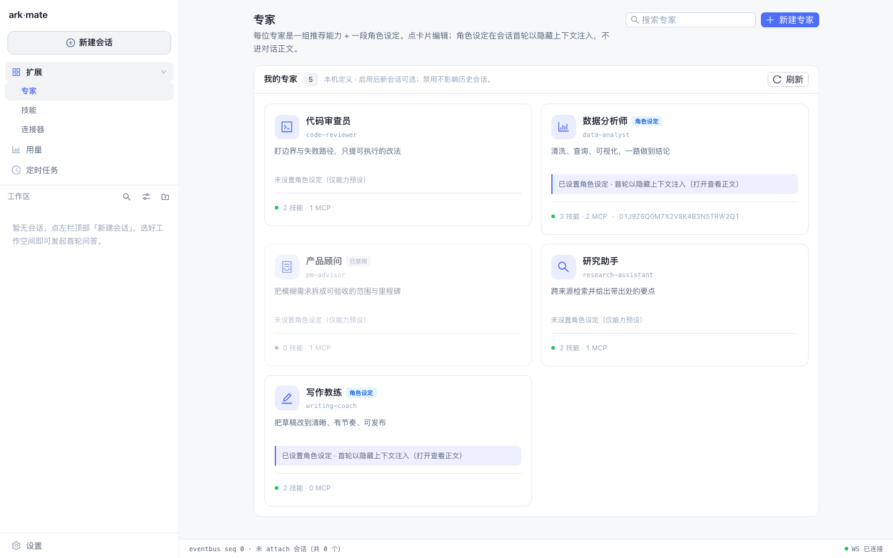

<div align="center">

# ark-mate

桌面端的个人 Agent 助手。左边建会话，右边和助手对话；它能读写工作区文件、调用 Skill / MCP 工具、需要你拍板时向你请求权限或提问，产出的文档、表格、图片都会留下来源记录。

思考、调工具、跑任务这些执行能力来自 DeepSeek Harness（`dsh`）等 ACP 兼容的开源运行时；ark-mate 负责的是会话、能力、专家、定时任务、资料库这些数据。

[](./LICENSE)

[下载与安装](#下载与安装) · [能做什么](#能做什么) · [快速开始](#快速开始) · [文档](#文档) · [开发](#开发)

</div>

---



## 能做什么

**会话**
- 多轮流式对话，正文、思考、工具调用分开显示；代码块带语言和行数、可复制。失败的轮次能原地重试，中断的会话能接着聊。
- 需要你决定的动作会弹卡片：工具权限可选允许一次 / 始终允许 / 拒绝一次 / 始终拒绝（「始终」记在会话里，之后可撤销）；结构化提问按 JSON Schema 生成表单。
- 会话忙的时候可以不干等：排队，或者「打断并发送」。排队的条目能撤下、编辑、重排。

**能力与专家**
- 管理 Skill / MCP / Tool 的定义、启停、探测和投放；远程 MCP 由平台代理连接；一个会话可以只用其中一部分能力。
- 专家就是一组预设：推荐模型 + 推荐技能 / MCP + 一段角色设定。建会话时挑一个，人格在首轮对话前注入。

**自动化与资料**
- 定时任务支持一次性、每日、每周、间隔、每月，时区用 IANA 名称。
- 会话跑在登记过的工作空间目录里，这个目录同时也是它的权限边界。
- 附件和产物：可以上传图片、文档；会话里产出的文档、表格、图片自动记录来源，能一键收进资料库。
- 模型与供应商：填一个兼容端点加一把密钥即可；模型清单由你声明，运行时目录由底座上报。
- 用量：按天汇总轮次、时长、上下文、每轮 token 和成本。

## 下载与安装

最省事的方式是装桌面应用：运行时随包带，你的机器上不需要装 Go、Node 或底座。

```bash
make desktop/dist   # 出安装包（目前只出 macOS；Windows 安装器见 docs/roadmap.md）
```

改代码的话看下面的[开发](#开发)。三种交付形态：

| 形态 | 状态 |
| --- | --- |
| 桌面（macOS / Windows，随包运行时） | 主线交付 |
| 浏览器入口（`make dev`） | 开发形态，和交付态是同一份产物 |
| 容器 / 自建二进制 + 外挂 dist | 维护态：可用、有测试、能修 bug，但不加新功能 |

## 快速开始

```bash
make desktop/dev   # 桌面态（Electron 壳 + 真核心），验证壳、原生能力、凭据和打包前行为
make dev           # 浏览器开发态，后端直接服务已构建的产物，改完刷新
```

不要同时跑 `make dev` 和 `make desktop/dev`，两个核心会共用 `~/.ark-mate/mate.db`。

前置依赖、用哪一份底座（`RUNTIME_BIN`）、前后端分离、CLI 子命令、容器与部署，都在 [`docs/agents/commands.md`](docs/agents/commands.md) 和 [`docs/deployment.md`](docs/deployment.md)。

## 文档

`docs/` 只记录当前有效的事实；外部产品的对照和逆向分析不放在仓库里。

| 文档 | 讲什么 |
| --- | --- |
| [`docs/features.md`](docs/features.md) | 功能清单：每项能做什么、边界在哪 |
| [`docs/architecture.md`](docs/architecture.md) | 架构总览：分层、进程拓扑、数据模型、契约、能力面、前端 |
| [`docs/contract.md`](docs/contract.md) | 控制面契约：REST 路由、错误码、WS 帧，由守卫和代码双向比对 |
| [`docs/positioning.md`](docs/positioning.md) | 定位与边界：做什么、不做什么 |
| [`docs/decisions.md`](docs/decisions.md) | 决策登记：定位和关键决策的唯一事实源，每条都写了代价 |
| [`docs/roadmap.md`](docs/roadmap.md) | 排期 |
| [`docs/unimplemented.md`](docs/unimplemented.md) | 未实现与降级清单 |
| [`docs/deployment.md`](docs/deployment.md) | 部署运维：二进制、systemd、容器、环境变量、备份、排障 |
| [`docs/agents/README.md`](docs/agents/README.md) | 开发纪律与机器判据的分册索引 |

## 开发

需要 Go ≥ 1.26、Node 26.x（见 `frontend/.nvmrc`）、pnpm 11.x（见 `frontend/package.json`），外加一个 ACP 兼容底座（当前内置 `dsh`，npm 包 `@deepseek-ai/dsh@next`）和模型 API key。数据默认放在 `~/.ark-mate`，可用 `MATE_HOME` 改。

```bash
make dev                  # 浏览器开发态，后端 :10001 直接服务构建产物
make verify/ui-product    # 浏览器验收：REST/WS 冒烟 + 界面
```

仓库是前后端平级的 monorepo：

```
backend/   单 Go module（cmd/mate + internal/*，分层 L0–L9，架构守卫在 internal/archtest）
frontend/  pnpm workspace（apps/web 产出唯一一份 UI dist；apps/desktop 是交付态；packages/console 是界面本体）
docs/      产品与架构文档
```

目录边界、分层、依赖方向见 [`docs/architecture.md`](docs/architecture.md)；开发纪律和机器判据见 [`AGENTS.md`](./AGENTS.md) 与 [`docs/agents/`](docs/agents/README.md)。

## 底座与适配

目前只内置 `dsh` 一个适配，没有打算接入所有 ACP 生态。但 adapter 层是完整的：接新底座就是新建 `backend/internal/infra/<id>/`（实现 `runtime.Adapter`）再在装配根加一行。底座在构建期固定，用户界面里没有切换 runtime 的入口。详见 [`docs/positioning.md`](docs/positioning.md)。

## License

[MIT](./LICENSE)
