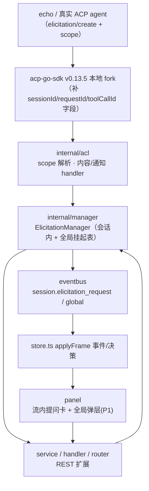
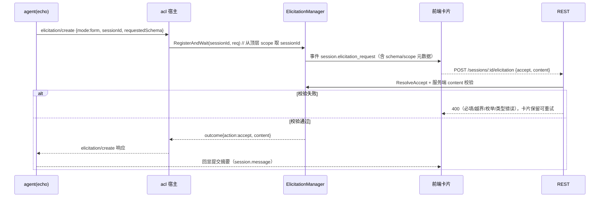
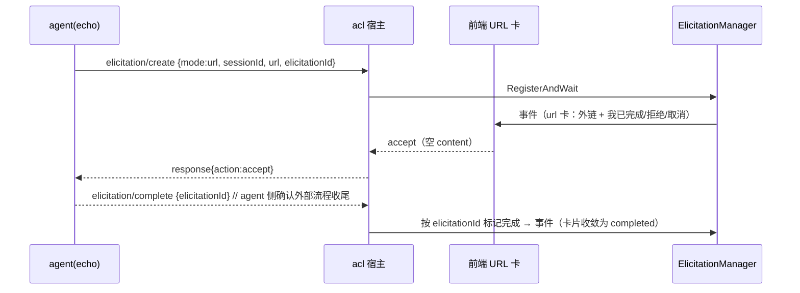

# agent↔用户常用交互 · ACP v1 交互升级方案（ark-mate 演示底座）

> **Rev2（2026-09-08，生效版）：真实运行时对齐（中档）**
>
> 目标运行时是 **dsh / opencode**（echo 仅作零依赖演示驱动）。事实核查结论：
> - opencode ACP 尚无「向用户提问」能力（[anomalyco/opencode#13752](https://github.com/anomalyco/opencode/issues/13752)）；dsh 捆绑官方 TS ACP SDK v2、但本体不触发 elicitation；AionUi 的 ACP 侧**零 elicitation**（其提问卡是自建通道的 AskUserQuestion 厂商帧）。
> - 因此真实 runtime 实际会用的交互是 **审批（request_permission）**（已实现）；elicitation 是「能力位」。
>
> Rev2 决策：**不 fork SDK、不排 P1 全局通道**；去掉非规范 `_meta.sessionId`，宿主改按「连接上唯一在途 turn」归属会话（过渡实现，`orchestrator.busyConn`）；把「scope 补丁 + request-scope 全局通道 + complete 联动」降级为**触发式能力位预案**（首个真实 elicitation wire 出现时再一次性对齐，预案细节即下方 Rev1 正文）。验收重点改为：**审批在 dsh/opencode 真实跑通 + echo 驱动提问卡演示无 `_meta`**。
>
> ---
>
> **Rev1 摘要（保留为实施预案，已按 Rev2 收敛执行范围）**：当前演示底座的「结构化提问（elicitation）」闭环已跑通，但会话归属靠 `_meta.sessionId` 桥接，不符合 ACP 规范 wire；ACP 已于 2026-07-22 将 elicitation（form/url）稳定化进 v1，Go SDK（coder/acp-go-sdk v0.13.5，最新）却漏建模 scope 字段。Rev1 曾计划本地 fork 补字段并按 v1 wire 全量重做 + P1 request-scope 全局通道；Rev2 经运行实现状核查收敛（见 §0 修订记录），不再按 Rev1 范围执行。

---

## 0. 修订记录 Rev2（2026-09-08，生效）

| 项 | Rev1（预案） | Rev2（生效） | 依据 |
|---|---|---|---|
| SDK 缺口处置 | A1 本地 fork + replace 补 scope 字段 | **不 fork**；宿主按连接上下文归属（过渡） | dsh/opencode/AionUi 当前都不发 elicitation（见顶部摘要）；YAGNI |
| 会话归属 | wire 顶层 scope（`sessionId`）取代 `_meta` | 去掉 `_meta.sessionId`；宿主经 `orchestrator.busyConn`（连接上唯一在途 turn）注入 `ElicitationRequest.SessionID` | SDK v0.13.5 不建模 scope，读不到顶层字段；连接上下文对真实 runtime（单 prompt 串行）成立 |
| 内容校验 / URL 卡 / 前端 | P0 含服务端权威校验、tool-call 展示、URL 卡 | 保留现状已实现的卡片与决策链路；服务端权威校验、tool-call 级展示**不进本轮** | 与真实 runtime 行为对齐优先，避免为 echo 造规范复杂度 |
| request-scope 全局通道 | P1（全局挂起表 + 弹层） | **不排**；转为触发式预案（见 §4.2 与本文 Rev1 正文） | 无真实会话外 elicitation 场景（AionUi 亦无） |
| complete 通知 / 轻量合规项 | P0/P1 含 complete 收尾、clientInfo、usage_update | 记录为能力位，不实现 | 同上 |
| 验收口径 | wire 100% 合规 + request-scope DoD | **审批在 dsh/opencode 真实跑通 + echo 提问卡演示无 `_meta` + 回归全绿** | 目标运行时是 dsh/opencode；见 §1.5 Rev2 DoD |

> 下方 §1 起的 Rev1 正文保留为「触发式能力位实施预案」（何时对齐 scope/何时加全局通道的施工图）；与本节冲突处以本节为准。§2.4A / §2.5 D 表结论被本节覆盖。

## 1. 背景与目标

### 1.1 现状与动因

- **已有最小闭环（非规范）**：上一轮实现了 form（单选/多选/复合）/url 提问 → 挂起表 → WS 事件 → 前端卡片 → REST 决策回流 agent 的完整链路（`internal/acl/elicitation.go`、`internal/manager/elicitation.go`、echo 场景、前端 ElicitationCard），真实链路已验证。
- **规范事实**：ACP 官方 [Updates](https://agentclientprotocol.com/updates#elicitation-is-stabilized)（2026-07-22）宣布 Elicitation RFD Completed，**form 与 URL 模式结构化交互已在 ACP v1 稳定**；宿主需在 initialize 显式声明支持的模式（[协议 v1 schema](https://agentclientprotocol.com/protocol/v1/schema)）。
- **两处偏差**：
  1. wire 上会话归属应是**顶层 scope 字段**（`sessionId` 必填 + 可选 `toolCallId`；会话外为 `requestId`），当前实现把它放进 `_meta.sessionId` —— 非规范（`_meta` 是保留扩展位，双方**不得假设**其内容）；
  2. `github.com/coder/acp-go-sdk@v0.13.5`（最新版）生成的 `UnstableCreateElicitationForm`/`UnstableCreateElicitationUrl` **没有 scope 字段**（`types_gen.go:6773/6788`），而 SDK 自带 `schema.unstable.json` 的 `ElicitationFormMode/UrlMode` 都通过 `anyOf[Session|Request]` 声明了 scope —— 即 **SDK 代码生成落后于其自带 schema**。这使真实 ACP agent（按规范发 scope）进不来、我们的 echo 也发不出规范请求。
- **AionUi 对照**：其「单选/多选提问卡」是 Anthropic AskUserQuestion 的厂商帧（`ask`），**不是 ACP 规范通道**，可作交互形态参考，不作为协议基线（避免引入第二个非规范通道）。

### 1.2 目标

1. **合规基线**：agent↔用户常用交互的 wire 全部贴合 ACP v1 稳定规范；会话内提问（form/url）、tool-call 关联、complete 通知、能力声明按规范实现；会话外提问（request-scope）具备宿主承载能力。
2. **交互覆盖（常用集合）**：审批（回归）＋ 表单提问（单选/多选/typed 字段）＋ URL 引导 ＋ request-scope 提问 ＋ tool-call 级提问 ＋ ACP v1 轻量合规项。
3. **工程质量**：服务端权威校验（不信任客户端）、双向（宿主/echo）都走规范 wire、断点可测（单元/集成/REST/端到端）。
4. 演示底座（echo）仍零依赖可跑通上述 P0 交互，DoD 与权限通道一致。

### 1.3 非目标

- 不实现 ACP terminal/*、fs/* 等其它宿主能力（不属于「提问/确认类常用交互」；已有占位）。
- 不移植 AionUi 的 `ask` 厂商帧作为正式通道（形态可借鉴，协议以 ACP v1 为准）。
- 不在本轮实现 MCP elicitation 转发（MCP 有自己的 elicitation 规范，与 ACP scope 关联留待 M2）。
- 不承诺把 coder/acp-go-sdk 升级到官方 1.0 Go SDK（官方 Rust/TS 已 1.0，Go 无官方稳定时间表）；只做最小可控 fork 并留回退路径。

### 1.4 约束

- **协议版本**：ACP protocol version 1（initialize 沿用现有协商）。
- **依赖**：`github.com/coder/acp-go-sdk v0.13.5`（不动版本号，仅本地 fork 补字段）；前端 React/antd/`@ark/types` 契约同步小改。
- **兼容**：破坏性调整被允许，但只落在「开发期未冻结」面（demo 数据可丢弃）；对外的 REST/WS 字段变更一律**只增不改名**，除非在冻结前一次性收敛。
- 单二进制交付不变（`make all`），fork 作为普通 module 编入，不新增运行时依赖。

### 1.5 验收标准（DoD）

> Rev1 版本见下（划线为已被 Rev2 取代的条目，保留作预案验收参照）；**Rev2 验收以本清单为准**。

Rev2 DoD：

- [x] `go vet ./...`、`go test ./...` 全绿（含 busyConn 归属单测：唯一在途可归属、并发在途不猜测、生命周期清理）。
- [x] 移除 `_meta.sessionId`：acl/echo 不再读写该键；acl 集成测试断言宿主收到的 `ElicitationRequest.SessionID` 为空（由上层注入）。
- [x] echo 单选/多选/复合表单/URL 提问卡演示无 `_meta` 仍端到端闭环（REST 冒烟）。
- [x] README 交互表与「协议现状」更新：elicitation 已稳定、宿主用连接上下文过渡归属、scope 补丁列为触发式预案（不 fork）。
- [x] （2026-09-08 完成）审批在真实 runtime 跑通：`agent-opencode`（默认模型 yygu-v2/deepseek-v4-flash）——「写文件」触发真实 `session/request_permission`（allow_once/always + reject），**Allow once → 文件创建成功、turn completed**；**Reject → 文件未创建、turn completed**。另实证：opencode 对 `bash` 工具默认放行、不请求权限（无卡属预期，非宿主缺失）。
- [ ] （触发式，不排期）首个真实 elicitation wire 出现时按 §0 预案一次性对齐 scope。

~~Rev1 DoD（预案，已不适用）~~：~~scope 顶层解析、服务端权威校验 400 错误面、complete 通知收尾、request-scope 全局弹层~~ —— 细节仍见 §4 与上方 Rev1 正文。

---

## 2. 方案设计

### 2.1 总体思路

一条主线：**把 elicitation 从「_meta 桥接的 unstable 雏形」升级为「v1 稳定 wire 的正式通道」**，具体拆三步：

1. **补 SDK 缺口**（一次性）：本地 fork + `go.mod replace`，给 form/url 两个请求结构加 scope 字段（SDK 的 wrapper `MarshalJSON` 会拍平结构并补 `mode`，因此**双端收发自动合规**，改动量极小，见 §3.2）。
2. **宿主全链路规范化**：scope 解析（session/request/tool-call）、服务端 content 校验、complete 通知收尾、事件/REST 契约扩展、移除 `_meta` 逻辑。
3. **范围矩阵落地**：常用交互分 P0/P1 两批（见下表），审批回归、表单/URL/工具关联进 P0；request-scope 全局通道进 P1。

| 交互（用户已圈定范围） | 载体/通道 | 阶段 | 现状 |
|---|---|---|---|
| 审批 approval | `session/request_permission`（已稳定） | P0 回归核对 | 已有，仅补回归与字段核对 |
| 表单提问：单选/多选/typed | `elicitation/create` mode=form | P0 合规重做 | 有雏形（_meta）→ 规范 scope |
| URL 引导 + complete 通知 | mode=url + `elicitation/complete` | P0 合规重做 | 有雏形（_meta）→ 规范 scope + 通知收尾 |
| tool-call 级提问 | scope.toolCallId | P0（显示+关联；echo 用伪工具调用演示） | 无 |
| request-scope 提问（会话外） | scope.requestId | P1（宿主能力+全局 UI） | 无 |
| ACP v1 轻量合规项 | clientInfo/usage_update 等 | P1 清单式补齐 | 部分有 |

### 2.2 总体架构（改动点总览）



### 2.3 核心流程

**会话内表单提问（P0 主链路，含服务端校验）**



**URL 模式 + complete 通知（P0）**



### 2.4 备选方案与取舍

**A. SDK 缺口处置**（整体方案层面最关键的取舍；> Rev2 已裁定：见 §0 —— A1 转为触发式预案，A2 过渡方案按 Rev2 落地执行）

| 方案 | 做法 | 代价 | 结论 |
|---|---|---|---|
| **A1 本地 fork + replace（Rev1 采纳 → Rev2 预案）** | 复制 v0.13.5 到 `backend/third_party/acp-go-sdk`，仅给 form/url 两个 struct 补 3 个 scope 字段 + 2 个 helper；`go.mod` 加 `replace` | 一次性拷贝；上游建模 scope 后需收敛（有脚本与 ADR 兜底）。**它本质是「给 SDK 补它自带 schema 已声明、但代码生成漏掉的字段」的补丁，不是产品分叉** | Rev1：全合规最小路径；Rev2：**不执行**，首个真实 elicitation wire 出现时启用（见 §0） |
| **A2 不 fork、宿主从在途 turn 推断（Rev2 采纳，过渡）** | 不加 fork；acl 不再注入归属（也不读 `_meta`），orchestrator 按「连接上唯一在途 turn」注入 `SessionID` | 仍是过渡实现（SDK 读不到 scope 的临时替代，非规范捷径但有明确触发退出条件：scope 补丁预案 A1）；requestId/toolCallId 暂读不到 → 会话外/工具级提问随 A1 预案一起启用 | Rev2 采纳：与真实 runtime 现状对齐的最小改动（见 §0） |
| A3 自研 elicitation transport | 在 acl 层自写 JSON-RPC 读写替换 SDK 派发 | 与 SDK 读循环冲突，等于重写传输层，风险面大 | 否决 |
| A4 等上游 Go SDK 支持后再做 | 无时间表（官方 Rust/TS 1.0，Go 无承诺） | 阻塞所有合规诉求 | 否决 |

**B. request-scope 会话外承载**

| 方案 | 做法 | 结论 |
|---|---|---|
| **B1 全局挂起表 + WS 全局 topic + 面板全局弹层（采纳，P1）** | manager 支持无会话 pending（key=requestId）；bus 新增全局 topic；前端全局待办角标 + Modal | 与现有「按会话 attach」模式并列一条全局通道，复用同一决策/超时逻辑 |
| B2 REST 轮询（降级） | 不做全局 WS，控制台定时拉 `GET /elicitations?global=1` | 兜底预案：若 P1 UI 复杂度过高，先用横幅+轮询上（见 §5 应对） |

### 2.5 关键决策（D1–D8）

| 编号 | 决策 | 理由 | 破坏性 |
|---|---|---|---|
| D1 | wire 按 ACP v1 稳定 elicitation（form/url + scope），不保留「unstable 命名」的语义（SDK 命名滞后不影响 wire） | 规范已稳定（2026-07-22），字段即 SDK 自带 schema 的形状 | 无 |
| D2 | ~~本地 fork + `go.mod replace` 补 scope~~（**Rev2 改为：不 fork**，见 §0） | Rev1 理由「双端合规最小路径」；Rev2 以真实 runtime 现状（无人发 elicitation）裁定 YAGNI，SDK 补丁转触发式预案 | Rev2 无（预案保留于 §2.4A） |
| D3 | **废弃 `_meta.sessionId`**（host 不再读、echo 不再发）；Rev2 会话归属过渡方案：宿主按「连接上唯一在途 turn」注入 SessionID，scope 顶层解析留待触发式预案 | `_meta` 为保留扩展位，规范禁止假设其语义 | 破坏（开发期数据可弃） |
| D4 | content 在服务端按 `ElicitationSchema` 权威校验（类型/必填/枚举/min/max/minItems/maxItems 等），不信任前端 | 协议要求 content 匹配 requested schema；demo 也防错误喂给 agent | 无（新增错误路径） |
| D5 | session-scope 卡片进会话流；request-scope 走全局通道（P1）；tool-callId 只在卡片展示关联（P0 不做工具级状态机） | 会话内 UI 已存在，全局通道值得单独做而不是硬塞进会话 | 无 |
| D6 | URL 模式双收尾：用户 accept 之后，agent 可再发 `elicitation/complete` 通知 → 宿主按 elicitationId 收敛卡片为 completed | 规范定义了 complete 通知；真实 agent（OAuth 类流程）依赖它 | 无 |
| D7 | REST/WS 事件字段**只增不改名**（`tool_call_id`/`request_id` 等新增） | 保兼容又满足 scope 语义；冻结前如需改名一次性做 | 尽量无 |
| D8 | 能力声明维持 `clientCapabilities.elicitation {form:{}, url:{}}`；实施第一步从 v1 schema 摘录复核（若稳定后字段更名则跟随） | 宿主应声明它真实支持的模式 | 待复核 |

---

## 3. 详细设计

### 3.1 wire 契约（ACP v1 稳定 elicitation）

以 `coder/acp-go-sdk@v0.13.5/schema/schema.unstable.json` 的形状为准（稳定化只改状态、不改字段；实施时用 [protocol/v1/schema](https://agentclientprotocol.com/protocol/v1/schema) 复核）。

**会话内表单（session scope + 可选 tool-call）**

```json
{
  "mode": "form",
  "message": "请选择本次要使用的部署环境",
  "sessionId": "sess-01",
  "toolCallId": "call-99",
  "requestedSchema": {
    "type": "object",
    "title": "部署目标",
    "description": "仅演示",
    "properties": {
      "env": {
        "type": "string",
        "title": "目标环境",
        "oneOf": [
          { "const": "dev", "title": "开发环境 dev" },
          { "const": "prod", "title": "生产环境 prod" }
        ]
      },
      "notify": { "type": "boolean", "title": "完成后通知我", "default": true }
    },
    "required": ["env"]
  }
}
```

**会话外（request scope）**

```json
{ "mode": "form", "message": "选择凭据类型", "requestId": "req-init-7",
  "requestedSchema": { "type": "object", "properties": { "type": { "type": "string", "enum": ["api-key", "oauth"] } }, "required": ["type"] } }
```

**URL 模式（session scope；url 与 elicitationId 必填）**

```json
{ "mode": "url", "message": "完成授权后回来", "sessionId": "sess-01",
  "url": "https://example.com/authorize?state=xyz", "elicitationId": "el-abc" }
```

**响应（action 判别）**：`{"action":"accept","content":{...}}` / `{"action":"decline"}` / `{"action":"cancel"}`；content 值仅限 `string | integer | number | boolean | string[]`（`ElicitationContentValue`）。

**complete 通知（agent → client）**：`{"method":"elicitation/complete","params":{"elicitationId":"el-abc"}}`。

**能力声明**：initialize 中 `clientCapabilities.elicitation = {"form":{},"url":{}}`（现状已发，D8 复核）。

**PropertySchema 变体**（`ElicitationPropertySchema`，type 判别）：`string`（enum/oneOf 时即单选）、`integer`、`number`、`boolean`、`array`（items+min/maxItems，即多选）。注意：**多选 wire 是 array 型**，单选是 string+enum/oneOf —— 与现有 echo/前端实现一致，仅需在服务端补权威校验。

### 3.2 SDK 本地 fork（预案，触发式启用；Rev2 未执行见 §0）

**为何必须动 SDK（证据，基于 v0.13.5 源码）：**

1. **发送侧没有裸发通道**：`AgentSideConnection` 公开面只有 `Done/SetLogger` 与生成的 typed 方法；`SendRequest` 需要内部未导出的 `*Connection`，且参数必须 typed（`agent_gen.go:474` 调 `SendRequest[UnstableCreateElicitationResponse](c.conn, ..., params)`）。而 wire 的 scope 是**必填**（form/url mode 都是 `anyOf[Session|Request]`，`types_gen.go:7669` 的 UrlMode MarshalJSON 二选一）——没有 `sessionId`/`requestId` 的 create 连 schema 都不过。echo 想发规范消息，typed 结构里却没有字段可填。
2. **接收侧 scope 在解码时被丢弃**：SDK 派发 `elicitation/create` 前已把 params 反序列化进 `UnstableCreateElicitationRequest`（`client_gen.go:31`）；其自定义 `UnmarshalJSON`（`types_gen.go:6811+`）只认 mode/requestedSchema/url 等键，未知键（sessionId/requestId/toolCallId）**在 SDK 内部丢失**，宿主 handler 拿不到。
3. **扩展机制救不了**：raw 参数处理只对 `_` 前缀的扩展方法开放（`extensions.go` 的 `ExtensionMethodHandler`，仅 `isExtensionMethodName` 命中时进入）；`elicitation/create` 是规范方法，走 typed 路由，无法在外部注册自定义 handler 或注入 raw params。

> 因此「全合规」必须让 SDK 的 form/url 两个结构带 scope 字段；由于 Go 无法从外部给第三方模块的类型加字段，唯一的出路是 replace 到一份**带 4 字段补丁的源码**（本地副本或上游已修复的 commit）。

- 目录：`backend/third_party/acp-go-sdk`（整模块拷贝 v0.13.5，剔除 `*_test.go` 与 example 以减小体积；保留 `go.mod`/`schema/`）。
- `go.mod`：`replace github.com/coder/acp-go-sdk => ./third_party/acp-go-sdk`；另加注释与校验脚本 `backend/scripts/verify-sdk-patch.sh`（diff 检查打补丁处，防上游升级时静默丢失）。若上游 main 分支已修复并可用伪版本 replace，优先用上游 commit 而非本地副本（见 §6.6）。
- 补丁点（仅两处 + helper）：
  1. `UnstableCreateElicitationForm` 增加 `SessionId *SessionId \`json:"sessionId,omitempty"\``、`ToolCallId *ToolCallId \`json:"toolCallId,omitempty"\``、`RequestId *RequestId \`json:"requestId,omitempty"\``（`types_gen.go:6773`）；
  2. `UnstableCreateElicitationUrl` 同样三字段（`types_gen.go:6788`）；
  3. `helpers_gen.go` 增 `NewUnstableCreateElicitationRequestFormWithScope(schema, sessionID, toolCallID)` 与 `...UrlWithScope(...)`，并在 header 注明 fork 缘由。
- **为什么补字段就够**：wrapper 的 `MarshalJSON`（`types_gen.go:6897`）把 variant struct 拍平成顶层 JSON 再补 `mode`；两端的自定义 `UnmarshalJSON` 也是把整包 JSON 灌进 variant struct —— 加字段后 `sessionId/requestId/toolCallId` 收发自动出现在正确位置，无需动派发/编解码。
- **回退路径**：上游 Go SDK 建模 scope 后，删 replace + 清 third_party + 跑 `verify-sdk-patch.sh`（预期报「不再需要」）即回官方依赖。

### 3.3 分层改动

| 层 | 文件 | 改动 |
|---|---|---|
| acl | `internal/acl/elicitation.go` | `ElicitationRequest` 增 `ToolCallID`/`RequestID`；`elicitationRequestFromSDK` 改从 `Form/Url` 的 scope 字段取 sessionId（删除 `ElicitationMetaSessionID` 读取）；新增 complete 通知 handler（SDK optional 断言，按 elicitationId 返回会话归属）；校验 scope 互斥（session vs request 只能一个） |
| acl | `internal/acl/client.go` | 接线 complete handler 与内容校验钩子（可复用 CreateElicitation 通道或独立 `OnElicitationComplete`）；Initialize 保持能力声明（D8） |
| manager | `internal/manager/elicitation.go` | pending 增 `requestID`/`toolCallID` 字段；挂起表拆「会话内 map」与「全局（requestId key）map」，超时/取消逻辑复用；新增 `validateContent(schema, content)`（见 §3.4）；`ResolveAccept` 前先校验 |
| manager | `internal/manager/orchestrator.go` / `events.go` | `requestElicitation` 载荷按 scope 归类发布（会话内 `session.elicitation_request`；全局新 topic `elicitation.request.global`）；`CancelSession` 与全局取消都清对应表 |
| service/handler/router | `internal/server/handler/*` | `ElicitationResp` 增 `tool_call_id?`/`request_id?`；`ResolveElicitation` 错误面区分 `validate_failed`（400）；新增全局端点 `GET/POST /v1/mate/elicitations`（无 session，request-scope，P1） |
| echo runtime | `internal/runtime/echo/elicitation.go` | 场景 builder 改为带 scope 发送（用 fork 的 WithScope helper）；删除 `metaSessionKey` 与 `_meta` 注入；新增「带工具关联」表单变体（伪 `toolCallId`，仅展示 scope 语义）；url 场景 accept 后发一次 `elicitation/complete`（演示 D6） |
| 前端 | `packages/types/{events,session}.ts`、`packages/api/.../mate.ts` | 类型补 `toolCallId/requestId`；ElicitationResp/Resolve 契约对齐；全局 elicitation 拉取/决策 API（P1） |
| 前端 | `apps/panel/src/store.ts`、`Transcript.tsx`、`ChatPage.tsx` | 事件载荷透传新字段；流内卡展示 tool-call 关联；全局 pending 角标 + 弹层（P1，组件见 §3.7） |
| 前端 | （P1）`apps/panel/src/components/ElicitationModal.tsx`（新） | request-scope 全局提问弹层：复用 ElicitationField 渲染 + 决策/超时收敛 |

### 3.4 服务端 content 校验（权威）

校验函数输入 requested schema（已扁平化为 map）与提交 content，逐字段执行：

| 字段 type | 校验 |
|---|---|
| string | 必填时非空；`minLength/maxLength`；`enum/oneOf` 命中 const（单选） |
| integer | 整型；`minimum/maximum` |
| number | 数值；`minimum/maximum` |
| boolean | 必须为 bool |
| array | `items` 命中；`minItems/maxItems`（多选 1..N） |

规则：多余键拒绝或忽略（选忽略并记录，倾向宽松）；缺必填 → `validate_failed`；错误信息带字段名（前端可定位）。manager 校验失败返回业务错误，**不把内容发给 agent**，卡片保留重试。单测覆盖每种类型 + 组合（表单场景的 name/score/public/urgency）。

### 3.5 REST/WS 契约变更

- **只增字段**：`ElicitationResp`/事件载荷加 `tool_call_id?`（session+tool-call）、`request_id?`（request-scope，P1）；响应不破坏现有前端字段。
- **错误面**：`POST /sessions/:id/elicitation` 在 content 校验失败时返回 `code=40000` 与字段明细（现缺失，需补），成功/未命中语义不变。
- **全局通道（P1）**：`GET /v1/mate/elicitations`（无 session 参数，返回 request-scope 挂起）与 `POST /v1/mate/elicitation`（决策体同会话版）；WS 全局 topic 经 `attach(global)` 语义与 `session.elicitation_request` 并列（全局载荷带 `request_id`、无 `session_id`）。

### 3.6 echo 演示场景矩阵（改造后）

| 触发词 | scope | 模式 | 说明 |
|---|---|---|---|
| 单选 / single | session | form（string+oneOf） | 现状回归 |
| 多选 / multi | session | form（array+min/maxItems） | 现状回归 |
| 表单 / form / 复合 | session + `toolCallId`（伪 `call-demo-ask`） | form（typed 复合） | 新增：展示 tool-call 关联；服务端校验生效 |
| 链接 / url | session | url | 现状回归 + accept 后 agent 发 `elicitation/complete` |
| （boom / 默认） | — | turn.error / 审批 | 不变 |

发往宿主一律走 fork 的 WithScope helper（顶层 `sessionId`），不再出现 `_meta.sessionId`。

### 3.7 前端（差异最小化）

- 流内卡：现有 ElicitationCard 支持 form/url 渲染与本地校验，仅需：把服务端 `validate_failed` 错误展示到卡片（保留本地预校验）；展示 tool-call 关联行；complete 收敛状态（`resolved=true` + `decision='已完成（agent 确认）'`）。
- 全局弹层（P1）：`ElicitationModal` 复用 `ElicitationField`，数据进 store 的 `globalElicitations: ElicitationResp[]`，动作 `respondGlobalElicitation/expireGlobalElicitation` 与现有模式平行。

### 3.8 数据模型（manager pending）

```
pendingElicitation {
  id            // el-<hex8>（全局唯一，request-scope 也用）
  sessionID     // session-scope 必填；request-scope 为空
  requestID     // request-scope 必填
  toolCallID    // 可选
  mode/message/schema/url  // 同现状
  timeout       // 同现状（默认 30min，env 可覆盖）
}
```
挂起集合：`pending[elicitationID]`（现状）+ `globalPending[elicitationID]`；`CancelSession(sessionID)` 只清会话内，全局取消走独立入口（服务端运行停止/连接断开时统一清）。

---

## 4. 实施计划（Rev1 视图；Rev2 实际执行范围见 §0/§1.5，本计划转为预案施工图）

### 4.1 阶段与里程碑

**P0 — 合规主路径（DoD 达成的部分）**

1. fork SDK + `go.mod replace` + 补字段与 helper + `verify-sdk-patch.sh`；`go build`/既有测试绿。
2. acl：scope 解析（session/request/tool-call）、移除 `_meta` 读取、complete 通知 handler；manager：pending 字段扩展 + `validateContent`；orchestrator/事件载荷按 scope 归位。
3. echo：WithScope 发送、删除 `_meta` 注入、tool-call 变体、url accept 后 complete。
4. handler/REST：`ElicitationResp` 增字段、validate_failed 错误面；前端类型/API/store/卡片透传 + 服务端错误展示。
5. 测试：acl 集成（scope 无 `_meta` 断言、form accept/decline/cancel、校验失败、url + complete）、manager 校验单测、REST 用例、echo 端到端冒烟。
6. README/交互表/协议现状更新。

**P1 — request-scope 全局通道 + 轻量合规项**

1. manager 全局挂起表/取消、bus 全局 topic、REST 全局端点、WS global attach。
2. store 全局集合 + `ElicitationModal` + 待办角标。
3. 轻量合规项清单：initialize 带 `clientInfo{name,version}`（稳定可选字段）；usage_update 既有处理回归核对；messageId 相关（若既有未用则不引入）。
4. 测试与手测（全局弹层真实决策 + 超时收敛）。

### 4.2 时间估算（假设：单人、兼职、无外部阻塞）

- P0：**2–4 天**（fork/依赖 0.5 天，acl+manager 1 天，echo+REST+前端 1 天，测试与冒烟 0.5–1 天）。
- P1：**2–3 天**（后端全局通道 1 天，前端弹层 1 天，测试手测 0.5–1 天）。
- 合计 **4–7 天**；P1 UI 若评审采纳「横幅+轮询」降级则 -0.5~1 天。

### 4.3 依赖与前置

- 评审通过本文档（§6 开放问题逐项拍板或给出默认倾向）。
- 无第三方阻塞；AionUi 不作为依赖（仅对照）。

---

## 5. 风险评估与应对

| 风险 | 触发信号 | 应对（具体动作） | 降级/回滚 |
|---|---|---|---|
| fork 维护成本/上游升级 | coder/acp-go-sdk 发新版本 | `verify-sdk-patch.sh` diff 告警；收敛流程见 ADR-2 | 一行删 replace 即回官方依赖（前提：官方已建模 scope） |
| 真实 agent 与 echo 发送的 scope 拼写差异 | 集成真实 runtime 时 create 解析失败 | 以 v1 schema 为准；测试夹具用 schema 生成的真实样例 | 双端均 fork，宿主解析失败时明确报「scope 缺失」错误而非静默回退 |
| v1 稳定能力名/字段更名 | 复核 schema 发现差异 | 实施第 1 步摘录比对（D8），改动集中在 acl/echo 两处映射 | 可逆（映射层内改） |
| content 校验过严挡掉真实 agent | 冒烟/集成遇合法 content 被拒 | 校验先按 schema 允许集合实现，多余键宽松忽略 | 关闭校验开关为过渡（环境变量），默认开启 |
| P1 全局 UI 复杂度超预期 | 弹层方案评审未过 | 按 B2 降级：全局待办横幅 + REST 轮询（复用现有 pending 列表组件） | 组件即 UI 展示位，后端通道不变 |
| 破坏性清理影响进行中演示 | `_meta` 移除后旧会话卡读不到 | P0 一次落地（不长期双轨）；demo 会话数据可弃 | 无（开发期数据） |

---

## 6. 开放问题定案记录（Rev1 评审 → Rev2 定案）

> 逐项已由评审与 Rev2 事实核查定案（含用户明确「其余走默认倾向」「echo 仅演示、dsh/opencode 才落地」）：

1. **SDK 缺口怎么补** → **不 fork、不引入任何 SDK 补丁载体**（本地副本 / 上游 commit / module-cache 打补丁三者均不启用）；scope 解析列为触发式预案 A1，首个真实 elicitation wire 出现时再选载体（默认本地副本 replace）。
2. **会话归属** → 废弃 `_meta`；Rev2 过渡实现：orchestrator 按「连接上唯一在途 turn」注入（对应原 §6 备选 b 的**受限版**：仅在唯一在途时推断、并发不猜测按取消），触发式预案落地后切换为顶层 scope 解析。
3. **request-scope 演示入口** → 不造（echo 无会话外场景；dsh/opencode 当前不发 elicitation）。
4. **tool-call 关联展示深度** → 本轮不做（含 Rev1「仅展示」），随 A1 预案启用。
5. **服务端 content 权威校验 / complete 通知收尾** → 本轮不做，随 A1 预案启用（前端卡片本地校验与现有 accept/decline/cancel 决策保持不变）。
6. **轻量合规项（clientInfo/usage_update/messageId）** → 记录为能力位，不排期。
7. **是否更新 `docs/design-and-roadmap.md`** → 不更新；本修订只落在本文档与 README。

---

## 7. 附录

### 7.1 参考资料

- [ACP Updates — Elicitation is Stabilized（2026-07-22）](https://agentclientprotocol.com/updates#elicitation-is-stabilized)
- [ACP v1 Schema（elicitation/form/url/scope 章节）](https://agentclientprotocol.com/protocol/v1/schema)
- `github.com/coder/acp-go-sdk@v0.13.5`：`types_gen.go:6773/6788/6897`（form/url 结构、wrapper MarshalJSON）、`helpers_gen.go:63`、`schema/schema.unstable.json`（ElicitationSessionScope/RequestScope/PropertySchema/ContentValue）
- 仓库内既有设计：`docs/design-and-roadmap.md`（§4/§5.8.1）、`docs/architect-design.md`

### 7.2 术语说明

| 术语 | 含义 |
|---|---|
| elicitation | ACP 中 agent 向用户索取结构化输入的能力（form 表单 / url 跳转两种模式），2026-07-22 起 v1 稳定 |
| scope | elicitation/create 的归属声明：`sessionId`（会话内，可带 `toolCallId`）或 `requestId`（会话外，如 auth/config） |
| request-scope | 未建会话时（某 JSON-RPC 请求处理中）发起的提问，宿主须在会话外承载 |
| complete 通知 | URL 模式中 agent 确认外部流程已收尾的 `elicitation/complete` 通知 |
| `_meta` | ACP 保留扩展字段，规范要求双方不得假设其语义（本方案废弃用它桥接 sessionId） |

### 7.3 决策记录（ADR）

- **ADR-1（D1/D3）采用 v1 稳定 wire、废弃 `_meta` 桥接**：备选=保持 unstable+meta 桥接（继续不兼容真实 agent）、自研厂商帧（如 AionUi ask，引入第二套非规范通道）。理由=规范已稳定、真实 agent 依规范发送、代价集中在一次性改动。
- **ADR-2（D2）本地 fork 补 scope**：备选=A2 双轨/A3 重写传输/A4 等上游。理由=改动面最小、双端同源、wrapper 拍平机制保证补字段即合规；回退=上游建模后删 replace。收敛动作：fork 头注释 + `verify-sdk-patch.sh`。
- **ADR-3（D4）服务端权威校验**：备选=信任前端本地校验（agent 会拿到脏数据）。理由=协议要求 content 匹配 requestedSchema，demo 即最小协议验证器。
- **ADR-4（D5/D8 范围分期）P0 会话内合规 / P1 会话外全局通道**：备选=一次做完（P1 UI 复杂、无 echo 自然入口）。理由=先让「真实 agent 常用路径」合规可用，再补边缘承载。

### 7.4 评审检查清单

- **架构合理性**：scope 语义（session/request/tool-call）与交互矩阵一一对应，无重复通道；SDK fork 边界清晰（仅两个 struct）；破坏性调整均有明确理由与回退。
- **协议合规**：wire 字段（顶层 sessionId/requestId/toolCallId、content 值域、complete 通知、能力声明）与 v1 schema 对齐；`_meta` 不再承载语义。
- **数据/接口**：REST/WS 字段只增不改；validate_failed 错误面有字段明细；全局通道端点与事件 topic 命名与既有模式一致。
- **可维护性**：fork 有 patch 校验脚本与回退路径；校验规则集中在 manager 单测可覆盖；echo 场景矩阵有表可查。
- **风险控制**：P1 全局 UI 有 B2 降级；fork 上游升级有收敛流程；内容校验有开关兜底。
- **可验证性**：DoD（§1.5）每条都有明确测试或冒烟步骤，含「无 `_meta` 也定位会话」的关键断言。
