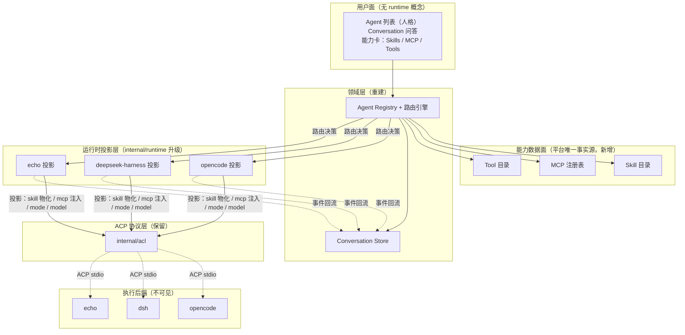

# ark-forge Agent × Runtime 解耦与能力复用重构设计

> 版本：v1（待审核）｜日期：2026-09-08｜类型：破坏性重构设计
> 状态：**待审核**——审核通过前不得执行代码重构。
> 关联文档：`docs/design-and-roadmap.md`（M0–M3 路线图，本文取代其中「runtime 一等公民」主线）、
> `docs/architect-design.md`（架构基线，本文 §3 覆盖其定位）、
> `docs/zacp-alignment-refactor-design-20260908.md`（持久化/Agent 管理面已落地，本文在其之上）。
> 参照实现：`~/Documents/study/ai-agent/goose`（Block / AAIF 的 Rust agent 框架，Provider 抽象）。

---

## 摘要（TL;DR）

当前 ark-forge 是「ACP 控制面网关」：runtime（opencode / deepseek-harness / echo）是用户可见的
一等公民，用户新建会话须显式选底座；skill / MCP / 工具没有平台侧统一模型，只是透传或空壳
（`McpServers: []`，见 `backend/internal/acl/session.go:65/83/102`）。

本次重构的目标：**把 runtime 从「用户可见的底座」降格为「可替换的执行后端」，把能力
（skill / MCP / 工具）从「runtime 私有实现」升格为「平台统一管理的数据面」，把会话从
「runtime 所有」升格为「平台所有」**。执行仍复用 runtime（不重造），但选择、路由、归一、
投影全部由平台代理，用户只面对「一个 Agent + 一组能力」。

核心结论（决策记录见 §2）：

1. **概念保留「Runtime」，但降格**：不换词（目录 `internal/runtime/` 可不动），只改其在领域模型
   中的位置——从「用户可见实体」变为「路由策略的产物」。
2. **MCP 是能力统一基底**：工具 = 平台拥有（MCP + 可选平台工具）；MCP 走 ACP 原生注入（`session/new` 的 `mcpServers`）。
3. **skill 平台拥有 + 物化投影**：ACP 不承载 skill（goose 亦如此），skill 走平台目录 + 物化到各
   runtime 原生位置，不跨 CLI 透传。
4. **会话平台拥有 + 双 id + 原生 resume 为主、handoff memo 兜底**：取代现有「断点恢复 + 别名映射」。
5. **权限 / 模型 / 思考强度 = 运行时投影映射**：用户看到统一档位，投影层映射到各 runtime 原生实现。

---

## 1. 背景与问题

### 1.1 现状盘点（网关形态）

| 层 | 现状 | 证据 |
|---|---|---|
| runtime 注册表 | 纯数据 Spec（command/args/env + 静态能力声明） | `backend/internal/runtime/contracts.go:12-27` |
| Agent 模型 | `{ID, Name, Runtime, Provider, State}`——runtime 是身份 | `backend/internal/manager/service.go:22-28` |
| ACP 接入 | `internal/acl` 封装 coder/acp-go-sdk，归一事件 | `backend/internal/acl/client.go:170-291` |
| MCP | `McpServers: []acpsdk.McpServer{}` 空数组 | `backend/internal/acl/session.go:65/83/102` |
| skill | 后端/前端零实现 | （grep 无命中） |
| 工具 | 仅 `tool_call/tool_update` 透传卡片 | `backend/internal/manager/orchestrator.go:714-745` |
| 会话 | runtime 所有 + 别名映射恢复 | `backend/internal/manager/orchestrator.go:73,206` |
| 用户面 | 新建会话显式选底座 | `frontend/apps/panel/src/pages/ChatPage.tsx:303`、`StartPage.tsx:106-153` |

### 1.2 预期目标（本次对齐）

- 用户**不感知**底层是 dsh 还是 opencode；
- 通过 ACP 复用 runtime 的问答 / skill / MCP / 内置工具能力；
- 能力面与 runtime 解耦，runtime 可替换。

### 1.3 根因

缺「能力归一化 + 运行时投影」层，且「runtime 是一等公民」的心智模型与「透明」预期相悖。
参照 goose：它把外部 ACP CLI（Claude Code / Codex）当作与 API 提供商同列的 `Provider`
（`crates/goose-provider-types/src/base.rs:464-715`），一个 `stream(model, system, messages, tools)`
接口统一所有后端，上层完全不感知后端差异。本设计把这一模式移植到 ark-forge，概念名沿用「Runtime」。

---

## 2. 术语与核心决策（ADR）

### 2.1 术语表

| 术语 | 含义 | 用户可见 |
|---|---|---|
| **Agent** | 人格 + 能力集 + 路由策略 + 权限策略 + 模型配置 | ✅ 唯一用户可见实体 |
| **Runtime** | 可替换执行后端（opencode / deepseek-harness / echo） | ❌ 默认不可见（仅高级设置「执行运行时（自动选择）」只读） |
| **Runtime 投影** | 每个 runtime 的 adapter：把平台能力集映射到其原生 config + ACP wire | ❌ |
| **Conversation** | 平台唯一事实源的会话（有序条目） | ✅ |
| **Execution** | runtime 内的一次 ACP session（无状态、可丢弃） | ❌ |
| **能力数据面** | skill 目录 / MCP 注册表 / 工具目录（平台拥有） | ✅（以「该 Agent 的能力」呈现） |

### 2.2 ADR 列表

**ADR-1：Runtime 降格（保留词，改变角色）**
- 决策：概念名沿用「Runtime」，但将其从「用户可见实体 / Agent 身份字段」降为「路由策略的候选 + 隐藏执行后端」。
- 理由：避免与现有 `provider`（模型提供商，`service.go:26` 的 `Provider` 字段）碰撞；目录 `internal/runtime/` 不动，仅升级 adapter 为「投影」。
- 后果：`AgentRec.Runtime` 字段删除，改为 `Agent.RoutingPolicy.Candidates []string`。

**ADR-2：MCP 作为工具统一基底（已确认，理由据 goose 校正）**
- 决策：工具目录 = 平台拥有的工具（MCP server 为主 + 可选平台工具/扩展）；`session/new` 时按 runtime 传输能力注入 `mcpServers`；runtime 原生工具（opencode/dsh 内置）不进目录，仅作「通用工具活动」透传观察。
- 理由（校正后）：绑定约束是 **ACP v1 无「列工具」方法**——CLI 原生工具无法被平台目录化，只能经 `tool_call` 通知事后观察，因此「目录化」只能发生在平台拥有的工具上（MCP 可 `tools/list`）。goose 同款：目录化「内置扩展 + 平台工具 + MCP」，被委托 CLI 的原生工具不进目录（`claude_acp.rs:90` 只透传 MCP server）。
- 评审确认：「工具目录泄露 runtime 身份」不作为本项目约束（不重要）。
- 后果：`acl/session.go` 三处空数组改为注入平台 MCP 子集；原生工具目录化仅可经每 runtime 静态清单实现（goose 不做、脆弱、随 CLI 版本漂移），默认不做、留作可选增强。

**ADR-3：skill 平台拥有 + 物化投影（不走 ACP）**
- 决策：平台是 skill 唯一事实源（`{id, name, description, body, sources}`），投影层把 skill 物化/软链到各 runtime 原生 skill 位置；执行仍在 runtime。
- 理由：ACP v1 无 skill 概念；goose 的 skill 也是「内置 Skills 平台扩展」（`documentation/docs/guides/context-engineering/using-skills.md:9-11`），不经过 ACP。skill 天生是「prompt + 文件」，不是协议。
- 后果：新增 skill 目录数据面；每加一个 runtime 多一个物化投影。

**ADR-4：会话平台拥有 + 双 id + 原生 resume 为主、handoff memo 兜底（已确认，据 goose 校正）**
- 决策：`Conversation` 是平台唯一用户可见会话；runtime 内的 ACP session 是 `Execution`（无状态、可丢弃）；会话里持久化 `provider_session_id`；恢复时**优先原生 resume**（`provider.resume(saved_id)` → ACP `LoadSession`），**跨 runtime / 无 resume 能力 / 无有效 provider session 时才用 handoff memo** 压缩历史注入首条 prompt。
- 理由（校正后）：goose 主路径是原生 resume（`agent.rs:2417-2420`、`acp/provider.rs:686-707`），memo 只是新会话兜底（`acp/provider.rs:635-665`）；`manages_own_context()`（`base.rs:631`）区分「谁拥有上下文」。取代现有别名映射（`orchestrator.go:73-80`）。
- 后果：删除 `aliases` 映射与「断点恢复重建会话」逻辑，改「双 id + 原生 resume 为主 + memo 兜底」。

**ADR-5：权限 / 模型 / 思考强度 = 运行时投影映射**
- 决策：用户看到统一档位（权限 Mode、模型、思考强度），投影层映射到各 runtime 原生机制。
- 理由：goose 的 `GooseMode → mode_mapping`（`claude_acp.rs:72-81`）、`model_config_option_id`（`acp/provider.rs:791-797`）已验证。
- 后果：现有 permission/elicitation 通道保留，其上盖统一 Mode 映射。

---

## 3. 目标架构



与现状的差异：

| 维度 | 现状 | 目标 |
|---|---|---|
| runtime 地位 | 用户可见、Agent 身份 | 隐藏执行后端、路由候选 |
| 能力面 | 透传 / 空壳 | 平台数据面（skill/MCP/tool） |
| 会话 | runtime 所有 + 别名 | 平台 Conversation + 无状态 Execution |
| 权限/模型 | 透传各 runtime | 统一档位 + 投影映射 |

---

## 4. 领域模型（接口级定义）

### 4.1 Agent（用户可见实体，重建）

```go
package agent

type Agent struct {
    ID          string
    Name        string
    Description string
    Persona     string           // 系统提示词
    Model       ModelConfig      // 默认模型
    Capabilities CapabilitySet
    Routing     RoutingPolicy
    Permission  PermissionPolicy
}

type CapabilitySet struct {
    Skills     []string   // skill 引用
    McpServers []string   // MCP 引用
    Tools      []ToolRef  // 启用工具（含 enable/disable）
}

type ToolRef struct {
    Name    string
    Enabled bool
}

type RoutingPolicy struct {
    Strategy    RoutingStrategy // first_available | capability_routed | sticky
    Candidates  []string        // runtime id 顺序（首选 + 回退）
    Constraints []Constraint    // 能力约束（如 "image"）
}

type PermissionPolicy struct {
    DefaultMode Mode // auto | smart_approve | approve | chat
}
```

> 关键变化：`Runtime` 不再是 Agent 的身份字段（删除 `AgentRec.Runtime`），只在
> `RoutingPolicy.Candidates` 出现。

### 4.2 Runtime（可替换执行后端，保留词但降格）

```go
package runtime

// Runtime 是可替换的执行后端。用户不可见；由路由引擎按 Agent.RoutingPolicy 选择。
// 对应 goose 的 Provider trait（crates/goose-provider-types/src/base.rs）。
type Runtime interface {
    ID() string

    // 唯一主入口：统一消息流 → 该后端 ACP prompt → 归一化事件流。
    Prompt(ctx context.Context, req PromptRequest) (<-chan acl.Event, error)

    // 谁拥有会话上下文（对应 goose manages_own_context）：
    //   true  = 后端内部管理上下文/执行工具（opencode/dsh/echo）
    //   false = 平台管理上下文/执行工具（未来 API 直连后端）
    ManagesOwnContext() bool

    // 底层 ACP 会话 id（不透明，仅用于恢复）；对应 goose provider_session_id。
    ProviderSessionID() string
    Resume(ctx context.Context, providerSessionID string) error

    // 权限模式归一：平台统一 Mode → 后端原生 mode（对应 goose update_mode）。
    ApplyMode(ctx context.Context, mode Mode) error

    // 模型投影：平台模型 → 后端 config option / env（对应 goose apply_model_selection）。
    ApplyModel(ctx context.Context, model ModelConfig) error

    // 能力断言（供路由，不直接暴露用户）；沿用 acl.Capabilities。
    Capabilities() acl.Capabilities
}

// PromptRequest 是平台 → 后端的统一请求（对应 goose stream 入参）。
type PromptRequest struct {
    System      string
    Messages    []acl.Message   // 统一消息
    Tools       []acl.Tool      // 平台统一工具目录
    McpServers  []acl.McpServer // 平台 MCP 子集（注入）
    HandoffMemo string          // 跨 runtime 续聊的压缩历史（仅首条 prompt 非空）
}
```

### 4.3 Conversation 与 Execution

```go
package conversation

// Conversation 是平台唯一事实源的会话。与 runtime 解耦，跨 runtime 可移植、可回放。
type Conversation struct {
    ID       string
    AgentID  string
    Entries  []Entry // user / assistant / tool / thought / permission / elicitation
    RuntimeHint string // 最近/首选 runtime（执行提示，非身份，用户不可见）
}

// Execution 是 runtime 内的一次 ACP session（无状态、可丢弃）。
type Execution struct {
    Runtime           string
    ProviderSessionID string // 底层 ACP session id（不透明）
}
```

### 4.4 能力数据面

```go
package capability

// Skill 目录（平台唯一事实源）。
type Skill struct {
    ID          string
    Name        string
    Description string
    Body        string          // SKILL.md 内容
    Sources     []SkillSource   // 物化目标（各 runtime 原生位置）
}

type SkillSource struct {
    Runtime string // opencode | deepseekharness | ...
    Path    string // 该 runtime 的物化路径
    Format  string // 该 runtime 的 skill 格式（如 "SKILL.md" / "agents/skills"）
}

// MCP 注册表（平台唯一事实源）。
type McpServer struct {
    ID        string
    Name      string
    Transport McpTransport // stdio | sse | http | streamable_http
    Command   string       // stdio 时
    Args      []string
    URL       string       // http/sse 时
    Headers   map[string]string
}

// Tool 目录（读通：MCP tools/list + 静态 + 观察兜底）。
type Tool struct {
    Name        string
    Description string
    Source      ToolSource // mcp | builtin | observed
    Schema      []byte     // 参数 JSON Schema
}
```

---

## 5. 能力统一机制（逐项）

### 5.1 问答

不变，现状已最优：`acl/session.go:22-33` 的 `Prompt` 走 ACP，流式经 `acl.Event` 回流。

### 5.2 工具（平台拥有 + MCP 化）

- 工具目录 = **平台拥有的工具**：MCP server 的 `tools/list` 结果（主）+ 可选平台工具/扩展（对应 goose `platform_tools.rs` / 内置扩展）；
- `session/new` 注入 Agent 启用的 MCP 子集（按 runtime 传输能力过滤：dsh 拒 sse、opencode 支持 http/sse）；
- runtime 原生工具（opencode/dsh 内置 bash 等）**不进目录**——ACP v1 无「列工具」方法，只能经 `tool_call` 通知透传观察（协议约束，非透明取舍）。

### 5.3 MCP

把 `acl/session.go:65/83/102` 三处空数组改为注入投影结果：

```go
// NewSession 改为从 PromptRequest.McpServers 注入
resp, err := c.conn.NewSession(ctx, acpsdk.NewSessionRequest{
    Cwd:        opt.Cwd,
    McpServers: toAcpMcpServers(req.McpServers), // 非空
})
```

### 5.4 skill（物化，不走 ACP）

三层：目录（平台事实源）→ 物化（投影层同步到各 runtime 原生位置）→ 执行（runtime 原生）。
goose 同款：skill 是平台扩展，不经过 ACP。

### 5.5 权限 / 模型 / 思考强度

- 权限：`Agent.PermissionPolicy.DefaultMode`（auto / smart_approve / approve / chat）→ `Runtime.ApplyMode` → 各 runtime 原生 mode（映射表见 §6）；
- 模型：`Agent.Model` → `Runtime.ApplyModel` → config option / env（opencode 走 `OPENCODE_MODEL` env，dsh 走 provider 配置）；
- 思考强度：作为 session config option 投影（对应 goose `THINKING_EFFORT_PARAM`，`acp/provider.rs:59`）。

### 5.6 会话（双 id + 原生 resume 为主 + handoff memo 兜底）

```
同 runtime 续聊（有 saved provider_session_id）：
  provider.resume(saved_id) → ACP LoadSession → 恢复精确会话，handoff_context_sent 置真（不再发 memo）
跨 runtime / 无 resume 能力 / 无有效 provider session：
  历史 entries → 压缩成 bounded handoff memo（token 预算）→ 首条 prompt 携带
memo 被后端拒绝：
  自动退回裸 prompt 重试一次
```

对应 goose：原生 resume（`agent.rs:2417-2420`、`acp/provider.rs:686-707`）；memo
`claim_handoff_context` / `bounded_handoff_memo`（`acp/provider.rs:635-665`）；拒绝重试（`acp/provider.rs:165-170`）。

---

## 6. 运行时投影层

### 6.1 投影 Spec（adapter 从「纯数据」升级为「投影」）

```go
package runtime

// ProjectionSpec 是一个 runtime 的声明式元数据 + 配置投影（对应 goose claude_acp.rs）。
type ProjectionSpec struct {
    ID          string
    Name        string
    Description string
    Command     string
    Args        []string
    Env         []string

    McpTransportSupport []McpTransport // 该 runtime 支持的 MCP 传输
    ModeMapping         map[Mode][]string // 统一 Mode → 该 runtime 原生 mode
    ModelConfigOptionID string            // 模型选择的 config option（如 "model"；空则走 env）
    ManagesOwnContext   bool
    SetupSteps          []string
}
```

### 6.2 三个投影规格

| 字段 | opencode | deepseek-harness | echo |
|---|---|---|---|
| Command/Args | `opencode acp` | `dsh --profile acp` | `forge acp-demo` |
| McpTransportSupport | http / sse / stdio | stdio / streamable-http | stdio（演示） |
| ModeMapping | 待实测 opencode 权限模式 | 待实测 dsh 模式 | allow/reject × once/always |
| ModelConfigOptionID | 空（走 `OPENCODE_MODEL` env） | provider 配置 | 空 |
| ManagesOwnContext | true | true | true |

> opencode / dsh 的 ModeMapping 精确映射需实测各自原生权限模式后填写（参照
> `docs/deepseekharness-acp-adaptation.md` 与 opencode ACP 文档），设计阶段留空为开放项。

---

## 7. 路由引擎

```go
package routing

type RoutingStrategy int

const (
    FirstAvailable    RoutingStrategy = iota // 首个可用（默认）
    CapabilityRouted                          // 按能力匹配
    Sticky                                    // 会话粘滞（优先复用）
)

// Resolve 在 turn 时刻决定本轮由哪个 runtime 服务。
func Resolve(ctx context.Context, agent agent.Agent, conv conversation.Conversation,
    needed CapabilitySet, runtimes map[string]runtime.Runtime) (runtime.Runtime, error) {
    // 1. 可用性探测：installed（command 可解析）+ credential（runtime 认证成功）
    // 2. 能力匹配：needed 的能力过滤候选（image / 某 skill / 某 MCP 传输）
    // 3. 按 RoutingPolicy.Strategy 排序
    // 4. 会话粘滞：conv.RuntimeHint 在候选中则优先
    // 5. 迁移触发：当前 runtime 不满足能力 → 换满足的 runtime + handoff memo 重灌
}
```

用户看到的最多只是「执行运行时（自动选择）」只读标签，藏在高级设置。

---

## 8. API 契约变更（破坏性清单）

### 8.1 REST（`/v1/forge`）

| 变更 | 现状 | 目标 |
|---|---|---|
| `/runtimes` | 默认暴露 | 移出默认面，仅高级设置只读 |
| `/sessions` | runtime 绑定 | 改名 `/conversations`，响应不含 runtime 字段 |
| `Agent` DTO | 含 `runtime` 字段 | 删除 `runtime`，增 `capabilities` / `routing`（routing 仅管理员可见） |
| `/agents/:id/capabilities` | 无 | 新增：返回 skill/MCP/tool 统一目录 |

### 8.2 WS 事件

事件词表不变（`manager/events.go:5-45`），但事件归 Conversation 而非 runtime；
`session.runtime` 事件降级为内部诊断（不推送给默认订阅）。

### 8.3 前端

- 「选底座」胶囊栏 → 「选 Agent」（`StartPage.tsx:106-153`、`ChatPage.tsx:303`）；
- Runtimes 页移出主导航，并入「高级设置」；
- 能力卡（Skills / MCP / Tools）新增，数据来自 `/agents/:id/capabilities`。

---

## 9. 存储迁移

| 现状 | 目标 |
|---|---|
| `sessions` 表（含 runtime 字段） | `conversations` 表（删 runtime 身份字段，加 `runtime_hint`） |
| 别名映射 `orchestrator.aliases` | 删除，改 `Execution.ProviderSessionID` |
| events / messages 读模型 | 保留（已是平台事实源底座） |

迁移：P0 一次性 breaking 迁移；旧 `sessions` 数据若需保留，提供 `runtime_hint` 回填（取历史会话的
runtime 作为 hint），不保留 runtime 身份语义。

---

## 10. 与 goose 对照（借 / 不借）

### 10.1 借鉴

| goose | ark-forge 落地 |
|---|---|
| `Provider` trait + `stream(model, system, messages, tools)` | `runtime.Runtime` 接口 + `Prompt(PromptRequest)` |
| `manages_own_context()`（`base.rs:631`） | `Runtime.ManagesOwnContext()` |
| `bounded_handoff_memo`（`acp/provider.rs:635-665`） | handoff memo 重灌（§5.6） |
| 双 session id（`base.rs:468-470`） | `Conversation.ID` + `Execution.ProviderSessionID` |
| `GooseMode → mode_mapping`（`claude_acp.rs:72-81`） | `PermissionPolicy.DefaultMode → ModeMapping` |
| `model_config_option_id`（`acp/provider.rs:791-797`） | `ProjectionSpec.ModelConfigOptionID` |
| MCP 透传（`claude_acp.rs:90`） | `PromptRequest.McpServers` 注入 |
| 声明式投影 adapter（`claude_acp.rs`，~100 行） | `ProjectionSpec` + 每 runtime 一个投影文件 |
| 可复用 agent 核心 crate（`crates/goose-agent`：inference/tool/machine/operation） | 未来可抽 `internal/agent` 为可复用包（本次不强制） |

### 10.2 不借鉴

- **goose 的完整 agent loop / 状态机**（`crates/goose-agent/src/machine.rs` + `ops_*.rs`）：
  那是「goose 自己当 agent」用的；本设计复用 CLI 的 agent 能力，`ManagesOwnContext()=true` 时
  loop 退化为「纯 stream 转发」，无需重建状态机。
- **goose 的「ACP session 与 goose session 不一致」限制**（`guides/acp-providers.md:18-21`）：
  本设计用 handoff memo + 双 id 更干净地解决跨 runtime 续聊，但同样**不做「一轮进行中热切换」**。

---

## 11. 重构计划（破坏性调整已授权，不做向后兼容）

> 评审确认：允许破坏性调整。旧 `sessions` / `aliases` / `/runtimes` / `/sessions` 契约**不保留兼容、
> 不迁移**，一次性替换；阶段仅用于可验证的里程碑，不承担「中途保持可用」的约束。

| 阶段 | 内容 | 验收 |
|---|---|---|
| **P0 领域模型 + 存储 + 契约重建（一次性破坏）** | 新 Agent/Conversation/Execution 模型、`conversations` 表、删 `AgentRec.Runtime`、删别名映射；**同步**改 REST（`/runtimes` 移出默认面、`/sessions`→`/conversations`）与前端（选底座→选 Agent、runtime 隐身） | 编译 + `go test -race` + 用户流程无 runtime 字样 |
| **P1 能力数据面** | Skill 目录 + MCP 注册表 + Tool 目录（含可选平台工具） | REST 可列出能力 |
| **P2 投影 + 路由** | `runtime.Runtime` 接口、opencode/dsh/echo 投影、`mcpServers` 注入（替换空数组）、skill 物化、路由引擎 | echo 全链路 + opencode/dsh 各验证一轮 |
| **P3 会话可移植** | 双 id + 原生 resume 为主 + handoff memo 兜底、跨 runtime 续聊 | kill -9 恢复 + 跨 runtime 续聊 DoD |

---

## 12. 风险与开放问题

1. **能力差异不可完全抹平**：只做「按能力降级、不归因 runtime」（用户见「图片不可用」，不见「因 dsh」）。
   若某能力缺失，降级在能力层，不 shim（shim = 重造，违反能力不重造边界）。
2. **skill 跨 runtime 格式兼容是真实成本**：需约定两方都能消费的 skill 格式；做不到的 skill 标
   「仅某 runtime 可用」并作为路由约束。
3. **opencode / dsh 的 ModeMapping 精确映射**：需实测各自原生权限模式（开放项，见 §6.2）。
4. **opencode 忽略客户端模型选择**（issue #13644）：模型走 env/config 投影，不走 ACP wire。
5. **dsh 接口迭代快**：投影层需对 dsh 的 initialize 能力断言做运行时探测 + 降级（现状已如此，保留）。
6. **`internal/runtime` 目录名与「运行时投影」语义**：ADR-1 保留目录，仅升级内容；若审核倾向重命名
   目录，可改为 `internal/projection/`（低优先级，不阻塞）。

---

## 13. 决策记录（已确认，2026-09-08）

- [x] ADR-1「Runtime 保留词降格」——**确认**（目录 `internal/runtime/` 不动，仅升级为投影）。
- [x] ADR-2「工具 = 平台拥有 + MCP 化」——**确认**（理由据 goose 校正：ACP 无法枚举 CLI 原生工具，属协议约束而非透明取舍；「泄露身份」不作为约束）。
- [x] ADR-4「双 id + 原生 resume 为主 + handoff memo 兜底」——**确认**（据 goose 校正，memo 为兜底非主路径）。
- [x] §11 分批——**确认按破坏性重排**：P0 合并模型/存储/契约一次性破坏，不保留兼容；共 P0–P3 四阶段。

## 14. P1 落地记录（能力数据面后端切片，2026-09-08）

按 §11 P1 落「Skill 目录 + MCP 注册表 + Tool 目录（REST 可列出能力）」的后端切片：

- 新增 `internal/capability` 包：§4.4 领域类型（Skill/SkillSource/McpServer/Tool，磁盘 JSON 定义
  与内存 Registry 共用）+ `Registry`（目录加载 `<dir>/{skills,mcp,tools}/*.json` + Register* 注入
  + 按 id/name 排序列表；坏文件/非法条目跳过告警，对齐 LoadAgentDefinitions 容错）。
- Service 集成（`manager/capabilities.go`）：`LoadCapabilityDefinitions`（serve 装配；数据源默认
  `~/.forge/capabilities`，FORGE_CAPABILITIES 覆盖）+ `ListSkills/ListMcpServers/ListTools`——
  MCP headers/凭证只存内部供 P2 注入、REST 不读回（同 providers has_key 立场）。
- REST：`GET /v1/forge/skills|mcps|tools`（信封 `data` 数组；空目录返回 `[]`，非 null）。
- 验收状态：`go build/vet ./...` 通过、`go test -race ./...` 全绿；capability/manager/handler/router
  新增单测覆盖目录加载、排序、非法条目、空表形态与 REST 列表。
- 前端能力卡（§8.3）：`/capabilities` 管理页（Skills / MCP Servers / Tools 三组只读目录，
  TopBar「能力」入口 + types/api 接线），读取本批三个端点（2026-09-08 同批落地）。
- **P1 剩余（未含，留后续）**：`/agents/:id/capabilities` 统一目录（§8.1）；
  P2 消费侧接线（`mcpServers` → session/new 注入、skill 物化、MCP `tools/list` live 探测写 Tool 目录）。
