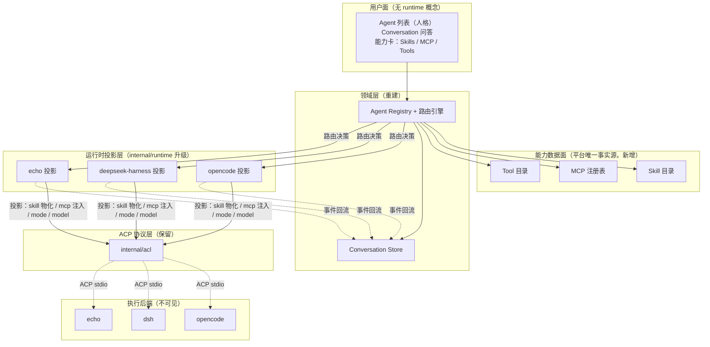

# ark-forge Agent × Runtime 解耦与能力复用重构设计

> 版本：v1（待审核）｜日期：2026-09-08｜类型：破坏性重构设计
> 状态：**待审核**——审核通过前不得执行代码重构。
> 关联文档：`docs/design-and-roadmap.md`（M0–M3 路线图，本文取代其中「runtime 一等公民」主线）、
> `docs/architect-design.md`（架构基线，本文 §3 覆盖其定位）、
> `docs/zacp-alignment-refactor-design-20260908.md`（持久化/Agent 管理面已落地，本文在其之上）。
> 参照实现：`~/Documents/study/ai-agent/goose`（Block / AAIF 的 Rust agent 框架，Provider 抽象）。

---

## 摘要（TL;DR）

当前 ark-forge 是「ACP 控制面网关」：runtime（opencode / deepseek-harness / echo）是用户可见的
一等公民，用户新建会话须显式选底座；skill / MCP / 工具没有平台侧统一模型，只是透传或空壳
（`McpServers: []`，见 `backend/internal/acl/session.go:65/83/102`）。

本次重构的目标：**把 runtime 从「用户可见的底座」降格为「可替换的执行后端」，把能力
（skill / MCP / 工具）从「runtime 私有实现」升格为「平台统一管理的数据面」，把会话从
「runtime 所有」升格为「平台所有」**。执行仍复用 runtime（不重造），但选择、路由、归一、
投影全部由平台代理，用户只面对「一个 Agent + 一组能力」。

核心结论（决策记录见 §2）：

1. **概念保留「Runtime」，但降格**：不换词（目录 `internal/runtime/` 可不动），只改其在领域模型
   中的位置——从「用户可见实体」变为「路由策略的产物」。
2. **MCP 是能力统一基底**：工具 = 平台拥有（MCP + 可选平台工具）；MCP 走 ACP 原生注入（`session/new` 的 `mcpServers`）。
3. **skill 平台拥有 + 物化投影**：ACP 不承载 skill（goose 亦如此），skill 走平台目录 + 物化到各
   runtime 原生位置，不跨 CLI 透传。
4. **会话平台拥有 + 双 id + 原生 resume 为主、handoff memo 兜底**：取代现有「断点恢复 + 别名映射」。
5. **权限 / 模型 / 思考强度 = 运行时投影映射**：用户看到统一档位，投影层映射到各 runtime 原生实现。

---

## 1. 背景与问题

### 1.1 现状盘点（网关形态）

| 层 | 现状 | 证据 |
|---|---|---|
| runtime 注册表 | 纯数据 Spec（command/args/env + 静态能力声明） | `backend/internal/runtime/contracts.go:12-27` |
| Agent 模型 | `{ID, Name, Runtime, Provider, State}`——runtime 是身份 | `backend/internal/manager/service.go:22-28` |
| ACP 接入 | `internal/acl` 封装 coder/acp-go-sdk，归一事件 | `backend/internal/acl/client.go:170-291` |
| MCP | `McpServers: []acpsdk.McpServer{}` 空数组 | `backend/internal/acl/session.go:65/83/102` |
| skill | 后端/前端零实现 | （grep 无命中） |
| 工具 | 仅 `tool_call/tool_update` 透传卡片 | `backend/internal/manager/orchestrator.go:714-745` |
| 会话 | runtime 所有 + 别名映射恢复 | `backend/internal/manager/orchestrator.go:73,206` |
| 用户面 | 新建会话显式选底座 | `frontend/apps/panel/src/pages/ChatPage.tsx:303`、`StartPage.tsx:106-153` |

### 1.2 预期目标（本次对齐）

- 用户**不感知**底层是 dsh 还是 opencode；
- 通过 ACP 复用 runtime 的问答 / skill / MCP / 内置工具能力；
- 能力面与 runtime 解耦，runtime 可替换。

### 1.3 根因

缺「能力归一化 + 运行时投影」层，且「runtime 是一等公民」的心智模型与「透明」预期相悖。
参照 goose：它把外部 ACP CLI（Claude Code / Codex）当作与 API 提供商同列的 `Provider`
（`crates/goose-provider-types/src/base.rs:464-715`），一个 `stream(model, system, messages, tools)`
接口统一所有后端，上层完全不感知后端差异。本设计把这一模式移植到 ark-forge，概念名沿用「Runtime」。

---

## 2. 术语与核心决策（ADR）

### 2.1 术语表

| 术语 | 含义 | 用户可见 |
|---|---|---|
| **Agent** | 人格 + 能力集 + 路由策略 + 权限策略 + 模型配置 | ✅ 唯一用户可见实体 |
| **Runtime** | 可替换执行后端（opencode / deepseek-harness / echo） | ❌ 默认不可见（仅高级设置「执行运行时（自动选择）」只读） |
| **Runtime 投影** | 每个 runtime 的 adapter：把平台能力集映射到其原生 config + ACP wire | ❌ |
| **Conversation** | 平台唯一事实源的会话（有序条目） | ✅ |
| **Execution** | runtime 内的一次 ACP session（无状态、可丢弃） | ❌ |
| **能力数据面** | skill 目录 / MCP 注册表 / 工具目录（平台拥有） | ✅（以「该 Agent 的能力」呈现） |

### 2.2 ADR 列表

**ADR-1：Runtime 降格（保留词，改变角色）**
- 决策：概念名沿用「Runtime」，但将其从「用户可见实体 / Agent 身份字段」降为「路由策略的候选 + 隐藏执行后端」。
- 理由：避免与现有 `provider`（模型提供商，`service.go:26` 的 `Provider` 字段）碰撞；目录 `internal/runtime/` 不动，仅升级 adapter 为「投影」。
- 后果：`AgentRec.Runtime` 字段删除，改为 `Agent.RoutingPolicy.Candidates []string`。

**ADR-2：MCP 作为工具统一基底（已确认，理由据 goose 校正）**
- 决策：工具目录 = 平台拥有的工具（MCP server 为主 + 可选平台工具/扩展）；`session/new` 时按 runtime 传输能力注入 `mcpServers`；runtime 原生工具（opencode/dsh 内置）不进目录，仅作「通用工具活动」透传观察。
- 理由（校正后）：绑定约束是 **ACP v1 无「列工具」方法**——CLI 原生工具无法被平台目录化，只能经 `tool_call` 通知事后观察，因此「目录化」只能发生在平台拥有的工具上（MCP 可 `tools/list`）。goose 同款：目录化「内置扩展 + 平台工具 + MCP」，被委托 CLI 的原生工具不进目录（`claude_acp.rs:90` 只透传 MCP server）。
- 评审确认：「工具目录泄露 runtime 身份」不作为本项目约束（不重要）。
- 后果：`acl/session.go` 三处空数组改为注入平台 MCP 子集；原生工具目录化仅可经每 runtime 静态清单实现（goose 不做、脆弱、随 CLI 版本漂移），默认不做、留作可选增强。

**ADR-3：skill 平台拥有 + 物化投影（不走 ACP）**
- 决策：平台是 skill 唯一事实源（`{id, name, description, body, sources}`），投影层把 skill 物化/软链到各 runtime 原生 skill 位置；执行仍在 runtime。
- 理由：ACP v1 无 skill 概念；goose 的 skill 也是「内置 Skills 平台扩展」（`documentation/docs/guides/context-engineering/using-skills.md:9-11`），不经过 ACP。skill 天生是「prompt + 文件」，不是协议。
- 后果：新增 skill 目录数据面；每加一个 runtime 多一个物化投影。

**ADR-4：会话平台拥有 + 双 id + 原生 resume 为主、handoff memo 兜底（已确认，据 goose 校正）**
- 决策：`Conversation` 是平台唯一用户可见会话；runtime 内的 ACP session 是 `Execution`（无状态、可丢弃）；会话里持久化 `provider_session_id`；恢复时**优先原生 resume**（`provider.resume(saved_id)` → ACP `LoadSession`），**跨 runtime / 无 resume 能力 / 无有效 provider session 时才用 handoff memo** 压缩历史注入首条 prompt。
- 理由（校正后）：goose 主路径是原生 resume（`agent.rs:2417-2420`、`acp/provider.rs:686-707`），memo 只是新会话兜底（`acp/provider.rs:635-665`）；`manages_own_context()`（`base.rs:631`）区分「谁拥有上下文」。取代现有别名映射（`orchestrator.go:73-80`）。
- 后果：删除 `aliases` 映射与「断点恢复重建会话」逻辑，改「双 id + 原生 resume 为主 + memo 兜底」。

**ADR-5：权限 / 模型 / 思考强度 = 运行时投影映射**
- 决策：用户看到统一档位（权限 Mode、模型、思考强度），投影层映射到各 runtime 原生机制。
- 理由：goose 的 `GooseMode → mode_mapping`（`claude_acp.rs:72-81`）、`model_config_option_id`（`acp/provider.rs:791-797`）已验证。
- 后果：现有 permission/elicitation 通道保留，其上盖统一 Mode 映射。

---

## 3. 目标架构



与现状的差异：

| 维度 | 现状 | 目标 |
|---|---|---|
| runtime 地位 | 用户可见、Agent 身份 | 隐藏执行后端、路由候选 |
| 能力面 | 透传 / 空壳 | 平台数据面（skill/MCP/tool） |
| 会话 | runtime 所有 + 别名 | 平台 Conversation + 无状态 Execution |
| 权限/模型 | 透传各 runtime | 统一档位 + 投影映射 |

---

## 4. 领域模型（接口级定义）

### 4.1 Agent（用户可见实体，重建）

```go
package agent

type Agent struct {
    ID          string
    Name        string
    Description string
    Persona     string           // 系统提示词
    Model       ModelConfig      // 默认模型
    Capabilities CapabilitySet
    Routing     RoutingPolicy
    Permission  PermissionPolicy
}

type CapabilitySet struct {
    Skills     []string   // skill 引用
    McpServers []string   // MCP 引用
    Tools      []ToolRef  // 启用工具（含 enable/disable）
}

type ToolRef struct {
    Name    string
    Enabled bool
}

type RoutingPolicy struct {
    Strategy    RoutingStrategy // first_available | capability_routed | sticky
    Candidates  []string        // runtime id 顺序（首选 + 回退）
    Constraints []Constraint    // 能力约束（如 "image"）
}

type PermissionPolicy struct {
    DefaultMode Mode // auto | smart_approve | approve | chat
}
```

> 关键变化：`Runtime` 不再是 Agent 的身份字段（删除 `AgentRec.Runtime`），只在
> `RoutingPolicy.Candidates` 出现。

### 4.2 Runtime（可替换执行后端，保留词但降格）

```go
package runtime

// Runtime 是可替换的执行后端。用户不可见；由路由引擎按 Agent.RoutingPolicy 选择。
// 对应 goose 的 Provider trait（crates/goose-provider-types/src/base.rs）。
type Runtime interface {
    ID() string

    // 唯一主入口：统一消息流 → 该后端 ACP prompt → 归一化事件流。
    Prompt(ctx context.Context, req PromptRequest) (<-chan acl.Event, error)

    // 谁拥有会话上下文（对应 goose manages_own_context）：
    //   true  = 后端内部管理上下文/执行工具（opencode/dsh/echo）
    //   false = 平台管理上下文/执行工具（未来 API 直连后端）
    ManagesOwnContext() bool

    // 底层 ACP 会话 id（不透明，仅用于恢复）；对应 goose provider_session_id。
    ProviderSessionID() string
    Resume(ctx context.Context, providerSessionID string) error

    // 权限模式归一：平台统一 Mode → 后端原生 mode（对应 goose update_mode）。
    ApplyMode(ctx context.Context, mode Mode) error

    // 模型投影：平台模型 → 后端 config option / env（对应 goose apply_model_selection）。
    ApplyModel(ctx context.Context, model ModelConfig) error

    // 能力断言（供路由，不直接暴露用户）；沿用 acl.Capabilities。
    Capabilities() acl.Capabilities
}

// PromptRequest 是平台 → 后端的统一请求（对应 goose stream 入参）。
type PromptRequest struct {
    System      string
    Messages    []acl.Message   // 统一消息
    Tools       []acl.Tool      // 平台统一工具目录
    McpServers  []acl.McpServer // 平台 MCP 子集（注入）
    HandoffMemo string          // 跨 runtime 续聊的压缩历史（仅首条 prompt 非空）
}
```

### 4.3 Conversation 与 Execution

```go
package conversation

// Conversation 是平台唯一事实源的会话。与 runtime 解耦，跨 runtime 可移植、可回放。
type Conversation struct {
    ID       string
    AgentID  string
    Entries  []Entry // user / assistant / tool / thought / permission / elicitation
    RuntimeHint string // 最近/首选 runtime（执行提示，非身份，用户不可见）
}

// Execution 是 runtime 内的一次 ACP session（无状态、可丢弃）。
type Execution struct {
    Runtime           string
    ProviderSessionID string // 底层 ACP session id（不透明）
}
```

### 4.4 能力数据面

```go
package capability

// Skill 目录（平台唯一事实源）。
type Skill struct {
    ID          string
    Name        string
    Description string
    Body        string          // SKILL.md 内容
    Sources     []SkillSource   // 物化目标（各 runtime 原生位置）
}

type SkillSource struct {
    Runtime string // opencode | deepseekharness | ...
    Path    string // 该 runtime 的物化路径
    Format  string // 该 runtime 的 skill 格式（如 "SKILL.md" / "agents/skills"）
}

// MCP 注册表（平台唯一事实源）。
type McpServer struct {
    ID        string
    Name      string
    Transport McpTransport // stdio | sse | http | streamable_http
    Command   string       // stdio 时
    Args      []string
    URL       string       // http/sse 时
    Headers   map[string]string
}

// Tool 目录（读通：MCP tools/list + 静态 + 观察兜底）。
type Tool struct {
    Name        string
    Description string
    Source      ToolSource // mcp | builtin | observed
    Schema      []byte     // 参数 JSON Schema
}
```

---

## 5. 能力统一机制（逐项）

### 5.1 问答

不变，现状已最优：`acl/session.go:22-33` 的 `Prompt` 走 ACP，流式经 `acl.Event` 回流。

### 5.2 工具（平台拥有 + MCP 化）

- 工具目录 = **平台拥有的工具**：MCP server 的 `tools/list` 结果（主）+ 可选平台工具/扩展（对应 goose `platform_tools.rs` / 内置扩展）；
- `session/new` 注入 Agent 启用的 MCP 子集（按 runtime 传输能力过滤：dsh 拒 sse、opencode 支持 http/sse）；
- runtime 原生工具（opencode/dsh 内置 bash 等）**不进目录**——ACP v1 无「列工具」方法，只能经 `tool_call` 通知透传观察（协议约束，非透明取舍）。

### 5.3 MCP

把 `acl/session.go:65/83/102` 三处空数组改为注入投影结果：

```go
// NewSession 改为从 PromptRequest.McpServers 注入
resp, err := c.conn.NewSession(ctx, acpsdk.NewSessionRequest{
    Cwd:        opt.Cwd,
    McpServers: toAcpMcpServers(req.McpServers), // 非空
})
```

### 5.4 skill（物化，不走 ACP）

三层：目录（平台事实源）→ 物化（投影层同步到各 runtime 原生位置）→ 执行（runtime 原生）。
goose 同款：skill 是平台扩展，不经过 ACP。

### 5.5 权限 / 模型 / 思考强度

- 权限：`Agent.PermissionPolicy.DefaultMode`（auto / smart_approve / approve / chat）→ `Runtime.ApplyMode` → 各 runtime 原生 mode（映射表见 §6）；
- 模型：`Agent.Model` → `Runtime.ApplyModel` → config option / env（opencode 走 `OPENCODE_MODEL` env，dsh 走 provider 配置）；
- 思考强度：作为 session config option 投影（对应 goose `THINKING_EFFORT_PARAM`，`acp/provider.rs:59`）。

### 5.6 会话（双 id + 原生 resume 为主 + handoff memo 兜底）

```
同 runtime 续聊（有 saved provider_session_id）：
  provider.resume(saved_id) → ACP LoadSession → 恢复精确会话，handoff_context_sent 置真（不再发 memo）
跨 runtime / 无 resume 能力 / 无有效 provider session：
  历史 entries → 压缩成 bounded handoff memo（token 预算）→ 首条 prompt 携带
memo 被后端拒绝：
  自动退回裸 prompt 重试一次
```

对应 goose：原生 resume（`agent.rs:2417-2420`、`acp/provider.rs:686-707`）；memo
`claim_handoff_context` / `bounded_handoff_memo`（`acp/provider.rs:635-665`）；拒绝重试（`acp/provider.rs:165-170`）。

---

## 6. 运行时投影层

### 6.1 投影 Spec（adapter 从「纯数据」升级为「投影」）

```go
package runtime

// ProjectionSpec 是一个 runtime 的声明式元数据 + 配置投影（对应 goose claude_acp.rs）。
type ProjectionSpec struct {
    ID          string
    Name        string
    Description string
    Command     string
    Args        []string
    Env         []string

    McpTransportSupport []McpTransport // 该 runtime 支持的 MCP 传输
    ModeMapping         map[Mode][]string // 统一 Mode → 该 runtime 原生 mode
    ModelConfigOptionID string            // 模型选择的 config option（如 "model"；空则走 env）
    ManagesOwnContext   bool
    SetupSteps          []string
}
```

### 6.2 三个投影规格

| 字段 | opencode | deepseek-harness | echo |
|---|---|---|---|
| Command/Args | `opencode acp` | `dsh --profile acp` | `forge acp-demo` |
| McpTransportSupport | http / sse / stdio | stdio / streamable-http | stdio（演示） |
| ModeMapping | 空（实测：无一一对应词表，per-action permission） | 空（实测：DSH_PERMISSION_MODE env + 预设） | allow/reject × once/always |
| ModelConfigOptionID | 空（走 `OPENCODE_MODEL` env） | provider 配置 | 空 |
| ManagesOwnContext | true | true | true |

> ModeMapping 实测结论（2026-09-08）：opencode 权限为 per-action/per-agent 配置（ACP 面无 mode
> 参数），dsh 权限经 `DSH_PERMISSION_MODE` env + approval 预设表达——均无与平台四统一模式
> 一一对应的原生词表，留空为有据结论（详见 §15 实测记录）。

---

## 7. 路由引擎

```go
package routing

type RoutingStrategy int

const (
    FirstAvailable    RoutingStrategy = iota // 首个可用（默认）
    CapabilityRouted                          // 按能力匹配
    Sticky                                    // 会话粘滞（优先复用）
)

// Resolve 在 turn 时刻决定本轮由哪个 runtime 服务。
func Resolve(ctx context.Context, agent agent.Agent, conv conversation.Conversation,
    needed CapabilitySet, runtimes map[string]runtime.Runtime) (runtime.Runtime, error) {
    // 1. 可用性探测：installed（command 可解析）+ credential（runtime 认证成功）
    // 2. 能力匹配：needed 的能力过滤候选（image / 某 skill / 某 MCP 传输）
    // 3. 按 RoutingPolicy.Strategy 排序
    // 4. 会话粘滞：conv.RuntimeHint 在候选中则优先
    // 5. 迁移触发：当前 runtime 不满足能力 → 换满足的 runtime + handoff memo 重灌
}
```

用户看到的最多只是「执行运行时（自动选择）」只读标签，藏在高级设置。

---

## 8. API 契约变更（破坏性清单）

### 8.1 REST（`/v1/forge`）

| 变更 | 现状 | 目标 |
|---|---|---|
| `/runtimes` | 默认暴露 | 移出默认面，仅高级设置只读 |
| `/sessions` | runtime 绑定 | 改名 `/conversations`，响应不含 runtime 字段 |
| `Agent` DTO | 含 `runtime` 字段 | 删除 `runtime`，增 `capabilities` / `routing`（routing 仅管理员可见） |
| `/agents/:id/capabilities` | 无 | 新增：返回 skill/MCP/tool 统一目录 |

### 8.2 WS 事件

事件词表不变（`manager/events.go:5-45`），但事件归 Conversation 而非 runtime；
`session.runtime` 事件降级为内部诊断（不推送给默认订阅）。

### 8.3 前端

- 「选底座」胶囊栏 → 「选 Agent」（`StartPage.tsx:106-153`、`ChatPage.tsx:303`）；
- Runtimes 页移出主导航，并入「高级设置」；
- 能力卡（Skills / MCP / Tools）新增，数据来自 `/agents/:id/capabilities`（2026-09-09 落地，见 §19.3）。

---

## 9. 存储迁移

| 现状 | 目标 |
|---|---|
| `sessions` 表（含 runtime 字段） | `conversations` 表（删 runtime 身份字段，加 `runtime_hint`） |
| 别名映射 `orchestrator.aliases` | 删除，改 `Execution.ProviderSessionID` |
| events / messages 读模型 | 保留（已是平台事实源底座） |

迁移：P0 一次性 breaking 迁移；旧 `sessions` 数据若需保留，提供 `runtime_hint` 回填（取历史会话的
runtime 作为 hint），不保留 runtime 身份语义。

---

## 10. 与 goose 对照（借 / 不借）

### 10.1 借鉴

| goose | ark-forge 落地 |
|---|---|
| `Provider` trait + `stream(model, system, messages, tools)` | `runtime.Runtime` 接口 + `Prompt(PromptRequest)` |
| `manages_own_context()`（`base.rs:631`） | `Runtime.ManagesOwnContext()` |
| `bounded_handoff_memo`（`acp/provider.rs:635-665`） | handoff memo 重灌（§5.6） |
| 双 session id（`base.rs:468-470`） | `Conversation.ID` + `Execution.ProviderSessionID` |
| `GooseMode → mode_mapping`（`claude_acp.rs:72-81`） | `PermissionPolicy.DefaultMode → ModeMapping` |
| `model_config_option_id`（`acp/provider.rs:791-797`） | `ProjectionSpec.ModelConfigOptionID` |
| MCP 透传（`claude_acp.rs:90`） | `PromptRequest.McpServers` 注入 |
| 声明式投影 adapter（`claude_acp.rs`，~100 行） | `ProjectionSpec` + 每 runtime 一个投影文件 |
| 可复用 agent 核心 crate（`crates/goose-agent`：inference/tool/machine/operation） | 未来可抽 `internal/agent` 为可复用包（本次不强制） |

### 10.2 不借鉴

- **goose 的完整 agent loop / 状态机**（`crates/goose-agent/src/machine.rs` + `ops_*.rs`）：
  那是「goose 自己当 agent」用的；本设计复用 CLI 的 agent 能力，`ManagesOwnContext()=true` 时
  loop 退化为「纯 stream 转发」，无需重建状态机。
- **goose 的「ACP session 与 goose session 不一致」限制**（`guides/acp-providers.md:18-21`）：
  本设计用 handoff memo + 双 id 更干净地解决跨 runtime 续聊，但同样**不做「一轮进行中热切换」**。

---

## 11. 重构计划（破坏性调整已授权，不做向后兼容）

> 评审确认：允许破坏性调整。旧 `sessions` / `aliases` / `/runtimes` / `/sessions` 契约**不保留兼容、
> 不迁移**，一次性替换；阶段仅用于可验证的里程碑，不承担「中途保持可用」的约束。

| 阶段 | 内容 | 验收 |
|---|---|---|
| **P0 领域模型 + 存储 + 契约重建（一次性破坏）** | 新 Agent/Conversation/Execution 模型、`conversations` 表、删 `AgentRec.Runtime`、删别名映射；**同步**改 REST（`/runtimes` 移出默认面、`/sessions`→`/conversations`）与前端（选底座→选 Agent、runtime 隐身） | 编译 + `go test -race` + 用户流程无 runtime 字样 |
| **P1 能力数据面** | Skill 目录 + MCP 注册表 + Tool 目录（含可选平台工具） | REST 可列出能力 |
| **P2 投影 + 路由** | `runtime.Runtime` 接口、opencode/dsh/echo 投影、`mcpServers` 注入（替换空数组）、skill 物化、路由引擎 | echo 全链路 + opencode/dsh 各验证一轮 |
| **P3 会话可移植** | 双 id + 原生 resume 为主 + handoff memo 兜底、跨 runtime 续聊 | kill -9 恢复 + 跨 runtime 续聊 DoD |

---

## 12. 风险与开放问题

1. **能力差异不可完全抹平**：只做「按能力降级、不归因 runtime」（用户见「图片不可用」，不见「因 dsh」）。
   若某能力缺失，降级在能力层，不 shim（shim = 重造，违反能力不重造边界）。
2. **skill 跨 runtime 格式兼容是真实成本**：需约定两方都能消费的 skill 格式；做不到的 skill 标
   「仅某 runtime 可用」并作为路由约束。
3. **opencode / dsh 无与平台统一模式一一对应的原生权限词表**（实测结论 2026-09-08，见 §6.2/§15）：
   统一模式语义落平台 permission 面；若后续要按底座放松（如 dsh `DSH_PERMISSION_MODE`、opencode
   `permission` 预设），以「按能力降级」同款纪律做白名单式映射，不做隐式放宽。
4. **opencode 忽略客户端模型选择**（issue #13644）：模型走 env/config 投影，不走 ACP wire。
5. **dsh 接口迭代快**：投影层需对 dsh 的 initialize 能力断言做运行时探测 + 降级（现状已如此，保留）。
6. **`internal/runtime` 目录名与「运行时投影」语义**：ADR-1 保留目录，仅升级内容；若审核倾向重命名
   目录，可改为 `internal/projection/`（低优先级，不阻塞）。

---

## 13. 决策记录（已确认，2026-09-08）

- [x] ADR-1「Runtime 保留词降格」——**确认**（目录 `internal/runtime/` 不动，仅升级为投影）。
- [x] ADR-2「工具 = 平台拥有 + MCP 化」——**确认**（理由据 goose 校正：ACP 无法枚举 CLI 原生工具，属协议约束而非透明取舍；「泄露身份」不作为约束）。
- [x] ADR-4「双 id + 原生 resume 为主 + handoff memo 兜底」——**确认**（据 goose 校正，memo 为兜底非主路径）。
- [x] §11 分批——**确认按破坏性重排**：P0 合并模型/存储/契约一次性破坏，不保留兼容；共 P0–P3 四阶段。

## 14. P1 落地记录（能力数据面后端切片，2026-09-08）

按 §11 P1 落「Skill 目录 + MCP 注册表 + Tool 目录（REST 可列出能力）」的后端切片：

- 新增 `internal/capability` 包：§4.4 领域类型（Skill/SkillSource/McpServer/Tool，磁盘 JSON 定义
  与内存 Registry 共用）+ `Registry`（目录加载 `<dir>/{skills,mcp,tools}/*.json` + Register* 注入
  + 按 id/name 排序列表；坏文件/非法条目跳过告警，对齐 LoadAgentDefinitions 容错）。
- Service 集成（`manager/capabilities.go`）：`LoadCapabilityDefinitions`（serve 装配；数据源默认
  `~/.forge/capabilities`，FORGE_CAPABILITIES 覆盖）+ `ListSkills/ListMcpServers/ListTools`——
  MCP headers/凭证只存内部供 P2 注入、REST 不读回（同 providers has_key 立场）。
- REST：`GET /v1/forge/skills|mcps|tools`（信封 `data` 数组；空目录返回 `[]`，非 null）。
- 验收状态：`go build/vet ./...` 通过、`go test -race ./...` 全绿；capability/manager/handler/router
  新增单测覆盖目录加载、排序、非法条目、空表形态与 REST 列表。
- 前端能力卡（§8.3）：`/capabilities` 管理页（Skills / MCP Servers / Tools 三组只读目录，
  TopBar「能力」入口 + types/api 接线），读取本批三个端点（2026-09-08 同批落地）。
- **P1 剩余**：`/agents/:id/capabilities` 统一目录（§8.1）→ 已落地，见 §19.1；P2 消费侧接线
  （`mcpServers` → session/new 注入已落地、skill 物化已落地、MCP `tools/list` live 探测写 Tool 目录
  → 见 §19.2）。

## 15. P2 落地记录（切片 1：MCP 注入通道，2026-09-08）

按 §5.2/§5.3 把 `acl/session.go` 三处空 `McpServers` 改为平台注册表注入的第一段：

- `runtime.Spec` 增 `McpTransports []string`（§6.2 传输能力；空 = 保守仅 stdio，ACP 全 agent 必须支持）。
  三投影填写：opencode `[stdio sse http]`、deepseekharness `[stdio streamable_http]`（拒 sse）、echo `[stdio]`。
- `acl` 新增传输中性注入表示 `acl.McpServer` + `SessionOptions.McpServers`；`toAcpMcpServers` 转 ACP SDK
  判别联合（每 server 一个 transport 子对象：stdio/http/sse；`streamable_http` 归一 http；headers 有序；
  unknown/缺名丢弃；空列表仍得 `[]` 数组——echo agent 校验 mcpServers 非 null）。
  NewSession/LoadSession/ResumeSession 三处统一走注入（load/resume 暂由 acl 预留，manager 尚未启用）。
- Service `McpServersForRuntime(runtimeID)`：注册表全量 → 按该 runtime `McpTransports` 过滤 → `acl.McpServer`
  （headers/凭证随 wire 下发，不进 REST）；orchestrator `startConversationOn` 建会话时随 `session/new` 下发。
- 验收状态：`go vet ./...` 通过、`go test -race ./...` 全绿；新增 acl 转换器单测 + manager 注入过滤单测
  （echo 仅 stdio 取 1、opencode 取 3、未知 runtime 不下发、未声明传输保守 stdio）；另增 acl 真 stdio
  往返集成断言（`TestMcpServersInjectionOverWire`：判别联合各子对象 + 有序 headers + 空列表保 `[]`）。
- **冒烟 DoD（人工，需真实底座）**：`echo` 全链路新建会话无回归；置 `~/.forge/capabilities/mcp/fs.json`
  （stdio server）后 `opencode`/`dsh` 各起一轮，观察底座是否拉起注入的 MCP server。
- **echo 全链路自动化冒烟（2026-09-08）**：构建真实 `forge` 二进制 + `serve`（memory 模式，agents/caps
  临时目录）+ REST 驱动：新建会话 → 权限 round×2 resolve（allow-once）→ boom 错误轮（`turn.error`）→
  同会话重试恢复 → 多轮文本标记命中；`/agents` 列出种子 + echo 自定义 agent、`/mcps` 列出 stdio server。
  事件谱系 `turn.ended×3 / permission_request×3 / turn.error×1`。
- **opencode / dsh 真实冒烟（2026-09-08，DoD 完成）**：同一 serve（真进程）按默认种子 agent 各起一轮——
  `opencode acp` 与 `dsh --profile acp`（本机 CLI 均在 PATH 且有模型凭证）真实完成会话：
  二者事件谱系均为 `session.created / user_message / message / usage / turn.ended`（含真实 usage）。
  注：dsh 的 acp profile 固定写真实 `~/.dsh`（不受 $HOME 重定向影响），冒烟需 home 目录写权限。
- **按 Agent 选 MCP 子集（§5.2 收口，2026-09-08）**：`AgentRec`/agent 定义文件新增可选 `mcps`
  白名单（指针三态：缺省 nil = 全启用按 runtime 传输过滤；非 nil = 白名单；`[]` = 本 agent 禁用注入）。
  Service 选择方法改为 `McpServersFor(agent, runtimeID)`（注册表 → 传输过滤 → 白名单）；orchestrator
  `session/new` 注入改走 agent 维度；`syncAgentDef` 持久化保留 `mcps` 不丢字段。
  REST create/patch 暂不暴露 `mcps`（定义文件级；§8.1 Agent.capabilities 统一面时并入）。
- **路由引擎 FirstAvailable 切片（§7，2026-09-08）**：新增 `internal/routing`——`Installed(spec)`
  判定启动命令可执行（PATH 查找 / 路径 stat），`FirstAvailable(reg, candidates)` 按候选顺序取首个
  「已注册 + 可执行」，未采用候选按 NotFound/NotInstalled 分类返回。Service `ResolveRuntime(agent)`
  映射错误码（全未注册 → runtime_not_found，与既有单候选语义一致；存在已注册但不可执行 →
  runtime_unavailable；空候选 → no_runtime）；orchestrator `StartConversation` 由「首候选」升级为
  路由选定（RunOnce 显式 --runtime 不变）。能力匹配/Sticky 粘滞/handoff 迁移依赖 Runtime 接口，留后续。
- **投影声明升级（§6.1/§6.2，2026-09-08）**：`runtime.Spec` 补齐 ProjectionSpec 字段——
  `Description`、`ManagesOwnContext`、`ModeMapping`（统一模式→原生 mode；实测后确认两底座无
  一一对应词表 → 留空为有据结论，见 §15）、`ModelConfigOptionID`（空 = 走 env/provider 配置）、`SetupSteps`（预留）。
  三投影（echo/opencode/deepseekharness）按 §6.2 填 `Description` 与 `ManagesOwnContext=true`；
  新增声明值守门单测。另修 `TestPermissionCancelSession` 时序抖动（等齐 2 条挂起再断言）。
- **拨号底座 `runtime.Connect`（§4.2 可执行半场基础，2026-09-08）**：spawn + initialize 握手从
  orchestrator.acquire 下沉为 `runtime.Connect(ctx, spec, args, env, opts)`（stdio；env 叠加于
  spec.Launch.Env 之后；决策钩子仍由调用方经 ClientOptions 注入；脱离请求 ctx 语义不变）。
  acquire 改用它——`Runtime` 接口落地时各投影复用同一拨号路径。
- **stdio MCP command 须绝对路径（2026-09-08，真底座发现）**：dsh `session/new` 严格校验并拒绝
  相对命令（`mcpServers[0].command must be an absolute path`）。注册表 `RegisterMcpServer` 对 stdio
  server 加绝对路径校验（坏文件跳过告警；sse/http 走 URL 不受影响）。注入端到端已由 opencode 真底座
  收文 + fake-agent wire 解码验证；dsh 对注入 server 还会要求其真实可握手（/bin/echo 等非 MCP server
  会被拒）——属底座行为，非平台缺陷（dsh 冒烟本体于无注入配置下通过，见上）。
- **`runtime.Runtime` 接口 + echo 可执行投影（§4.2 会话边界版，2026-09-08）**：
  `runtime/runtime.go` 落地接口（ID/ManagesOwnContext/Capabilities/ProviderSessionID/Prompt/
  ApplyMode/ApplyModel/Resume）与平台词汇 Mode（auto/smart_approve/approve/chat）/
  ModelConfig/PromptRequest（Text 已接入；McpServers/HandoffMemo 规划占位）。
  **偏差文档化**：本平台一对话即一活跃 ACP 连接（Orchestrator 管连接与决策钩子），故按「会话边界」
  落地，Prompt 返回 stop reason（事件流在连接层 OnEvent），backend-wide 生命周期管理仍在 Orchestrator。
  `NewEchoRuntime` 为 echo 投影可执行形态：ID=echo、ManagesOwnContext=true、透传会话 Prompt；
  无原生模式/模型/持久会话 → Apply*/Resume 显式返回 `unsupported_*` acl 错误（不静默吞掉）。
  集成测试在**进程内真实 EchoAgent** 上 Dial→NewSession→Prompt×2→契约断言（无子进程依赖）。
- **三投影可执行形态齐备（2026-09-08）**：把 echo 投影泛化为 `sessionRuntime`（同一「活会话」
  实现：ID/ManagesOwnContext 取自各自 §6.2 Spec，Prompt/Capabilities/ProviderSessionID 透传
  acl.Session），`NewEchoRuntime / NewOpencodeRuntime / NewDeepseekHarnessRuntime` 三公开构造各以
  对应 Spec 实例化（opencode/dsh 后端自管上下文）。ApplyMode/ApplyModel/Resume 统一显式返回
  `unsupported_*`（ModeMapping/模型切换原语/会话恢复承载均待实测，见 §12 开放项）。测试：三个构造
  器在同一活会话上断言身份 + 契约；echo 全链路可执行投影测试不变。
- **路由能力匹配切片（§7 CapabilityRouted，2026-09-08）**：routing 引擎增
  `Strategy`（first_available 默认 / capability_routed）、`ParseStrategy`、`SupportsTransports`
  （spec.McpTransports 空 = 保守 stdio）、`CapabilityRouted`（候选须承载 requiredTransports，
  不符记入 `Availability.CapabilityMismatch`）。agent 定义增可选 `routing_policy`（文件面，
  未知值宽容回退默认）。`Service.ResolveRuntime` 按策略分发：capability_routed 下由 Agent 显式
  MCP 白名单 ∩ 能力数据面推导 requiredTransports（`requiredMcpTransports`；Mcps nil = 无硬约束，
  等价 first_available），全不满足时报 `runtime_capability_mismatch`。测试：引擎单测 + manager
  策略接入（跳过不承载 runtime / mismatch 码 / nil 白名单 / 未知策略回退）。
- **§6.2 ModeMapping / §5.4 skill 物化 实测结论（2026-09-08，用户授权实测；开放项关闭/定位）**：
  - dsh（acp profile `--dump-config` 353 行实探）：权限由 `DSH_PERMISSION_MODE` env
    （sandbox 模式：workspace-write / danger-full-access …）+ per-plugin approval 预设
    （ask/never）表达，另有独立 plan-mode 会话层模式与 telemetry mode——无与平台四统一模式
    （auto/smart_approve/approve/chat）一一对应的原生词表。
  - opencode：权限为 per-action/per-tool 配置（`permission: {"edit":"ask","bash":"allow"…}`，
    per-agent 亦同，见 [Permissions](https://opencode.ai/docs/permissions/)），ACP 面无 mode
    参数（`opencode acp --help` 无 mode 选项，决策走 request_permission）；skill 为一等公民：
    用户目录 `~/.config/opencode/skills`、项目 `.opencode/skills/` 与 config `skills:` 源列表
    （见 [Skills](https://opencode.ai/v2/docs/skills/)）。
  - 结论：ModeMapping 保持空映射是**有据**结论（无一一对应原生词表；统一模式语义落平台
    permission 面，ApplyMode 会话内切换原语不存在，勿臆造词表）；skill 物化（§5.4）opencode 侧
    物化目录已实证（config skills 源 / 用户目录），dsh 侧未实证——物化为下一评审项，P2「按需」
    未触发（当前 skills 仅数据面列表，未向 agent 会话注入）。
- **P2 剩余（未含，留后续评审）**：Orchestrator 采用 Runtime 接口（会话模型重构评审点）、
  skill 物化接入（§5.4，opencode 目录已实证）、会话恢复 Resume 按底座实测。P2 验收三项
  （race 全绿 / echo 全链路 / opencode+dsh 冒烟）均已达成，见上。

## 16. P2 后续：Orchestrator 采用 Runtime（会话模型重构方案）

### 16.1 目标与边界

P2 已把 `runtime` 升级为可执行投影（§4.2 会话边界版接口 + 三投影 + `runtime.Connect` 拨号底座）。
本节让 **Orchestrator 正式采用 Runtime 接口**：会话生命周期内一切对底层 ACP 会话的操作经由投影
表达。设计约束：**行为零变化**（投影方法目前等价直连会话：Prompt 透传、Capabilities/
ProviderSessionID 同源）；采用的价值是给未来 backend-wide Runtime（多会话/恢复/模式）留出单一
接缝，杜绝再往 orchestrator 里堆直连会话调用。

### 16.2 采用接缝（切片落地）

- `runtime.NewProjection(spec, sess) Runtime`：按 Spec.ID 分发到 echo/opencode/deepseekharness
  投影；未知 runtime 返回 nil（orchestrator 保持直连回退）。
- `ActiveConversation.proj runtime.Runtime`：`startConversationOn` 建会话后构造并持有；
  `runTurn` 的 Prompt 走 `proj.Prompt(ctx, PromptRequest{Text})`；proj 为 nil（测试假会话/
  未投影 runtime）回退 `sess.Prompt`——两路径语义一致。
- Cancel 等无投影方法仍走底层会话；ApplyMode/ApplyModel/Resume 语义落平台（§15 实测结论）。

### 16.3 遗留（后续评审点，非本节范围）

- backend-wide Runtime（连接/会话多路复用）重构：需要「每 runtime 多会话」能力（现每 runtime
  单连接）。opencode/dsh 的会话恢复承载按底座实测后接 Resume。
- skill 物化接入（§5.4）：opencode 物化目录已实证（config `skills:` 源 / `~/.config/opencode/skills`）；
  dsh 未实证 → 不臆造，按能力数据面降级。

### 16.4 采用记录

- **切片 A（2026-09-08）**：`NewProjection` 分发器 + `ActiveConversation.proj` +
  `runTurn` 走接口（nil 回退直连）；分发器单测（三投影路由/未知 nil/构造不触碰会话）；
  echo 全链路真进程冒烟回归验证行为零变化；`go vet` + `go test -race ./...` 全绿。

### 16.5 skill 物化接入（§5.4 落地切片）

**实证（2026-09-08，opencode v1.18.29 spike）**：opencode 自动扫描
`~/.config/opencode/skills/<skill>/…`（无需 config 项）；`config.skills` 数组为 v2 语法，
v1 不识别（config skills 源 spike：可用列表无 forge-demo-skill，报 "Skill not found"）。
物化约定：`format == "SKILL.md"` → `<root>/<skillID>/SKILL.md`（body 即内容），幂等覆盖。

- **切片 B1（2026-09-08）**：`capability.MaterializeSkill(root, skill)` /
  `RemoveSkillDir(root, id)`（按上述约定写/删；未实测 format（如 dsh "agents/skills"）
  跳过告警，不臆造）+ 单测（约定路径/内容/幂等/删除/校验）。
- **切片 B2（2026-09-08，enable 接线）**：config 增 `SkillMaterializeDir`
  （`FORGE_SKILLS_MATERIALIZE_DIR`，默认空 = 关）；serve 装载能力后
  `Service.MaterializeSkills(dir)` 把 opencode SKILL.md 源 skill 物化到该目录（部分失败
  告警可容忍，全失败才报错）。端到端验证：temp 能力目录 + enable 目录 → 写出
  `<root>/forge-demo/SKILL.md`（body 一致）+ serve 日志 count=1；echo 全链路回归通过。
- **切片 D（2026-09-08，删除联动 + 启动重校）**：物化目录写 forge 归属标记
  `<skillID>/.forge-managed`；`capability.ReconcileSkills(root, current)` 启动重校——内容一致
  跳过（幂等计数）、缺失/更新写出，仅删「带标记且不在注册表」目录，**用户自有目录绝不动**；
  Service 增 `ReconcileSkills`（返回 written/removed）替换 serve 装配调用，日志 written/removed。
  端到端验证：run1 写 skill-a → run2（删 a 增 b + 用户目录 user-x）written=1 removed=1，产物 =
  skill-b + user-x（skill-a 清、user-x 保留）；echo 全链路回归通过；vet + race 全绿。
- **enable 决策（遗留，部署评审）**：目标目录为真实 opencode 用户配置时须运维显式开启
  （`FORGE_SKILLS_MATERIALIZE_DIR`）。dsh 未实证 → 降级只列不物化。
  （**2026-09-09 已实证并修正，见 §19.4**：原「body 即内容」约定被双底座实测证伪。）

### 16.6 Resume 承载矩阵（§16 切片 C，实测/记录 2026-09-08）

- **echo**：未声明 `sessionCapabilities.resume` → `acl.ResumeSession` 在**能力门被拒**
  （`resume_session_unsupported`，wire 前，不会发到 agent）——实测守卫单测锁定
  （注：echo agent 有 ResumeSession handler 但无能力声明，能力门先行）。
- **opencode / dsh**：已实测（2026-09-08 握手能力断言，forge serve INFO 日志，无模型 turn）：
  opencode `sessions_persistent/multi_session_concurrent/load_session/resume/list/fork/close` 全
  true；dsh `sessions_persistent/multi_session_concurrent/resume/list/close` true、
  `load_session=false`、`fork=false`。→ 两底座 **resume 握手级支持**（`acl.Client.ResumeSession`
  能力门通过），剩余为 forge 侧恢复流程接入（重建投影）——投影 `Resume` 仍按单会话投影语义
  不支持隐式热切换，接入随 §5.6 后续推进；forge P0 仍不做进程重启断点恢复（ADR-4 P3）。
- 结论：三投影「不支持面」明确；与 §5.6 原生 resume 蓝图的对齐点 = `acl.Client.ResumeSession`
  能力门（已实现，按 caps 门控）+ 重建投影；backend-wide 多会话重构时按底座探测接入。

### 17. backend-wide Runtime 会话模型重构（§16.3 遗留评审点）

#### 17.1 现状勘察（真实代码，2026-09-08）

- 连接模型：`Orchestrator.conns map[string]*runtimeConn`（key=runtime ID，每 runtime 至多一条连接，
  orchestrator.go:72）；`acquire`（orchestrator.go:450）复用既有连接。
- 会话模型：每次建会话在共享连接上 `rc.client.NewSession(...)`（orchestrator.go:232）→ 每个
  `ActiveConversation` 持有自己的 `acl.Session` + `runtime.NewProjection(spec, sess)`（:240-241）。
  即**连接共享、会话独立**；多会话同连接并发在途 turn 在接口上未被禁止（Prompt 仅检查
  `as.busy`，:267）。
- 在途归属：SDK v0.13.5 的 elicitation 未建模 scope（宿主读不到顶层 conversationId）→
  `busyConn map[*acl.Client]map[string]struct{}`（:80）以「该连接唯一在途 turn」推断会话归属；
  多会话并发在途时归属不唯一 → 不猜测按取消回应（§1.5 决策修订，:76-79 注释）。
- Runtime 接口已含 Capabilities()/ProviderSessionID()/Prompt/ApplyMode/ApplyModel/Resume
  （runtime.go）；Orchestrator 执行面已走 proj（runTurn，:314），直接 acl 触点仅剩
  NewSession/Done/Close/Cancel（连接生命周期 + 取消），见 §16.2 采用接缝。
- 会话恢复：P0 无进程重启断点恢复（ADR-4 P3）；acl.Client.ResumeSession/LoadSession/ListSessions
  已按握手能力门控（§16.6）。

#### 17.2 目标与方案评审

backend-wide 采用 = 编排层对「连接/会话」的建模与 Runtime 会话模型一致，消除每 runtime 单连接
假设，让「一个 conversation 的活跃执行面」完全由投影表达。候选：

- **A：每会话独立连接（每 conversation 一条 runtime 连接/进程）**。隔离最强、权限/elicitation
  归属天然唯一（client==conversation，busyConn 启发式可整体删除）；代价：dsh/opencode 每会话
  一进程，资源重、启动慢，且与「暖进程空闲回收」（idle reaper）收益相悖。
- **B：保持每 runtime 一连接，会话独立（现况），但把并发在途语义显式化**：每连接同时至多一个
  在途 turn（conn 级串行门闩，替代跨会话忙推断），或运行时支持多会话并发则归属走会话级 scope
  （需 SDK/底座升级）。代价：先要实证各底座在共享连接上多会话并发的行为。
- **C：每会话独立连接仅对不支持共享会话的底座（无 MultiSessionConcurrent 能力）启用**，其余保
  B——能力驱动混合，最贴 acl 能力面但模型最复杂。

倾向：**先测量再定 A/B/C**（不臆造，同 §6.2 纪律）。测量点 = 各底座在一条连接上并发
两个会话/两个在途 turn 的行为（echo/opencode/dsh）。测量结果决定主方案：
- 若共享连接多会话并发稳定 → B + conn 级串行（或会话级归属），改动最小；
- 若任一底座异常/不支持 → A（或 C 能力驱动）作为该底座路径。

#### 17.3 迁移步骤（每步独立提交 + 全绿 + echo 回归）

1. **切片 E0（测量，2026-09-08，完成）**：并发探测——同 runtime 连接上两会话同时在途 turn 的
   事件谱系/归属（echo 免费真进程；opencode/dsh 授权短模型调用）。产出写入 §17.2 决策依据。
   **结果**：① echo（真进程，forge REST 两会话背靠背）：两会话同连接各自全链路
   （permission round + turn.ended），事件按会话隔离、无串扰 → 共享连接多会话可用；
   ② opencode（真进程，两会话几乎同时发起、真重叠 18/16 thought）：两会话各自 turn.ended、
   无错误无串扰 → **共享连接多会话并发在 opencode 上稳定**。dsh 未测（连接模型同构，留 E2
   按需）。→ §17.2 倾向 **方案 B（每 runtime 一连接 + 会话独立 + conn 级在途语义显式化）**，
   改动最小且已实测可行；方案 A 仅作不支持共享会话底座的后备（当前无证据需要）。
2. **切片 E1（2026-09-08，完成）**：方案 B 数据模型前置——把 Orchestrator 直接操作的
   `busyConn map[*acl.Client]map[string]struct{}` 簿记显式化为 `inFlightTracker`
   （Mark/Unmark/SoleOwner/Len/Clear，自持锁；语义同 §1.5 修订：唯一在途才归属、并发在途不
   猜测；nil client 安全）。行为零变化（markBusy/unmarkBusy/busyConversationForClient/
   reap/StopAgent/dropConn 调用点原样换封），单测（语义表 + 8×200 并发 race）+ 既有归属
   测试适配；vet + race 全绿，echo 全链路回归通过。E2 在此接缝上演进并发语义。
3. **切片 E2（2026-09-08，Cancellation 通路）**：Runtime 接口补 `Cancel(ctx)`（会话级执行
   原语；连接生命周期仍归 Orchestrator，§4.2 偏差）；sessionRuntime 透传 `sess.Cancel`；
   `CancelTurn` 经投影取消（proj nil 回退直连，语义一致）——会话执行面自此全由投影表达
   （Prompt/Cancel/ID/Capabilities/ProviderSessionID）。契约单测（echo Cancel nil 成功）+ 归属
   生命周期既有用例；vet + race 全绿，echo 全链路回归通过。
4. **切片 E3…**：按主方案逐项迁移（归属推断演进、回收/看门狗适配、ProviderSessionID/
   Resume 通路按实测接入），每步 echo 回归 + 全量 race。

#### 17.4 backend-wide 采用收口（2026-09-08）

逐项对照 §17.1 现状清单的终态：

| 现状项 | 终态 |
|---|---|
| Runtime 接口含全会话字段 | 执行面全投影：`Prompt`/`Cancel`(E2)/`ID`/`Capabilities`/`ProviderSessionID`/`Apply*`/`Resume` |
| Orchestrator 直接 acl 触点（Prompt/Cancel） | 清零；仅剩连接级生命周期（NewSession/Done/Close，归 Orchestrator，§4.2 既定偏差） |
| busyConn 跨会话在途推断（§1.5 修订） | `inFlightTracker` 显式簿记（E1）；语义不变：唯一在途才归属、并发在途不猜测 |
| 共享连接多会话并发 | E0 实测 echo/opencode 稳定 → 方案 B 成立：每 runtime 一连接 + 会话独立（多会话） |
| Resume | 不支持面明确（§16.6）；接入路径 = acl.Client.ResumeSession 能力门 + 重建投影 |

**结论**：backend-wide Runtime 采用完成（编排层会话执行面全投影、连接模型与 §4.2 会话边界版
一致、并发语义经实测）。**开放项（未实证/待演进，非本次范围）**：
1. elicitation 归属在「多会话并发在途」下仍需 SDK scope 建模（v0.13.5 缺失）→ 维持不猜测；
2. Resume 按底座实测接入（echo 已明确不支持；dsh 连接模型同构，E2 后可按需复测）；
3. ~~dsh 共享连接多会话并发行为未实测~~（已实测 2026-09-08：握手声明
   `multi_session_concurrent=true` + 真进程两会话重叠各自 usage/turn.ended 无错误 →
   与 opencode 同为方案 B 可行；观测日志：serve INFO「runtime 握手能力」）；
4. 会话 provider_session_id 持久化与断点恢复属 P0 之外（ADR-4 P3），不在本重构范围。

### 18. P3 会话可移植规划（§11 P3；backend 优先，2026-09-08 起草）

#### 18.1 目标与边界

§11 路线 P3 验收：**kill -9 恢复 + 跨 runtime 续聊 DoD**。本期范围 = 后端（经决策确认：后端
优先、前端随后）。边界同单机单操作员；elicitation scope、断点恢复的 provider 侧、多用户均不
在本期。

#### 18.2 现状基线（真码/实测）

- 会话 id = 原生 provider session id（`ActiveConversation.ID = sess.ID()`，orchestrator.go:240）；
  已随 `conversations` 表持久化（id 列）+ runtime_hint/cwd/agent_id（store/schema.go）。
- 底座能力实测（§16.6，2026-09-08 握手级）：opencode load/resume/list/fork 全支持；dsh
  resume/list/close 支持、load=false；echo 无持久会话能力。
- 进程重启后：store 恢复仅元数据，不在活跃集合 → Prompt 报 conversation_not_found
  （orchestrator.go 注释，P0 不做断点恢复，ADR-4 P3）。
- §5.6 机制（原生 resume 为主 + bounded handoff memo 兜底 + 拒绝自动重试）；`PromptRequest`
  HandoffMemo 占位已留（runtime.go）。
- 用户不得感知底座的约束（P0 主线）：会话 id 直接暴露 `ses_*`/uuid 属隐患，双 id 价值即
  会话对外身份与底座解耦。

#### 18.3 决策点（切片 F0 产出结论，不臆造）

- **D-1 双 id 引入时点**：会话对外 id 现为原生 id。P3 恢复需要「平台定位 id → provider id」
  映射。选项：(a) 会话对外 id 改平台 uuid + 新列 provider_session_id（对外稳定、隐藏底座、
  跨 runtime 同会话 id；但 REST/eventbus/前端 id 语义为一次破坏性变更，按 P0 式一次性排期）；
  (b) 保持 id=provider id 并冗余 provider_session_id 列（零破坏，但底座泄露依旧、跨底座续聊
  id 漂移）。推荐 (a)，在 P3 内一次性完成（kill -9 恢复的稳定会话定位需要对外 id 稳定）。
- **D-2 恢复承载**：opencode 走 `LoadSession`（实测 load=true）；dsh 走 `ResumeSession`
  （load=false, resume=true）；echo 无能力 → 明确不支持 + memo 兜底（若会话在 echo 上）。
- **D-3 memo 预算参数**：bounded handoff memo 的 token 预算/压缩算法参数化（env/默认），
  拒绝自动重试一次（§5.6）。

#### 18.4 后端切片任务（每步独立提交 + 全绿 + echo 回归）

- **F0 决策记录（2026-09-08）**：D-1 = 采纳平台 uuid 双 id（用户授权破坏性变更）——会话对外
  id 改 `uuid.NewString()`，原生 provider id 存新列 `provider_session_id`；D-2 恢复承载 =
  opencode LoadSession / dsh ResumeSession / echo memo 兜底；D-3 memo 预算 env 参数化（F3
  落地时定默认值）。
- **F2 恢复执行面（2026-09-09，完成）**：会话不在活跃集合时 Prompt 按需恢复——持久层记录
  可恢复（in_progress/interrupted）且有 provider_session_id → acquire 连接后按能力驱动
  LoadSession（opencode load=true）/ ResumeSession（dsh resume=true，capability 判别）重建
  投影并登记 byProvider → 发布 session.resumed（reason=restart）→ 续跑该轮；终态/无 provider
  会话仍走原 conversation_not_found 语义（echo 无原生恢复 → resume_unavailable，memo 兜底归 F3）。
  **kill -9 DoD 实测（真进程 + sqlite）**：opencode 与 dsh 均在「生成中途 kill -9」→ 重启 →
  同 uuid prompt 恢复成功：事件序列含 session.resumed + 续轮 turn.ended；DB 保持同一会话 id、
  provider_session_id 不变（opencode ses_*/dsh uuid）、status 终态 completed；无重复建会话。
  注意：实测发现 pkill -f 匹配不到 env 前缀进程（argv 不含 FORGE_ADDR），杀服务须按端口
  lsof -ti tcp:<port> kill -9；巨型 opencode.log（316MB）会致后续 spawn FileSystem.open 失败。
- **F3 handoff memo 兜底 + 跨 runtime 续聊（2026-09-09，完成）**：历史 → bounded memo
  （svc.HandoffMemo：用户轮聚合、滤 thought/tool/usage、rune 安全预算截断保最新，预算 env
  FORGE_HANDOFF_MAX_CHARS 默认 6000 / SetHandoffMaxChars，0=关闭）→ 无原生 resume（echo/无
  provider/原生恢复失败/agent 路由已迁移）时建 fresh session，memo 注入首条 prompt（仅发
  runtime 的文本前缀，user_message 事件保持用户原文）→ session.resumed reason=handoff，并更新
  rec 的 provider_session_id/runtime_hint。SDK v0.13.5 无 provider handoff 通道 → 拒绝自动
  重试语义随 SDK 能力后置（不臆造）。**DoD 实测（真进程 + sqlite）**：①echo kill-9 重启续聊
  ——reason=handoff、fresh provider id 顶替、同 uuid 无重复行、权限 round 回归；②跨 runtime：
  opencode 会话（含暗号 青瓷-4711）kill-9 中断 → agent 定义切 deepseekharness → 重启同 uuid
  prompt → 迁移到 dsh + memo → dsh 正确复述暗号（历史确实跨底座携带）→ runtime_hint/
  provider_session_id 更新、completed。
- **F4 前端依赖（2026-09-09，完成）**：①`session.resumed` 纳入事件契约
  （packages/types/events.ts）+ store.applyEvent 渲染为系统提示（reason=restart「原生会话续接」/
  handoff「历史摘要重灌」· runtime），用户不再误判会话被重开；②对外 id 展示策略：详情面板
  会话 ID 只显示前 8 位（hover 全量 + 一键复制完整 id），titleFor 在 agent 缺失时回退短 id
  而非 36 位 uuid；③agent picker 保持隐藏（StartPage 既有「新建固定用默认 Agent」不变）。
  同切片修正前端冒烟脚本与当前 REST/WS 契约的漂移：`/sessions`→`/conversations`、Agent 字段
  `runtime`→`state`、snapshot 帧 `event_seq` omitempty（水位 0 时省略，改判 state 对象）、新增
  「会话 id 全为平台 uuid」断言。**验证**：pnpm typecheck + pnpm build 全绿；vite dev(:5173) +
  forge serve(:8099, sqlite, echo agent) 下 `smoke:e2e` 全 PASS（含 id 形状断言）、
  `e2e-live-turn.mjs alias-echo` 收到真实 turn.ended 全链路事件（seq 3→9）；用 vite lib 打包
  真实 store.ts/console/util.ts 后在 Node 直接调用 applyEvent/titleFor/shortId（handoff/restart
  文案、tone、seq 幂等、短 id、标题回退均 PASS）。
- **F1 双 id 持久化（2026-09-08，完成）**：schema v2 `ALTER TABLE conversations ADD
  provider_session_id`；store/manager 全链路（Conversation/ConversationRec/upsert/restore）
  贯通该列；建会话改用平台 uuid（REST/eventbus/transcript/权限记忆全部以 uuid 会话 id 键控，
  对外不再泄露 `ses_*`/底座 id 形状）。**同切片修复**：底层事件/权限请求只携带原生 id →
  新增 `byProvider`（原生→平台）映射于 eventSink/requestPermission 解析后再发布，dropConn
  清理映射（迟到事件丢弃）；echo 全链路（含权限 round）在 uuid 会话下回归。端到端：sqlite
  建会话 → conversations.id=uuid、provider_session_id=原生 echo id。vet + race 全绿。
- **F0 决策与勘察**：D-1/D-2/D-3 结论写入本文档；细读 RestoreFromStore/会话列表语义定恢复
  触发面（首轮 prompt 前按需恢复 vs 启动批量恢复——推荐按需，冷启动开销小）。
- **F1 持久化 provider_session_id**：schema 加列 + ConversationRec/register 路径传值（
  memory/sqlite 同构）+ 迁移；若 D-1=(a) 则同切片引入平台 uuid 会话 id 与 provider 列双轨。
- **F2 恢复执行面**：会话从 store 恢复后首轮 prompt 前 acquire conn → Load/Resume（按 D-2
  + runtime_hint/agent/cwd）→ 重建投影 → 发恢复事件（如 session.resumed）→ 既有 runTurn/
  watchConn 全复用；kill -9 恢复 DoD（sqlite + opencode/dsh 真进程，授权实测）。
- **F3 handoff memo 兜底**：历史 entries → bounded memo 构建（token 预算参数）→
  PromptRequest.HandoffMemo 贯通 → 拒绝自动退回裸 prompt；跨 runtime 续聊语义（会话切
  runtime：新 runtime 无原会话 → memo 路径）DoD。
- **F4 前端依赖（2026-09-09，完成，见上）**：会话恢复态呈现（session.resumed → 系统提示）、
  对外 id 展示策略（短 id + 复制）、agent picker 保持隐藏。

#### 18.5 验收与纪律

每切片：go build + go vet + go test -race ./... 全绿、独立提交推送、echo 全链路回归冒烟；
行为不回归、不臆造（开放项文档化）。阶段 DoD：kill -9 后恢复会话续聊（sqlite 模式，真进程
opencode/dsh 授权实测）+ 跨 runtime 续聊各一轮。

### 19. P2 剩余能力面落地记录（2026-09-09）

#### 19.1 切片 G1：`/agents/:id/capabilities` 统一能力目录（完成）

**目标**：§8.1「新增：返回 skill/MCP/tool 统一目录」——按 Agent 视角聚合，而不是把三张表原样拼一起。

**语义（可见性规则，代码即契约：`handler.AgentCapabilitiesResp` 注释）**：

- `skills`：至少一个候选 runtime 有物化源才可见；`sources` 裁剪到候选 runtime（非候选底座的目标不下发）。
- `mcp_servers`：注册表**全量** + 每条的 `enabled`（agent 白名单语义：`mcps` 缺省=nil→全启用、
  显式列表=命中制、`[]`=禁用）与 `runtimes`（候选里声明支持该传输的子集，保持候选声明顺序；
  空 = 无可承载者，不会被注入）。
- `tools`：`builtin`/`observed` 恒可见；`source=mcp` 条目须其归属 server 对该 agent 启用且至少一个
  候选可承载（无归属的 mcp 条目按兼容处理恒可见）。
- `notes`：降级说明（未注册的候选 runtime、`mcps: []` 禁用、无候选 runtime），**不臆造能力**。
- 未知 agent → `40401`（`gincontext.Fail` 透传 gerror 码）。

**为什么这里出现 `runtimes`**：§8.1 的「Agent DTO 不含 runtime」约束的是**用户选底座**（路由是隐藏
实现细节）；能力可用性必须按 runtime 声明推导（MCP 传输支持、skill 物化目标），故本管理面端点
显式给出归属，并在 DTO 注释里声明「不构成对外路由承诺」。

**同切片修复（真缺陷，非顺手改）**：`config.Load` 中 `FORGE_SKILLS_MATERIALIZE_DIR` 的 `else` 分支
误把 `CapabilityDir` 覆盖为 `~/.forge/capabilities`，导致 **`FORGE_CAPABILITIES` 被吞**（能力目录
永远落到 home 默认）——真进程实测端点返回空目录时暴露。修复为两项独立解析；新增
`TestCapabilityDirIndependentOfSkillMaterialize` 回归。

**证据**：

- 单测：`TestAgentCapabilities`（skill 裁剪/无源不可见、MCP 全量 + enabled/runtimes、mcp 工具按
  归属过滤、`mcps:[]` 禁用、未知 agent 40401）、`TestAgentCapabilitiesRoute`（REST 信封 + 40401 透传）。
- 真进程（`:18121`，memory + caps 目录 fixtures）：`alias-echo`（runtimes=[echo]，mcps=[fs_demo]）
  → skills 只留 echo 源、`sse_demo` enabled=false 且 `runtimes:[]`（echo 不支持 sse）、tools 只含
  `fs_read`(mcp 归属 fs_demo)+`web_search`(builtin)；`mix`（opencode+deepseekharness，白名单缺省）
  → 两个 MCP 均 enabled、`sse_demo` 仅 opencode 可承载；未知 agent → `code=40401`。
  平级端点 `/skills` `/mcps` `/tools` 回归正常（1/2/2 条）。
- `go build` + `go vet` + `go test -race ./...` 全绿。

#### 19.2 切片 G2：MCP `tools/list` live 探测（完成）

**落地**：新增 `internal/mcp`（自研最小 MCP 客户端，不引第三方 SDK）：

- 传输：`stdio`（换行分隔 JSON-RPC 2.0，spawn 子进程 + `initialize` 握手 + `notifications/initialized`
  + `tools/list`）与 `http`/`streamable_http`（POST，响应兼容 JSON 与 SSE `data:` 两种；`Mcp-Session-Id`
  自动回带）；**`sse` 明确降级** → `mcp_transport_unsupported`（不臆造 legacy 双向通道）。
- 只覆盖探测所需子集：tools/list 支持 `nextCursor` 翻页（≤20 页防死循环）、忽略通知、应答服务端
  `ping`；不实现 tools/call、resources/prompts、sampling/roots、断线重连。
- 稳定错误码：`mcp_transport_unsupported` / `mcp_command_invalid` / `mcp_url_invalid` /
  `mcp_spawn_failed` / `mcp_initialize_failed` / `mcp_tools_list_failed` / `mcp_timeout`；
  manager 按类映射信封码（传输不支持→40501、命令非法→40001、其余上游故障→50201），
  msg 前缀 `[<code>]` 便于排障。

**REST/状态**：`POST /mcps/:id/probe` 显式触发（**不做隐式启动探测**，保持行为不回归）；
结果写 Tool 目录并带 `mcp_server` 归属，`tools/list` 视为**权威快照**（`ReplaceToolsForMcpServer`
整体替换该 server 旧条目，不动 builtin/observed/其它 server）；`GET /mcps` 增 `tool_count` /
`last_probe_at` / `last_probe_error`。**失败保留上次快照**（无新快照不删旧条目）+ 记录
`last_probe_error`。探测预算默认 15s（`SetMcpProbeTimeout` 可覆盖）。

**证据**：

- 单测：`internal/mcp` 11 项（stdio 全流程/翻页/握手失败/坏 JSON/超时/相对命令/spawn 失败、
  sse 降级、http JSON、http SSE、HTTP 5xx），`TestProbeMcpServer`（成功替换 + 二次探测收敛 +
  归属标注 + 状态回读 + 未知 id 40401 + sse 40501）、`TestProbeMcpServerRoute`。
- 真进程（`:18122`，memory + caps fixtures）：
  - stdio：Node 写的真实 MCP 服务端 → 握手 `forge-demo-mcp 0.2.0`、`added=2`、schema 保真；
    切换服务端输出后二次探测 `added=1 removed=2`（旧条目删除、builtin/静态条目保留）；
  - 失败：`/nonexistent/mcp-server-xyz` → `50201` + `last_probe_error` 记录，且**目录保留上次快照**；
  - 超时：服务端不回 → 15s 后 `50201 [mcp_timeout] tools/list 失败：context deadline exceeded`；
  - streamable_http：真实 Node HTTP 进程（校验 `Mcp-Session-Id` 回带，否则 400）→ 探测成功；
  - sse → `40501`；未知 server → `40401`。
- `go build` + `go vet` + `go test -race ./...` 全绿。

**遗留（有据，非本次）**：MCP 工具**执行**（tools/call）不在平台范围（平台只做目录化 + 注入）；
`resources`/`prompts` 目录化未做；`sse` 传输未支持；探测为显式触发，未做定时/启动自动探测。

#### 19.3 切片 G3：前端能力卡（完成）

**落地**：

- `packages/types/src/capability.ts`：新增 `AgentCapabilities`/`AgentSkill`/`AgentMcpServer`/
  `McpProbeResult`；`McpServer` 增 `tool_count`/`last_probe_at`/`last_probe_error`，`Tool` 增
  `mcp_server` 归属。
- `packages/api`：`getAgentCapabilities(agentId)`、`probeMcpServer(id)`。
- `apps/panel/src/console/capabilityView.ts`（纯函数，可 Node 侧校验）：`mcpRows` 合并「Agent 视角
  MCP 条目（enabled/runtimes）」与「全局注册表（探测状态）」→ 行模型；`probeSummary` 生成探测
  结果摘要；`toolSourceLabel` 展示 mcp 工具归属；`fmtProbeAt` 时间格式化。
- `CapabilitiesPage`：新增「Agent 视角」卡片（Agent 选择器 → skills/MCP/tools 三组 + 候选底座 +
  notes 降级提示），MCP 行展示 `已启用/未启用`、可承载底座、探测状态（工具数/未探测/失败原因），
  并提供「探测」按钮（**sse 禁用并说明原因**，不臆造）；全局三张表保留（无回归），MCP 段同享探测
  按钮与状态。探测成功/失败都刷新全局表 + 当前 Agent 视图（失败原因经 `last_probe_error` 读回）。

**证据**：

- `pnpm typecheck` + `pnpm --filter @ark/panel typecheck` + `pnpm build` 全绿。
- 真实联调（vite dev :5173 → forge serve :8099，sqlite + caps fixtures）：`smoke:e2e` 全 PASS，
  新增断言「`/agents/:id/capabilities` 形状 + agent_id 一致」「`/mcps` 含 tool_count 等探测状态」
  「未知 server 探测 → 40401」；经 vite proxy 触发 stdio 探测（`forge-demo-mcp 0.2.0`，added=2）
  与 streamable_http 探测（`forge-http-mcp 0.3.0`，added=1），`/mcps` 状态回读正确；
  `alias-echo`（白名单 fs_demo）只见 `fs_read`，`mix`（无白名单）见全部 mcp 工具 —— 与后端
  可见性规则一致。
- 代码级：vite lib 打包真实 `capabilityView.ts` 后在 Node 调用 `mcpRows`/`probeSummary`/
  `toolSourceLabel`/`fmtProbeAt`，合并语义、sse 不可探测、归属标签、时间格式化均 PASS。

**遗留**：浏览器视觉走查仍缺（环境无浏览器）；探测为手动触发（未做定时/启动自动探测）。

#### 19.4 切片 G4：dsh skill 物化实证与物化内容修正（完成）

**实证方法（不依赖模型凭证，直接驱动真实实现）**：

- dsh：`@deepseek-ai/dsh-skill-filesystem@0.1.2-rc.1`（dsh 自带包）真实 provider
  （`new FileSystemSkillProvider(ctx, control, {includeDefaultRoots:false, customSkillDirs:[root], watch:false})`
  → `list({cwd})`）直接扫描候选根目录。
- opencode：`opencode debug skill`（v1.18.29，`XDG_CONFIG_HOME` 隔离到临时目录，不触碰用户真实配置）。

**实测结论**：

| 输入形态 | dsh 0.1.2-rc.1 | opencode 1.18.29 |
|---|---|---|
| `<id>/SKILL.md` 无 frontmatter | 丢弃（`missing YAML frontmatter`） | **不加载** |
| 只有 `name` 或只有 `description` | 丢弃（`frontmatter requires name and description`） | 加载（无 description 时后续过滤） |
| `name`+`description` | 加载（`name` 不要求等于目录名） | 加载（`name` 与目录不一致也加载） |
| 嵌套 `<a>/<b>/SKILL.md` | 不扫描 | 递归扫描 |
| 扁平 `<name>.md` | 加载 | — |

**修正**：原物化约定「`format == "SKILL.md"` → body 原样写入」被证伪——**两个底座都不会加载
无 frontmatter 的 SKILL.md**。现统一为**保证 YAML frontmatter**：

- `format: "SKILL.md"` 与 `"SKILL.md+frontmatter"` 语义等价（后者为显式写法，便于定义文件自解释）；
  其它 format 仍未实证 → 跳过告警。
- body 已带 frontmatter → 只补缺失的必填键（用户内容保留）；无 frontmatter → 前置
  `name`（=skill id）+ `description`（退化 `name`→`id`）；YAML 标量做引号转义、换行折空格。
- 同一 skill 多 source 指向同一目标文件（单 root 投影）→ 取**首个**已实证 format 并告警，
  避免「写多次 / 比一次」不一致（重校幂等判定与写入内容同源）。

**证据**：

- 单测：`TestMaterializeSkillConvention`（路径/frontmatter 内容/幂等/删除）、
  `TestMaterializeSkillDshFrontmatter`（合成、已有 frontmatter 补键且不重复、空 description 退化、
  多 source 等价、重校幂等与变更重写）、`TestReconcileSkills`、`TestServiceReconcileSkills` 更新。
- **跨实现端到端**：真实 `forge serve`（`FORGE_SKILLS_MATERIALIZE_DIR=/tmp/dsh-e2e/root2`，
  两个 skill：dsh 声明 + opencode 声明）写出 2 个产物 → **同一产物目录**分别交给
  真实 dsh provider 与真实 `opencode debug skill` 解析：两者都正确列出 `dsh-plan`
  与 `oc-raw`（名称/描述一致），**零告警**。
- `go vet` + `go test -race ./...` 全绿。

**遗留**：单 root 投影下「同一 skill 同时服务两个 runtime」只取首个 format（当前两 format 等价，
故不影响可用性；若未来出现真正互斥的 format 需按 runtime 分 root）；dsh 的 `.system` 子目录、
`user-invocable`/`disable-model-invocation` 等可选键未做平台化映射（不在平台范围）。

#### 19.5 切片 G5：per-agent 默认权限策略（完成）

**数据面（定义文件 → 内存 → 落盘 → REST）**：agent 定义新增
`permission_policy: {default: ask|allow|deny, tools: {<title 或 ACP kind>: ask|allow|deny}}`。

- `AgentRec.PermissionPolicy`（nil = 全 ask = 历史行为，不回归）；`applyDefinition` 校验取值
  （未知动作值 → 定义跳过告警 / REST 40001 `invalid_permission_policy`，避免「写了但不生效」的静默失败）；
- 落盘：`persistAgentDef`/`syncAgentDef` 随定义文件持久化，重启加载恢复；
- REST：`GET /agents` 暴露只读 `permission_policy`；`POST /agents`、`PATCH /agents/:id` 可写
  （校验同定义文件）。

**编排消费（M2 #7）**：`Orchestrator.requestPermission` 在**会话级记忆之前**判定 agent 策略：

- `allow` → 自动放行（选 `allow_once`，不写会话记忆）；`deny` → 自动拒绝（选 `reject_once`）；
  `ask`/未声明 → 回落既有路径（记忆 → 发布挂起请求等用户决策）；
- 匹配优先级：工具 `title` → ACP `kind` → `default`（键值大小写不敏感）；
- 无匹配选项时不臆造（告警并回落征询）；
- 审计事件 `session.permission_policy`（payload = session_id/agent_id/action/title/kind/allowed/
  rejected/option_id）+ serve 日志 `permission: auto-decided by agent policy`。

**语义约定**：策略是运维护栏，**优先于会话级记忆**（用户「始终允许」不覆盖运维 `deny`）；
自动决策不写记忆，避免污染用户会话决策。

**证据**：

- 单测：`TestPermissionPolicyDecide`（匹配矩阵/大小写/nil/非法 default）、
  `TestPermissionPolicyValidate`、`TestAutoPermissionDecision`（once 优先/回落/无选项不决策）、
  `TestOrchestratorPermissionPolicyAutoDecide`（allow 自动放行+审计事件+无挂起+无记忆；deny 自动拒绝；
  ask 回落挂起；nil 策略行为不变）、`TestAgentPermissionPolicyPersist`（加载/只读面/PATCH 校验/落盘/
  重启恢复/非法定义跳过）、`TestAgentPermissionPolicyRoute`（REST 透传 + 40001）。
- **真进程**（`:18126`，echo 底座，`FORGE_PERMISSION_TIMEOUT=3s`）：
  - `allow-echo`（`default: allow`）→ 事件序列 `thought → message → session.permission_policy(allow/allow)
    → session.permission → tool_call → tool_update → message → turn.ended`，**用户零征询**；
  - `deny-echo`（`tools: {execute: deny}`）→ `session.permission_policy(deny/reject)`，**用户零征询**，
    工具未执行；
  - `plain-echo`（无策略）→ 仍发布 `session.permission_request` 并等待用户决策（行为不变）。
- `go vet` + `go test -race ./...` 全绿；前端对未知事件类型默认忽略（reducer default 分支）→ 无回归。

**遗留**：策略目前只作用于「用户确认位」（ACP 权限请求），不下发到底座原生 permission 配置
（opencode `permission` / dsh 权限模型映射未实证）；前端尚未展示 `permission_policy`（只读面已就绪）；
策略无「按工具参数模式匹配」（如 bash 命令白名单），如需再评估。
