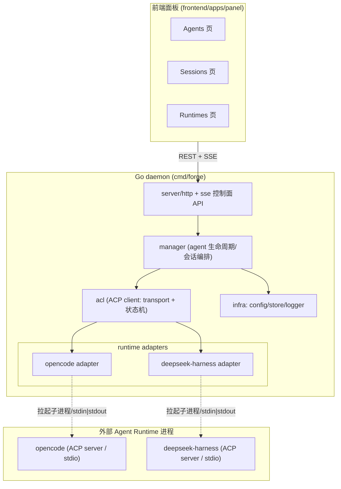

# ark-forge 架构设计

> 面向 Agent 应用开发的通用底座/平台（monorepo）：创建、运行、扩展与统一管理 Agent，
> 作为 ACP Host，经 stdio 连接 opencode 与 deepseek-harness 等多个 Agent Runtime。

## 1. 定位与目标

一款可自托管的 Agent 平台底座。与前缀 `ark-`（个人品牌标识象征）下的其他项目（如 `ark-iam`）共享品牌，
本项目是其中的「Agent 锻造所」，聚焦：

- **Create**：定义、注册、复用 Agent。
- **Run**：在统一控制面下跨越 Runtime 运行 Agent 会话。
- **Extend**：通过 ACP 协议接入多种 Runtime（首版：opencode、deepseek-harness）。
- **Manage**：生命周期、Registry、会话与配置的统一管理。

元定位：**是底座/平台，不是单纯的 Agent SDK**。核心差异化是靠统一协议（ACP）承载多个外部 Agent 运行时，
让用户在同一面板内切换与控制不同的底层 Agent。

## 2. 关键决策（已确认）

| 决策 | 结论 | 说明 |
|------|------|------|
| 仓库结构 | **monorepo** | 前后端在同一仓库 |
| 后端 | **Go** | daemon / 控制面 / ACP Host |
| 前端 | **TypeScript + Vite(React)** | 面板 |
| ACP 角色 | **Host（Client 侧）** | 拉起并连接 Agent 为 ACP server |
| ACP 协议版本 | **v1** | 稳定版；v2 为草案，暂不涉及 |
| 传输 | **stdio**（本地子进程） | 两 runtime 均原生 ACP server over stdio |
| ACP Client 实现 | **引入现有库 `github.com/coder/acp-go-sdk`** | 纯 Go、覆盖 client/server 侧；`internal/acl` 封装它并抽象兜底（见 §9） |
| Runtime 技术栈 | opencode（TS/Effect）、deepseek-harness（TS/Node） | 均为 Node 系；Go 后端**只拉其 ACP 子进程**，经 stdio 通信，**无语言/库耦合** |
| 交付 | 单二进制（前端经 `go:embed` 嵌入） | 前端构建产物经 `go:embed` 打入 Go 二进制 |

### 流式输出传输选型（控制面 → 面板）
流式会话有两段链路，传输选型需分开说明，避免混淆：

- **ACP 层（daemon ↔ agent）**：JSON-RPC over stdio，agent 以 **notification** 流式推送 token/thought/tool_call/message chunk。这层没有 HTTP 语义。
- **控制面层（daemon ↔ 前端面板）**：把上层的 ACP notification 转发给前端。**主流且首选是 SSE（Server-Sent Events）**，而非 WebSocket。

主流传真：

| 方案 | 场景 |
|------|------|
| **SSE**（`text/event-stream`，HTTP 单向流） | 服务器 → 客户端**单向流式**推送（token 流、事件、消息增量）；LLM 厂商侧（OpenAI/DeepSeek 等）本就是 SSE 事实标准 |
| **WebSocket**（全双工） | **双向**交互：命令上行 + 事件下行、协作广播、实时终端 PTY、低延迟密集消息 |

**设计决策**：
- 首版「流式会话」落点取 **SSE**：session/prompt 的结果用 `text/event-stream` 逐块推给面板。理由——这正是 SSE 的设计目标（单向流式、基于 HTTP、天然支持 chunked 与自动重连、对 HTTP/2/代理友好），也是 LLM 厂商的主流路径。
- WebSocket 不做首版标配，仅在出现**双向**需求时引入（如未来 PTY 实时终端、协作广播、控制信号上行）。
- 可在 `server` 内预留统一的事件订阅抽象，SSE 与（未来的）WS 都作为其输出适配器。

### SSE 会话事件流范式（内部设计基准）
首版 `internal/server/sse.go` 与 `internal/runtime` 的事件模型，遵循以下五条自主设计基准：

- **单一事件通道 + `type` 判别 union**：会话事件不进「每类型独立端点」，而是走**少数 SSE 端点**（按作用域/会话区分），载荷为一个判别字段 `type` 的 tagged union。避免为每种事件开端点。
- **可重放会话流（durable + `after` seq）**：会话事件流是「历史回放 + live 增量」双段流——先按 `seq > after` 读库回放历史，再订阅唤醒信号接 live 增量，wire 上携带 `durable:{aggregateID, seq, version}`。据此做**断线重连续传**。
- **live-only 增量 与 durable 终态 分离**：流式片段（token delta、thought delta）为 **live-only**、不进持久层；其语义终态（如 `Text.Ended`）才作为**可重放原子值**落库，与流式增量定义分离。避免全量增量入栈造成膨胀。
- **SSE 编排帧**：连接建立发 `server.connected`、周期 `server.heartbeat` 保活、销毁发 `server.instance.disposed`。
- **缓冲 + 断线续传（可选项）**：若需在 daemon 重启后保持流不丢，事件先落内存缓冲、客户端带 `after` 续传。首版可用内存缓冲，SSE 端点天然支持客户端重连后从 `after` 续拉。

### ACP 传输现状（为何首版只做 stdio）
ACP 官方 v1 传输：

- **stdio**：成熟、是 SHOULD 支持的标准，用 client 拉起 agent 子进程、stdin/stdout 走 JSON-RPC（`\n` 分隔、UTF-8）。
- **Streamable HTTP / WebSocket**：草案草稿阶段，适配远程/云场景。
- **自定义传输**：协议允许且 transport-agnostic。

opencode 与 deepseek-harness 都是本地子进程形态，走 stdio 是零摩擦标准路径。两者**均已将 ACP server 原生暴露在 stdio（NDJSON/JSON-RPC 分帧）**：

- **opencode**：以 `opencode acp` 子命令、`AgentSideConnection` + NDJSON stream 承载 ACP 连接。
- **deepseek-harness**：ACP server 由独立 bin `@deepseek-ai/dsh-acp-demo` 提供，以 NDJSON 流走 stdio；诊断必须走 stderr。

`internal/acl` 内部预留 `Transport` 抽象，未来若要接入远程 Agent 再补充 HTTP/WS 实现，首版不过度设计。

## 3. 技术栈选型

### 后端
- Go 1.26+，标准库为主；HTTP 用 `net/http`（控制面 REST + SSE 流式推送，首版负载小，暂不引入重型 Web 框架）。
- ACP Client：`github.com/coder/acp-go-sdk`。
- 持久化：`database/sql` + SQLite（agents、sessions、runtime 配置）；无外部中间件，契合自托管底座。

### 前端
- Vite + React + TS；UI 轻量（不绑定重型组件库）。
- 实时会话通过 SSE 消费后端转发的 ACP notification 流。

## 4. 架构总览



## 5. 目录结构（双层 monorepo）

本项目采用**双层 monorepo**：

- **Go 侧**：用 `go.work`（Workspace）管理多个独立 Go module，`internal/` 内每一层（acl / runtime / manager /
  server / infra）各自 `go.mod`，方便独立的 `acl` 等层对外复用。
- **前端侧**：`frontend/` 内部是独立的 pnpm workspace monorepo（apps + packages），与 Go 无 module 耦合。

```
ark-forge/
├── go.work                # Go workspace：union(acl, runtime, manager, server, infra, cmd/forge)
├── Makefile               # make server / make web / make all
│
├── cmd/
│   ├── forge/             # module: forge —— daemon 入口，依赖其余各 module
│   │   ├── main.go
│   │   └── go.mod
│   └── forge-cli/         # module: forge-cli（可选、二期）
│
├── internal/              # 每层一个独立 Go module（业务模块）
│   ├── acl/               # module: forge-acl —— ACP Host 接入层（可独立复用）
│   │   ├── go.mod
│   │   ├── transport.go   #   Transport 抽象（首版 StdioTransport）
│   │   ├── client.go      #   ACP client 句柄（封装 coder/acp-go-sdk）
│   │   └── request.go     #   请求/通知分发、会话生命周期辅助
│   ├── runtime/           # module: forge-runtime —— runtime adapter 层
│   │   ├── go.mod
│   │   ├── contracts.go   #   Runtime 统一接口
│   │   ├── registry.go    #   runtime 注册表（可插拔）
│   │   ├── opencode/      #   opencode adapter
│   │   └── deepseekharness/  # deepseek-harness adapter
│   ├── manager/           # module: forge-manager —— Agent 生命周期 + Registry
│   │   ├── go.mod
│   │   ├── agent.go
│   │   ├── lifecycle.go
│   │   └── session.go
│   ├── server/            # module: forge-server —— 控制面 API
│   │   ├── go.mod
│   │   ├── http.go        #   REST 端点
│   │   └── sse.go         #   SSE 流式推送（session/prompt 事件流）
│   └── infra/             # module: forge-infra —— 基础设施
│       ├── go.mod
│       ├── config/
│       ├── store/         #   SQLite
│       └── logger/
│
├── frontend/              # 前端 monorepo（pnpm workspace）
│   ├── pnpm-workspace.yaml
│   ├── package.json
│   ├── apps/
│   │   └── panel/         #   主面板（Vite + React + TS）
│   │       ├── dist/      #   构建产物，供后端 go:embed 嵌入
│   │       └── src/
│   │           ├── pages/ #   Agents / Sessions / Runtimes
│   │           └── api/
│   └── packages/          #   共享前端包（api client、ui 等）
│
├── docs/
│   └── architect-design.md # 本文件
├── LICENSE                # MIT（已就位）
└── README.md              # 中英简介（已就位）
```

### 前后端交付关系
`frontend/apps/panel` 构建产物（`dist/`）由 Go 侧通过 `go:embed` 打入最终二进制，产出单文件自托管底座。二者通过 **REST + SSE** 通信，不共享代码/依赖。

## 6. 模块职责与数据流

### 6.1 `internal/acl` — ACP Host 接入层
- `Transport` 接口：`Start(ctx) `、`Send`、`Read`、`Close`。首版仅 `StdioTransport`：拉起子进程，接入其 stdin/stdout（`\n` 分帧），stderr 透出为日志。
- `Client`：封装 `coder/acp-go-sdk` 的 client API，提供 `Initialize`、`NewSession`、`Prompt`、`Cancel`、`Close` 等高级方法；内部完成 ACP v1 版本协商与能力断言。
- 依赖方向：`internal/runtime` → 使用 `acl.Client`；`acl` 不依赖 `runtime`，保持可独立复用。

### 6.2 `internal/runtime` — Runtime adapter
- `Contracts` 定义统一接口，例如：
  ```go
  type Runtime interface {
      Name() string
      Start(ctx, spec Spec) (Session, error) // 拉起子进程 + ACP initialize
  }
  type Session interface {
      Prompt(ctx, PromptRequest) (PromptHandle, error)
      Cancel(ctx) error
      Close(ctx) error
  }
  ```
- `Registry`：`map[string]Factory`，注册 opencode / deepseekharness 两个工厂。
- `opencode/` 与 `deepseekharness/`：各自提供**命令名与启动参数**、**ACP 初始化能力断言**。

**两个 adapter 的启动形态（实现时按此落地）**：

| adapter | 命令/参数 | 说明 |
|---------|-----------|------|
| **opencode** | `opencode acp` | `opencode acp` 以 stdio NDJSON 承载 ACP server；`initialize` 能力完整——`loadSession`、`promptCapabilities{embeddedContext, image}`、`sessionCapabilities{close, fork, list, resume}`、`mcpCapabilities{http, sse}` |
| **deepseek-harness** | `dsh-acp-demo --config <cordis.yml>` | 独立 bin `@deepseek-ai/dsh-acp-demo`（非 `dsh` 子命令）；stdio NDJSON；**需注入子进程自己的 `DEEPSEEK_API_KEY`**；`cordis.yml` 需含 provider/model/workspaceContext 的 acp 组合配置 |

**能力不对称（关键）**：两 runtime 的 ACP 能力并不对等，adapter 必须在 `initialize` 阶段**断言各自能力、据此裁剪 `Session` 接口语义**：

- **opencode**：能力全——支持 `loadSession`/`list`/`resume`/`fork`/`close`、多会话并发。
- **deepseek-harness**：能力受限——**仅 fresh session**（不支持 load/list/resume/fork/delete）；`authMethods:[]`、`audio:false`、`embeddedContext:false`、image 仅当精确 provider/model 支持才启用；**同一连接的会话在连接断开时全部释放**，需在 daemon 的会话映射中处理「断连即失效」。

所以 `Session` 接口不能假设所有 runtime 支持持久会话；`deepseekharness` adapter 将 `loadSession`、`resume` 等方法返回「不支持」，由 `manager` 层向下兼容（见 §6.3）。

### 6.3 `internal/manager` — 生命周期与编排
- `Agent` 模型：`{ ID, Name, Runtime, Config, State }`。
- 生命周期状态机：`created → running → paused → stopped`，由 `lifecycle.go` 驱动。
- `Session`：把对 Agent 的一次会话编排为「ACP 连接 → session/new → prompt → 流式事件 → cancel/close」，是**流式数据的主要来源**。

**会话/Run 状态机与 Agent 定义/发布**：

- **会话执行（Run）状态机**：一次 prompt 的执行建模为 `RunStatus`（`created → in_progress → completed / failed / cancelled / required_action`），提供 `StepToComplete`/`StepToFailed` 流转。区别于 Agent 的长期状态机（created/running/paused/stopped），Run 是一次对话的执行态。
- **Agent 定义 vs 运行时 vs 发布分离**：Agent 定义（`Agent` 模型）/运行时（`internal/runtime` adapter）/会话（`Session`）三者解耦；Agent 支持**草稿 → 发布（draft → release）**二元态与版本管理，首版可只保留创建即发布的简化版。
- **会话事件流走「单一通道 + type 判别」**：manager 产出的会话事件（token delta、thought、tool_call、message chunk、终态）统一走一条**进程内事件流**（`internal/acl` 订阅 ACP notification → 归一化 → manager 事件），由 `internal/server` 以单 SSE 通道转发，前端按 `type` 判别处理（见 §2「SSE 会话事件流范式」）；流式增量 live-only、终态持久化，支持 `after` 续传。

### 6.4 `internal/server` — 控制面 API
- REST：管理类操作（列/创建 Agent、列 Runtime、启停、列会话）。
- SSE：**流式会话**优先落地——前端发起 prompt，daemon 将 ACP 的 notification（token 块、thought、tool_call、message chunk）以 `text/event-stream` 实时推给前端。这是首版的第一优先级能力。
- **单一 SSE 通道 + 编排帧**：会话事件流沿用 §2 范式——单端点、`type` 判别 union、`server.connected`/`server.heartbeat`/`server.instance.disposed` 编排帧。
- **断线续传（可选）**：事件先写进 `processEventStream` 缓冲（首版内存实现），前端重连后以 `after=seq` 续拉历史再继续 live。

### 6.5 `frontend/` — 前端 monorepo
- `apps/panel`：Sessions 页为主（输入 → SSE 流式出结果）；Agents 页、Runtimes 页为辅。

## 7. 首版范围（MVP）

| 模块 | 首版包含 | 首版不包含 |
|------|----------|-----------|
| ACP 接入 | stdio 拉起 + v1 协商 + 会话 CRUD + prompt 流式 | HTTP/WS 远程传输、v2、认证流程 |
| Runtime | opencode、deepseek-harness 两个 adapter | 更多 runtime |
| 管理 | 创建/启停/销毁、会话列表、runtime 列表 | 权限/审计、多用户、RBAC |
| 前端 | Sessions 流式页 + Agents 列表 + Runtimes 列表 | 复杂编排画布、多语言 |
| 扩展 | 无（不实现 MCP-append） | MCP、插件系统、skill |

**MVP 内两 runtime 能力不对称的处理**：opencode 支持 load/resume/fork，deepseek-harness **仅支持新鲜会话且断连即释放**。MVP 明确：

- 会话列表以 **opencode 为完整能力基线**（可列出、可续推进）；deepseek-harness 的会话列表只反映「本次连接存活期间新建的新鲜会话」，`resume`/`fork` 在 harness adapter 返回「不支持」，前端对 harness 禁用「续谈/派生」入口。
- 跨 runtime 切换的冒烟验证（§8）以**同一 prompt 分别跑通两 runtime 的 fresh session** 为准，不断言 harness 支持持久会话。

## 8. 验证方式（实现后执行）

- `go build ./...` && `go vet ./...` && `go test ./...`
- `cd web && pnpm build`
- `make all`：产出单二进制，`go run ./cmd/forge` 拉起。
- 手工冒烟：配置一个 runtime（如已安装 opencode），`ark-forge` 拉起其 ACP server，经面板发送 prompt，观察 SSE 流式回包；再切换 deepseek-harness（`dsh-acp-demo --config <cordis.yml>`，注入 `DEEPSEEK_API_KEY`）验证跨 runtime 可切换，注意 harness 仅支持新鲜会话。

## 9. 待办 / 风险

- `coder/acp-go-sdk` 对 **client 侧完整度**需实现阶段验证；若某方法缺口，由 `internal/acl` 抽象兜底（自写该点）。
- opencode / harness 的 ACP 启动命令已在上文确认（`opencode acp` / `dsh-acp-demo --config <cordis.yml>`）；实现时以各自仓库最新文档为准，写入各 adapter（`cordis.yml` 的 provider/model/workspaceContext 组合、`DEEPSEEK_API_KEY` 注入）。
- deepseek-harness 迭代快、接口**可能出现与文档不符的 breaking change**（其 README 明示开发期兼容性会破坏）；adapter 需对 harness 的 `initialize` 能力断言做**运行时探测 + 降级**。
- ACP 协议版本在 init 阶段协商；若某 runtime 仅支持更新版本，需在 adapter 声明及降级策略中处理。
