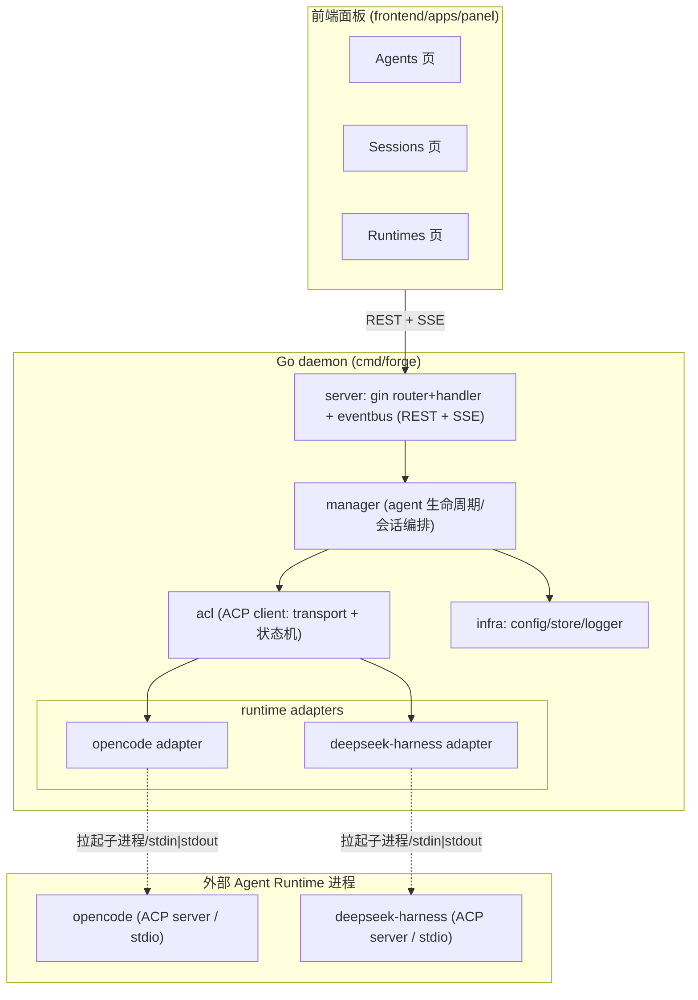

# ark-forge 架构设计

> 面向 Agent 应用开发的通用底座/平台（monorepo）：创建、运行、扩展与统一管理 Agent，
> 作为 ACP Host，经 stdio 连接 opencode 与 deepseek-harness 等多个 Agent Runtime。

> **决策更新（见 [design-and-roadmap.md](./design-and-roadmap.md) §0「决策变更 v2」）**：
> ① 控制面 → 面板的实时传输由「SSE 首选、WS 仅双向需求时引入」调整为 **仅 WebSocket（不设 SSE 出口）**：
>    REST 命令 + WS 事件推送（attach/快照/重放协议）；脚手架期遗留的 SSE 端点/适配器代码随 M0 移除。
>    事件流五条范式不变，仅换载体。
> ② 产品定位收敛为**一次会话/一次运行指定一个 Agent Runtime，无跨 agent 协作**（多 runtime = 注册表 +
>    按会话选择切换）。本文档后续章节中与上述冲突的表述（如 SSE 首选、跨 runtime 编排）以该更新为准。
> ③ **deepseek-harness 启动形态勘误**：本文档 §2/§6.2/§7 所述 `dsh-acp-demo --config <cordis.yml>`
>    已随上游演进废弃，现为统一启动器 `dsh --profile acp`（会话可持久化 list/resume/close、无 load/fork），
>    以 [design-and-roadmap.md](./design-and-roadmap.md) 与
>    [deepseekharness-acp-adaptation.md](./deepseekharness-acp-adaptation.md) 为准。
> ④ **定位边界（决策 v3，见 [design-and-roadmap.md](./design-and-roadmap.md) 文首「决策变更 v3」）**：
>    **能力不重造**——skills/MCP 等运行时能力复用底层 runtime 原生实现，本项目只做其数据/配置管理层
>    （会话、skill、MCP 数据统一管理）；**单机单操作员**——不做多人协作/多用户鉴权/远程聊天通道，
>    M3 的「基础鉴权与多用户」取消。本文档与 roadmap 中与 v3 冲突的表述以 v3 为准。
> ⑤ **管理面范围校准（决策 v4，见 roadmap 文首「决策变更 v4」）**：参照应用型 Agent 工作台 AionUi，
>    把「数据/配置管理层」做厚——M2 增权限策略数据位、M3 增会话数据管理面（分组/归档/搜索/导出）与
>    usage 快照粒度、P1+/P2 冻结 cron/MCP/skills 数据契约（详见 roadmap §5.8 与对应里程碑）。
> ⑥ **WS 载荷契约校准（决策 v5，见 roadmap 文首「决策变更 v5」）**：传输层（seq/agg/attach/重放）不动；
>    载荷层增可选 `msg_id`（消息分组键）与工具 `kind/input/output`、usage 载荷字段化、预留
>    `session.permission_request`/`session.runtime`（M2 发布），前端补 seq 幂等去重（roadmap §4.5 载荷契约）。
> ⑦ **面板「发起问答」交互校准（决策 v6，见 roadmap 文首「决策变更 v6」）**：会话绑底座不可中途换维持
>    现状（与 AionUi 同构）；新建会话 = 整页 `/new`（无弹窗；hero + 助手胶囊条 + 内嵌输入卡[模型 pill
>    只读 + 发送] + 示例指令，对照 AionUi /guid）；首轮前明示「模型 = 底座自身默认」，面板不设模型选择器
>    （opencode ACP 忽略客户端模型选择，issue #13644；模型只经 runtime 自身配置/启动环境注入）。
>    详见 roadmap §5.8 与决策 v6。

## 1. 定位与目标

一款可自托管的 Agent 平台底座。与前缀 `ark-`（个人品牌标识象征）下的其他项目（如 `ark-iam`）共享品牌，
本项目是其中的「Agent 锻造所」，聚焦：

- **Create**：定义、注册、复用 Agent。
- **Run**：在统一控制面下跨越 Runtime 运行 Agent 会话。
- **Extend**：通过 ACP 协议接入多种 Runtime（首版：opencode、deepseek-harness）。
- **Manage**：生命周期、Registry、会话与配置的统一管理。

元定位：**是底座/平台，不是单纯的 Agent SDK**。核心差异化是靠统一协议（ACP）承载多个外部 Agent 运行时，
让用户在同一面板内切换与控制不同的底层 Agent。

定位边界（与 [design-and-roadmap.md](./design-and-roadmap.md) 文首「决策变更 v3」一致）：
- **能力不重造**：skills/MCP/推理等执行能力直接复用底层 runtime 原生实现，本项目不做运行时功能；
- **数据管理是平台职责**：统一管理会话数据（wire transcript/历史）、skill 数据、MCP 服务器数据；
- **单机单操作员**：不做多人协作、多用户鉴权与远程聊天通道。

## 2. 关键决策（已确认）

| 决策 | 结论 | 说明 |
|------|------|------|
| 仓库结构 | **monorepo** | 前后端在同一仓库 |
| 后端 module 粒度 | **单 module**（`backend/`，`github.com/morehao/ark-forge`）+ `internal/` 分层目录 | 抽离公共逻辑用「包」即可，无需 module；层目录保留 seam，待出现跨项目复用/独立版本化需求时再按层抽独立 module/仓（演进见 §5） |
| 后端 | **Go** | daemon / 控制面 / ACP Host |
| 前端 | **TypeScript + Vite(React)** | 面板 |
| ACP 角色 | **Host（Client 侧）** | 拉起并连接 Agent 为 ACP server |
| ACP 协议版本 | **v1** | 稳定版；v2 为草案，暂不涉及 |
| 传输 | **stdio**（本地子进程） | 两 runtime 均原生 ACP server over stdio |
| ACP Client 实现 | **引入现有库 `github.com/coder/acp-go-sdk`** | 纯 Go、覆盖 client/server 侧；`internal/acl` 封装它并抽象兜底（见 §9） |
| Runtime 技术栈 | opencode（TS/Effect）、deepseek-harness（TS/Node） | 均为 Node 系；Go 后端**只拉其 ACP 子进程**，经 stdio 通信，**无语言/库耦合** |
| 交付 | 单二进制（前端经 `go:embed` 嵌入）；前端产物亦可独立部署 | `make web` 将前端构建产物拷入 `backend/pkg/web/dist`，`-tags release` 下经 `//go:embed` 打入 Go 二进制；独立部署则直接托管 `frontend/apps/panel/dist` |

### 流式输出传输选型（控制面 → 面板）
流式会话有两段链路，传输选型需分开说明，避免混淆：

- **ACP 层（daemon ↔ agent）**：JSON-RPC over stdio，agent 以 **notification** 流式推送 token/thought/tool_call/message chunk。这层没有 HTTP 语义。
- **控制面层（daemon ↔ 前端面板）**：把上层的 ACP notification 转发给前端。**主流且首选是 SSE（Server-Sent Events）**，而非 WebSocket。

主流传真：

| 方案 | 场景 |
|------|------|
| **SSE**（`text/event-stream`，HTTP 单向流） | 服务器 → 客户端**单向流式**推送（token 流、事件、消息增量）；LLM 厂商侧（OpenAI/DeepSeek 等）本就是 SSE 事实标准 |
| **WebSocket**（全双工） | **双向**交互：命令上行 + 事件下行、协作广播、实时终端 PTY、低延迟密集消息 |

**设计决策**：
- 首版「流式会话」落点取 **SSE**：session/prompt 的结果用 `text/event-stream` 逐块推给面板。理由——这正是 SSE 的设计目标（单向流式、基于 HTTP、天然支持 chunked 与自动重连、对 HTTP/2/代理友好），也是 LLM 厂商的主流路径。
- WebSocket 不做首版标配，仅在出现**双向**需求时引入（如未来 PTY 实时终端、协作广播、控制信号上行）。
- 可在 `server` 内预留统一的事件订阅抽象，SSE 与（未来的）WS 都作为其输出适配器。

### SSE 会话事件流范式（内部设计基准）
首版 `internal/server/sse.go` 与 `internal/runtime` 的事件模型，遵循以下五条自主设计基准：

- **单一事件通道 + `type` 判别 union**：会话事件不进「每类型独立端点」，而是走**少数 SSE 端点**（按作用域/会话区分），载荷为一个判别字段 `type` 的 tagged union。避免为每种事件开端点。
- **可重放会话流（durable + `after` seq）**：会话事件流是「历史回放 + live 增量」双段流——先按 `seq > after` 读库回放历史，再订阅唤醒信号接 live 增量，wire 上携带 `durable:{aggregateID, seq, version}`。据此做**断线重连续传**。
- **live-only 增量 与 durable 终态 分离**：流式片段（token delta、thought delta）为 **live-only**、不进持久层；其语义终态（如 `Text.Ended`）才作为**可重放原子值**落库，与流式增量定义分离。避免全量增量入栈造成膨胀。
- **SSE 编排帧**：连接建立发 `server.connected`、周期 `server.heartbeat` 保活、销毁发 `server.instance.disposed`。
- **缓冲 + 断线续传（可选项）**：若需在 daemon 重启后保持流不丢，事件先落内存缓冲、客户端带 `after` 续传。首版可用内存缓冲，SSE 端点天然支持客户端重连后从 `after` 续拉。

### ACP 传输现状（为何首版只做 stdio）
ACP 官方 v1 传输：

- **stdio**：成熟、是 SHOULD 支持的标准，用 client 拉起 agent 子进程、stdin/stdout 走 JSON-RPC（`\n` 分隔、UTF-8）。
- **Streamable HTTP / WebSocket**：草案草稿阶段，适配远程/云场景。
- **自定义传输**：协议允许且 transport-agnostic。

opencode 与 deepseek-harness 都是本地子进程形态，走 stdio 是零摩擦标准路径。两者**均已将 ACP server 原生暴露在 stdio（NDJSON/JSON-RPC 分帧）**：

- **opencode**：以 `opencode acp` 子命令、`AgentSideConnection` + NDJSON stream 承载 ACP 连接。
- **deepseek-harness**：ACP server 由独立 bin `@deepseek-ai/dsh-acp-demo` 提供，以 NDJSON 流走 stdio；诊断必须走 stderr。

`internal/acl` 内部预留 `Transport` 抽象，未来若要接入远程 Agent 再补充 HTTP/WS 实现，首版不过度设计。

## 3. 技术栈选型

### 后端
- Go 1.26+；HTTP 用 **Gin**（`github.com/gin-gonic/gin`）承载控制面 REST + SSE。**按需引用 `github.com/morehao/golib`**（作者自研库）：`glog`（zap 日志）、`biz/gcontext/gincontext`（`Success/Fail` 响应封装 + requestID）、`biz/gserver/ginserver`（版本化路由分组 `/{version}/{appName}`，自动挂 otelgin + AccessLog）。golib 的 go.mod 虽整体 require AWS/ES/Redis/GORM/OTel，但 Go 仅编译实际 import 的子包，不影响运行时加载。
- 状态：`internal/server` 为起始层（mock 冒烟可用），其余各层（acl/runtime/manager/infra）为占位骨架，`internal/web` 为 embed 宿主骨架，后续按 §5 落地。
- ACP Client：`github.com/coder/acp-go-sdk`。
- 持久化：`database/sql` + SQLite（agents、sessions、runtime 配置）；无外部中间件，契合自托管底座。

### 前端
- Vite + React + TS；UI 轻量（不绑定重型组件库）。
- 实时会话通过 SSE 消费后端转发的 ACP notification 流。

## 4. 架构总览



## 5. 目录结构（同仓：backend/ 单 Go module + frontend/ pnpm workspace）

> **现状（2026-09 结构重构后）**：本节以下的目录树与 §6 的层描述是**设计期记录**（当时还规划过
> `forge-cli`、`server/sse.go`、`server/handler/mock.go` 等，均未落地或用别的方式落地）。
> 当前实际分层以 **README「仓库结构」与 `AGENTS.md`「布局与目录边界」为准**，要点：
>
> - **`pkg/` 与 `internal/` 二分**（对齐 ark-iam）：`acl` / `runtime` / `mcp` / `capability` /
>   `routing` / `config` / `procreg` / `web` / `object/objusage` 已从 `internal/` 上提到 `pkg/`——
>   这正是本节下文「演进」里触发 ①「某层要被本仓之外的项目 import」的**落地动作**，`internal/`
>   的可见性边界不再需要为可复用层兜底，改由目录位置直接表达。
> - 应用侧分层：`internal/app`（装配 + 生命周期）→ `internal/router`（唯一路由装配点）→
>   `internal/controller/ctr<领域>`（传输层）→ `internal/service/svc<领域>`（领域端口）←
>   `internal/manager`（领域实现）；`internal/dto/dto<领域>` 被两侧共用。
> - 四条依赖边界（`pkg` 不依赖 `internal`、`dto`/`service` 不依赖传输与实现、`store`/`eventbus`
>   不依赖应用层、`controller` 只依赖端口）由 `backend/internal/archtest` 的守卫测试强制，
>   替代了本节末尾提到的 "用 golangci-lint depguard 在 CI 强制" 的备选方案。
> - 单 module 决策**未变**（触发 ②/③ 仍未出现）。

本项目采用**前后端平级 monorepo**（`backend/` 与 `frontend/` 同仓平级）：

- **后端侧**：单 module `github.com/morehao/ark-forge`（`go.mod` 位于 `backend/` 根，依赖统一收敛于单一
  go.mod/go.sum），`internal/` 下每层（acl / runtime / manager / server / infra / web）是一个**普通包目录**；
  Go 的 `internal/` 可见性保证仅本仓可 import，形成天然的分层边界，跨层 import 方向靠目录约定保证。
- **前端侧**：`frontend/` 是独立的 pnpm workspace monorepo（apps + packages），与 Go 无 module 耦合；因其产物
  可单独部署/运行，可视作仓库内自足的独立子项目（双宿主说明见文末「前后端交付关系」）。

**演进：保留多 module / 独立仓可能性**。抽离公共逻辑用「包」就够（单 module 内建共享包即可被各层复用）；
module / 独立仓解决的是**跨项目共享 + 独立版本/发布**。`internal/` 的层目录即 seam——当某层出现以下任一触发
条件时，将其抽为独立 Go module；若需对外复用则移出 `internal/`（对齐 golib / ark-iam 惯例做独立仓），
本地多仓联调时再在仓库根临时加 `go.work`：

- 触发 ①：某层要被**本仓之外的项目 import**（如 `acl` 作为 ACP Host 库对外发布）；
- 触发 ②：某层需要**独立版本/发布节奏**（独立 tag / 独立 CI）；
- 触发 ③：某层需要**依赖隔离**（如对外库不希望把 gin/golib 的依赖树带给消费者）。

当前阶段（代码总量小、各层多为占位）不具备任一触发条件，故收敛单 module，避免为空壳层付逐 module
构建/tidy 的持续摩擦；需要约束跨层 import 方向时，用 golangci-lint 的 `depguard` 在 CI 强制即可。

```
ark-forge/
├── Makefile               # 根编排入口：make web / make server / make build|vet|test / make all
├── docs/
│   └── architect-design.md # 本文件
├── LICENSE                # MIT（已就位）
├── README.md              # 中英简介（已就位）
│
├── backend/               # 后端：单 Go module（github.com/morehao/ark-forge）
│   ├── go.mod             #   依赖统一收敛于此（gin/golib；单一 go.sum）
│   ├── go.sum
│   ├── cmd/
│   │   ├── forge/         #   daemon 入口（main）
│   │   │   └── main.go
│   │   └── forge-cli/     #   可选、二期
│   │
│   └── internal/          # 分层目录即包边界（Go internal：仅本仓可 import；目录即未来抽离的 seam）
│       ├── acl/           #   ACP Host 接入层（封装 coder/acp-go-sdk；候选抽离层，见上文「演进」）
│       │   ├── transport.go   #   Transport 抽象（首版 StdioTransport）
│       │   ├── client.go      #   ACP client 句柄（封装 coder/acp-go-sdk）
│       │   └── request.go     #   请求/通知分发、会话生命周期辅助
│       ├── runtime/       #   runtime adapter 层
│       │   ├── contracts.go   #   Runtime 统一接口
│       │   ├── registry.go    #   runtime 注册表（可插拔）
│       │   ├── opencode/      #   opencode adapter
│       │   └── deepseekharness/  # deepseek-harness adapter
│       ├── manager/       #   Agent 生命周期 + Registry
│       │   ├── agent.go
│       │   ├── lifecycle.go
│       │   └── session.go
│       ├── server/        #   控制面 API（Gin + golib 按需引用）
│       │   ├── server.go      #   Server 生命周期（Start/Stop），组装 handler+router
│       │   ├── router/        #   路由注册：ginserver 版本分组 /{v1}/{forge}，挂 REST+SSE
│       │   │   └── router.go
│       │   ├── handler/       #   各功能 handler（响应用 gincontext.Success/Fail）
│       │   │   ├── handler.go #   Service 接口 + Handler 聚合（注入 eventbus）
│       │   │   ├── agent.go   #   agents 列表
│       │   │   ├── session.go #   sessions 列表
│       │   │   ├── runtime.go #   runtimes 列表
│       │   │   ├── sse.go     #   SSE 薄适配层：订阅 eventbus → 转发帧 + 编排帧
│       │   │   └── mock.go    #   mock Service 占位（manager 实现前可独立冒烟）
│       │   └── eventbus/      #   会话事件总线（单一通道 + after 续传，见 §2）
│       │       └── bus.go     #   Publish/Subscribe/Unsubscribe/LastSeq + history 缓冲
│       ├── infra/         #   基础设施
│       │   ├── config/
│       │   ├── store/     #   SQLite
│       │   └── logger/
│       └── web/           #   前端产物 go:embed 宿主（release 编译）
│           ├── doc.go     #   包说明：产物来源 / 编译形态 / 三种运行形态
│           ├── web.go     #   //go:build release；//go:embed dist
│           └── dist/      #   make web 从 frontend 拷贝的产物副本（不入库，见 .gitignore）
│
├── frontend/              # 前端 monorepo（pnpm workspace；可独立部署/单独运行）
│   ├── pnpm-workspace.yaml
│   ├── package.json
│   ├── apps/
│   │   └── panel/         #   主面板（Vite + React + TS）
│   │       ├── dist/      #   构建产物（唯一真源）：供独立部署；make web 拷入 backend/pkg/web/dist
│   │       └── src/
│   │           ├── pages/ #   Agents / Sessions / Runtimes
│   │           └── api/
│   └── packages/          #   共享前端包（api client、ui 等）
```

### 前后端交付关系（embed + 独立部署双宿主）
`frontend/apps/panel` 构建产物（`dist/`）是**唯一真源**，支持两种宿主：

1. **单二进制（默认交付）**：`make web` 把 `dist/` 拷入 `backend/pkg/web/dist`（该副本不入库），
   `make all` 以 `-tags release` 编译，`web` 包经 `//go:embed dist` 把前端打入最终二进制，产出根目录 `./forge`。
2. **前端独立部署/运行**：直接托管 `frontend/apps/panel/dist`（nginx 等任意静态宿主，配 SPA fallback）；
   开发期跑 `pnpm dev` + vite proxy（`/v1 → :8099`）联调。独立形态下前端 API base 可配置（`VITE_API_BASE`），
   跨域时后端按需开 CORS。

默认（不带 release tag）的 `go build` 不编译 `web` 包，后端可独立起服冒烟，不受前端产物有无影响。
二者通过 **REST + SSE** 通信，不共享代码/依赖。

## 6. 模块职责与数据流

### 6.1 `internal/acl` — ACP Host 接入层
- `Transport` 接口：`Start(ctx) `、`Send`、`Read`、`Close`。首版仅 `StdioTransport`：拉起子进程，接入其 stdin/stdout（`\n` 分帧），stderr 透出为日志。
- `Client`：封装 `coder/acp-go-sdk` 的 client API，提供 `Initialize`、`NewSession`、`Prompt`、`Cancel`、`Close` 等高级方法；内部完成 ACP v1 版本协商与能力断言。
- 依赖方向：`internal/runtime` → 使用 `acl.Client`；`acl` 不依赖 `runtime`，保持单向依赖与接口自洽——对外复用时按 §5 演进将其抽为独立 module/仓。

### 6.2 `internal/runtime` — Runtime adapter
- `Contracts` 定义统一接口，例如：
  ```go
  type Runtime interface {
      Name() string
      Start(ctx, spec Spec) (Session, error) // 拉起子进程 + ACP initialize
  }
  type Session interface {
      Prompt(ctx, PromptRequest) (PromptHandle, error)
      Cancel(ctx) error
      Close(ctx) error
  }
  ```
- `Registry`：`map[string]Factory`，注册 opencode / deepseekharness 两个工厂。
- `opencode/` 与 `deepseekharness/`：各自提供**命令名与启动参数**、**ACP 初始化能力断言**。

**两个 adapter 的启动形态（实现时按此落地）**：

| adapter | 命令/参数 | 说明 |
|---------|-----------|------|
| **opencode** | `opencode acp` | `opencode acp` 以 stdio NDJSON 承载 ACP server；`initialize` 能力完整——`loadSession`、`promptCapabilities{embeddedContext, image}`、`sessionCapabilities{close, fork, list, resume}`、`mcpCapabilities{http, sse}` |
| **deepseek-harness** | `dsh-acp-demo --config <cordis.yml>` | 独立 bin `@deepseek-ai/dsh-acp-demo`（非 `dsh` 子命令）；stdio NDJSON；**需注入子进程自己的 `DEEPSEEK_API_KEY`**；`cordis.yml` 需含 provider/model/workspaceContext 的 acp 组合配置 |

**能力不对称（关键）**：两 runtime 的 ACP 能力并不对等，adapter 必须在 `initialize` 阶段**断言各自能力、据此裁剪 `Session` 接口语义**：

- **opencode**：能力全——支持 `loadSession`/`list`/`resume`/`fork`/`close`、多会话并发。
- **deepseek-harness**：能力受限——**仅 fresh session**（不支持 load/list/resume/fork/delete）；`authMethods:[]`、`audio:false`、`embeddedContext:false`、image 仅当精确 provider/model 支持才启用；**同一连接的会话在连接断开时全部释放**，需在 daemon 的会话映射中处理「断连即失效」。

所以 `Session` 接口不能假设所有 runtime 支持持久会话；`deepseekharness` adapter 将 `loadSession`、`resume` 等方法返回「不支持」，由 `manager` 层向下兼容（见 §6.3）。

### 6.3 `internal/manager` — 生命周期与编排
- `Agent` 模型：`{ ID, Name, Runtime, Config, State }`。
- 生命周期状态机：`created → running → paused → stopped`，由 `lifecycle.go` 驱动。
- `Session`：把对 Agent 的一次会话编排为「ACP 连接 → session/new → prompt → 流式事件 → cancel/close」，是**流式数据的主要来源**。

**会话/Run 状态机与 Agent 定义/发布**：

- **会话执行（Run）状态机**：一次 prompt 的执行建模为 `RunStatus`（`created → in_progress → completed / failed / cancelled / required_action`），提供 `StepToComplete`/`StepToFailed` 流转。区别于 Agent 的长期状态机（created/running/paused/stopped），Run 是一次对话的执行态。
- **Agent 定义 vs 运行时 vs 发布分离**：Agent 定义（`Agent` 模型）/运行时（`internal/runtime` adapter）/会话（`Session`）三者解耦；Agent 支持**草稿 → 发布（draft → release）**二元态与版本管理，首版可只保留创建即发布的简化版。
- **会话事件流走「单一通道 + type 判别」**：manager 产出的会话事件（token delta、thought、tool_call、message chunk、终态）统一走一条**进程内事件流**（`internal/acl` 订阅 ACP notification → 归一化 → manager 事件），由 `internal/server` 以单 SSE 通道转发，前端按 `type` 判别处理（见 §2「SSE 会话事件流范式」）；流式增量 live-only、终态持久化，支持 `after` 续传。

### 6.4 `internal/server` — 控制面 API
- 用 **Gin + golib按需引用**组织：`router/` 用 `ginserver` 版本分组（`/{v1}/{forge}`，自动挂 otelgin + AccessLog）；`handler/` 按功能实现各处理函数，响应封装统一用 `gincontext` 的 `Success/Fail`（`{code, requestID, msg, data}`）。
- REST：管理类操作（列/创建 Agent、列 Runtime、启停、列会话）。
- **SSE：事件总线 + 薄适配层（合理性优先的重新设计）**。会话事件不内联在 controller，而是抽独立 **`eventbus`** 层（单一事件通道）承载：
  - `eventbus.Bus`：`Publish(type, aggID, version, payload)` 分配全局递增 `seq`、写入内存历史缓冲、广播给订阅者；`Subscribe(after)` **先按 `seq > after` 同步回放历史、再收 live 增量**；`Unsubscribe` 释放；`LastSeq` 供 heartbeat 标注位置。
  - `handler/sse.go` 只做**协议薄适配**：订阅 `eventbus` → 把每个事件转成标准 `text/event-stream` 帧（`id: <seq>` + `event: <type>` + `data: {type,seq,agg_id,version,payload}`），叠加 `server.connected`/`server.heartbeat` 编排帧；`after` 从 query 或 `Last-Event-ID` 读取实现断线续传。业务与协议解耦：后续 manager 把归一化的 ACP notification 事件 `Publish` 进总线即可，SSE 无需感知域变化。
- **单一 SSE 通道 + 编排帧**：单端点 `/v1/forge/sse/stream`、`type` 判别 union、`server.connected`/`server.heartbeat` 编排帧（`server.instance.disposed` 预留）。
- **断线续传**：`eventbus` 的 history 缓冲即首版内存缓冲，前端重连带 `after=seq` 续拉历史再继续 live。

### 6.5 `frontend/` — 前端 monorepo
- `apps/panel`：Sessions 页为主（输入 → SSE 流式出结果）；Agents 页、Runtimes 页为辅。

## 7. 首版范围（MVP）

| 模块 | 首版包含 | 首版不包含 |
|------|----------|-----------|
| ACP 接入 | stdio 拉起 + v1 协商 + 会话 CRUD + prompt 流式 | HTTP/WS 远程传输、v2、认证流程 |
| Runtime | opencode、deepseek-harness 两个 adapter | 更多 runtime |
| 管理 | 创建/启停/销毁、会话列表、runtime 列表 | 权限/审计、多用户、RBAC |
| 前端 | Sessions 流式页 + Agents 列表 + Runtimes 列表 | 复杂编排画布、多语言 |
| 扩展 | 无（不实现 MCP-append） | MCP、插件系统、skill |

**MVP 内两 runtime 能力不对称的处理**：opencode 支持 load/resume/fork，deepseek-harness **仅支持新鲜会话且断连即释放**。MVP 明确：

- 会话列表以 **opencode 为完整能力基线**（可列出、可续推进）；deepseek-harness 的会话列表只反映「本次连接存活期间新建的新鲜会话」，`resume`/`fork` 在 harness adapter 返回「不支持」，前端对 harness 禁用「续谈/派生」入口。
- 跨 runtime 切换的冒烟验证（§8）以**同一 prompt 分别跑通两 runtime 的 fresh session** 为准，不断言 harness 支持持久会话。

## 8. 验证方式（实现后执行）

- `make build` && `make vet` && `make test`：即 `cd backend && go build/vet/test ./...`（单 module，覆盖全部包）。
- `make web`（仓库根实现，对应原 `cd web && pnpm build`）：构建前端并刷新 `backend/pkg/web/dist`。
- `make server`：`go run ./cmd/forge` 拉起后端（开发联调，不起前端）。
- `make all`：产出仓库根单二进制 `./forge`（`-tags release` 内嵌前端）；`./forge` 拉起后冒烟。
- 手工冒烟：配置一个 runtime（如已安装 opencode），`ark-forge` 拉起其 ACP server，经面板发送 prompt，观察 SSE 流式回包；再切换 deepseek-harness（`dsh-acp-demo --config <cordis.yml>`，注入 `DEEPSEEK_API_KEY`）验证跨 runtime 可切换，注意 harness 仅支持新鲜会话。

## 9. 待办 / 风险

- `coder/acp-go-sdk` 对 **client 侧完整度**需实现阶段验证；若某方法缺口，由 `internal/acl` 抽象兜底（自写该点）。
- opencode / harness 的 ACP 启动命令已在上文确认（`opencode acp` / `dsh-acp-demo --config <cordis.yml>`）；实现时以各自仓库最新文档为准，写入各 adapter（`cordis.yml` 的 provider/model/workspaceContext 组合、`DEEPSEEK_API_KEY` 注入）。
- deepseek-harness 迭代快、接口**可能出现与文档不符的 breaking change**（其 README 明示开发期兼容性会破坏）；adapter 需对 harness 的 `initialize` 能力断言做**运行时探测 + 降级**。
- ACP 协议版本在 init 阶段协商；若某 runtime 仅支持更新版本，需在 adapter 声明及降级策略中处理。
