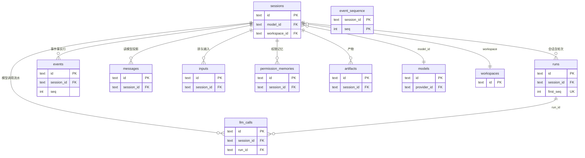
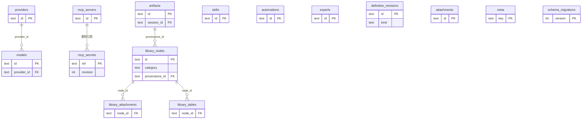
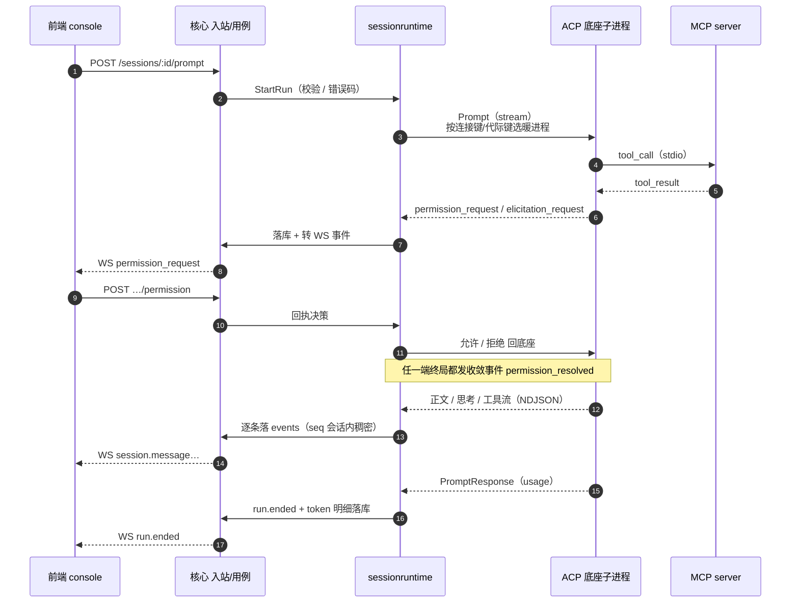

# ark-mate 架构总览

> **读者**：第一天接手本仓的人。本文只描述**当前有效**的结构事实，不记录设计过程、不写历史沿革。
> 纪律条文、目录边界与全部机器判据的权威表述在仓库根 **`AGENTS.md`** 及其分册 **`docs/agents/`**（纪律正文见 `docs/agents/layout.md`，机器判据清单见 `docs/agents/guards.md`）；两者的分工见第 10 节。
>
> **最后对齐：2026-11-09**（对齐提交 `5d921727` 及之前的当前实现；schema 39 / 24 表 / 27 事件类 / 196 条守卫 / 平台不做鉴权）。代码与本文冲突时**以代码为准**——本文是地图，不是契约。

本文配 5 张代码核实的图（2026-11-09 重画），每张只讲一件事，各自嵌在对应章节：

| 图 | 讲什么 | 落在哪节 |
| --- | --- | --- |
| [架构总览](assets/architecture-overview-20261109.svg) | 两层结构 + 运行期进程拓扑 + L0–L9 分层带 + 跨层硬约束 | §1 / §3 / §4 |
| [会话执行时序](#62-实时通道只有一个ws)（Mermaid） | 一条提问从进入核心到 `run.ended` 的完整时序（含权限/提问/流式） | §6 |
| [数据模型 ERD](#5-数据模型)（Mermaid） | 24 张表的主键/外键关系与连线 | §5 |
| [能力指纹与代际生命周期](assets/capability-fingerprint-lifecycle-20261109.svg) | 连接键/代际键、子进程共享、扩缩权生效边界 | §7.4 |
| [产物溯源与自动抽取数据流](assets/artifact-provenance-dataflow-20261109.svg) | 字节走 filestore、artifacts 只建索引、抽到即收录 | §7.6 |



---

## 1. 一句话定位与两层结构

ark-mate 自上而下分两层，两层职责并列成立：

| 层 | 是什么 | 交付物 |
| --- | --- | --- |
| **底座层** | `mate` 内核：多 runtime 统一接入 + 会话与能力数据面 + REST/WS 契约 + 交付形态 | `mate` 二进制（`backend/`，单 Go module） |
| **产品层** | 底座之上的**个人 Agent 助手**，面向用户、聚焦桌面端 | 桌面安装包（`frontend/apps/desktop`） |

边界的四条硬口径（不是取向，是已登记的产品约束）：

- **单机单操作员，平台不做鉴权**。不做多用户、团队共享、登录/RBAC，也没有访问令牌/分面凭据（决策 v34，2026-10-30 整体移除，见 `docs/deployment.md` §2.3.2）；控制面默认只绑回环（`127.0.0.1`），真正防护靠运行用户文件权限与反向代理层的鉴权。REST 面与事件流面**同源开放**，仅受 Host/Origin 矩阵约束（见 §6）。
- **底座由构建期固定，用户不能选 runtime**。选中的 id 由 `-X` 在编译期注入 `internal/runtime.BuildRuntime`，不注入即 `dsh`；用户面没有任何 runtime 选择或读取入口（`GET /runtimes` 不存在）。带被撤掉的**选择键**的写请求一律显式拒绝（`40001`），不静默丢弃。
- **能力不重造**。skill 执行、MCP 工具调用、推理循环一律复用底座原生实现；平台只做这些能力对应的**数据与配置管理**。
- **无跨 agent 协作**。一次会话/一次运行只绑定一个 runtime，不存在委托、子 agent、并行协作。

**接边有界**：内置适配只有 `dsh` 一个。但 adapter 层是完整的——接一个新底座 = 新建 `backend/internal/infra/<id>/`（实现 `runtime.Adapter`：`Spec()` + `RegisterPorts()`）+ 装配根加一行 + 挂**五张端口表**实现（`resource.Syncer` / `runtime.NativePermissionAdapter` / `runtime.ModelValueAdapter` / 工具失败归类 / 产品身份），**不需要改框架内核**。内核里不得出现任何内置适配 id 的特判（守卫钉住）。

## 2. 交付形态三态

| 形态 | 入口 | 状态 | 说明 |
| --- | --- | --- | --- |
| **桌面** | `make desktop/dev` · `make desktop/accept` · `make desktop/dist` | **主线** | Electron 壳 + 随包载荷（用户机器不需要 Go / Node / 预装底座） |
| **浏览器入口** | `make dev` → `http://127.0.0.1:10001` | **开发形态** | 唯一的重建循环：改 UI 走它。服务的就是 `apps/web/dist` 那一份产物 |
| **容器 / 自建二进制 + 外挂 dist** | `make image` · `make server` | **维护态** | 保留可用、继续被测试、可修缺陷；不加新功能、不进主线排期 |

两条结构性事实：

- **核心从不自带前端资产**。资产只有一份：`frontend/apps/web/dist`，由调用方经 `--web-dir` / `MATE_WEB_DIR` 指给核心。**没给就拒绝启动（退出码 3）**，不存在回落来源；仓库里也没有 `go:embed`、没有「单二进制」形态。
- **一份 UI 产物，两种加载方式**：交付态由壳与核心两条路径服务同一份 dist（深链回退归核心），开发态由核心托管同一份产物。这不是两个产品——删掉 `apps/web` 等于删掉整个界面。

开发态与交付态**只有一条资产路径**：`make dev` 是「构建一次 → `tsc -b --watch` + `vite build --watch` 重建 → 核心服务同一份产物」，不存在「从源码现编译」的第二条路。改完自动刷新由核心经 `GET /dev/assets/events`（SSE）推一帧整页刷新实现，**它只在开发态存在**（`make server` 与桌面壳都不挂这条路由）。

CLI 子命令（`mate`，无默认子命令）：

```
serve · demo · migrate · transcripts prune · config
capability {migrate,import,export} · automation {import,export} · provider {import,export}
mcp bridge --runtime <id> · doctor · --version [--json]
```

其中 `mate doctor` 是**只读体检**（资产目录与逐文件摘要、随包载荷清单与全量复算、数据目录可写性、端口占用、不在册底座的存量体检、读模型漂移），「无法校验」记警告、事实与声明不符才退出 1。

## 3. 进程与运行时模型

### 3.1 进程拓扑

```
Electron 主进程（桌面态）
  ├─ 单实例锁 · mate-app:// scheme · 托盘 · 更新 · 原生对话框
  └─ spawn ─► mate 核心（127.0.0.1:0，--web-dir 指向包内 dist）
                └─ spawn ─► 底座 ACP server 子进程（stdio JSON-RPC/NDJSON）
                              └─ spawn ─► MCP server 子进程（stdio，或经平台网关代理远程 MCP）
```

- 桌面壳的启动链没有「安装」动作：无 registry 请求、无编译、不写系统目录、不改用户 `PATH`。壳按 `/v1/mate/health` 轮询直到核心就绪，再 `loadURL mate-app://app/`，并在 boot 时把事件流基址下发给渲染进程（平台不做鉴权，见 §6.3）。
- **远程端点两种传输**：除本地子进程外，同一套 ACP 客户端还能直连远程端点——`acl.HTTPTransport`（Streamable HTTP：POST 每条消息 + SSE 响应流承载通知）与 `acl.WSTransport`（一条 WebSocket，一帧一条消息）。远程 runtime 在 `.ark-mate/config/runtimes.json` 声明，且**只有被构建期选中的那个 id 命中声明时才会注册**。远程端点没有 pid，进程注册表与孤儿回收对它不适用。

### 3.2 产物装配（fail-closed）

| 环节 | 事实 |
| --- | --- |
| 选中 id | `internal/runtime.SelectedRuntime()`（构建期注入值，空则 `dsh`） |
| 产品装配 | `runtime.ProductRegistry(remotes)`：**只注册选中的那一个**，未注册即**启动失败**——不给「能启动但没底座」的进程 |
| 全量适配面 | `AllBuiltinSpecs()` / `AllBuiltinRegistry()` 只服务测试与诊断；医生与能力矩阵守卫必须看到**全部**适配面，否则未被选中的适配守卫会静默空转 |

### 3.3 进程生命周期

- **进程注册表**（`internal/infra/procreg`）：daemon 把拉起的子进程（pid / pgid / 命令 / runtime / 启动时刻 / daemon 实例 id）登记为 JSON；正常停止或断连时摘除。
- **孤儿回收**：启动时只回收**非本实例**登记的条目，SIGTERM → 宽限期 → SIGKILL **整个进程组**；以「pgid 与登记值一致」防 PID 复用误杀（不一致只清账并留日志）。取向是**宁可漏杀，不可误杀**。
- **按需拉起 + 空闲回收**：编排器自己按下需拉起暖进程，`reapLoop` 扫「无在途 run、无会话引用、闲置超时」的暖进程并回收；之后会话与诊断面自动按需重拨。

### 3.4 配置隔离（硬纪律）

平台拉起的底座必须**只**读写平台自己的目录，绝不碰用户自己安装与正在使用的那一份。机制是声明式的：

- adapter 在自己的 `Spec.Isolation` 里声明变量名与落点（`IsolationPath` 投影到 `<MATE_HOME>/runtime/<id>/…`、`IsolationLiteral` 字面量、`IsolationEmpty` 清空），父包只做**机械投影**（`IsolationEnvFor`），不认识任何具体底座；
- 公共 npm 面（`npm_config_cache` / `npm_config_prefix`）对所有本地子进程统一给——MCP server 常经 `npx` 拉起；
- **同一张隔离表在仓库里有三份**：核心（`internal/runtime/isolation.go`）、桌面私有启动器（`apps/desktop/scripts/gen-runtime-bin.mjs`）、V9 探针（`frontend/scripts/desktop-runtime-smoke.mjs`）。**改一处就得改三处**，三条 guard 分别钉住「逐变量逐取值」「启动器 ⊆ 核心」「探针与核心逐条对齐」。

配套的读数口径：**不注入底座的 skill 家目录变量**——底座的 skill 读根必须与平台的投放写根同源，注了就会让读根与写根悄悄分叉、skill 静默不生效。

### 3.5 载荷解析

链是**显式、不探测**的：显式配置覆盖 > 随包载荷 > `PATH`。桌面分发一定存在随包载荷，于是永远落不到 `PATH`；开发态与容器通常落到 `PATH`。命中哪一级必须写进启动日志与 `/meta`。**任何 `which` / `command -v` 式探测都是被守卫拦下的**——探测会让「机器上恰好装过这个底座」静默顶掉随包那份。

## 4. 后端分层与依赖方向

### 4.1 层带（L0–L9，v3.2 终局表）

机器判据是 `backend/internal/archtest/layers_v32_test.go` 的 `v32Layers`：每个包按**最长前缀**归到一层，
规则只有三条——① 只能向内 import（目标层号 ≤ 源层号）；② 同层默认不互链，除非该层 `sameLayer: true`
（`service` **永不** `sameLayer`，它 deny 自己的前缀，逼"svc 包之间零互相 import"）；③ 每层可带 `deny`
精确排除个别内层包。违规是**硬失败**，例外清单必须为空且双向。

| 层 | 谁 | 一句话 |
| --- | --- | --- |
| **L0** | `persistence/model` | 表行形状。零依赖，被所有持久侧与部分领域引用 |
| **L1** | `core/{object/*,redact,identity,resource,credential,eventbus,code,failure,automation,definition,capability}` `version` `runtime` `core/protocol` `infra/logging` | 值对象与平台值，**本带允许互链**（平台载荷、错误码与失败分类折算、值类型复用）。`infra/logging` 是唯一的例外条目：日志是横切关注点（每层都要能拿 logger） |
| **L2** | `domain/*` | 业务规则与状态。**出边为零**：不 import dto、store、mechanism、infra |
| **L3** | `dto/dto<领域>` | 对外契约（控制器、用例层、CLI、WS 共用同一份） |
| **L4** | `service/svc<领域>` | 用例层：接口 + 实现 + 构造函数；校验、错误码、响应装配 |
| **L5** | `persistence/{store,dao}` `infra/{credentials,dbclient,procreg,dsh,host,installed}` `infra/protocol/{acp,mcp}` | 持久与基础设施（`host` = 宿主短命进程，`installed` = 本机可执行性探测；`protocol/*` = 协议绑定——内圈只认 `core/protocol` 平台值，翻译只在连接边界与装配面） |
| **L6** | `drivers/{gateway,mechanism,registry,runtimeconn,transfer}` `config` | 驱动侧：机制、注册表、连接面、存量定义导入导出编排 |
| **L7** | `sessionruntime` | 会话编排（Service / Orchestrator / 权限） |
| **L8** | `controller/ctr<领域>` `middleware` | 入站适配（参数解析与响应 / Host-Origin 来源判定） |
| **L9** | `router` `bootstrap/{assembly,app,cliops,cli,maintenance}` | 路由装配与前端资产交付 / 组合根与生命周期 |

两条容易搞混的：**`domain` 在 `dto` 里侧**（域不认识对外契约，视图由用例层投影）；**`maintenance` 与组合根同级**
（`mate doctor` 要真的把 app 装起来自检，它向下吃 `assembly`/`router`）。

### 4.1.1 三个"第二形态"

- **`domain` 双载体**：`store`（sqlite）与文件/memory 各一份，由窄端口（`WorkspaceStore` / `ProviderStore` /
  `AutomationStore` / `DefinitionFiles` / `Secrets` / `Store`）在装配期接进来；`*store.Store` 结构上满足它们。
  适配体落在装配点 `registry`（与 `workspaceStore` / `skillDefs` / `mcpDefs` 同一处：只有它同时看得见域端口与机制实现）。
- **`transfer`（L6）**：**存量定义**在文件载体与持久层之间的导入/导出**编排**（扫目录、计数、落库、导出），
  三个域（capability / automation / provider）共用一套纪律。域只留纯转换（文件形状、v11→v12 映射、
  id 词法），因为编排要认识 `store` 与 `mechanism`，而域不该认识它们。它也不能并进 `capability`：
  后者是 L1 值层，而 `domain/*` 已经 import 它——把 `store` 加进去是 L1 向上的边，`capability → domain`
  还会直接成环。
- **`maintenance`（L9）**：命令实现（migrate / doctor / transcripts / mcp / config / demo / automation /
  capability / provider）。`cliops` 只剩命令分发与常驻 `serve`。

### 4.2 持久侧

```
internal/dbclient（句柄装配 + SQLite URL 拼装）
      →  internal/persistence/dao（列词汇 + gormdao 泛型方法 + 机械原语；不承载业务读面）
             →  internal/persistence/store（业务面：排序/筛选/聚合/状态迁移 + 跨表事务 + 读模型 API）
internal/persistence/model（实体定义）被上面三者依赖，自身不依赖任何一层
```

三条方向纪律：`dao` 不得 import `store`（成环）；`model` 不得 import `dao`/`store`；`store` 只做三件事——持有句柄、兜住**单聚合**事务、暴露读模型 API，单表读写一律经 `dao`。

跨聚合的事务（如"删工作空间 + 释放会话归属"）**不在仓储里**：策略属于领域，所以领域通过
`Atomically` 在自己的规则里编排，仓储只提供事务开合与三个窄操作（`store/workspace_tx.go`）。

### 4.3 只有一个代码层

`backend/pkg` 已全量并入 `internal/`（v3.1 §3.1.12）：不再有"可复用基础设施 vs 应用专属"的目录分界，
新增包时只问一句——**它落在层表的哪一层**。原先 `pkg/` 下的包现在归在 L1（协议与值对象）或 L5
（基础设施），层号就是它们的准入标准。

## 5. 数据模型

### 5.1 载体与代数

持久层是单文件 SQLite（纯 Go 驱动，`CGO_ENABLED=0`），自管迁移（`schema_migrations`）。**当前 schema 代数 = `latestSchemaVersion()` = 39**（取 `migrate.go` 的 `schemaMigrations` 数组最后一项；v21 以后的版本步各由一个 `migrate_v*.go` 出 `migration` 字面量。近期版本步：v33 资料库目录树三表、v34 产物溯源 `artifacts` 表 + `library_nodes` 两列、v35 `artifacts.path`、v36 `runs.token_usage_json`、v37 `llm_calls` 表、v38 `inputs.attachments`、v39 `models` 思考能力三列），判断代数一律看这个函数，不照抄决策号。库版本高于本二进制时**拒绝启动**；「就地改写既有数据」的迁移执行前会先把库文件复制进 `<数据目录>/backups/`（目录 0700、文件 0600）。

分两张看（只列主键 PK / 外键 FK / 唯一键 UK，连出表间引用）。

**① 会话与执行核心**：一条会话向下带出轮次、事件、消息、排队输入、权限记忆、产物与模型调用；会话引用一个模型和工作空间。



**② 能力、资源与资料库**：供应商带出模型，MCP 服务器带出密钥；产物收录进资料库节点，节点再挂附件与表格。




> **决策编号与 schema 编号是两个独立系列，数值不一一对应。**判断「数据模型到哪一代」一律看 `latestSchemaVersion()`，不要照抄决策号；两者的对照表见 [`decisions.md`](./decisions.md) 的「编号说明」。

持久层有两种模式：`MATE_STORE=sqlite|memory|auto`。**定义类数据的载体按模式分叉**——sqlite 模式下 DB 表是事实源（目录降级为导入/导出目录），memory 模式下文件是唯一载体。读模型（`messages` 等投影表）**一律可重建**，`mate doctor --rebuild-read-models` 是这条命令唯一的显式写动作。

### 5.2 表与实体

24 张表，一表一文件（`internal/persistence/model/<域>.go`），结构体一律 `<域词>Entity` / `<域词>EntityList`，表名常量 `TableName<域词>` 随实体文件走：

| 分组 | 表 |
| --- | --- |
| 会话与执行 | `sessions` · `runs` · `messages` · `events` · `event_sequence` · `inputs` |
| 交互与记忆 | `permission_memories` |
| 能力定义 | `skills` · `mcp_servers` · `mcp_secrets` · `automations` · `experts` |
| 资源与凭据 | `providers` · `models` · `llm_calls`（v37 内部模型网关流水，可累加） |
| 附件与资料库 | `attachments` · `artifacts`（v34 产物溯源 + v35 `path`，引用非复制）· `library_nodes` · `library_attachments` · `library_tables` |
| 空间与系统 | `workspaces` · `definition_revisions` · `meta` · `schema_migrations` |

### 5.3 身份与位次（两件不同的事）

**身份**由 `internal/core/object/objid` 单点铸造：`3 位小写字母 + _` + 26 位 Crockford Base32 ULID（进程内单调，字典序 = 铸造序）。

| 前缀 | 实体 | 前缀 | 实体 |
| --- | --- | --- | --- |
| `ses_` | 会话 | `mdl_` | 平台模型条目 |
| `run_` | 轮次 | `pem_` | 会话级权限记忆 |
| `msg_` | 消息物化行 | `evt_` | 事件事实行 |
| `inp_` | 排队输入 | `wsp_` | 工作空间登记 |
| `att_` | 平台附件行（v32；指向 filestore 的 upload_id，不是 blob） | `libnd_` | 资料库节点（v33；目录树节点身份） |
| `art_` | 产物溯源行（v34；artifacts 表，引用 filestore 的 upload_id，不存字节） | | |

- **刻意不铸造 id** 的是定义类（skill / mcp_server / automation / provider / expert）：它们的 id 是**用户自定义的 slug**（同时是库里的主键与文件名），改它等于把密钥与历史一起丢掉。这是判据，不是遗漏。
- **透传壳 `rt_`**：底座发来的原生会话 id，平台**只加壳、不解析、不重写**（底座可能原生就发 `ses_…`，也可能发裸 uuid）。包装与解包各只有少数几个调用点，且都是**严格**的（拒绝无壳、拒绝双包）。
- **位次是每会话的**：`events.seq` 是会话内、0 起、稠密的位次，由 `event_sequence(session_id, seq)` 计数行在单写者事务内分配，跨重启连续。`events.id`（身份）与 `events.seq`（位次）各司其职——**`id` 永不当游标**。
- **轮次是实体**：`runs.id` 是铸造值，`(session_id, first_seq)` 唯一；事件流里的 `run.started` / `run.ended` 让「进行中的轮」也有痕迹，于是 `runs` 行是纯投影、可从 `events` 重建。

### 5.4 模型与凭据这两张表的收口

- `providers`：`id` 是用户起的 slug（**不加代理键**），`key` 是密钥列（只写不读回，`GET` 只给 `has_key`）。
- `models`：`id` 是 `mdl_…`（平台行 id）；`model` 是**发给上游的模型名**（外部世界的字符串）；`provider_id` 指向供应商；容量列（`max_input_tokens` / `max_output_tokens`）**可空、无 DEFAULT**——空 = 不下发该字段，「0」当不了「未声明」的哨兵。
- **会话引用平台 id**：`sessions.model_id` 指向 `models.id`。底座的**不透明取值**不落库、不过 wire，由 adapter 每次现算（唯一解析点）。对不上平台清单的提交**显式拒**（`40401`），不静默回落默认模型。
- **凭据只有一个事实源：库**。`providers.key` 列 + `mcp_secrets(ref, value, revision, updated_at)` 表；`<MATE_HOME>/credentials.json`（严格 `ref → value` 映射、0600、原子写）是**可重建的双写镜像**——删掉它不丢任何东西。
- **读值走四层回落**，唯一实现在 `internal/infra/credentials`：**继承环境（只读，最高）> 托管文档 > `<cwd>/.env` > `<MATE_HOME>/.env`**。继承环境最高是因为「这次运行的显式意图」不该被静默遮蔽。
- MCP 的引用词法是 `store:<ns>/<name>`（库里的一行）或 `env:<ENV_NAME>`（进程环境变量）；**明文密钥一律拒收**，引用只在注入前一刻解析成明文。
- **代价如实写在决策登记里**：库与其备份现在含明文密钥，因此 `backups/` 0700 与备份文件 0600 是硬要求，共享机器不再安全。

## 6. 契约面

### 6.1 REST

前缀 `/v1/mate`（gin 版本分组 `/{version}/{appName}`，`appName = mate`）。路由由 `internal/router/routes_*.go` 按领域装配，**对外的路径集合以本包注册的为准**，README 的「控制面接口摘要」由守卫逐条比对（新增/改名路由必须同步）。

面的一览（代表路径，完整清单见 README）：

| 领域 | 代表路径 |
| --- | --- |
| 会话 | `/sessions` · `/sessions/:id` · `…/prompt` · `…/cancel` · `…/history` · `…/runs` · `…/inputs`（排队输入的当前态与撤下）· `/sessions/export` · `/sessions/search` |
| 交互决策 | `…/permission` · `…/permissions/memories` · `…/elicitation` |
| 能力 | `/capabilities` · `/skills` · `/skills/import`（技能包 `.zip` 导入）· `/skills/:id/materialization` · `/mcps` · `/mcps/:id/probe` · `/mcps/:id/tools/:tool/call` · `/tools` |
| 专家 | `/experts`（六接口：列表带 `has_instructions`、详情含正文、`POST/PUT/DELETE/PATCH`）|
| 资源 | `/providers` · `/providers/:id/probe` · `/models` · `/models/catalog` · `/models/sync` |
| 空间 | `/workspaces` · `…/browse` · `…/files`（列目录内容，非上传）· `…/pick-directory` |
| 上传（全局唯一收字节面）| `/files`（ginupload：`POST` 按 `content_hash` 内容寻址去重 + `check-exist` / `:id` / `presign-url` / `redirect` / `serve` / `multipart` 分片） |
| 附件 | `/attachments`（`POST` 只收 JSON `{file_id}` 建索引 / `DELETE` / `GET`；字节预览/下载走 `/files/:id/presign-url` + `/objects`） |
| 产物溯源 | `/artifacts`（`POST` 只建索引不收流）· `/artifacts/:id` · `/sessions/:id/artifacts`（v34）|
| 资料库 | `/library` · `/materials/nodes`（`?category=` 分栏）· `/materials/nodes/:id` · `/materials/import-artifact`（产物收录，v34）|
| 任务与运维 | `/automations` · `…/preview` · `…/runs`· `/usage/summary` · `/search/messages` · `/runtime/diagnostics` · `/meta` · `/health` |

### 6.2 实时通道只有一个：WS

`/v1/mate/ws/events` 是**唯一**的实时出口，没有第二个通道。一条提问的完整时序（含工具调用、权限/提问的双向回执、流式回传）见下图；执行与推理在底座，平台只做转发、落库、广播与决策回执：



断线与续传：WS 订阅按会话聚合过滤；`since_seq` 游标续传（`>= 0` 增量、省略或负数走全量回放）；历史缓冲超限时走快照回退；慢订阅丢帧时发 `gap` 帧，客户端按水位立即重挂。

契约要点：

- `attach` / `detach` / `ping` 帧；订阅按会话聚合过滤；`since_seq` 游标续传（`>= 0` 增量、省略或负数走全量回放）；历史缓冲超限时**快照回退**；慢订阅丢帧时发 `gap` 帧，客户端按水位立即重挂续传。
- **不挂鉴权**：平台不做鉴权（决策 v34），WS 与 REST 一样只受 Host/Origin 矩阵约束——**来源判定在控制器里做**（Accept 之前，Origin 的 host 必须等于请求 Host，`ctrws/ws.go`），与 REST 共用同一个 policy 对象；没有「首帧带凭据 / 超时关门」这套（随令牌体系一起移除）。
- 事件类型是**冻结的对外契约**，当前 27 类：`session.*` 21 类（`created` / `resumed` / `user_message` / `message` / `thought` / `tool_call` / `tool_update` / `usage` / `permission` / `permission_policy` / `permission_request` / `permission_resolved` / `elicitation_request` / `elicitation_resolved` / `input_queued` / `input_updated` / `input_delivered` / `input_cancelled` / `runtime` / `config_options` / `commands`）、`run.*` 5 类（`started` / `status` / `ended` / `error` / `cancelled`）、`automation.run` 1 类。清单由守卫冻结（`archtest/contract_test.go` 的 `frozenEventTypes` ↔ 原生常量 ↔ 前端 `Ev` 三处同源）。
- **任何挂起项一旦终局就发布收敛事件**（权限、提问、排队输入都是），前端以服务端事件为唯一事实，不依赖前端时钟、不做本地推断。

### 6.3 错误码与鉴权

- **错误码的唯一事实源是 `internal/core/code`**：常量 + 默认文案 + 注册表 + `FromError` 归一。信封里的 `code` 是对外契约，三处必须同步——`internal/core/code`（事实源）、README 的表、前端 `packages/types/src/response.ts`。**控制器错误出口一律带码**，不得透传裸 error。
- **平台不做鉴权**（决策 v34，2026-10-30 整体移除访问令牌/分面凭据/`--auth-stdin`/`MATE_TOKEN`）：没有 REST 令牌，也没有 stream 首帧凭据；`/health`、REST 与事件流一律开放，仅受 Host/Origin 矩阵约束。控制面默认只绑回环，真正防护靠运行用户文件权限与反向代理层的鉴权（`docs/deployment.md` §2.3.2）。`core/credential` 现在只剩**供应商/密钥引用**的语义（`providerkey.go` / `source.go`），与访问鉴权无关。
- **Host 白名单 + Origin 矩阵只挂 `v1` 整组**（回环监听面），静态资产与 SPA 回落不在其内——真正的攻击面是 API。WS 的来源判定在控制器里做（Accept 之前），与 REST 共用**同一个** policy 对象。

## 7. 能力面

### 7.1 三表与「平台只做数据管理」

平台侧的 Skill / MCP / Tool 是**数据面**：定义、注册、启停、审计、投放声明都在平台；**执行一律归底座**。定义的载体按持久层模式分叉（见 §5.1），每次变更在同一张审计表（`definition_revisions`）追一条，覆盖 skill / mcp / automation / provider / model / expert 六种定义。

**Skill 正文在入表前过威胁扫描**（11 条模式：9 条 critical 直接拒载、2 条 warning 放行但记在条目上并对外暴露）。规则是**字面匹配**——语序改写/中文改写可绕过，这条边界写在测试里，不要当成语义检测。

### 7.2 投影与物化

**「能力放到哪、叫什么名字、写成什么格式」由 runtime 声明**（`Projection{Kind, Scope, Root, Layout, Format}`），不由一个全局配置键决定——各底座的落点与格式本就不同，塞进一个配置键只会让「设了根但没生效」变成猜谜。

物化是**原子**的：staging → 写全 → 自校验摘要 → 原子 `rename`（底座永远看不到半成品）；产物带目录级 SHA-256 sidecar（`.mate-provenance.json`）；**拒覆盖非自有目录**（无标记 / 是软链 / 不是目录 → 显式报错，不改别人一个字节）。体检状态集是显式的：`in_sync` / `missing` / `tampered` / `stale` / `disabled` / `user_owned` / `not_applicable` / `untested` / `not_configured`，且**接口只报不修**（修复走启用或重校）。

### 7.3 MCP

MCP 分**内置**与**用户注册**两类。用户注册的走下面的明文/密钥、网关代连；内置的是平台自带的几条 stdio server，默认注入会话。

**7.3.1 内置 MCP（平台自带）**

平台把若干能力以 MCP server 形式自带并注入会话，模型在会话里直接能用，用户不必手动注册：

| server / 子命令 | 内容 | 怎么用 |
| --- | --- | --- |
| `mate-platform`（`mate mcp platform`，**默认唯一注入的一条**） | 聚合三域共 16 个工具：`automation_*`（定时任务 6）+ `expert_*`（专家 6）+ `library_*`（资料库 4） | 会话自动注入（stdio，Command = 本进程可执行文件） |
| `mate mcp material` | 资料库文件级工具 + 产物收录（`library_*` 单独一条） | 独立入口，调试/兼容；与 platform 共用同一套装配 |
| `mate mcp automation` | 定时任务工具（`automation_*` 单独一条） | 独立入口，调试/兼容 |
| `mate mcp bridge --runtime <id>` | 远程 MCP 网关：代连用户注册的远程 server，把它拼成一条 stdio 条目给底座 | 远程 MCP 经它注入（见下） |

注入的三条边界（`sessionruntime/platform_mcp.go`）：**只用本进程可执行文件**（`os.Executable()`，不依赖 PATH，与网关同款配方）；**只注入本机启动的 runtime**（远程 ACP 端点没有本机可执行文件，注入会反复拉起失败，故跳过）；**注入面与指纹共用**（这些 server 进 `plan.Direct`，`McpServersFor` 与 `CapabilityFactsFor` 看到同一份，不会「指纹说没变、注入却多了」）。门槛：`MATE_PLATFORM_MCP=off` / 会话钉 `[]` / 未注册或远程 runtime / 取不到可执行文件，任一即不注入；**会话钉非空白名单不挡平台内置**（它们是产品默认能力，不是用户可选集）。缺省路径指纹恒为空 → 新会话立即有工具、老会话重启后才换代际。

> 契约（工具 schema、语义、错误码、幂等/CAS、「什么算符合本协议」）的唯一口径在 [`docs/platform-capability-protocol.md`](platform-capability-protocol.md)：**任何 runtime 只要 (a) 说 ACP、(b) 支持 stdio MCP server 注入，就自动获得这套工具**；给协议加能力域只需往聚合器 `domains` map 加一项，不改 adapter。

**7.3.2 用户注册的 MCP**

- **明文与密钥分开**：`env` / `headers` 是明文（可读回键名、可 diff），`secret_env` / `secret_headers` 的值**只能是引用**。读模型只回键名，连引用都不回；「绑了但解析不了」作为半配置摆到列表上，绝不静默塞空凭证。
- **远程 MCP 经平台侧网关代连**（`mate mcp bridge --runtime <id>`）：底座侧只注入**一条恒定**的 stdio 条目，网关进程自己读库、解引用、连远端、把工具面拼给底座。收益是结构性的——底座的配置面不再随「有几台远程 server / URL 改没改 / 密钥换没换」变化，于是**增删改远程 MCP 不再换代际**，密钥本体也不进入底座可见面。
- 工具命名是 `<serverID>__<toolName>`；跨 server 撞名时**fail-closed 整组丢弃**（保留「第一个」会让调用静默落到另一台 server 上）。
- 缺省路径（未声明能力集）的指纹恒为空、不迁移，所以恒定注入是「从零到一加一台远程 server」能被看见的唯一方式。

### 7.4 能力指纹与代际

**先说为什么要这套机制。** 一个会话能用的能力（启用哪些 skill、挂了哪些 MCP、用哪个模型），在底座进程**启动那一刻就固定了**——ACP 协议没有「给一个正在跑的会话临时换能力」的通道。所以要改能力，只能**起一个新的底座进程**。于是平台的难题是：

- 用户改了能力（加个 skill、关个 MCP），怎么让改动生效、又不把无关的会话全打断？
- 几百个会话，总不能一人一个底座进程（内存扛不住）；能力配置完全相同的会话，应该**共用一个进程**。

「能力指纹 + 代际」就是解决这两件事的：**把一套能力配置算成一个指纹；指纹相同的会话共用同一个底座进程（同一"代际"），指纹一变就换到新进程。**

**两个键（决定"哪些会话能共用进程"）：**

| 键 | 组成 | 作用 |
| --- | --- | --- |
| **连接键** | runtime id + 会影响线程行为的 env 签名 | 决定「底座进程能不能复用」——同连接键才可能共享 |
| **代际键** | 连接键 + **能力指纹** + 模型配置指纹 | 决定「是同一个能力代际吗」——三者全同才算同一代，可共用 |

两个键都要有：只用连接键，会漏掉「能力改了但进程没换」（暖进程还用旧清单，界面却显示已保存）；只用代际键，又会把本可共享的会话拆开。

**能力指纹怎么算**（`internal/domain/session/capability_fingerprint.go` 是唯一决定点，算法在 `internal/runtime`）：

- 只把**真正会生效的东西**算进去——禁用的 skill、不投给这个 runtime 的 skill、这个底座不支持的传输方式的 MCP，都不进指纹（否则「改了但不生效」也会误判成新代际）。
- **密钥值绝不进指纹**，只用键名和引用名（防止密钥泄露进可比的哈希，也防止换密钥值误触发换代）。skill 正文摘要复用物化时的同一套算法。

**改了能力，什么时候生效？只有一条规则：下一个轮次。** 但四种情况的处置不同：

| 你做的改动 | 处理 |
| --- | --- |
| **扩权 / 改内容**（加能力、改 skill 正文） | 下一轮迁移到新代际；纯内容变化迁移失败可回退旧代际继续跑 |
| **缩权**（收回已给的能力） | **立刻生效，且失败不回退**——宁可这一轮带错误码拒发，也不用已经被收回的权限面继续跑（安全优先） |
| **会话正忙**（有在途 run） | 顺延，等这一轮跑完再生效，不打断 |
| （任何情况下）**代际达上限** | 先淘汰「没有会话引用且空闲」的代际；仍超限就要求复用现有能力集——**绝不静默复用错误的能力集**（猜细了是安全 bug） |

**会话还能只用一部分能力。** 除了"全套能力"，一个会话可以钉住一个**子集**（`capabilities` 逐 kind 三态）：键缺失 = 没声明（用全套）；`[]` = 一个都不要；非空 = 白名单，且是**覆盖**而非与默认求交。

下图把上面这套画成一张生命周期图（两级键、子进程共享、四个方向的生效处置）：



### 7.5 权限

平台有**拦截面**（会话级权限记忆落库、可列可撤、超时自动拒绝、任何终局都发收敛事件）与**原生权限投影**（`NativePermissionAdapter`，内核只做「模式 → 取端口 → 转发」，动作取值与工具键一概不归一——那是各底座自己的词表）。原生权限 mode 的取值在内核 wire 常量与 adapter 侧必须**逐字一致**（守卫钉住；分叉时 adapter 会落进 default 只写描述、不落日志，表现为「我设了没反应」）。

### 7.6 附件、产物、资料库、专家（近期新增的数据面）

这几块都是「平台做数据与配置管理、执行归底座（或纯本地存储）」的同一条定位下的延伸。产物从产生到收录进资料库的数据流见下图（字节统一走 filestore，artifacts 只建索引，抽到即收录）：


- **统一收字节面 `/files`（产物溯源 P0′）**：收字节只走 golib `ginupload.Register` 的 `POST /files`（内容寻址去重，`content_hash` 由上传方算）；业务模块**只建索引**、引用 `file_id`，不再各自收 multipart——守卫 A-5（收 multipart 写端点仅 `ctrcapability` 白名单）/ A-6（字节唯一落点 filestore）钉住。
- **附件（v32）**：新会话页可上传图片/文档。`POST /attachments` 收口后**只收 JSON `{file_id}` 建索引**；小图直投为 image 块，文档/大图下沉为 **handle 文本** + 只读目录白名单（`session.user_message.attachments` 载荷）。字节落盘去重复用 golib `filestore`（`attachments` 表存平台行 `att_…` 指向 upload_id，不是 blob）；`AttachmentResolver` 是把平台附件投影成底座可消费 PromptPart 的**端口**（`sessionruntime/attachment_parts.go`）。孤儿附件有清扫 ticker。
- **产物溯源（v34/v35）**：`artifacts` 表登记「哪会话 / 哪轮 / 哪个工具」产生了哪个产物（`kind ∈ file/text/table/link`，`origin`），**只建索引不存字节**（字节复用 filestore 的 `upload_id`）。`POST /artifacts` 登记、`GET /sessions/:id/artifacts` 列、`POST /materials/import-artifact` 把产物**收录进资料库**（引用而非复制，`provenance_id` 指回 `art_…`）。**自动抽取（v35）**旁路消费 dsh write/edit 的终态工具事件，把工作区文件快照进 filestore 再登记一行；路径**相对/绝对都认**（真机模型几乎总给绝对路径），绝对路径必须落在 `sessions.cwd` 内，越界只 WARN 跳过。**抽取成功即自动收录**（2026-11-04 产品拍板）：直接建 `category='artifact'` 节点（引用而非复制）；同一会话/同一工作区路径只留**一个**节点、载体跟最新快照（改同一个文件不会叠出多份）。会话详情「产物」区仍保留「存进资料库」补收（历史产物 / 自动收录失败），MCP 亦有 `library_import_artifact`；产物节点可回跳来源会话。`domain/artifact` 是叶子域（不 import `material`，守卫 A-1）；artifact 域/`materialmcp` 零语义检索标识符（守卫 A-4）。
- **资料库（v33）**：给用户一棵本地可寻址的目录树（space → node，`node_kind ∈ folder/doc/table/link/drive/page`），走 `library_nodes` / `library_attachments` / `library_tables` 三表；v34 起 `library_nodes` 带 `category`（material|artifact）与 `provenance_id`，`GET /materials/nodes?category=` 分「资料 / 产物」栏。drive 节点走两步式上传（先 `POST /files` 拿 `file_id` 再传 `drive_upload_id`，`POST /materials/upload` 已删）。**「找」只做结构浏览 + 关键词子串匹配**（`LIKE` `title`/`body`），**不含**语义向量检索/RAG（知识库另立项，守卫 `TestMaterialHasNoSemanticSearch` 把这条拍板变成机器判据，见 `unimplemented.md` C37）。资料库的 MCP 工具面 `mate mcp material` 已交付（`library_list_nodes` / `library_node_info` / `library_upload` / `library_import_artifact`），可被任意 MCP 客户端拉起。
- **专家（expert）**：`experts` 表 + `/experts` 六接口 + 前端管理页（卡片画廊 + 居中弹窗）；专家定义含名称/描述/头像/推荐模型/推荐技能/MCP/标签/角色设定 `instructions`。**会话发起时可选用专家**，人格在首轮注入（`sessionruntime`）；`instructions` 用 textarea + 字节计数 + 只读注入预览 + 保存期校验。

### 7.7 dsh 资源初始化与能力扩展

ark-mate 跑的是 ACP 传输，底座自身需要一个「profile + 资源」才能在启动时把能力面装配起来。这一节讲**启动时初始化了哪些运行时资源**、**office 为什么需要额外运行时**、以及**想扩展能力时该改哪里**。

**7.7.1 启动时初始化什么（`mate-acp` 这套）**

dsh 官方把能力切在 **profile 模板 × bundle 的 patch** 上：`acp` 模板只挂 `dsh-base + dsh-acp-app`（**只有 ACP 传输**，没有 office、没有文件交付插件）。ark-mate 自建持久 profile **`mate-acp`**（基座 = acp 模板），再用 `cordis.patch.yml` 覆写层把 office 三件套 + `present` + `deliverable-file-references` + `time-context` + `tool-ask-user` 声明式补回来。启动前由 `prepare_runtime.go` 幂等准备：

| 初始化物 | 落点 / 内容 | 谁做 |
| --- | --- | --- |
| **profile 四文件** | `<DSH_HOME>/profiles/mate-acp/`：`package.json`（bundles=[dsh-base, dsh-acp-app]）· `cordis.yml`（空树）· `cordis.patch.yml`（覆写层）· `pnpm-workspace.yaml` | `ProvisionProfile`（`infra/dsh/profile.go`，幂等 writeIfChanged） |
| **dsh 载荷** | `resources/payloads/dsh/<ver>/`（`@deepseek-ai/*` 插件集 + 随包 npm + libreoffice-kit + office 七件套资产，**不含 Python**） | 随包，`release.json` pin 版本；入口 `bin.js` |
| **primary-runtime 载荷** | Python 3.12.14 + 独立 Node + pnpm + 13 个 Python 库（numpy/pandas/python-docx/…）+ `office-skills/` | 随包**逐字节同官方**；`make desktop/payloads` 装配 |
| **4 个 office env** | `DSH_PRIMARY_RUNTIME` / `DSH_BUNDLED_OFFICE_SKILLS` / `DSH_BUNDLED_OFFICE_CLI`（须指到 cli.js 文件）/ `DSH_BUNDLED_OFFICE_NODE` | `BundledEnv` 派生 → `PrepareRuntimeEnv` 在**每处真拉底座前**经 `SetLaunchEnv` 注入 |
| **skill 投影** | `${HOME}/.agents/skills/<id>/SKILL.md`（最低优先 rank 500） | `adapter.go`；物化在 `core/capability` |
| **原生凭据 / 模型 overlay / 身份 overlay** | `<$DSH_HOME>/.credentials.yaml`(0600) · `mate-models.patch.yml` · `mate-identity.patch.yml`（后两者经 `--patch` 递入） | `adapter.go` / `identity.go` |

隔离纪律：`DSH_HOME = <MATE_HOME>/runtime/dsh`，平台拉起的底座只读写这一份，绝不碰用户自己安装的 dsh（见 §3.4）。

**7.7.2 office 为什么要单独一份 primary-runtime（不要理解成「ark-mate 才需要 Python」）**

Python 是 **office 生成能力**的依赖，不是 dsh 底座的依赖。DSH 官方要 office 的那套 bundle（`sdk-app`/`web-app`）**同样需要 Python**，其 `primary-runtime` 载荷里就带 Python 3.12.14。ark-mate 因为主动给 `acp` 基座补了 office 能力，所以同样继承这条依赖——**两边「要不要 Python」一致，差异只在「从哪来、怎么送进运行时」**：dsh 走 runtime-bootstrap 包壳在启动前 set env，ark-mate 在本进程里用 `BundledEnv` 派生注入。

**降级语义**：没有 primary-runtime（未装配/未随包）时 `BundledEnv` 返回 nil → office env 不注入 → 覆写层门控（`disabled: !!js`）如实关闭 office（agent 退回自带工具链），并打 WARN。这是**设计内降级，不是缺陷**：不误开、不拒启。

**7.7.3 想给 ark-mate 加能力，改哪里（三条路，按代价从低到高）**

1. **加一个「能力域」到内置 MCP**（最常见，零 adapter 改动）。若新能力是「模型在会话里用结构化工具调用平台已有的数据/操作」（如新建类专家、新建定时任务），做法是往 `mate mcp platform` 聚合器的 `domains` map 加一项（一个**不含下划线**的域前缀 + 该域 `mcp.Handler`），装配在 `bootstrap/assembly/platform_mcp.go`。**不需要改任何 adapter**，所有说 ACP + 支持 stdio MCP 注入的 runtime 自动获得。契约见 [`platform-capability-protocol.md`](platform-capability-protocol.md)。
2. **加一个 Skill / MCP 定义**（用户数据面，不碰代码）。把 skill 包或 MCP server 定义登记进库、物化投放即可（§7.1/§7.2），执行仍归底座。
3. **改 `mate-acp` 覆写层，补一个 dsh 插件**（当新能力必须是底座侧的插件/工具，比如某个 dsh 原生插件）。做法是在 `infra/dsh/profile.go` 的 `profilePatchYML` 里按上游 bundle 的 patch 逐字 `insert` 该插件的 `id`/`name`/`disabled: !!js` 门控/config getter，再按需派生 env。**代价**：这条从此绑到 dsh 上游的具体 bundle（如 `office-to-pdf` 是从 `web-app` 借来的传递依赖），升 dsh 版本要同步锚点（见 §7.7.4）。接**新底座**（非扩展 dsh）不属于此路——那是新建 `internal/infra/<id>/` 实现 `runtime.Adapter` + 装配根加一行（见 §1「接边有界」）。

**7.7.4 升 dsh 版本时要同步的锚点**

升级随包 dsh 载荷时逐一核对：A1 `profile.go` 的 `profilePatchYML` ↔ 上游 `sdk-app`/`web-app` 的 office block 是否逐字一致（`office-to-pdf` 单独确认为何仍借自 `web-app`）；A2 `BundledEnv` 的 4 个 env key 是否仍是上游读的那几个；A3 `primary-runtime/lock.json` 与上游同 tag 逐项（最好 md5）；A4 `prepare.ts` 本地 2 处改动是否仍成立；A5 装配入口 `skillSource` 指向；A6 `adapter.go` 的隔离/投影/凭据/overlay 契约；A7 `prepare_runtime.go` 的初始化时机是否覆盖所有本机 spawn 路径。验证口径：`go test ./internal/archtest/` + 真机 `dsh --profile mate-acp --dump-config` 确认 office 三件套 / present / deliverable-file-references / ACP 全在（`x-cordis.complete=true`、诊断为空）。

### 7.8 模型配置 overlay 与产品身份（两个 `--patch` 交付面）

ark-mate 不改 dsh 源码/fork，两个「让底座按平台口径说话」的能力都走 dsh 的官方配置扩展点 `--patch <绝对路径>`：平台生成**自己的** overlay 文件、作为 CLI 启动参数递入。为什么是平台自己的文件而不是 dsh 的 home patch：归属干净（只有平台写它）、**可撤销**（坏了去掉参数即回出厂配置）、层序最高（bundle → profile → home → CLI）。

| 交付面 | 生成物 | 内容 | 生效粒度 | 失败半径 | 事实源 |
| --- | --- | --- | --- | --- | --- |
| **模型清单** | `<DSH_HOME>/mate-models.patch.yml` | 把平台 `models` 表投影成 dsh 认的 provider/model 声明（含派生路由键） | 每次拉起 | 写坏 → 会话选模型起不来 | `infra/dsh/config.go`（`resource.Syncer`） |
| **产品身份** | `<DSH_HOME>/mate-identity.patch.yml` | `- id: system-prompt` + `includeHarnessIdentity: false`（去掉底座固定开场白）+ `personaPrefix`（ark-mate 身份段） | 每轮（系统提示） | 写坏 → 底座**拒启**；但身份**非 critical**，交付失败只留 WARN + 诊断 `identity_patch_failed`，不阻塞启动 | `infra/dsh/identity.go` + `domain/identity/identity.go` |

**模型 overlay 的关键约束**：dsh 在 ACP 的 `modelValue()` 上要的是 `["<provider>","<model>"]` 这段**它自己的词表**；第一段是**派生路由键**（v25 起带平台保留前缀），不是平台 id 本身——`set_config_option` 拿这个值去找路由，而路由在 patch 里以派生键声明，两处必须逐字同源，否则「所有选了模型的会话立刻起不来」（守卫 `TestDshRouteKeyAgreesBetweenPatchAndModelValue` 钉住）。写盘前过两级校验门：静态（schema dump 字段核对）+ 底座级（`--dump-config-schema`，staging home）。`api` 协议（当前只 `openai-completions`）由 adapter 固定，不进用户表单。

**产品身份的两层交付面**（为什么两个面分开放）：

- **主路径**：`mate-identity.patch.yml`，每轮生效，写坏会让底座拒启——这是「模型自述」的主来源。
- **回退面**：会话首个 prompt 前注入 `<product_identity>` 块（`userContext`），每个执行上下文一次；失败半径只让 prompt 变长。`session.user_message` 事件与 transcript **仍是用户原文**，块前缀不进历史；新建 / 原生恢复 / handoff / 代际迁移都会重新锚定。

**身份是部署级常量，不热更**（这是设计边界，不是待办）：一个构建产物对应一个产品身份，不做用户改名/人格定制。想「不重启换身份」做不到——`--patch` 是启动参数、`acp` profile 的 `hmr` 恒关、ACP 协议不暴露任何 persona/system-prompt 方法。dsh 进程内其实可热改系统提示（以插件形式跑进 dsh 进程），但那是 ACP 外挂客户端够不到的，改成内嵌插件等于推翻「多底座、底座零改动」定位。改任何身份文案都要 `Version +1`，文案不得含底座名/模板花括号/路径（守卫钉住）。

> 身份值对象是 `core/identity` 的 `Spec{Version, Name, DisplayName, Tagline, SystemPrompt, UserContext}`（纯值，不认识任何底座）；`Mode`（`auto|system|user|off`，由 `MATE_IDENTITY_MODE` 解析，非法值报错不静默回落）把模式作用到 Spec 得到本模式该交付的两个面；`Spec.Fingerprint()` 由文案 + 版本算（不由产物算），重复交付同一 Spec 收敛。判断「身份是否启用」要用 `Spec.Enabled()`（任一字段非空）而不是 `Fingerprint()==""`（零值也返回非空 hex）。模型清单的投影机制与此同构，只是产物换成 provider/model 声明、失败半径换成「会话选模型起不来」。

### 7.9 内部模型网关（`internal/core/llm`）

平台原本只有一条调模型的路——经 ACP 会话 `Prompt`（会话 × 轮次）。凡「不创建用户会话」的**旁路调用**（摘要、判别、抽取、标题、向量化、改写…）在结构里没有落点、也不进用量统计。`internal/core/llm` 把「调模型」收口成一个引擎内的网关：业务只依赖 `Gateway` 接口（纯值 + 契约，放 L1），不关心底层执行器。

**三条不变量**（设计地基）：

1. **调用即流水**：任何一次模型请求，无论有没有会话，都产出一条 `LLMCall`。会话调用 = `SessionID != ""` 那批，旁路调用 = `""` 那批——`SessionID` 可空是**明确设计**（表达「计量不与会话绑定」）。
2. **网关是唯一咽喉**：选 provider/model、重试、超时、限流、脱敏、计量全在网关内，调用方没有机会漏记账，成败都记一条。
3. **快照 ≠ 流水**：`llm.TokenUsage` 是**单次/单轮累加型明细**（可相加，落 `runs.token_usage_json`），而 `objusage.UsageInfo` 是**上下文窗口快照**（同会话后到覆盖先到，不可相加）。两个类型、两张表、两套口径，不得互相替代。

**两个执行器**（按 `Purpose` 的默认 policy 选，一般不用手写 `Prefer`）：

| 执行器 | 是什么 | 适合 | 结构化输出 |
| --- | --- | --- | --- |
| `ExecutorStateless` | HTTP 直连 provider | 高频纯文本（标题/摘要/改写/embed） | **只有它**保证 `Result.Structured`（`response_format`） |
| `ExecutorStateful` | 内部复用/池化 ACP 会话 | 需要工具 / 多轮 agent 能力（agent_turn / summary） | 不产出结构化；**必须带护栏** |

**接入约定**（业务侧加新用途时）：先问「一定要模型做吗」（纯规则能解决就别接）；要模型且是平台内部发起的旁路调用 → 走 `Gateway`，不自己直连 provider（否则重试/超时/记账/脱敏各写一份必然漂移）；用户主对话 → 走会话（`PurposeAgentTurn`）。三条硬约定：prompt 只写在一处（功能包 `prompts.go`）；`Request.Purpose` 必填且用已有 `Purpose*` 常量；`PurposeAgentTurn` 必须显式设 `MaxSteps` + `Timeout`（默认零值会被 `ErrUnboundedAgentTurn` 拒绝，防内部会话跑飞）。

**失败语义**：默认（`Strict=false`）失败以 `Result.Outcome=Failed` 表达、不抛错（旁路不阻塞主流程）；`Strict=true` 失败返回 error（失败必须显式拒绝/中止的场景，如风控判别）。

> 这份网关的边界也解释了用量统计的两套口径：会话轮次的 token 明细（`runs.token_usage_json`）与旁路调用的流水（`llm_calls` 表）都记，但前者附带在轮次上、后者是独立行（`SessionID` 可空）。详见 §5、§5.1。

## 8. 前端与桌面

### 8.1 包结构与依赖方向

| 包 | 角色 |
| --- | --- |
| `frontend/apps/web` | **入口 + 组装**：`main.tsx` 挂载 + vite 构建配置。对外是**产物包而非应用**（`dependencies` 为空、`exports` 只开产物、`files` 排 sourcemap、非 private） |
| `frontend/packages/console` | **界面本体**（React 19 + antd + zustand + axios）：会话问答、能力目录、设置、用量 |
| `frontend/packages/{types,api,ui}` | 类型、API 客户端、组件库 |
| `frontend/packages/desktop-contract` | 桌面与界面共用的契约常量（CSP、资产 Content-Type、版本闸门等） |
| `frontend/apps/desktop` | **唯一产品形态（交付态）**：Electron 壳 + 资产与载荷装配 + 打包/签名/更新 + 合规门禁 |

四条由守卫固化的依赖边界：`apps/web` 不得 import 任何 Electron 模块或 Node 内置模块；`apps/desktop` 不得 import `apps/web` 的源码（只消费其 `dist`）；`packages/*` 不得反向 import `apps/*`；`backend/` 不依赖 `frontend/`。这把「两端功能一致」从纪律变成**结构**——界面在类型与依赖层面就够不到 Electron API。

### 8.2 桌面专属能力与「桌面只能多给」

托盘、更新、原生对话框、原生目录面板只存在于交付态。一致性纪律是：**桌面只能「多给」，多给的那半必须有服务端等价路径**；共享代码不得依赖宿主专属物，也不得嗅探「我是不是在壳里」。

一处最容易被放错边的判定：**「能不能抬起系统目录面板」属于宿主，不属于客户端**。判据在宿主侧（绑回环 / 非 SSH / 有显示会话），经 `GET /capabilities` 的 `native-dialog` 声明下发，执行面是 `POST /workspaces/pick-directory`（核心 spawn 系统面板命令）。一旦把判据落到客户端（UA、`window.electron`、有没有桥），**本机浏览器入口就会被静默降级**。

### 8.3 渲染进程加固基线

CSP 是**双源逐字一致**的（前端契约 ↔ 核心路由层），`webPreferences` 的四项加固取值有静态断言，且不得出现已废弃的远程模块开关。UI 与 API 之间有版本闸门（build id / digest 与「无法校验」的显式口径）。静态资产的 Content-Type 映射同样是两侧逐字一致。

## 9. 目录地图

### 9.1 `backend/`（唯一 Go module，go 命令必须在 `backend/` 下运行）

```
backend/
├── cmd/mate/                 进程入口（只做参数分发与返回码）
├── internal/
│   ├── bootstrap/            组合根与生命周期（装配顺序有语义，不要随意调换）
│   │   ├── app/              app 装配 + 启停（只消费 assembly.BuildResult）
│   │   ├── assembly/         装配根：用例实例与控制器都在这里造（交窄端口、现判 nil）
│   │   ├── cli/ · cliops/    子命令分发（serve 常驻）与命令行输出
│   │   └── maintenance/      子命令实现（migrate / doctor / transcripts / mcp / config / demo / automation / capability / provider）
│   ├── router/               唯一传输层装配点；按领域分 routes_*.go；资产管理（web*.go）
│   ├── middleware/           入站横切：Host/Origin 来源判定（平台不做鉴权）
│   ├── controller/ctr<域>/   入站适配（16 个：session / capability / model / workspace / automation / attachment / artifact / library / material / commandpolicy / export / search / usage / runtime / system / ws）
│   ├── service/svc<域>/      用例层（接口 + 实现 + 构造函数；15 个；svc 之间零互 import）
│   ├── sessionruntime/       会话编排（L7：Service / Orchestrator / 权限 / 附件 PromptPart 投影）
│   ├── domain/<域>/          领域平面（session / workspace / provider / skill / mcp / automation / interaction / identity / expert / material / artifact）
│   ├── dto/dto<域>/          请求/响应 DTO（两侧共用，自身不依赖应用层）
│   ├── core/                 值对象与平台值（L1）：object/*（含 objid id 铸造 + rt_ 壳）· code · capability · automation · identity · resource · redact · credential（供应商密钥引用）· definition · eventbus · failure · protocol
│   ├── persistence/          持久层（实体 + 访问面 + 业务面，同一只管带）
│   │   ├── model/            持久层实体（一表一文件 + enum/serializer/time/query）
│   │   ├── dao/              列词汇（Cond）+ gormdao 泛型方法 + 机械原语
│   │   └── store/            持久层业务面（排序/筛选/聚合 + 跨表事务 + 读模型 + 自管迁移 migrate_v*.go）
│   ├── drivers/              驱动侧（L6）：mechanism（定义装载/凭据/doctor）· registry（适配装配点）· runtimeconn（连接池/拨号/代际/诊断）· gateway（远程 MCP 平台侧 stdio 网关）· transfer（存量定义导入导出编排）
│   ├── infra/                基础设施（L5）：protocol/{acp,mcp}（协议绑定）· dsh（唯一 adapter）· credentials · dbclient · procreg · logging · host（宿主短命进程）· installed · attachmentstore · materialmcp
│   ├── runtime/              adapter 注册表（Spec + Adapter 接口 + 隔离投影 + build 期固定；**不得 import 任何 adapter**）
│   ├── config/               进程配置包
│   ├── version/              版本常量
│   ├── archtest/             架构守卫（**唯一的机器判据集中地**，见第 10 节）
│   └── testutil/             跨包复用的测试夹具（含合成 adapter；不得 import 装配根）
└── （无 pkg/：已于 v3.1 全量并入 internal/，见 §4.3）
```

### 9.2 `frontend/`（pnpm workspace）

```
frontend/
├── apps/
│   ├── web/                  入口 + 组装；产物 dist 是唯一一份 UI
│   └── desktop/              Electron 产品：src/（main/preload/scheme/core/node-runtime/payload）
│                             scripts/（资产与载荷装配、release.json、签名、合规）
├── packages/                 console（界面本体）· types · api · ui · desktop-contract · tsconfig
└── scripts/                  dev-loop · 界面验收（真 Chrome / 真 Electron）· 一致性比较
```

Node 版本看 `frontend/.nvmrc`，pnpm 版本看 `frontend/package.json` 的 `packageManager`；主版本不符即失败。

### 9.3 文档与内部笔记

| 位置 | 内容 |
| --- | --- |
| `docs/` | **对外/产品面**：定位、决策登记、架构（本文）、路线图、未实现清单、验收矩阵、部署、底座核实 |
| `.dsh/docs/` | **内部工作笔记**：`specs/`（逐次设计的完整方案）、`plans/`（执行计划与进度）、`notes/`（探针记录、外部产品逆向分析、交接） |

两者的分工是硬口径：**`docs/` 只讲我们是什么，不承载外部产品的对照与逆向内容**——那类材料一律进 `.dsh/docs/notes/`。

## 10. 纪律与守卫在哪

本仓的取向是 **fail-closed，且必须能被机器判定**：一条纪律要么有对应的静态或动态判据，要么在 `AGENTS.md` / `docs/agents/` 里被显式登记为「靠人执行」。**机器判据集中在 `backend/internal/archtest`**（仓库里唯一的守卫集中地），跑法：

```
cd backend && go test ./internal/archtest/
```

守卫覆盖的面向包括：分层与依赖方向（`internal` 不得 import adapter、DAO/Store 方向、内核不得按底座 id 特判）、词汇收口（一个东西一个词，被撤掉的标识符零命中）、契约冻结（事件 type 快照、错误码三处同步、README 路由与码表）、前端边界（包纪律、共享 UI 够不到 Electron/Node、界面源码根覆盖）、交付与加固（CSP 双源逐字一致、资产 Content-Type、桌面载荷不得探测本机安装、隔离表三份同源、交付矩阵完整性）、数据模型形态（表/列/索引命名、事件身份与位次分离、读模型可重建、消息白名单投影、纯 Go SQLite 驱动）、以及一批**「静默失效」专案**（构建期底座固定、模型下拉只出现声明过的模型、设置文案不得出现代码词、全局浮层层号、目录选择器形态）。**守卫条数以 `docs/agents/guards.md` 为唯一维护处**（当前合计见该分册「共 N 条」，按 `grep -c "^func Test" backend/internal/archtest/*.go` 实际值维护），本文不写死数字以免漂移。

这些字面判据逐条列在 **`docs/agents/guards.md`**，连同：

- **目录边界与准入标准**（`pkg/` vs `internal/`、一表一文件、命名约定）；
- **常用命令**（桌面主线、开发循环、容器、单包测试、界面验收的前置与靶）；
- **本机隔离纪律**（开发/构建/验收/手工探针都不得读写用户自己安装的底座；三份隔离表同步；沙箱绕道不许留在工作区）；
- **错误码规则**与**「一个东西一个词」**的消歧表；
- **变更授权**与运行配置要点。

新增一处结构或一条纪律时，做法是固定的：**先读 `AGENTS.md` 索引指向的对应分册，再决定这条纪律需不需要一条守卫**。如果它落在本文档描述的任何一条边界上，答案通常都是「需要」。
