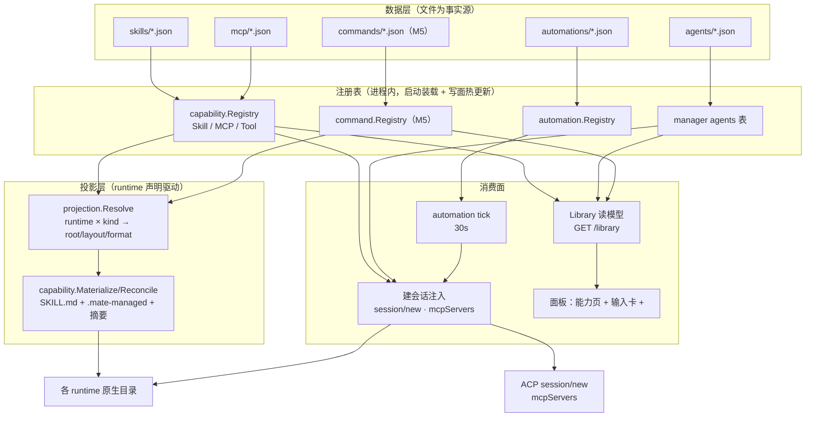
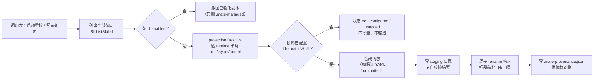
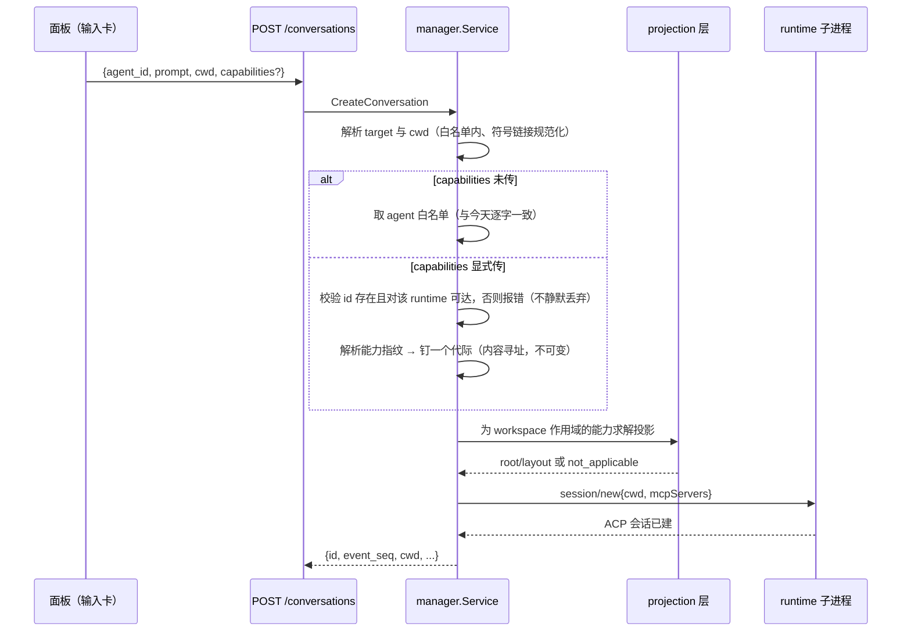
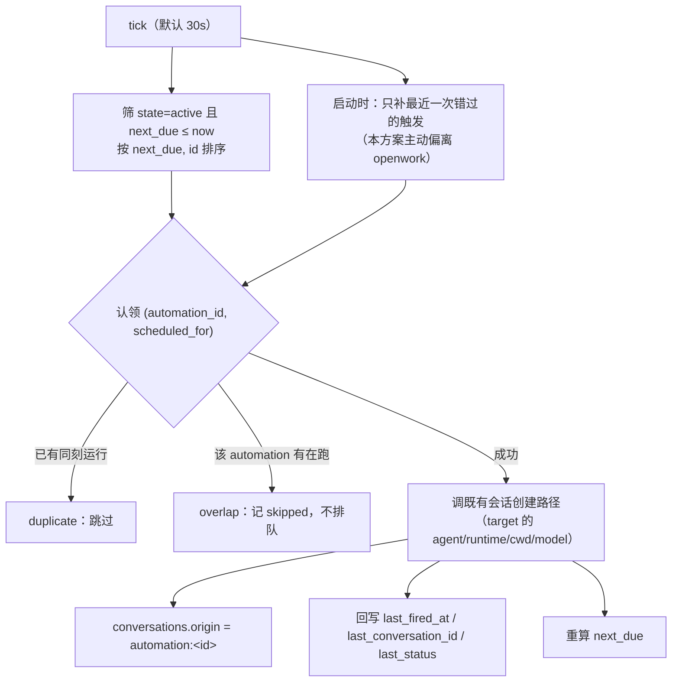

# ark-mate 能力库与自动化数据面技术方案（多 runtime 投影）

> 档位：标准档｜场景：S2 增量改造（主）+ 新子系统｜专题：数据模型设计、API 设计、架构设计
> 参考对象：openwork（`/Users/morehao/Documents/study/ai-agent/openwork`，只读；基线 **`v0.18.49` / `e8c6de421`**，下文所有行号引用均针对该 commit）
> 相关既有文档：[`design-and-roadmap.md`](design-and-roadmap.md) §5.8/§P1+、[`p0-hardening-design-20260911.md`](p0-hardening-design-20260911.md) §13
>
> **定位口径（2026-10-10 加注，不改写下文）**：本文写于决策 v7 时代，正文里的「单操作员的 ACP **多 runtime** 控制面」
> 是**当时的描述**。现行口径以 [`design-and-roadmap.md`](design-and-roadmap.md) 文首「**决策变更 v8**」为准：
> 两层（底座 + 其上的个人 Agent 助手）、**runtime 接边有界**（`dsh` / `opencode` 两个一等适配，不追求数量）、
> **聚焦桌面端**（浏览器入口只是开发形态）。
>
> **范围标注约定**：斜杠命令（command）按评审结论延后到 M5（可取消），因此本文档中凡涉及 command 的设计点一律标注 **【M5】**。M1–M4 不实现、不注册、不装载；`GET /library` 的 `kind` 枚举在那之前只含 `skill | mcp | agent | tool`。

---

## 背景与目标

### 业务背景与现状

ark-mate 是**单操作员的 ACP 多 runtime 控制面**：一个 Go 单二进制（REST + WS + 内嵌面板）把 `opencode` / `deepseekharness` 两个 ACP 底座统一成一个平台会话模型。当前已落地的能力面：

| 域 | 事实源 | 平台能做什么 | 代码位置 |
|---|---|---|---|
| Skill | `<CapabilityDir>/skills/*.json`（`Skill`：`id/name/description/body/sources[]/enabled`） | 列 / 启停（overlay）/ 物化体检 / 按 runtime 物化到原生目录 | `pkg/capability/types.go:37`、`pkg/capability/skill_materialize.go:126` |
| MCP | `<CapabilityDir>/mcp/*.json`（`McpServer`：传输判别 + 明文/密钥四字典） | 列 / live 探测 / 工具调用 / 资源 / 提示词；注入时按 `Spec.McpTransports` + agent 白名单过滤 | `pkg/capability/types.go:74`、`internal/manager/capabilities.go:348` |
| Tool | 运行时派生（探测写入 + builtin/observed） | 列 | `pkg/capability/registry.go` |
| Agent | `<AgentDir>/<id>.json`（`runtimes[]/provider/mcps[]/permission_policy/routing_policy`） | 注册 / 热更新 / 启停 / 删除 / 设为当前 | `internal/manager/agents.go:29` |
| 注入 | — | 建会话时 `acl.SessionOptions{McpServers: McpServersFor(agent, runtime)}`，技能靠**全局**物化目录 | `internal/manager/conversation_start.go:78,171` |
| 自动化 | **不存在** | — | — |

投影能力目前有一部分：skill 走 `sources[].{runtime,path,format}` + 部署配置 `MATE_SKILLS_MATERIALIZE_DIRS=runtime=dir`（`pkg/config/config.go:85,90`），MCP 走 `Spec.McpTransports`（`pkg/runtime/contracts.go:41`）。

### 痛点分析

以下四条都是**具体场景**，不是形容词：

1. **能力只能靠手写文件注册**。`GET /skills`、`GET /mcps` 之外，写面只有 `PATCH /skills/:id {enabled}`（`internal/router/routes_capability.go:16-31`）。要加一个 skill，用户得知道 `<CapabilityDir>/skills/<id>.json` 的确切 schema（含 `sources[]` 的 `format` 枚举）并手写 JSON。**频次**：每接入一个新能力一次；**成本**：一次 schema 试错 1–3 轮（坏定义只告警跳过，`registry.go:326-349`，用户看不到错误在哪）。
2. **投影声明放错了层**。同一个 runtime 的原生路径要在**每一条** skill 的 `sources[]` 里重抄一遍（N×M 复杂度）；而根目录又由部署配置覆盖，于是「数据里写的 path」与「配置里的 dir」是两套说法，`sources[].path` 事实上只被当作文档用。新增第四个 runtime 时，要改所有 skill 文件，而不是改一处 adapter。
3. **能力可见性与注入集是死的**。MCP 的启用集是 agent 级常量 `agent.Mcps`（`internal/manager/agents.go:44`），技能是全局物化——**会话中途无法收窄或增补**。对话里想临时开一个 MCP、或让这一轮只加载两个 skill，没有表达方式；面板输入卡也没有入口（`CapabilitiesPage.tsx` 是独立管理页，与聊天流断开）。
4. **没有定时触发**。roadmap §P1+ 把 automation 列为候选队列第二项并要求「先定 cron 数据契约」，至今未立项。现在想「每天早上 9 点用 opencode 跑一次依赖巡检」只能人肉点。

### 目标与非目标

**目标**

1. 建立**投影契约**：把「能力 → runtime 原生形态」的映射从数据层上移到 runtime adapter，一处声明、全局生效。
2. 补齐**能力写面**：skill / MCP 的 create / update / delete，事实源仍是文件（可手工编辑、可 diff、可进 git）。
3. 提供**统一 Library 读模型**：skill / mcp / agent / tool 四类能力一张清单（command **【M5】** 追加为第五类），成为面板「能力」页与输入卡「+」的唯一数据源，杜绝两处分头渲染而漂移。
4. 落地**代际绑定**：建会话时选定 skill / MCP 子集，平台把选择解析成**能力指纹**并钉住一个内容寻址的**代际**（进程 + 投影根）；缺省行为与今天逐字一致。
5. 落地 **automations**：`once`/`daily`/`weekly` + IANA 时区 → 到期自动建一个平台会话（执行完全委托 runtime）。

**超出范畴的用例（非目标）**

- **不引入 OAuth / 远端授权连接**。openwork 的 `ManagedMcpOAuthConnection`（`needs_auth`/`connected`/`reconnect_required`，`apps/app/src/app/types.ts:330-341`）服务于它的云端 Den 账号体系；ark-mate 是单操作员本机工具，密钥一律走既有的 `vault:` / `env:` 引用（`pkg/capability/secretref.go`）。**原因**：OAuth 需要一个回调 HTTP 端点 + 浏览器重定向 + 令牌存储，而单操作员场景下 `env:` 引用的成本是 0。
- **不做能力市场 / 插件包 / 版本门禁**。openwork 的 marketplace + plugin（一个包同时带 skill + MCP + command）依赖 Den 侧的发布与权限体系，本平台没有"发布方"这一角色。**原因**：见「不借鉴清单」。
- **不做跨 agent 协作 / 多 runtime 并行执行**。一次会话仍绑定且仅绑定一个 runtime（既有决策 v2②），automation 一次触发也只指定一个 target。**原因**：这是一条定位红线，改动需单独走定位评审（roadmap §7.1 风险 8）。
- **不做会话内热切换 runtime**（handoff 语义）——automation 只新建会话，不改写既有会话的 runtime。
- **不引入新的执行器**：automation 不自己跑 agent，只调既有的会话创建路径。

### 约束与非功能需求

| 维度 | 约束 | 依据 |
|---|---|---|
| 规模 | 单操作员单进程：skill ≤ 200 条、MCP ≤ 50 条、automation ≤ 100 条（command 延后到 M5，届时 ≤ 100 条）；**活跃代际 ≤ 4**（可配，见风险表第 12 行） | 单机自托管、用户是一个人；按"每天装 1 个 skill"给一年 365 条，取保守值 200；代际上限按"用户真的会同时用几套能力"取 4，超过即拒绝而非静默复用 |
| 启动开销 | 能力装载 + 正文扫描 < 500ms（本次新增 automation 定义装载；command **【M5】**） | SSD 随机读 150μs/文件 → 300 个定义文件 ≈ 45ms；正文扫描 11 条正则 × 200 条 × ≤50k 字符 ≈ 110ms（字面匹配量级） |
| 调度开销 | tick 间隔 30s，单 tick CPU < 5ms | 100 条 automation × 一次时区换算（`time.Date`，μs 级）≪ 1ms；无 IO（定义已在内存） |
| 存储增量 | SQLite 增量 < 10MB（规划期 3 年，10 万会话） | `conversations` 新增 2 个 TEXT 列 ≈ 每行 +40B；10 万行 ≈ 4MB，计索引膨胀系数 ×2 ≈ 8MB |
| 可用性 | **不设 9 的目标** | 单进程本机工具，"可用"= 进程在跑；可用性由 systemd `Restart=always` 兜底（`docs/deployment.md`），不是本方案的指标 |
| 一致性 | 定义文件为唯一事实源；写面必须原子（临时文件 + rename），未知键保留 | 沿用既有 M10 纪律（`internal/manager/skills.go:24-31`、`pkg/config/settings.go:38`） |
| 时间语义 | schedule 必须带 IANA 时区；DST 行为必须可解释 | 见「关键逻辑与边界条件」 |
| 兼容 | `POST /conversations` 缺省行为、`GET /skills\|/mcps\|/tools` 响应形态保持逐字段不变 | `TestReadmeRoutesMatchRouter` + 前端已消费这些字段 |

**待验证假设（不成立时的应对）**

- *假设 A（已并入 ADR-14，且不再是阻塞项）*：runtime 允许**比进程更细**地收窄能力面（`session` 或 `directory`）。**本方案不依赖它**——能力集按进程绑定，会话级子集总能通过"不同指纹 → 不同代际"表达，故假设不成立只是**多花内存**，不影响功能是否存在；成立则是省内存的优化。**若连"按 cwd 分进程"都无法让两套能力集并存**（实测罕见）：按 cwd 进一步分进程，代价仍是内存。验证方法见「回归与验证范围 · 能力绑定范围的验证方法」。
  **【实施结论 2026-09-23】未实测**：E1–E6 探针本轮未执行，两个 adapter 如实保持 `CapabilityScope=process` + `Tested=false`（第 10 条 archtest 守卫在守）。影响面仅限"多套能力集能否共享一个进程"这一省内存优化与"跨代际 resume 质量"的记录，**不影响任何功能的可用性**——代际绑定（ADR-13/ADR-14）不赌这个假设。补测仍为开放项，登记在开发计划的待办清单 T-1。
- *假设 B*：opencode 与 dsh 的原生 command / subagent 定义目录约定在 2026-09 仍有效。**这条假设只 gate M5**（评审已把 command 延后），因此它不阻塞 M1–M4 的任何验收项。**若不成立**：M5 里 command 只做平台数据层（Library 可见、不可物化），投影状态报 `not_applicable`，或直接不做。
  **【实施结论 2026-09-23·分底座实测 + 实测否决】**：opencode 1.18.32 **成立**（读项目 `.opencode/command/*.md` 与 `$XDG_CONFIG_HOME/opencode/command/*.md`，并把命令经 `available_commands_update` 通告出来）；dsh 0.1.5-rc.2 **不成立**（命令由插件 `ctx.commands.register()` 进程内注册、无目录扫描，`dsh-acp` 的不支持清单明列"命令"，实测 6s 内 0 条通告）。**即便如此也不做**——**M5-0 = No-Go**，四条理由：① 落点不在平台拥有的根上（opencode 只认**用户工作空间**的项目目录或**底座自己的配置树**；`~/.agents/commands` 实测不被读取，即命令**没有** skill 那样的中立根）；② 同类场景已有中立根落点（实测 opencode 会把 `~/.agents/skills` 里的 skill **以命令形式**通告，平台既有的 skill 投影已间接产出"运行时可用的命令"，再叠一层是重复建设 + 两套语义）；③ 它是**单底座**特性（dsh 是 ACP 面明确不做，非"暂未实现"），不值得为它新增 Library kind；④ 真正的缺口不是"声明/投影"而是"**发现**"——ACP 规范里命令只有通告、执行就是把命令行当 `session/prompt` 文本发出，所以用户今天已能直接输入 `/review` 生效，平台缺的只是接收通告（`pkg/acl` 当时忽略它）。取证见 `.dsh/docs/notes/2026-09-23-command-surface-probe.md`；留档的两个可选后续里，**M5′ 发现面已于 2026-09-24 实施**（`pkg/acl` 归一化 + `session.commands` 事件 + 面板 `/` 补全，零投影零写入，ADR-17），**MCP prompts 作为中立命令面仍未排期**（待办 T-3）。

### 验收标准

| # | 验收项 | 阈值 / 判据 | 谁验 · 怎么验 |
|---|---|---|---|
| 1 | skill / MCP 写面闭环 | `POST` → 文件落盘 → 重启后仍可见 → `GET /library?kind=` 命中；坏定义返回带码错误而非静默跳过 | `go test ./internal/manager` 新增用例 + 手工 `curl` |
| 2 | 投影一处声明 | 清空某条 skill 的 `runtimes` 后，两个已配置 root 的 runtime 仍各自物化成功；`GET /skills/:id/materialization` 两条 `in_sync` | `go test ./pkg/capability` + 隔离 HOME 的真实底座实测 |
| 3 | 用户目录不被冒犯 | 删除 skill 只撤回带 `.mate-managed` 的副本；同名用户自有目录报错且零字节改动 | 既有 `skill_materialize_test.go` 断言保持绿 |
| 4 | 缺省零回归 | `POST /conversations` 不带 `capabilities` 时，注入的 MCP 集合与今天逐条相同；`GET /skills`/`/mcps`/`/tools` 响应字段不变 | `go test ./...`（含 `capabilities_test.go` 既有断言） |
| 5 | 调度正确性 | `POST /automations/preview` 对 `daily 09:00 Asia/Shanghai` 返回的未来 5 次时刻与 `TZ=Asia/Shanghai date -d` 手算一致；跨 DST 日期返回 `warnings` 非空 | `go test ./internal/automation` + 手工对照 |
| 6 | 触发幂等 | 同一个 `scheduled_for` 连续触发两次只产生 1 个会话；上一轮未结束时的到期触发记为 `skipped` 且会话数不增 | `go test ./internal/automation -run TestClaim` |
| 7 | 契约守卫 | `make build && make vet && make test && make test/release` 全绿；`pnpm typecheck` 通过；**10 条** archtest 守卫全绿（M1-10 新增 `TestCapabilityScopeDeclaration`，9 → 10）；README 路由表与 `router.go` 双向一致 | CI / 本地一条命令 |
| 8 | 时区可用性 | 容器（`CGO_ENABLED=0`）内 `time.LoadLocation("Asia/Shanghai")` 成功且 `preview` 与宿主机一致 | `make image` 后容器内跑 `mate automation preview` |
| 9 | 破坏性调整可迁移 | 含 `sources` 的既有定义：`mate capability migrate --dry-run` 打印丢弃项 → 实跑 → 连跑第二次无变化 → 适用 runtime 集合与迁移前手工推导一致 | `mate capability migrate` + `go test ./pkg/capability` |
| 10 | 运行台账含"没跑成"的那些 | 一条短间隔 automation 在上一轮未结束时被触发：`GET /automations/:id/runs` 能看到该次 `overlap`（来自 `automation.run` 事件），`skipped` 次数与观测一致 | 手工压测 + `go test ./internal/manager -run TestAutomationRunEvent` |
| 11 | 事件契约四条边齐 | `automation.run` 同时存在于 `events.go`、`frozenEventTypes`、前端 `Ev`、README §WS 帧契约；故意漏一处时 `go test ./internal/archtest` 必须红 | 先验证守卫会红，再补齐 |
| 12 | 代际指纹稳定 | 同一套能力定义连续计算 N 次指纹逐字相同；**打乱定义文件顺序后仍相同**；MCP env 只参与键名、密钥值改变**不**改变指纹（除非引用名变） | `go test ./pkg/runtime -run TestCapabilityFingerprint`（含 map 顺序打乱用例） |
| 13 | 代际复用与上限 | 同一套能力开两个会话 → **只有 1 个进程**；两套不同能力 → 2 个进程；建第 5 套（上限 4）→ **带码拒绝**而非静默复用错的能力集 | `go test ./internal/manager -run TestGenerationPool` + 手工数进程 |
| 14 | 轮次边界生效 + 忙则顺延 | 改一条 skill 后：正在跑的会话**本轮仍用旧版**（轮次内不变）、**下一轮用新版**；有在途轮次或未应答权限时迁移顺延且不打断 | `go test ./internal/manager -run TestGenerationMigration` |
| 15 | 迁移失败可回退 | 注入 resume 失败后，会话**仍在旧代际**上可继续对话，且落一条诊断事件；不产生"会话不可用" | `go test ./internal/manager -run TestMigrationFallback` |
| 16 | 绑定范围默认保守 | 两个内置 adapter 的 `CapabilityScope` 默认 `process`；任一 adapter 声明更细但 `Tested` 为假时 `go test ./internal/archtest` **必须红** | 先故意声明成 `session` 且不置 `Tested`，确认红 |

---

## 对标：openwork 能搬什么、不能搬什么

### openwork 的分层与数据契约

openwork 是 macOS/Windows/Linux 桌面应用，**built on OpenCode**，仓库自述三个面：桌面工作台、OpenWork MCP 网关（把组织能力以 `search_capabilities`/`execute_capability` 两个工具暴露给外部 agent）、OpenWork Den 组织控制面（`AGENTS.md:5,12,17`）。

下文所有 openwork 引用均基于同一基线：`v0.18.49` / `e8c6de421`（2026-09-21）。三份带行号的调研笔记落在 `.dsh/docs/notes/2026-09-22-openwork-*.md`（本机，已随 `.dsh/` 一并 gitignore）。

**它的引擎无关部分（本方案要搬的）**

- **Library 是能力清单的唯一入口**。`apps/app/src/react-app/domains/settings/library.ts:2` 原文：*"Library is the single inventory for composer capabilities. Configure from the + menu, and the agents / commands / skills lists, all resolve through this module so settings routes cannot drift."* 能力种类 = `agents | commands | skills | mcps | plugins | connections | extensions | providers`（同文件 `:9,:13`），输入卡的 `+` 菜单与设置页共用同一套 section 映射（`:29`）。
- **但它没有统一的 Library schema，只有统一读模型**——这一点比"统一表"更值得学。本地能力是 4 个扁平 interface + **不透明载荷** `config: Record<string, unknown>`（`apps/server/src/types.ts:170-207`，无 zod、无判别联合）；Den 侧另有一套判别联合 `libraryItemSchema`（判别键 `type: plugin|app|connection|workflow`，skills/commands/agents/mcp **不是顶层条目**，`ee/apps/den-api/src/routes/org/plugin-system/schemas.ts:569-626`）；**agents 在服务端没有任何实体**，`LibraryAgentItem` 只是从引擎 `app.agents()` 投影出来的视图类型（`library.ts:64-74`）。→ 本方案的 `GET /library` 据此定为**纯读聚合**，不新增存储（选型 E）。
- **两条正交的来源轴**：`origin: "local" | "openwork-connect"`（血缘）与 `scope?: "project" | "global"`（作用域）——`apps/app/src/app/types.ts:286,294`。skill 与 MCP 用同一对轴，因此 UI 可以统一渲染 badge 而不用按类型分支。
- **合并去重有四处、规则各不相同，且诊断路径刻意不合并**。三层静态层是"先到者胜"的顺序遮蔽（runtime > project > global，`apps/server/src/mcp.ts:531-582`）；而用于诊断的 `inspectMcpLayersFromRuntimeSnapshot` **故意不合并**，把同名多来源报成有序 collision（`mcp.ts:590-639`）。这个设计的理由值得原样吸收：**合并结果会随生命周期漂移，所以"当前生效项"不假装可静态回答，只给有序冲突列表**——多 runtime 下更必要，直接对应本方案 `Applicability[]` 逐 runtime 报可达性而非给一个合并结论。
- **前缀所有权 + 只清自有条目**：`openwork-cloud` 与 `openwork-connect-`/`openwork-direct-` 前缀禁止被占用（`apps/server/src/validators.ts:6-7,44-50`），reconcile 只清理自有前缀、用户自建 MCP 一个不动（`connect-mcp-server-catalog.ts:431-446`）。本方案的 `.mate-managed` 标记与保留 id 前缀沿用同一纪律。
- **automation 的时间契约**：`automationScheduleSchema` 是判别联合 `once{at}` / `daily{hour,minute}` / `weekly{daysOfWeek,hour,minute}`，**每个变体都必带 IANA `timezone`**（`packages/types/src/automations.ts:26-43`）——不是裸 cron 表达式。到期计算在 `packages/automations/src/schedule.ts`，DST 用 18 小时本地时间搜索窗口解析，落在切换空档的墙钟时刻被前移到下一个有效分钟并产出 `warnings`（`:7,:160`）。
- **错过触发不补跑，只记回执**。生产路径（`ee/apps/app/den-api` 侧）给每个 occurrence 一个认领窗口（`max(now+min(window,60s), min(now+window,nextDueAt))`，`packages/automations/src/runner.ts:29-38`），到期无人认领即落 `skipped/runner_unavailable` 并附可行动原因（`repository.ts:1234-1242`）。`recoverableAutomationOccurrence`（`schedule.ts:194-195`，注释 *"Returns at most the latest missed occurrence; older backlog is never replayed"*）与 `trigger:"recovery"` **在 den-api 中未被调用**——这是本方案与它的**主动偏离点**（见 ADR-9）。
- **认领是幂等的三态**：`AutomationClaimResult = claimed | duplicate | overlap`，且 ports 注释写明 *"Claims and revision updates must be transactional"*（`packages/automations/src/ports.ts:22-27`）；`hasActiveRun` 把 `claimed|running` 视为"已有在跑"（`tick.ts:17`）。生产侧三层防重：幂等键唯一去重 → 同 automation 已有活跃 run 直接 `skipped`（overlap，不排队）→ `SELECT … FOR UPDATE` 锁行。
- **即使触发时校验失败也要推进 schedule**：due→claim 时会再校验模型权限，**失败也照样 claim**，以保证 `next_due_at` 持久推进（`ee/apps/den-api/src/.../service.ts:306-354`）。这是一条容易漏的正确性要求，本方案照单收下（见「关键逻辑与边界条件」）。
- **状态机显式化**：`active ⇄ inactive ⇄ needs_attention → archived`（`archived` 是终态），终态 run 状态为 `succeeded|failed|cancelled|skipped`（`packages/automations/src/state.ts:3-13`）。
- **失败语义**：12 个 error code 各带 `retryable` 布尔，**超时/未知异常一律不自动重试**（`automations.ts:147-164`）。本方案照抄这条口径。
- **工作空间在创建时钉死**。`automationRevisionSchema.workspaceId` 的注释记录了一个真实缺陷：*"Before this field existed, both executors resolved the runner's currently active workspace at run time, so activating a different workspace silently retargeted every automation."*（`automations.ts:121-129`）——这条教训直接适用于本平台：automation 的 `cwd` 必须在创建时固定，不得在触发时解析"当前工作空间"。
- **唯一现成的投影层范本**：`engine-v2-preview.ts:285-308` 的 `mapRuntimeMcpToV2` 是全仓唯一把「能力语义」与「runtime wire 格式」分开的函数（把 `local|remote` 翻译成 v2 引擎的两种形态，`enabled===false` 返回 `undefined`）。本方案要做的正是把这件事从"v1→v2 一次性适配"提升为「capability 模型 → N 个 runtime 投影器」的一等抽象。

**两个「本方案原本以为有、实际不存在」的先例（必须显式纠正）**

1. **不存在会话级能力启用集**。openwork 的启用粒度是 **workspace 级布尔**（`POST /workspace/:id/mcp/:name/enabled`，严格布尔校验，`apps/server/src/server.ts:4004-4051`），全仓找不到任何 per-session 的启用集合数据结构；skill 更弱——用户在每一轮 prompt 里**按轮附带**（前端解析草稿 token → 在引擎 `/api/skill` 目录里解析出 id，歧义即拒发 → 先向引擎要 `{action:"skill"}` 权限，不给 allow 就不发 → `POST /api/session/:id/prompt {text, skills:[{id}]}`，`apps/app/src/app/lib/opencode-v2-adapter.ts:1954-2008`），系统提示明确否认快照语义：*"Removed skills from previous turns are not available capabilities"*（`apps/server/src/opencode-v2-instructions.ts:122`）。**含义**：本方案的「代际绑定」是**在没有先例处新增语义**，必须自证必要性（见选型 F），不许援引 openwork 当背书。
2. **per-agent 也没有 MCP 服务器级子集**。openwork 表达 per-agent 差异靠 OpenCode 的 `tools`/`permission` 通配策略再映射到工具 id 求 deny（`mcp.ts:440-475`，输出 `McpItem.toolDenies`）。本平台既有的 `agent.Mcps`（服务器级白名单）在这一点上**比 openwork 更强**，保留不动。

### 单 runtime vs 多 runtime 的差异清单

这是本方案与 openwork 的**核心分歧**，逐条给「差异 → 影响 → 对策」：

| # | 差异 | 影响 | 对策 |
|---|---|---|---|
| 1 | openwork 的一切最终落到一个引擎的原生约定（OpenCode 的 `.opencode/` 目录、opencode config 的 mcp 段）；ark-mate 有 N 个底座 | 能力数据不能直接写成某个底座的文件形态，必须多一层翻译 | **投影契约**：投影是 runtime 的属性，数据层只描述"是什么" |
| 2 | openwork 的 `McpServerConfig.type` 只有 `remote` / `local` 两态；ACP 的 `session/new` 有四种 token（`stdio`/`sse`/`http`/`streamable_http`），且各底座支持度不同 | 一份 MCP 定义在底座 A 可注入、在底座 B 不可 | 复用既有 `Spec.McpTransports`（`pkg/runtime/contracts.go:41`）做**逐 runtime 可达性**，并在读模型里外露 `runtimes[]` 与不可达原因 |
| 3 | openwork 是 Electron 桌面，有本地文件系统与后台守护；ark-mate 是 Web 控制面，agent 跑在服务端进程拉起的子进程里 | 工作空间、skill 目录的"本地"含义不同 | 投影的 `scope` 保留 `global\|workspace` 语义，但 workspace 投影的根是**会话 cwd**，受 `MATE_WORKSPACE_ROOTS` 白名单约束（`pkg/config/config.go:74`）。**【实施后收窄 2026-09-23】**：`scope` 实际只用到 `global`——skill 投影落在平台自有的中立根（`~/.agents/skills`）；**workspace 作用域投影随 command 面（M5-0）一并否决**，故"会话 cwd 作为投影根"当前不成立。`MATE_WORKSPACE_ROOTS` 及其符号链接规范化改由 workspace 库消费 |
| 4 | openwork 的 automation 有 desktop / cloud 两个 `executionTarget`，需要 runner 注册、心跳、存在性窗口（`AUTOMATION_DESKTOP_RUNNER_PRESENCE_WINDOW_MS = 10min`，`automations.ts:216`） | 本平台只有一个执行位置（daemon 自己） | **删掉 executionTarget 维度**：只有一个落点，多一层选择只增加状态；`needs_attention` 的原因收敛为「agent 被删 / runtime 不可用 / 工作空间不存在 / 密钥缺失」 |
| 5 | openwork 的 automation 与 threading 是服务端 + DB 强事务（claim 要求 transactional），因为执行者可能是**离线的桌面或远端容器** | 本平台 `MATE_STORE=memory` 是合法模式，没有 DB；执行者就是本进程 | 定义走文件、台账走既有的 `conversations`；认领幂等靠「文件里的 `last_fired_at` + 进程内互斥」。**lease / heartbeat / attempt 三段式整天不需要**——它是"执行者可能消失"的产物。memory 模式下 automation 仍可用（只少运行史检索） |
| 6 | openwork 的 `origin: openwork-connect` 指向云端分发；本平台没有分发方 | 来源轴只有一端 | 保留 `origin: local \| imported`（`imported` 预留给"从某个 runtime 原生目录反向扫描入库"，见开放问题） |
| 7 | openwork 的**能力启用粒度是 workspace 级布尔**，且 skill 是**按轮附带**（依赖 OpenCode v2 私有 API `POST /api/session/:id/prompt {skills:[{id}]}`）；**ACP 没有 per-turn 能力字段** | 本平台无法表达"这一轮带哪个 skill"，**粒度上限是轮次边界**（不是 per-turn） | 代际绑定（选型 F1）＋生效边界 ADR-13。因为按**进程**绑定，会话级子集总能表达，**不再受假设 A 阻塞**（假设 A 退化为省内存的优化） |
| 8 | openwork 的 MCP 传输判别联合（`stdio\|streamable-http\|sse`）只活在 Den 导入边界，进引擎时被压扁成 `local\|remote`，**sse/http 的区分被丢掉**（`apps/server/src/validators.ts:52-89`） | 本平台的四态（`stdio\|sse\|http\|streamable_http`）比它更细，也意味着投影时**必须逐底座协商**，不能假定都可注入 | 保留四态；用 `Spec.McpTransports` 做逐 runtime 可达性（本平台在这一点上不需要向 openwork 学） |
| 9 | openwork 的 per-agent 差异是**工具级 deny 策略**（映射 MCP 工具 id，`mcp.ts:440-475`）；本平台的 `agent.Mcps` 是**服务器级白名单** | 本平台的粒度更粗但语义更清晰 | 保留服务器级白名单，不引入工具级 deny（ACP 侧没有等价的工具策略通道；要做需先走 runtime 能力协商） |
| 10 | **openwork 的增量能力"下一次调用即生效"，机制不可搬运**：它靠 OpenCode v2 的私有 API——按目录热注册 MCP（`PUT/DELETE /api/mcp/:name?directory=`，`engine-v2-preview.ts:360-394`）与 per-prompt 附带 skill（`{skills:[{id}]}`，`apps/app/src/app/lib/opencode-v2-adapter.ts:2008`），e2e 断言同一会话下一次调用即可用且 **PID 不变**（`evals/specs/opencode-v2-mcp-hot-reload.e2e.test.ts:31/99/144`） | **ACP 没有"给活会话加 MCP"的通道**，也没有 per-turn 能力字段；本平台无法表达"这一轮带哪个 skill" | **粒度上限 = 轮次边界**（ADR-13）：不做 per-turn；因为按**进程**绑定，会话级子集仍总能表达（代际），但必须付 openwork 不用付的 resume 代价。**政策学它、机制不学它** |
| 11 | **openwork 的绑定范围是"目录"**（`/instance/dispose?directory=` 与 instance cache 按目录隔离，`engine-reload-defer.ts:9-11`；MCP 按 `?directory=` 注册） | 极易被误读成"本平台也能按目录绑定" | **不搬**：那条证据测的是 **OpenCode 的 HTTP/v2 层**，而本平台走 **ACP**——不同接口层。本平台默认声明 `process`（ADR-14），只有实测（见「能力绑定范围的验证方法」）才能放宽；archtest 守卫"未实测者不得声明比 `process` 更细" |
| 12 | **openwork 需要 fs.watch**（`reload-watcher.ts`，750ms debounce + 内容 sha256 指纹），因为 `.opencode` 是**它的公共契约**——用户会在编辑器里直接改 | 本平台**不需要**：事实源是 `~/.ark-mate/capabilities/`，**平台自己是唯一写方** | 不引入 fs.watch。注意 openwork 自己的**平台内写入路径也没用 fs.watch**——走进程内 hook（`onRuntimeOpencodeConfigWrite`，`engine-v2-preview.ts:548-564`）。本平台用同样的形态：进程内通知 + 读端点指纹短路。fs.watch 的平台代价它也付了（macOS 丢文件名/目录级合并 → `NAMED_TRIGGER_TTL_MS=5000` 兜底 + 轮询兜底 + 专门的 CI flake 注释），且其产物**只是给前端的事件 feed**，不是重载触发器 |

### 不借鉴清单

1. **marketplace / plugin 包 / 版本 digest 门禁**（`apps/app/src/react-app/domains/settings/library.ts` 的 `plugins`/`marketplaceName` 一族）——没有发布方与消费者，做了就是空壳。
2. **Den 组织控制面**（团队、成员、权限、推理供给）——撞既有决策 v3③（单操作员、无多用户）。
3. **MCP OAuth 连接管理**——见非目标。
4. **`saved_script` 类 action**（automation 跑一段插件脚本，`automations.ts:64-76`）——本平台的执行面只有 ACP；跑脚本会引入一条无权限门禁的旁路。
5. **不可变 revision + digest**——本平台 automation 定义是可手工编辑的 JSON 文件，版本管理交给 git；引入 revision 表会让"手工改一行"变成"发一版"，与单操作员场景不匹配。
6. **`plugins` / `extensions` / `providers` 作为 Library 种类**——provider 已有独立页面与管理面，塞进 Library 只会让"能力"这个概念失焦。Library 只收「会被注入到会话里的东西」。
7. **`/opencode/*` 全量透传代理**（`apps/server/src/server.ts:586,1016`）——它让前端直接依赖某个底座的 SDK 类型（`opencodeClient.app.agents()`、`session.create`），后果就是 agents 这个 Library 类别**连服务端实体都没有**。本平台已有 `pkg/acl`，必须坚持控制面自有 DTO。
8. **账户级超级 MCP 的单例特判**（`openwork-cloud` 在 `connect-state.ts:25`、`runtime-opencode-config-store.ts:24,252`、`mcp.ts:25-27`、`validators.ts:6` 等处被硬编码为"强制全局权威"）——多 runtime 下任何能力都应是普通条目，靠投影与可达性表达差异，不靠保留名单。
9. **把应用状态写进底座目录再 fs.watch 回来**（`workspace-files.ts` + `cloud-plugins.ts:206-258` + `reload-fingerprint.ts:74-105` 的循环）——那是把 OpenCode 的目录约定当 API 用。本方案把「能力 → 文件布局」做成每个 adapter 的输出，而不是控制面的公共路径。

---

## 方案设计

### 总体思路

一段话：**把「能力是什么」（数据层，文件为事实源）与「能力怎么在某个底座上生效」（投影层，runtime 声明）彻底分开**；新增一个纯读的 Library 聚合层作为面板与输入卡的唯一数据源；写面补齐但落盘纪律沿用既有 M10；建会话时的能力选择被解析成**能力指纹**并钉住一个内容寻址的**代际**（进程 + 投影根）；automation 定义走文件、触发即调既有会话创建路径，执行 100% 委托 runtime。

### 投影契约

**结论：投影是 runtime 的属性，不是能力的属性。**

新增 `runtime.Projection`，挂在既有 `Spec` 上（`pkg/runtime/contracts.go:31`）：

```go
// ProjectionKind 可投影的能力种类。
type ProjectionKind string

const (
	ProjectionSkill   ProjectionKind = "skill"
	ProjectionCommand ProjectionKind = "command"
)

// Projection 声明某 runtime 承载某类能力的原生形态。
//
// 职责划分（选型 D4）：投影形态（Root/Layout/Format）**只在这里声明**；
// 条目侧只表达「给哪些 runtime 用」（Skill.Runtimes），不表达位置与格式。
// 因此不存在"两处声明同一件事"的优先级问题——这也是删掉 SkillSource 的原因。
type Projection struct {
	Kind    ProjectionKind
	Scope   string   // global | workspace
	Root    string   // 默认根，支持 ${HOME} / ${XDG_CONFIG_HOME} 占位；空 = 该 kind 不投影
	Layout  string   // 相对根的落点模板，如 "<id>/SKILL.md"
	Format  string   // 内容合成格式，取值域同 capability.Format*
	Tested  bool     // 是否经真实底座实测（未实测 → 投影状态报 untested，不臆造）
	Note    string   // 实测结论与版本号
}
```

**根目录解析链（唯一事实源，按优先级）**

1. `MATE_PROJECTION_DIRS=runtime:kind=dir[,...]`（部署显式覆盖，最高）
2. `Spec.Projections[].Root`（adapter 声明的默认，逐 runtime 不同）
3. 都没有 → 该 `(runtime, kind)` 投影**关闭**，`GET /skills/:id/materialization` 返回 `status=not_configured`

**关键取舍：为什么不上移成"数据里也写 path"**。见「备选方案与取舍」选型 D。

**既有 `MATE_SKILLS_MATERIALIZE_DIRS` 的处置（已拍板：改名，不留兼容别名）**：本仓禁止未知配置键（启动即报错），直接改名会让存量 `~/.ark-mate/config/config.json` 拒绝启动。处置为**只识别、不兼容**——启动时仍报错，但把该键识别为"已改名"并在文案里给出新键名与等价写法（`skill_materialize_dirs=opencode=/x` ≡ `projection_dirs=opencode:skill=/x`）。这样"非法键名启动即报错"的规则不被软化，用户拿到的是出路而不是死胡同；同时配置面只留一个键，不产生语义重复的别名（拍板结论：允许破坏性调整，合理性优先）。升级动作就是改这一行。

### 总体架构



图与正文的对应：`数据层` 五个目录即「数据模型」一节的落点（其中 `commands/` 标 M5）；`投影层` 只在 skill/command 上生效（MCP 不落盘，走 ACP wire）；`消费面` 的三个入口分别对应「接口设计」「代际绑定与注入」「自动化调度」。

### 核心流程

**流程一：能力定义 → 某底座原生形态（投影）**



异常分支：`staging` 阶段任何失败都保留旧产物（半成品对 agent 不可见）；目标已存在且不带 `.mate-managed` 标记 → 显式报错、不改动一个字节（沿用 `skill_materialize.go:14` 的既有不变式）。

**流程二：建会话与能力注入**



**关键点**：`capabilities` 里出现不可达 id 时**报错而不是静默丢弃**——静默丢弃会让用户以为"选了就生效了"，与平台既有的"不静默降级"纪律（`internal/manager/capabilities.go:379-384` 的 MCP 注入注释）一致。

**流程三：automation 触发**



### 备选方案与取舍

**选型 A：能力定义的事实源 —— 文件 JSON vs SQLite 表 vs 文件+索引**

| 方案 | 为什么选 / 不选 | 代价 | 什么情况下该选它 |
|---|---|---|---|
| **A1 文件 JSON（推荐）** | 延续既有事实源（`registry.go:46`），可手工编辑、可 diff、可进 git、与 agent 定义同构；`memory` 模式（无 DB）下能力面照常可用 | 无事务、无并发写保护；列表查询靠内存注册表，规模上限 10³ 量级 | 单操作员、条目数百、需要"用编辑器改一个文件"的工作流 |
| A2 SQLite 表 | 有事务、索引、查询能力 | **`MATE_STORE=memory` 下能力面直接消失**；破坏"文件可手工编辑"的既有预期；要写迁移内核 | 条目上万、多进程共享同一份能力库 |
| A3 文件为准 + DB 索引 | 兼得 | 两套事实源的一致性要长期维护，收益只是查询快一点 | 读多写多、需要跨条目全文检索 |

**选 A1。落地**：写面读写都落在 `<CapabilityDir>` 下，`memory` 模式下 `CapabilityDir` 为空 → 写面报 `capability_dir_unset` 而不是假装成功。

**选型 B：automation 存储 —— 文件 vs 新建两张表**

| 方案 | 取舍 |
|---|---|
| **B1 定义文件 + `conversations.origin`（推荐）** | 与 agents/capabilities 同构；运行台账复用既有 `conversations`（已有 `idx_conversations_list`）；memory 模式可用。**代价**：没有独立的 run 状态机（`queued/claimed/running/...`），运行态只能取"会话是否存在 + 会话状态"；`skipped`/`duplicate` 这类"没跑成"的事实没有台账 |
| B2 `automations` + `automation_runs` 表（openwork 形态） | 有完整 run 台账与状态机。**代价**：memory 模式整个 automation 面不可用；多两张表的迁移与投影代码 |
| B3 文件 + 独立 JSONL 运行日志 | 兼得。**代价**：多一个需要 prune 的落盘面（本仓已有 `mate transcripts prune` 的先例，不是不能做，是本期不值得） |

**选 B1**。理由：本平台 automation 的"运行"就是一个平台会话，会话自身的 `status`（`in_progress`/`completed`/`failed`/`interrupted`）已经是最权威的运行态，再建一套 run 状态机就是第二事实源。B2 的 `queued/claimed` 之所以必要，是因为 openwork 的执行者可能是**离线的桌面**（无法靠会话状态判断），而本平台的执行者就是本进程。

**选型 C：schedule 表达 —— 判别联合 vs 标准 cron vs 固定间隔**

| 方案 | 取舍 |
|---|---|
| **C1 `once`/`daily`/`weekly` + IANA tz（推荐）** | 无 cron 解析依赖；前端能直接生成"每天 09:00（Asia/Shanghai）"的人话预览；DST 语义可显式定义为"前移到下一个有效分钟"；校验面小（hour 0-23、minute 0-59、daysOfWeek 0-6 去重排序） | 
| C2 标准 cron（5/6 段） | 表达力强（能表达"每小时第 15 分"）。**代价**：引 cron 库；5 段与 6 段（带秒）歧义；DST 各家语义不同，得自己写一层；非法表达式的错误消息对非技术用户不可读 |
| C3 只支持 `every <duration>` | 实现最省。**代价**：无法表达"工作日 9 点"——而这恰恰是定时任务最常见的形态 |

**选 C1**。**不该选 C1 的场景**：用户明确需要"每小时第 15 分钟""每月 1 号""每 5 分钟"这类表达——C1 表达不了。若真出现，加一个 `hourly{minute}` 变体比引入 cron 便宜（见开放问题）。

**选型 D：投影声明放 runtime 还是放数据**（已按拍板结论「允许破坏性调整、合理性优先」定为 D4）

| 方案 | 取舍 |
|---|---|
| D1 全部放数据（现状） | 零改动。**代价**：N 条 skill × M 个 runtime 的路径重复；新增 runtime 要改所有 skill 文件；`sources[].path` 与 `MATE_SKILLS_MATERIALIZE_DIRS` 是两套说法 |
| D2 全部放 runtime，条目无话语权 | 一处声明、数据最干净。**代价**：丢掉"这条 skill 只给某两个底座"这个**真实需要**（一条依赖某底座专有工具的 skill 不该投给别的底座） |
| D3 混合：`sources[]{runtime,path,format}` 作条目级覆盖（本文档早先的推荐） | 保住了按条裁剪。**代价**：把一个字段当成两种东西用——「哪些 runtime 适用」**与**「在那个 runtime 里放哪、什么格式」。后者本就该由 runtime 决定；让条目也能写 path，正是"数据里的 path 与部署配置里的 dir 打架"这个原始痛点的来源 |
| **D4 职责分离（采纳）**：投影形态（root / layout / format）**一律来自 runtime**；条目只声明 `runtimes []string`（可选，空 = 全部） | 常见情况零声明；按条裁剪保留且**语义单一**；两层不再可能声明同一件事。**代价**：删掉既有 `sources` 字段（破坏性），需要一次性迁移 |

**选 D4**，落地：

```go
type Skill struct {
	// …既有字段…
	// Runtimes 适用 runtime 白名单；空 = 全部支持 skill 投影的 runtime。
	// 只表达「给谁用」，不表达「放哪、什么格式」——后者是 runtime 的投影声明。
	Runtimes []string `json:"runtimes,omitempty"`
	// Sources（原 []SkillSource{runtime,path,format}）已删除。
}
```

**迁移**：一次性子命令 `mate capability migrate`——把既有定义文件里的 `sources[].runtime` 去重升序写进 `runtimes`，`path`/`format` 丢弃并**逐条打印**（不静默）。**丢弃是修正而非损失**：`path` 与 `MATE_PROJECTION_DIRS` 本就是两套说法，`format` 现在由 `Projection.Format` 声明（且已按底座实测过：opencode 宽松扫描、dsh 要求 frontmatter 且不递归）。迁移幂等，可重复执行。

**不该选 D4 的场景**：若将来真出现"同一 runtime 内需要两种布局"的需求（例如某 skill 要投到子目录），正确的做法是给 `Projection` 加变体，而不是重新允许条目写 path——否则同一个坑会再踩一次。

**选型 E：Library —— 统一读模型 vs 统一存储**

| 方案 | 取舍 |
|---|---|
| **E1 统一读模型（推荐）** | 各域仍是自己的 owner 与事实源，Library 只在读路径上 join，杜绝"两处渲染分头漂移"（openwork 的 `library.ts:2` 就是这个动机）。**代价**：多一个聚合层；join 在内存里做，规模 10³ 内无压力（350 条定义 × 字段拷贝 ≈ 数十 μs） |
| E2 统一存储（合成一张 capability 表） | "看起来整齐"。**代价**：破坏 skill（有正文、有物化）与 agent（有权限策略、有进程生命周期）之间本质不同的字段形态，只能靠一个巨大的 nullable 表或 JSON blob 承载——是假统一 |

**选 E1**。

**选型 F：能力启用粒度 —— 代际绑定 vs 会话快照 vs workspace 布尔 vs 只保留 agent 白名单**

先说清前提：**这一项在 openwork 里没有先例**（它的启用粒度是 workspace 级布尔，skill 甚至只是按轮附带），所以下面不给它当背书，只做自证。

| 方案 | 取舍 |
|---|---|
| **F1 代际绑定（采纳）** | 粒度与"一次任务"对齐（同一 cwd 下"这次只给我两个 skill"可表达），且不可变性由**结构**保证：勾选结果 → 能力指纹 → 内容寻址的代际（进程 + 投影根）。指纹相同则复用同一进程，故**稳态进程数与今天相同**；只有用户真的同时用多套能力时才多进程。会话记录钉住的指纹，审计可逐字节验证 |
| F2 会话启用集快照（原案） | 不引入代际概念，实现更直接。**代价**：把不可变性变成**纪律**而不是结构——底座是否真按会话隔离，取决于一个未实测的假设（见 ADR-14）；且"改了不生效"只能靠"重建会话丢上下文"来换，等于用可用性买审计性 |
| F3 workspace 级布尔（openwork 形态） | 实现最省（一个 `enabled` 字段 + 投影时过滤）。**代价**：粒度错位——ark-mate 的 workspace 是**会话的 cwd**，多个会话常共享同一 cwd；在 A 对话里关掉一个 MCP 会连带影响 B 对话，而这个因果关系不在用户视野里 |
| F4 只保留 `agent.Mcps`（不动） | 零改动。**代价**：无法回答"这次只开一个 MCP"——而输入卡的 `+` 入口（用户明确要求的能力）本质上就是这个动作 |

**选 F1（代际绑定）**。理由的**决定性一条**是本仓既有的正确性前提：`orchestrator.go:123-124` 已经因为"**权限开关是进程级**"而把进程当作能力边界，`connKey`（`connection.go:13-16`）因此纳入 runtime + 原生权限 env + provider env。**F2 要求能力集是会话级的，比权限开关更细**——若底座实际上是进程级绑定，F2 会把两套不同能力集悄悄合并到一个进程且不报错。F1 不赌这个假设：它按最粗的绑定设计，底座若更细只是多花了内存（见 ADR-14 的代价不对称）。

另外两条支持理由：① 输入卡的 `+` 是会话起始时刻的交互，勾选结果映射成指纹是自然映射，**UX 与 F2 完全相同**（用户感觉不到代际）；② 指纹 + 显式校验能消除一个静默失败面——今天的 `agent.Mcps` 如果写了不存在的 id，注入时 WARN 跳过（`internal/manager/capabilities.go:379-384`），用户以为生效了。

**代价要说清**：F1 在"同时存在多套能力集"时需要多个进程（F2 不需要），因此必须有代际上限与超限拒绝策略（风险表第 12 行）。**不该选 F1 的场景**：如果实际使用中用户从不需要按会话裁剪（只是想让 agent 决定一切），F4 才是对的，F1 会变成一个没人点的复选框——**因此 M3 上线后要看这个交互是否真被使用，未被使用时应当删掉而不是留着**。

---

## 详细设计

### 模块划分与数据所有权

| 模块 | 职责 | 数据所有权 | 新增/改动 |
|---|---|---|---|
| `pkg/runtime` | 声明每个底座的投影形态（`Spec.Projections`） | runtime 的启动与投影**声明** | 改：`contracts.go` 加 `Projection`；两个 adapter 各加声明 |
| `pkg/projection`（新） | 把 `(runtime, kind)` 解析成 `root/layout/format`；根目录解析链 | 无（纯函数 + 配置读取） | 新增 |
| `pkg/capability` | Skill/MCP/Tool 注册表与物化（既有） | `<CapabilityDir>/{skills,mcp,tools}` | 改：`Skill.Scope/Origin`、物化改为走 `pkg/projection` |
| `pkg/command`（新）**【M5】** | 斜杠命令注册表 | `<CapabilityDir>/commands` | 新增（M1–M4 不做） |
| `pkg/automation`（新） | schedule 解析、下次触发计算、认领幂等 | 无状态纯逻辑（便于单测） | 新增 |
| `internal/manager` | 编排：Library 聚合、写面落盘、代际绑定与迁移、automation 调度循环 | 内存注册表 + 写盘动作 | 改：新增 `library.go`、`capability_write.go`、`automation.go`、`automation_sched.go`（`commands.go` **【M5】**） |
| `internal/store` | 持久层 | `conversations` 新增 3 列 + 2 索引（v7 迁移） | 改：`migrate.go` + `model/entity.go` |
| `internal/controller/ctrlibrary`（新） | Library + 写面 + automation 的传输层 | 无 | 新增 |
| `frontend` | 能力页改为 Library 驱动 + 输入卡 `+` | 无 | 改 |

**数据所有权不重叠**：能力定义的 owner 是 `pkg/capability` / `pkg/command`；agent 的 owner 是 `manager.agents`；automation 的 owner 是 `manager.automation`。Library **不拥有任何数据**。

### 数据模型

**① Skill 改造**（`pkg/capability/types.go:37`）——**删 `Sources`，加 `Runtimes` 与 `Scope`**（选型 D4）

```go
type Skill struct {
	ID          string `json:"id"`
	Name        string `json:"name"`
	Description string `json:"description,omitempty"`
	Body        string `json:"body,omitempty"`
	// Runtimes 适用 runtime 白名单；空 = 全部支持 skill 投影的 runtime。
	// 只表达「给谁用」，不表达「放哪、什么格式」——后者是 runtime 的投影声明。
	Runtimes []string `json:"runtimes,omitempty"`
	// Scope 作用域：global（默认，写到 runtime 全局目录）/ workspace（写到会话 cwd）。
	Scope string `json:"scope,omitempty"`
	Enabled *bool  `json:"enabled,omitempty"`
	Warnings []Warning `json:"-"`
}
```

新增字段一律 `omitempty`；`Sources` 是**唯一被删除**的字段（选型 D4），其余缺省语义 = 今天的行为，故磁盘上的既有 skill 文件在跑过 `mate capability migrate` 之前仍可读（`sources` 会被忽略并告警一次）。

**② Command（新，**已拍板延后到 M5**）**

按拍板结论「可以放在 M4 之后」：`Command` **不在 M1–M4 的范围内**，Library 的 `kind` 枚举在 M5 之前只含 `skill | mcp | agent | tool`。延后的理由成立——它的价值完全押在**假设 B**（opencode / dsh 的命令目录约定）上，而该假设尚未实测；先做投影与自动化这两块确定性收益，等 command 的落点实测有结论再决定要不要做、以及做成什么样。下面的类型定义保留，作为 M5 的起点，**M1–M4 不实现也不注册它**。

```go
// Command 是一条斜杠命令定义（平台数据层；执行完全委托 runtime）。
// M5 起点：字段形态对齐 openwork 的 LibraryCommandItem（library.ts:53-62），
// 但 opencode / dsh 是否都能从某目录加载命令未实测——在假设 B 有结论前不落代码。
type Command struct {
	ID          string `json:"id"`
	Name        string `json:"name,omitempty"`        // 触发名（缺省 = ID）
	Description string `json:"description,omitempty"`
	Template    string `json:"template,omitempty"`    // 命令正文模板
	Agent       string `json:"agent,omitempty"`       // 目标 subagent（runtime 原生概念）
	Model       string `json:"model,omitempty"`
	Subtask     bool   `json:"subtask,omitempty"`
	Scope       string `json:"scope,omitempty"`       // global | workspace
	Enabled     *bool  `json:"enabled,omitempty"`
}
```

**③ McpServer 扩展**：新增 `Scope string`（`global|workspace`）与 `Enabled *bool`。传输与四字典**完全不动**——`stdio/sse/http/streamable_http` + `env/secret_env/headers/secret_headers` 已比 openwork 的两态判别更细，且密钥纪律更强。

**④ Library 读模型**（纯派生，不落盘）

```go
type LibraryItem struct {
	ID          string   `json:"id"`
	Kind        string   `json:"kind"`        // skill | mcp | agent | tool（command 【M5】）
	Name        string   `json:"name"`
	Description string   `json:"description,omitempty"`
	Origin      string   `json:"origin"`      // local | imported（血缘）
	Scope       string   `json:"scope"`       // global | workspace
	Enabled     bool     `json:"enabled"`
	SourceFile  string   `json:"source_file,omitempty"` // 事实源文件（代码注入时为空）
	// Applicability 逐候选 runtime 的投影可达性；reason 是人话原因，不是错误码。
	Applicability []Applicability `json:"applicability"`
	Warnings      []string        `json:"warnings,omitempty"`
}

type Applicability struct {
	Runtime string `json:"runtime"`
	OK      bool   `json:"ok"`
	Status  string `json:"status"` // projected | not_configured | untested | not_applicable | disabled
	Reason  string `json:"reason,omitempty"`
}
```

**⑤ Automation（定义文件）**

```go
type Automation struct {
	ID      string           `json:"id"`
	Name    string           `json:"name"`
	Enabled bool             `json:"enabled"`
	Schedule Schedule        `json:"schedule"`
	Target   AutomationTarget `json:"target"`
	MaxRunDuration string    `json:"max_run_duration,omitempty"` // Go duration；空 = 交给 MATE_TURN_TIMEOUT；上限 60m
	// —— 以下为运行态 overlay：平台写回，人工不必编辑 ——
	LastFiredAt      *time.Time `json:"last_fired_at,omitempty"`
	LastConversation string     `json:"last_conversation_id,omitempty"`
	LastStatus       string     `json:"last_status,omitempty"` // completed | failed | interrupted | skipped
	ConsecutiveFailures int     `json:"consecutive_failures,omitempty"`
}

type Schedule struct {
	Kind     string   `json:"kind"`     // once | daily | weekly
	Timezone string   `json:"timezone"` // IANA 名，必填
	At       *time.Time `json:"at,omitempty"`        // kind=once
	Hour     *int     `json:"hour,omitempty"`        // kind=daily|weekly
	Minute   *int     `json:"minute,omitempty"`      // kind=daily|weekly
	DaysOfWeek []int  `json:"days_of_week,omitempty"` // kind=weekly，0=周日
}

type AutomationTarget struct {
	AgentID   string `json:"agent_id"`
	RuntimeHint string `json:"runtime_hint,omitempty"` // 空 = 走 agent 的 routing_policy
	Cwd       string `json:"cwd"`                      // 创建时钉死（学 openwork 的 workspaceId 教训）
	Model     string `json:"model,omitempty"`          // 不透明值，同会话模型
	Prompt    string `json:"prompt"`
}
```

**为什么运行态写回定义文件而不是另开状态文件**：定义文件只有一份，读的人（运维）打开就能看到"上次什么时候跑的、跑成没成"；拆成两个文件会让"删了定义忘了状态"变成常态。写回沿用既有原子替换 + **未知键保留**纪律，用户手写的注释性字段不会被抹掉。

**⑥ 运行台账走既有事件表（拍板：可以加）**

定义文件只能留"最后一个状态"，答不了"上周三那次为什么没跑"。为把**没跑成的那些**（`skipped` / `duplicate`）也留痕，新增**一个**域事件 type：

```
manager.BusAutomationRun = "automation.run"
```

载荷（`payload`）：`{automation_id, trigger: scheduled|recovery|manual, scheduled_for, status: claimed|duplicate|overlap|failed|completed, reason?, conversation_id?}`。

**为什么是一个事件而非一张 `automation_runs` 表**：`events` 表已经具备这张表需要的全部能力——持久化、按 `agg_id` 有索引、可回放（`since_seq`）、WS 实时推送、transcript 归档、前端已有渲染管线。新开一张表等于把同一套能力再实现一遍，还要多一份保留期策略。

**为什么不复用 `conversations.origin` 代替事件**：两者解决**方向相反**的查询。`origin` 列回答"这个会话是不是自动跑出来的"（会话列表逐行渲染，O(1)、不能靠回放事件）；`automation.run` 事件回答"这条 automation 历次触发都发生了什么"（含没有产生会话的那些）。因此**两个都要**，理由不是冗余而是互不可替代。

**代价（必须写进同步清单）**：事件 type 有**三条边**由守卫钉住，加一个 type 要同时改四处——`internal/manager/events.go`（常量）、`internal/archtest/contract_test.go` 的 `frozenEventTypes`（22 → 23）、`frontend/packages/types/src/events.ts` 的 `Ev`，以及 README 第 282 行的 type 列举（该处无守卫，靠约定）。

**⑦ 持久层改动：`conversations` 两列（迁移 v7）**

```sql
ALTER TABLE conversations ADD COLUMN origin TEXT NOT NULL DEFAULT '';                 -- '' = 人工；'automation:<id>'
ALTER TABLE conversations ADD COLUMN capability_json TEXT NOT NULL DEFAULT '';        -- 选定明细（skill/mcp id 列表，JSON）
ALTER TABLE conversations ADD COLUMN capability_fingerprint TEXT NOT NULL DEFAULT ''; -- 钉住的代际指纹（内容寻址）
CREATE INDEX idx_conversations_origin ON conversations(origin, updated_at);
CREATE INDEX idx_conversations_fingerprint ON conversations(capability_fingerprint);
```

- `origin` 的用途：面板在会话列表给自动化会话打标；`GET /automations/:id/runs` 用它做"生效运行"的快速路径（见接口设计）。
- `capability_json` 的用途：**选定明细**（用户勾了什么），供 UI 回显与审计。为空 = 未声明 → 回落到 agent 白名单（与今天一致）。
- `capability_fingerprint` 的用途：**钉住的代际**。单独成列而不是塞进 `capability_json`，因为它必须可索引——`idx_conversations_fingerprint` 支撑代际回收判定"还有哪些会话在用这个代际"（O(log n)）；塞进 JSON 就得全表扫 + 逐行解析，是 O(n)。
- **索引与查询匹配**：`idx_conversations_origin(origin, updated_at)` 支撑"某 automation 最近 N 次**产生了会话**的运行"（`WHERE origin = ? ORDER BY updated_at DESC LIMIT n`）；不含会话的那次触发（`skipped`/`duplicate`）只在 `automation.run` 事件里，索引对它无能为力，故运行史读模型以事件为主、`origin` 为辅。

**⑧ 装载与落点汇总**

| 目录（默认） | 文件 | 装载时机 |
|---|---|---|
| `~/.ark-mate/capabilities/skills/<id>.json` | `Skill` | 启动 + 写面热更新 |
| `~/.ark-mate/capabilities/mcp/<id>.json` | `McpServer` | 同上 |
| `~/.ark-mate/capabilities/tools/<name>.json` | `Tool` | 同上（探测也写） |
| `~/.ark-mate/capabilities/commands/<id>.json` | `Command` | **M5**；M1–M4 不装载 |
| `~/.ark-mate/agents/<id>.json` | agent 定义（既有） | 同上 |
| `~/.ark-mate/automations/<id>.json` | `Automation` | 启动 + 写面热更新 |

### 接口设计

**统一约定**：前缀 `/v1/mate`；信封 `{code, requestID, msg, data}`；语义错误一律 HTTP 200 + `code != 0`；控制器出口一律带码（`TestControllerErrorExitsCarryCode`）；**新增路由必须同步 README 路由表**（`TestReadmeRoutesMatchRouter` 双向比对）。

**Library 与写面**

| 方法 | 路径 | 说明 | 幂等 |
|---|---|---|---|
| GET | `/library` | 统一能力清单；`?kind=skill\|mcp\|agent\|tool`（**command 【M5】**）、`?q=`（对 id/name/description 子串匹配） | 是 |
| POST | `/skills` | 新建 skill，body = `Skill`（`id` 必填）。已存在 → `skill_exists`（40901） | 否（重复即冲突） |
| PUT | `/skills/:id` | 覆盖写（body 里未出现的键**保留原值**；要清空请显式传 `""`/`null`）；路径 id 与 body id 不一致 → `invalid_param` | 是 |
| DELETE | `/skills/:id` | 删定义文件 + 重校物化（撤回 `.mate-managed` 副本） | 是（不存在返回 `deleted:false`） |
| POST / PUT / DELETE | `/mcps` · `/mcps/:id` | 同上；写面复用 `RegisterMcpServer` 的全部闸门（transport 枚举、stdio 绝对路径、密钥引用词法、明文/密钥键不重复） | 同上 |
| POST / PUT / DELETE | `/commands` · `/commands/:id` **【M5】** | 同上 | 同上 |

**代际绑定**

| 方法 | 路径 | 说明 |
|---|---|---|
| POST | `/conversations` | body 新增可选 `capabilities: {skills?: [id], mcps?: [id]}`。**缺省完全等于今天的行为**；显式传入时校验每个 id 存在且对该 runtime 可达，否则报 `capability_not_applicable`（40001）并列出不可达原因 |
| GET | `/conversations/:id` | 响应新增 `capabilities`（回显快照；为空表示"未声明，走 agent 白名单"） |

**Automations**

| 方法 | 路径 | 说明 |
|---|---|---|
| GET | `/automations` | 列表（含派生的 `next_due_at`、`last_status`、`last_conversation_id`） |
| POST | `/automations` | 新建（body = `Automation` 去掉运行态字段）。`id` 已存在 → `automation_exists`（40901） |
| GET | `/automations/:id` | 详情 |
| PATCH | `/automations/:id` | 更新 `{name?, enabled?, schedule?, target?}`（指针字段，nil 不更新）；改 schedule 后**立刻重算** `next_due_at` |
| DELETE | `/automations/:id` | 删定义文件；**已产生的会话不受影响** |
| POST | `/automations/:id/run` | 手动触发一次（`trigger=manual`）。上一轮未结束 → `automation_busy`（40901） |
| GET | `/automations/:id/runs` | 运行史：**以 `automation.run` 事件为主**（覆盖 `skipped`/`duplicate` 等未产生会话的触发），`conversations.origin` 作为会话信息的补充来源；`?limit=` 默认 20 上限 100 |
| POST | `/automations/preview` | body `{schedule, after?}` → `{occurrences[5], warnings[]}`（**不落盘、不建会话**，供面板即时预览） |

**错误码**

**不新增数值码**——现有 10 个码（`pkg/code/code.go:29-51`）已够用：语义错误走 `40001`，资源不存在走 `40401`，冲突走 `40901`，能力不支持走 `40501`。需要做的是把新的"不存在"类错误名加进 `pkg/code/acl.go:13` 的 `notFoundCodes` 白名单：

```go
var notFoundCodes = map[string]bool{
	// …既有 6 条…
	"automation_not_found": true,
	"command_not_found":    true, // 【M5】
}
```

新增的**错误文案名**（非数值码）：`skill_exists`、`mcp_exists`、`command_exists`、`automation_exists`（40901）；`automation_busy`、`definition_changed`（40901）；`capability_not_applicable`、`invalid_schedule`、`invalid_timezone`、`capability_dir_unset`、`*_not_persistable`（40001）。

因为不动数值码，`README` 的「业务错误码」表与前端 `BizCode`（`packages/types/src/response.ts`）**无需改动**，两条守卫（`TestReadmeCodesMatchRegistry` / `TestFrontendBizCodesMatchRegistry`）自然保持绿。

### 代际绑定与注入

**代际语义**：用户建会话时选定的能力子集，被解析成一个**能力指纹**，并钉在一个**代际**上。代际按指纹**内容寻址**（指纹相同 = 同一个代际），创建后不可变；会话落 `capability_fingerprint` 记录自己钉的那一个。

**为什么不是"会话内不可变"（ADR-7 的改写）**：原案用"改了不生效"换审计性，等于**用可用性买审计性**。代际方案三样都要：

- 不可变由**结构**保证——代际有自己的投影根，改源文件不影响已在运行的代际；
- 会话可在**轮次边界**迁移到新代际（ADR-13），所以既有会话能吃上新能力；
- 审计从"单个不可变快照"变成"**可重建的时间线**"：`capability_fingerprint` + 迁移事件 + 按指纹归档的投影根，能回答"第 N 轮到第 M 轮用的是哪套能力、哪一版 skill 正文"——**这比原案更强**，原案的快照做不到逐字节复现正文。

**能力指纹算入什么**（缺一不可；漏一项就会让两套不同的东西共用一个代际）：

1. 解析后的 skill 列表：id + **正文摘要**（复用现有 sidecar 的 `hashPayload`，不另造摘要算法）；
2. MCP 定义：id + transport + command/args/url + env **键名**（密钥只记 `vault:`/`env:` **引用名**，**绝不记密钥值**——否则指纹会泄漏到日志与事件里）；
3. 投影形态：每个 runtime 的 `Projection{Kind,Scope,Root,Layout,Format}`；
4. **runtime 版本**——底座升级必须产生新代际，否则"这个会话在哪个底座版本上跑的"不可答。

**代际键 = 既有连接键 + 指纹**。`connKey` 现在是 `(runtimeID, nativePermissionEnv, providerEnv)`（`connection.go:13-16`），代际键在它之上再加指纹。**因此"配置相同则共享暖进程"这条既有规则原样成为代际复用规则**，不需要新的池化机制。

**代际生命周期**

| 阶段 | 行为 | 复用什么 |
|---|---|---|
| 创建 | 按指纹查池；命中复用，未命中新建。变更发生后可**预热**（立刻起新代际，不等下一个轮次） | 既有连接池 `conns` |
| 迁移 | 指纹变化 → 下一轮把会话迁到新代际；**忙则顺延**（ADR-13），绝不打断在途轮次 | 既有 `ensureConversation` resume 路径 |
| 缩权 | 涉及收回权限时，老代际**立即停止接受新轮次**，排空后回收（不等空闲阈值） | 同上 |
| 回收 | 无会话引用且空闲超阈值 → 收掉 | 既有 `reapIdleOnce`（`orphan_reap.go:79`） |
| 归档（可选） | 投影根按指纹归档，供事后逐字节复现 | 现成物化产物 + sidecar |

**注入实现**：`McpServersFor(agent, runtimeID)`（`internal/manager/capabilities.go:348`）增加一个可选参数：会话钉住的指纹对应的解析集非空时，用它替代 `agent.Mcps` 白名单；两者都为空则维持"全量按 transport 过滤"。调用点两处（`conversation_start.go:80` 新建、`:171` 恢复）**都改**——恢复路径若漏改，会话重启后注入集就悄悄变了。

**代际绑定让假设 A 不再是阻塞项**：能力集按**进程**绑定，所以"会话级子集"总能通过"不同指纹 → 不同代际"表达，**不依赖底座支持按会话收窄目录**。假设 A 从此只决定**省不省内存**（底座若支持更细，多个代际可共享一个进程），不决定功能是否存在。

**这一项没有 openwork 先例**（openwork 是 workspace 级布尔 + skill 按轮附带，且按轮附带依赖 OpenCode v2 的私有 API，ACP 没有对应字段），选取理由与退出条件见「备选方案与取舍」选型 F。**不要**在实现或评审时把它当成"对标 openwork 的既定做法"。

**workspace 作用域的投影**：`Scope=workspace` 的能力投影到会话 `cwd` 下的原生目录。边界：`cwd` 已受 `MATE_WORKSPACE_ROOTS` 白名单与符号链接规范化约束（`manager.ResolveWorkspace`）；投影写盘仍走 `.mate-managed` 标记与"拒覆盖非自有目录"，因此不会把用户 git 仓库里的同名目录吃掉。**注意**：workspace 作用域能力的指纹会因此带上 `cwd`（解析结果与 cwd 相关）——这是**指纹的推论**，不必给代际键显式加 cwd 维度。

### 自动化调度

**调度循环**：单 goroutine，`MATE_AUTOMATION_TICK`（默认 `30s`；`0` = 关闭整个 automation 调度）。每 tick：

1. 取注册表快照，过滤 `enabled && state=active`，计算 `next_due`，按 `(next_due, id)` 升序排序（与 openwork `selectDueAutomations` 同序，`packages/automations/src/tick.ts:4-14`）。
2. 对每个到期项尝试**认领**：`claim(automationID, scheduledFor)` 返回三态之一（对齐 openwork `ports.ts:22-25`）：
   - `claimed`：无同刻记录、无在跑 → 执行；
   - `duplicate`：`last_fired_at` 已覆盖该 `scheduledFor` → 跳过（进程重启后重复 tick 的唯一防线）；
   - `overlap`：该 automation 上次生成的会话仍处于 `in_progress` → 记 `skipped`，**不排队**（排队会让短间隔任务在长时间任务后面堆积成雪崩）。
3. 执行 = 调既有会话创建路径，`origin = "automation:<id>"`；回写运行态 overlay；**无论执行成败都要重算并推进 `next_due`**。
4. **即使触发时前置校验失败也要推进 schedule**。这是照抄 openwork 的一条正确性要求（它在 due→claim 时校验模型权限，失败也照样 claim，`ee/apps/den-api/.../service.ts:306-354`）：若校验失败就不推进 `next_due`，那么一条 `daily` 任务在 agent 被删之后会**永远卡在同一个 due 上**，每 30s 重试一次并刷屏告警。本平台的动作：`claim` 成功 → 校验 target 的 agent/runtime/cwd → 失败则记 `state=needs_attention` + 原因，**当天不再重试**，等用户修好或下一个 occurrence。
5. **失败不自动重试**（对齐 openwork 的"超时/未知异常一律不自动重试"口径，`automations.ts:147-164`）：本轮失败即置 `needs_attention` 并把原因写进定义文件；要再跑由用户 `POST /automations/:id/run`。**理由**：automation 的 prompt 往往有副作用（改代码、发通知），自动重试在单操作员场景下是纯粹的风险放大。
6. 启动时单独走一次**恢复**：`last_fired_at` 到 `now` 之间若有错过，**只补最近一次**（`trigger=recovery`），更早的积压不重放。**这是本方案对 openwork 的主动偏离**（它生产路径不补跑、只落 `skipped` 回执），理由见 ADR-9。补跑只对 `daily`/`weekly` 生效；`once` 已过期则直接置 `state=inactive`。

**幂等与并发**：认领的互斥由"注册表单写 goroutine + 定义文件里的 `last_fired_at`"共同保证。**本平台是单进程**，不存在多实例抢占，因此 lease / heartbeat / attempt 计数三段式整天不需要——那是"执行者可能消失（离线桌面、远端容器）"的产物，而本平台的执行者就是本进程（见差异清单第 5 行）。若将来出现多实例，需要重新设计（见开放问题）。

**超时**：`MaxRunDuration` 默认 `0` = 不额外限制，交给既有 `TurnTimeout` 看门狗（`MATE_TURN_TIMEOUT`）；可设上限 `60min`（对齐 openwork 的运行时上限，`automations.ts:491-493`）。到期调既有 `CancelTurn` 收口，并把本轮记 `failed`、`needs_attention`。**不引入第二套超时机制**——默认走已有看门狗，`MaxRunDuration` 只是一个可选的外层收紧。

### 关键逻辑与边界条件

**时间计算（`pkg/automation`，纯函数，无 IO）**

- 时区：`time.LoadLocation(schedule.Timezone)`；失败 → `invalid_timezone`（40001），**不静默回落 UTC**（回落会让"每天 9 点"变成"每天 17 点"，且用户无从察觉）。
- 本地墙钟 → 绝对时刻：`time.Date(y, m, d, hour, minute, 0, 0, loc)`。Go 对 DST 空档的处理是**前移**（不存在的本地时刻被规范化到之后的有效时刻），语义等价于 openwork 的 `resolveLocalOccurrence` 前移分支（`schedule.ts:160`），因此不需要它的 18 小时搜索窗口——这是 Go 标准库省掉的一整段实现。**但要产出 warning**：当 `time.Date` 的结果其本地墙钟 ≠ 请求的墙钟时，判定发生 DST 前移。
- 重复的本地时刻（DST 回拨，同一墙钟出现两次）：`time.Date` 返回**第一个**（夏令时那一次）。行为写进文档与测试，不留给实现者猜。
- `weekly.daysOfWeek`：0 = 周日（与 `time.Weekday()` 对齐），入库前去重+升序（对齐 `automations.ts:36-40` 的 transform）。

**写面落盘（沿用 M10）**

1. 读原文件为 `map[string]any`（不存在则空 map）；
2. 只改目标键（`PUT` 的 body 键集；`PATCH` 的指针非 nil 键）；
3. **未知键原样保留**；
4. 原子替换（同目录临时文件 + `rename`），权限沿用原文件；
5. 写前校验 `mtime`：与读时不一致 → `definition_changed`（40901），让用户重试而不是让两边互相覆盖。

**校验闸门不可绕过**：写面必须走 `Registry.Register*` 而不是直接写盘——正文扫描（critical 拒载）、transport 枚举、stdio 绝对路径、密钥引用词法、明文/密钥键不重复，全部在这一个入口（`registry.go:65-123`）。落盘顺序 = **先注册（校验）→ 通过后写盘**；注册通过而写盘失败 → 回滚内存条目，不留"内存里有、盘上没有"的幻影。

**列表规模与复杂度**：`GET /library` 每次请求重新 join 五个注册表并在内存里做一次子串匹配。350 条 × O(len) 子串匹配 ≈ 数十 μs，**不做缓存**（缓存会引入失效问题，而收益是微秒级）。

---

## 影响面与兼容性

### 调用方与消费方盘点

| 受影响面 | 谁在用 | 变化 | 兼容策略 |
|---|---|---|---|
| `GET /skills` · `/mcps` · `/tools` | 面板能力页、脚本 | 响应**字段只增不改**（新增 `scope`/`origin`/`enabled`） | 前端 `Skill`/`McpServer` 类型新增字段为可选（`packages/types/src/capability.ts`） |
| `GET /agents/:id/capabilities` | 面板能力页上半部 | `applicable` 判据从"候选 runtime 是否在 `sources` 里"改为"`runtimes` 白名单（空 = 全部）∩ runtime 有已实测投影"；不适用原因文案相应改变 | 响应形状不变；前端 `skillActivationView`（`console/capabilityView.ts`）需同步文案分支 |
| `POST /conversations` | 面板 `/new` 起始页、脚本 | 新增**可选** body 字段 `capabilities`；平台把它解析成能力指纹并钉一个代际 | 缺省路径零变化（有测试钉住：`capabilities_test.go` 的 `TestMcpServersFor`） |
| `conversation_start.go:171` 恢复路径 | 会话重启后按需重建 | 注入集来源多一个分支 | 两处调用点必须同时改，否则恢复后注入集漂移；加一条测试钉住"恢复路径与会话快照一致" |
| `MATE_SKILLS_MATERIALIZE_DIRS` | 运维的 `~/.ark-mate/config/config.json` | 改名为 `MATE_PROJECTION_DIRS`，**不留别名** | 旧键仍报错（不静默兼容），但文案给出新键与等价写法。升级动作 = 改一行配置 |
| `Skill.Sources`（`[]SkillSource{runtime,path,format}`） | 磁盘上的既有 skill 定义、物化层、`capabilities_test.go` | **字段删除**，改为 `Skill.Runtimes []string` | 一次性 `mate capability migrate`：`sources[].runtime` 去重升序 → `runtimes`，`path`/`format` 丢弃并逐条打印（不静默）。迁移幂等；未迁移的文件读取时忽略 `sources` 并告警一次 |
| `conversations` 表 | 全部会话读路径 | 新增 3 列 + 2 索引（v7：`origin`、`capability_json`、`capability_fingerprint`） | 纯增列，旧数据默认 `''`；旧二进制读新库不受影响（它只是看不到这几列）；新二进制读旧库走迁移补齐。空指纹 = 未声明 → 回落 agent 白名单（与今天一致） |
| 既有暖进程缓存 `conns`（`orchestrator.go:85`） | 全部会话建立/复用路径 | **连接键新增一维能力指纹**（`connKey` + 指纹）；`Spec` 新增 `CapabilityScope`（默认 `process`） | 指纹为空/未声明时键与今天逐字相同 → 缺省零回归；同配置共享暖进程的规则原样成为代际复用规则 |
| 域事件契约（22 个 type） | `internal/manager/events.go`、`internal/archtest/contract_test.go` 的 `frozenEventTypes`、前端 `Ev`、README §WS 帧契约 | **新增 1 个 type** `automation.run`（22 → 23） | 四处必须同一次提交改齐；前三条各有守卫（`TestEventTypeContractFrozen` / `TestFrontendEventTypesMatchRegistry`），README 那句靠约定 |
| 域事件契约（**后续追加**） | 同上 | **再新增 1 个 type** `session.commands`（23 → 24），承载 ACP `available_commands_update` 的**全量**命令列表 | 同一条纪律：四处同一次提交改齐。它**不落新表、不新增 REST 读端点**——会话级实时状态的冷读走事件重放（冷挂载 `since_seq=0` 全量回放），而 acl 会话快照只在会话活跃期存在，拿它做读端点对非活跃会话必然返回空。理由与裁决见 ADR-17 |
| README 路由表 | `TestReadmeRoutesMatchRouter` | M1–M4 共新增 18 条路由（Library/写面 10 + automation 8） | **必须同一次提交**同步 README 表格（否则守卫红） |
| 前端 `console.css.ts` 唯一交互样式收口 | 新页面 | 输入卡 `+` 面板需要在既有收口内实现 | 不新增 css 文件（`AGENTS.md` 前端约束） |

### 既有行为变化（逐条）

1. **`agent.Mcps` 白名单的定位改变**：从"唯一的注入集来源"变成"未声明能力选择时的缺省"。语义不变、优先级明确。
2. **`sources` 被 `runtimes` 取代，适用面判定随之改变**。原判据是"候选 runtime 是否出现在 `sources[]` 里"（没写就等于不适用）；新判据是"`runtimes` 为空 = 全部适用，runtime 侧只需有已实测投影"。**这是一次真实且方向明确的行为变化**：原本因为没写 `sources` 而静默不生效的 skill，升级后会开始被物化到已配置 root 的底座上；反过来，原本靠**写错** `sources[].format` 而事实上不生效的 skill 也会开始生效。对已有部署，`MATE_PROJECTION_DIRS` 非空时会出现"物化条目变多"——这是修正而非回归，但**必须在部署说明里点名，并给出"先跑 `mate capability migrate --dry-run` 看清单"的动作**。
3. **`GET /skills/:id/materialization` 的状态集扩张**：新增 `not_configured` / `untested` 两个 status。前端 `materializationMeta` 需要给出对应文案（否则未知 status 会渲染成空白）。
4. **启动装载多读两个来源**（automation 定义目录 + `automation.run` 事件不需要装载），且 skill 定义多一个 `runtimes` 字段参与校验。启动开销增量 < 30ms（100 个 automation 定义文件）。**command 目录在 M5 之前不读**，故不含在本次增量里。

### 数据兼容与迁移

- **定义文件**：`Skill.Sources` 是唯一的删除项，由 `mate capability migrate` 一次性处理（幂等、支持 `--dry-run` 打印将丢弃的 `path`/`format`）。其余新增字段一律可选，既有 mcp JSON 原样可读。
- **SQLite**：v7 迁移两条 `ALTER TABLE` + 一条 `CREATE INDEX`。因为是纯增列，`mate migrate` 的 transcript 导入路径不受影响；`schema_migrations` 自管内核照常处理"库版本高于二进制 → 拒绝启动"，因此**回滚到旧二进制前必须先把库降级**——但旧二进制会因 v7 > latest 而**拒绝启动**，所以回滚路径实际是"恢复升级前的库文件备份"。这一点写进回滚预案。
- **回滚方向的能力差异（要说清）**：`mate capability migrate` 丢弃的 `path`/`format` **不可逆**（迁移不保留备份文件）。但因为新投影是从 runtime 声明重新推导的，回滚到旧二进制时这些字段本来也不再被消费，所以实际影响是"旧二进制下这些 skill 又不生效了"——建议迁移前对 `<CapabilityDir>` 做一次目录快照（文档化动作，不写进代码）。
- **没有其他不可逆动作**：不删表、不删列、不改既有列语义。

---

## 回归与验证范围

### 可能被破坏的既有功能

| # | 风险点 | 怎么验证 |
|---|---|---|
| R1 | MCP 注入集合变化 | `go test ./internal/manager -run TestMcpServersFor`（既有的 3 个断言：全量/白名单/空白名单/未知 runtime） |
| R2 | skill 物化与撤回 | `go test ./pkg/capability -run TestReconcile`、`./internal/manager -run TestServiceReconcileSkills`（含"只删带标记目录""拒覆盖用户目录"断言） |
| R3 | 正文扫描闸门仍不可绕过 | `go test ./pkg/capability -run TestRegister`（critical 拒载）+ 新增"写面走同一入口"的用例 |
| R4 | 会话创建缺省路径 | `go test ./...` 全量（约 2 分钟，不依赖外部 runtime） |
| R5 | 路由与 README 同步 | `go test ./internal/router -run TestReadmeRoutesMatchRouter` |
| R6 | 事件 type 契约（**本次是主动改，不是"保持绿"**） | `go test ./internal/archtest -run 'TestEventTypeContractFrozen\|TestFrontendEventTypesMatchRegistry'`：把 `frozenEventTypes` 与前端 `Ev` 都加上 `automation.run` 后应绿；**故意只改后端一处时应当红**（先验证守卫真的会抓到，再补齐） |
| R7 | release 构建形态 | `make test/release`（默认 `go test` 编译不到 `//go:build release` 的代码） |
| R8 | 前端契约 | `cd frontend && pnpm typecheck && pnpm build` |
| R9 | `mate capability migrate` 的幂等与不静默 | 连跑两次结果一致；`--dry-run` 打印的丢弃项与实跑一致；迁移后 `capability_test` 全套绿 |
| R10 | 既有 skill 定义在迁移前后都可读 | 用一份含 `sources` 的真实定义：迁移前读取（忽略 `sources` + 一次告警）与迁移后可读且 `runtimes` 正确 |
| R11 | **暖进程复用的缺省零回归**（代际引入的唯一高风险点） | `connKey` 加入指纹后，**未声明能力选择**的会话产生的键必须与今天**逐字相同**（同配置仍共享同一个暖进程）。断言：同一 runtime + 同权限 + 同 provider 建两个无能力选择的会话 → 进程数仍为 1 |
| R12 | **连接拆除语义未被代际迁移破坏** | 代际迁移走既有 resume 路径，因此 `disconnectConversation` 的语义必须原样成立：迁移中在途轮次归 `interrupted`（可续聊重发）、空闲会话状态原样保留。`go test ./internal/manager -run 'TestDisconnect\|TestMigration'` |

### 能力绑定范围的验证方法（ADR-14 的落地程序）

**为什么要单独一节**：`CapabilityScope` 默认 `process`，但"默认"不是"不测"——它是**在没有反证之前不许放宽**。这一节给出**可执行、可复现、不依赖模型行为**的判定程序。每条结论都必须能指向一次原始输出。

#### 要测的是什么

runtime 的能力面（MCP 集、skill 目录扫描）在哪个粒度上被**确定**：

| 判定 | 精确含义 | 平台后果 |
|---|---|---|
| `session` | 同一进程内，两个 ACP 会话**可同时**持有不同能力集 | 多个代际可共享一个进程 —— **最省内存** |
| `directory` | 同进程内按 `cwd` 区分；**同 cwd 的会话必须同集** | 代际可跨 cwd 共享，同 cwd 内不可 |
| `process` | 进程生命周期内固定；**该进程所有会话同集** | 一代际一进程 —— **安全默认** |

#### 两条独立观测通道（必须都做）

**通道 1：机制探针 —— 看底座到底读/起了什么（硬证据，不依赖模型）**

- **MCP**：给每个受测 MCP server 套一层自记 wrapper。
  - stdio：`sh -c 'printf "%s %s\n" "$(date +%s.%N)" "$$" >> $LOG; exec <real-server> "$@"'`
  - HTTP/SSE：用平台自己监听的不同端口，记录连接时刻与来源。
  - 每次被拉起/被连接都留一条带时间戳的记录 → 直接区分"进程启动时拉一次" / "每 cwd 一次" / "每会话一次"。
- **skill**：对 runtime 子进程做**系统调用跟踪**，只看投影根。
  - Linux：`strace -f -e trace=openat,stat,statx -p <pid>`（过滤投影根路径）
  - macOS：`fs_usage -w -f filesys <pid>` 或 `opensnoop -p <pid>`
  - 记录 `SKILL.md` 被打开的时间点，与实验时间线对齐 → 直接区分"只在进程启动时扫" / "每次建会话扫" / "每轮扫"。

**通道 2：效果探针 —— 看能力到底生不生效**

- 用一个**平台自己实现的 MCP fixture** 暴露一个工具，工具名带唯一 nonce；
- 用**确定性**指令驱动（"调用名为 `<nonce>` 的工具；它不存在就只回复 `NOTOOL`"），而非开放式提问；
- skill 侧同理：skill 正文里放唯一 nonce 并指示"回复你的 nonce"，或优先读 ACP 侧的会话能力列举接口（若可用）。
- **诚实标注代价**：这一条要跑真实底座 + LLM，慢且可能不稳 → **每个实验点重复 3 次取多数**，并把原始输出留档。这也是为什么通道 1 不能省。

#### 实验矩阵（E1–E6 必须在**同一个进程生命周期内按序**执行）

顺序很关键：跨进程重启做这些实验，测到的是"进程启动时读什么"，而不是**粒度**。

| # | 变更 | 观察 | 判定问题 |
|---|---|---|---|
| E1 | 基线：会话 S1，能力集 A | 记录被拉起的 MCP、可见 skill | 基线 |
| E2 | 同进程、**同 cwd**、新会话 S2，能力集 B（B≠A） | B 生效吗？A 被顶掉吗？ | 是否比 `directory` 更细 |
| E3 | 同进程、**不同 cwd**、新会话 S3，能力集 B | B 生效**且 A 仍有效**吗？ | 是否到 `directory` |
| E4 | 同一会话 S1 的**下一轮**，能力集改成 C | C 生效吗？ | 生效边界是否到轮次 |
| E5 | 不改能力集，只改投影根里某 skill 的**正文** | 新版生效吗？ | **"轮次内不变"能否保证** |
| E6 | 删掉 S2 正在用的一个 MCP | 下一轮该工具不可用吗？ | 缩权能否立即生效 |

#### 判定表

| E2 生效 | E3 生效 | 结论 `CapabilityScope` |
|---|---|---|
| 是 | 是 | `session` |
| 否 | 是 | `directory` |
| 否 | 否 | `process`（**默认**） |

**E4 / E5 是另一个维度**（生效边界，不是绑定范围），单独记录，回填 ADR-13 与 `Projection.Note`。E6 决定"缩权立刻生效"要不要额外做主动排空。

#### 三条必须遵守的纪律

1. **默认取最粗**：未实测的 runtime 一律声明 `process`。
2. **不对称取证**：只有 `E2=是` 才能声明 `session`；只有 `E2=否 且 E3=是` 才能声明 `directory`。**禁止"看起来像"就声明。**
3. **结论随版本过期**：绑定范围可能随底座版本变 → 记录 `TestedOnVersion`；版本一变 `Tested` 自动失效、回落 `process`。

#### 隔离与记录

- 隔离 `XDG_CONFIG_HOME` / dsh home（沿用 `skill_materialize.go:17-28` 已用过的方法：**用真实底座自己解析，不读文档**）。
- **每个 runtime 各测一轮**（opencode 的 ACP 层、deepseekharness），并记录底座版本。
- 产出落 `.dsh/docs/notes/<date>-runtime-capability-scope-probe.md`（含命令、原始输出、判定），结论回填 `Spec.CapabilityScope` + `Tested` + `TestedOnVersion` + `Note`。

#### 守卫

`internal/archtest` 新增一条：**未 `Tested` 的 adapter 不得声明比 `process` 更细**。这样"猜细"在编译期就被挡住，不依赖人记得。

---

## 实施计划

### 阶段与里程碑（每阶段可独立上线）

| 阶段 | 内容 | 可独立交付的产物 | 时间估算 |
|---|---|---|---|
| **M1 投影契约 + 代际** | `pkg/runtime/projection.go`（**放 `pkg/runtime` 而非新建 `pkg/projection`，避免成环**）解析链 + 两个 adapter 声明 `Projection`/`CapabilityScope` + `MATE_PROJECTION_DIRS`（旧键改名提示）+ `Skill.Sources` → `Runtimes` 与 `mate capability migrate` + **代际指纹与连接键扩展** | skill 物化改由投影驱动；`materialization` 新增 `not_configured`/`untested`；`sources` 退役；暖进程按能力指纹去重复用 | 6–7 人日 |
| **M2 写面 + Library** | `POST/PUT/DELETE /skills\|/mcps` + `GET /library`（kind 只含 `skill\|mcp\|agent\|tool`）+ 面板能力页改用 Library | 全流程可在面板里增删能力 | 4–6 人日 |
| **M3 代际绑定与轮次边界迁移** | `capability_json` + `capability_fingerprint` 两列 + `McpServersFor` 分支 + 两处调用点 + 轮次边界迁移（含忙则顺延/失败回退）+ 输入卡 `+` 面板 | 建会话时可勾选能力；既有会话在下一轮吃到变更（**不再依赖假设 A**） | 6–7 人日 |
| **M4 Automations** | `pkg/automation`（schedule/preview/claim）+ `conversations.origin` 列 + `automation.run` 事件（四处同步）+ 调度循环 + REST + 面板页 | 定时任务可用、可手动触发、运行史可查（含没跑成的那些） | 7–9 人日 |
| **M5 斜杠命令**（拍板延后至此） | 先做假设 B 的实测；成立则 `pkg/command` + 写面 + 投影 + Library `kind` 加 `command`；不成立则只留平台数据层或直接不做 | command 面（取决于实测结论） | 2–4 人日（可取消） |
| **M5-0 实测否决（2026-09-23）** | 假设 B 分底座取证（opencode 成立 / dsh 不成立）→ 拍板 **No-Go**：M5-1…M5-5 **不执行** | 无（M5 只留结论；两个可选后续里 **M5′ 发现面已于 2026-09-24 实施**，见下） | 0.5 人日（已用） |
| **M6 收口** | README 路由表与事件列举、部署说明（升级动作、tzdata）、`make test/release` 全绿 | 可发布 | 1–2 人日 |

**合计 26–35 人日**（单人全程）。假设：一名熟悉本仓的 Go 开发者全职；前端复用既有 `packages/ui` 组件无需新设计；不含真实底座联调被外部 CLI 版本变动阻塞的时间。**M5 是唯一的可选项**——它是否做、做多少，取决于假设 B 的实测结论；不做则合计 24–31 人日。
**【实施结果 2026-09-23】**：M0–M4 + M6 全部完成（**M5 按 M5-0 的实测否决不执行**），实际交付 = 计划里"不做 M5"的 24–31 人日区间。M5 只花了 0.5 人日的取证。逐里程碑的提交与偏离见下节「实施记录与偏离」。
**【追加实施 2026-09-24·M5′ 命令发现面】**：M5-0 否决的是"命令的**声明/投影/写面**"，而它当时留下的第 4 条理由同时指出真正的缺口是"**发现**"（平台忽略 `available_commands_update`，用户看不见底座提供了什么）。本轮补的正是这一块，且**只补这一块**：`pkg/acl` 归一化 + 上抛 `session.commands` 全量域事件，面板在输入框里打 `/` 时给候选。零投影、零写入、零新路由——裁决与理由见 **ADR-17**。

**与上一版的差异（拍板与代际方案带来的变更）**：`sources` → `runtimes` 的破坏性调整给 M1 加了 1 人日；**代际方案给 M1 加 1 人日、给 M3 加 2 人日**（指纹计算 + 连接键扩展 + 轮次边界迁移与回退——原案的「会话快照不可变」不需要迁移机制，代际需要）；`automation.run` 事件给 M4 加了 1 人日；command 从 M2 移出单列 M5。**净增 4 人日**，换到的是：能力不可变由结构保证、既有会话在下一轮生效、且不再依赖假设 A。

### 资源需求

- 无新增外部依赖（时间计算用标准库；`import _ "time/tzdata"` 是标准库的一部分）。
- 需要本机装 opencode 与 dsh 各一份用于**能力绑定范围实测**（与 `mate demo` 的前置一致）；该实测**不阻塞任何里程碑**（见 ADR-14）。

### 实施记录与偏离（2026-09-23 收口）

**交付状态**：M0（删 echo 演示底座）→ M1（投影契约 + 能力指纹）→ M2（写面 + Library）→ M3（代际绑定与轮次边界迁移）→ M4（Automations）→ M6（收口）全部完成；**M5 经 M5-0 实测否决后不执行**；**M5′ 命令发现面于 2026-09-24 追加实施**（详见「实施记录与偏离」）；**T-4 面板界面验收于 2026-09-24 以真 Chrome 补做完毕**（M3-4 / M4-6 / M5′ 共 51 条断言全绿）；**同日内置底座镜像 `ark-mate:runtimes` 用当轮代码重建，并在容器内跑通一轮真实会话**（T-5 收口）。收口时四条 make 目标（`build`/`vet`/`test`/`test/release`）+ `pnpm typecheck`/`build` + 10 条 archtest + 路由/错误码/事件三条守卫全绿。

**实施偏离（原案 → 实际 → 为什么）**

| # | 原案 | 实际实现 | 为什么 |
|---|---|---|---|
| 1 | automations 的运行史"以事件为主"（`GET /automations/:id/runs` 读事件流） | **持久运行史落定义文件的 `recent_runs`**（最多 20 条、新在前），`automation.run` 事件只走实时通道（bus-only） | 硬约束：`events.conversation_id` 是 `NOT NULL REFERENCES conversations(id)` 且 `foreign_keys(1)`，而 duplicate/overlap/失败**根本没有会话**；落表就得建假会话或改列（动 M3 刚稳的读模型）。两者语义不同但都保留（ADR-15） |
| 2 | "前置校验失败也必须推进 `next_due`" | **不做前置校验**：目标 agent 被删 / runtime 不存在 / cwd 不存在这些错误在**真正建会话时**才出现，此时按 ADR-10 已推进游标，失败落 `needs_attention` + `consecutive_failures++` + `skipped` 留痕 | 少一套"校验"就少一处**会与真实路径漂移**的复制品（校验说行、真跑却不行）。ADR-10 的意图（不重报、不刷屏）由"游标必推进"保证，与校验存在与否无关 |
| 3 | `days_of_week` 归一（去重升序） | 写面**容忍**重复/乱序，**装载期**归一**并回写定义文件** | 不因为用户写了 `[3,1,3]` 就拒绝；回写让文件始终是规范形态，下一个读它的人/脚本不必再判 |
| 4 | 前端命令/自动化视图落 `console/resources/automations.ts` | 落 `apps/panel/src/console/automationView.ts`；`console.css.ts` **未改** | 仓里没有 `resources/` 这一层（`usageView`/`capabilityView` 都在 `console/` 平铺）；不为"改过这个文件"而改（页面只用 antd + `tokens` 内联样式，无新增交互态 CSS） |
| 5 | 事件 `automation.run` 的四处同步含"落 events 表" | 四处同步 = `events.go` / archtest 冻结快照 / 前端 `Ev` / README；**不落 events 表** | 同偏离 1（无会话可挂 FK）；"bus-only" 是设计决定而非遗漏 |
| 6 | `origin` 只作为"辅"（会话列表打标的可选信息） | 提升为**权威判据**：`ConversationResp.origin` 出口 + 前端类型 + 侧栏标；测试断言它走完到客户端那一段 | M3 起库里就有 `origin` 但没有出口，面板只能靠时间猜"这条会话是谁开的"；M4 的会话由平台自己创建，来源必须可读 |
| 7 | 手动触发的失败语义未写死 | **报错信封 + 留痕两者都要**；定时触发失败是 `code=0` + 留痕 + 事件 | 有人接的调用该报错；没人接的定时路径不该往客户端报错但**必须看得见** |
| 8 | 用 `make image` 验容器内时区 | 用 **`FROM scratch`（零 zoneinfo 文件）+ 有/无 import 对照**验证 | 默认最小镜像 `debian:bookworm-slim` **自带** `/usr/share/zoneinfo`，"默认镜像里能跑"证明不了这条；scratch 对照才能证明 import 是承重的 |
| 9 | M1-5 的 applicable 判据 = `Runtimes` ∩ **有已实测投影** | 改为 `Runtimes` ∩ **根已解析**（不看 `Tested`）；`Tested=false` 把体检状态降级为 `untested` | `Tested=false` 是当时两个 adapter 的**如实**状态（假设 A 未实测）。若把它当硬门槛，技能物化会在实测出结论前**整体静默失效**——那是把"我们还没实测"翻译成"功能关掉"。`untested` 让用户看到"在投放，但未经担保"，比"什么都不发生且没有解释"更诚实 |
| 10 | 指纹第四项"runtime 版本"取观测值 | 取 adapter **声明**的 `Spec.Version` | 指纹必须在**建连之前**算出来（它就是用来决定复用哪个连接的），而 ACP 握手 `initialize` 只在建连之后发生。后果：底座升级要产生新代际，得由 adapter 在适配时同步改声明 |
| 11 | M2 写面请求体是 `map[string]any` patch | `map[string]json.RawMessage`，强类型视图**合并进现有定义之后**再解（`Merged()`） | `any` 经 `encoding/json` 往返会把数字变成 `float64`、把大整数压成科学计数法；且正文扫描闸门必须看到**最终会落盘的内容**，否则 `PUT {"name":"x"}` 会让正文凭空变空从而绕过扫描 |
| 12 | 写面错误在 manager 侧 `code.FromError` 归一 | manager 直接返回**已分类的 acl 错误**，控制器出口再做 `FromError` | `FromError` 把 acl 错误压成 `{code,msg}` 并**丢掉稳定 code 名**，而 `pkg/code/acl.go` 的 `notFoundCodes` 提档（→ 40401）正是按那个名字判定的；提前归一等于让 `*_not_found` 退化成 40001 |
| 13 | 会话能力选定与 agent 白名单的关系未写死 | **会话选定覆盖（override）而非求交**；三态 `nil`（未声明）/ `[]`（一个都不要）/ 非空（白名单）逐 kind 表达 | 求交会让"会话想放宽"永远表达不出来（agent 白名单是静态声明，用户改不动），而"想收紧"用覆盖同样能做到；跨 agent 复用 MCP 定义因此不必改 agent |
| 14 | 迁移用新事件 type 表达 | 复用 `session.resumed` + 新增 `reason=generation` | 新事件类型要走"常量 ↔ 冻结清单 ↔ 前端 `Ev`"三边同步，而迁移在语义上就是一次"以新能力重开会话"；`reason` 是开放字符串字段，加取值不动契约 |
| 15 | 缩权/扩权对称处理 | **不对称**：基础键（原生权限 / provider）变化时迁移失败**不许回退**（旧代际 = 已被收回的权限面，宁可这一轮带码拒发 `40901`）；纯内容变化失败仍回退 | 缩权是安全方向，"用被收回的权限面继续跑"比"这一轮发不出去"更糟（ADR-13） |
| 16 | 代际上限是一个全局数 | 按**基础键分组**，不设全局数；达上限时先淘汰该基础键下无人引用且空闲的代际，仍超限才拒绝（只挡新建、不挡复用） | 不同权重的进程池本就互不共享，一个全局数字只会让合法的多 agent 互相挤掉 |
| 17 | `GET /skills/:id/materialization` 之外的派生信息来源未定 | `capability.Skill/McpServer/Tool` 加 `SourceFile string \`json:"-"\``（装载时记下、写面写回时也记下） | Library 要如实回答"这条从哪来、你改哪个文件"，而注册表此前不记录装载来源。它是**派生字段**：事实源是文件内容，文件路径不该被写进定义（等于把运行环境的路径固化进去），故 origin 判据只有一条且可验证：有没有事实源文件 |
| 18 | M5′ 发现面照 `config_option_update` 的形态做（**落会话快照 + 上抛事件**），并按 permissions/elicitations 的先例配一个 `GET /conversations/:id/commands` 读端点 | **只上抛事件**：`acl.Session` **不存**命令快照，也不加路由 | 依据是本轮对既有链路的实测复核：会话级实时状态的冷读**本来就靠 WS 全量重放**（冷挂载 `since_seq=0`），而 permissions/elicitations 的那两个 REST 读端点**面板里根本没被使用**（它们读的是 manager 进程内 pending map，与 acl 快照不是一回事）。命令只有 acl 会话快照，**空闲/断连后句柄即摘除** → 读端点对非活跃会话必然返回空，比事件重放更差。加它等于新增一个必然返回错的接口（ADR-17） |

**实测记录（M0–M4，供对照）**

- **M0**：echo 底座与 `acp-serve`/`acp-demo` 删除的**产品能力损失台账**（免安装免 key 的首次体验路径消失、`acp-serve` 消失、最小镜像失去自检手段），以及测试覆盖缺口的逐项处置（elicitation e2e / 权限 reject / 失败轮**均已补测**，stdio 真实子进程往返**无替代、接受**）——`.dsh/docs/notes/2026-09-22-echo-removal-coverage-ledger.md`。
- **M1**：投影形态两底座实测（opencode 宽松扫描 / dsh 要求 frontmatter 且不递归）；`sources[] → runtimes[]` 的行为变化——原本因"没写 `sources`"而静默不生效的 skill 会开始物化，这是**修正**而非回归，已在部署说明点名并给出"先跑 `mate capability migrate --dry-run`"的动作。
- **M3**：代际迁移四条纪律（轮次内不变 / 下一轮生效 / 忙则顺延 / 失败回退）+ 缩权立刻生效 + `MATE_GENERATION_LIMIT` 拒绝策略，全部有单测与真底座观察。
- **M4**：容器内嵌 tzdata（实测 **+403 KB**，scratch 对照证明 import 承重）；`POST /automations/preview` 把"时区 + DST + weekly"变成可见事实；`conversations.origin = automation:<id>` 作为来源的权威判据。
- **M5′（2026-09-24 追加）**：`pkg/acl` 归一化 `available_commands_update` → `session.commands` 域事件（全量、保序、空列表照样发布），manager 转发为域事件，面板输入框 `/` 补全。**契约面四处同步**（`events.go` / archtest 冻结快照 / 前端 `Ev` / README）并**实跑验证过守卫有牙齿**：临时抽掉前端 `Ev.Commands` 后 `TestFrontendEventTypesMatchRegistry` 报 `事件 type "session.commands" 在契约里、但前端 events.ts 的 Ev 缺失`，补回即绿。**未新增路由、未新增表、未改 schema**。
- **T-4 面板界面验收（2026-09-24 补做）**：驱动方式为零依赖的真 Chrome CDP（Node 24 自带全局 `WebSocket`，不引 playwright/puppeteer；脚本不自己起服务——验的就是人正在看的 `:5173`/`:10001`）。M3-4 21 条 + M5′ 12 条 + M4-6 26 条全绿，含 API/DOM 双向交叉验证。**真机推翻两处实现假设、修掉一个既有缺陷**：
  1. `AutomationsPage.onPreview` 对 `form.validateFields()` 的失败走 `String(err)`，而 antd reject 的是 `{errorFields}` 普通对象 → 界面上一句 `[object Object]`，恰好把"预览就是为了先把话说清楚"反过来。修法 `describeFormError()`：校验失败列字段与人话原因，领域拒绝照常走 `toErrorMessage`（实测修后输出 `表单还没填完：工作空间（需要一个绝对路径的工作空间）、Prompt（任务内容不为空）`）。
  2. 斜杠补全原按"命令名里不含 `/`"截断上下文，但 opencode **实测**就把命名空间写进名字（`git/branch`/`git/commit-push`/`git/pr-merge`）→ 手打 `/git/` 时弹层当场消失。修法：上下文边界只认空白。
  3. 候选多时（实测 **23 条**）`.fg-cmd-pop` 整体滚动，把"命令由底座提供，平台只做回显"这句页脚滚出可视区——而它是用户判断命令来源的唯一线索。修法：滚动区收窄到列表，页脚常驻。
- **T-5 内置底座镜像重建 + 容器内真实一轮（2026-09-24 补做）**：`make image/runtimes WITH_DSH=true WITH_OPENCODE=true`（版本钉在 `dsh 0.1.5-rc.3` / `opencode 1.18.32`）→ `ark-mate:runtimes` **673 MB**；只装 opencode 的一版 **450 MB**（容器内 `dsh` 确实不存在），两个开关各自生效。镜像内 `node v24.21.0` / `dsh 0.1.5-rc.3` / `opencode 1.18.32`，`GET /` 命中的资产里含 M5′ 的 `fg-cmd-pop`（证明是当前代码而非旧产物；注意 `sh -lc` 会重置 `PATH`，容器内校验要用 `sh -c`）。**容器内真实会话**：`POST /agents/opencode/start`（`connected=true`）→ 建会话 → `POST /conversations/:id/prompt` → `status=completed`、`GET /usage/summary` = `runs=1 completed=1`；该会话 `history` 里出现 **`session.commands`**（容器内 3 条），即 M5′ 在打包产物里同样成立。**顺带修掉 Makefile 与文档的 tag 不一致**：`image/runtimes` 原固定产出 `$(IMAGE_TAG)-runtimes`（默认 `ark-mate:local-runtimes`），而文档成对写的 `make image/run IMAGE_TAG=runtimes` 找的是 `ark-mate:runtimes`——开箱即用不了；现由独立变量 `RUNTIMES_TAG`（默认 `runtimes`）决定，并把「容器里怎么给底座凭据」（`docker cp` + `chown`；bind mount 因宿主 `600` 权限读不到）写进 `docs/deployment.md` §4。**残留**：dsh 侧只验到「起得来 + 握手通」（其 provider 凭据是环境变量 `apiKeyEnv`，本机未导出），故真实轮次由 opencode 承担。

---

## 风险评估与应对

| # | 风险 | 触发条件 | 动作 | 验证 |
|---|---|---|---|---|
| 1 | 底座不支持比 `process` 更细的绑定（假设 A 不成立） | 隔离实测的 E2/E3 均不生效 | **不再是功能降级，只是多占内存**：能力集按进程绑定，会话级子集照常表达，只是多个代际无法共享一个进程。动作 = 接受多进程；若用户确实同时用多套能力，提示可调高代际上限 | 实测记录回填 `Spec.CapabilityScope`/`Tested`/`TestedOnVersion` 与 `Projection.Note` |
| 2 | 容器内时区库缺失 | 镜像内 `time.LoadLocation("Asia/Shanghai")` 返回错误 | `import _ "time/tzdata"`（二进制约 +450KB）；同时在 `preview` 失败时给出明确文案而不是 `invalid_timezone` 的笼统报错 | 容器内跑 `mate automation preview` 与宿主机结果比对 |
| 3 | 写面与运维手工编辑互相覆盖 | 读→写窗口内文件被外部改动 | 写前比对 `mtime`，不一致报 `definition_changed`；**绝不 last-write-wins** | 单测模拟"读后改文件再写" |
| 4 | 短间隔 automation 打爆 runtime 进程 | tick 到期但上一轮会话仍在 `in_progress` | overlap 跳过（不排队）+ `MaxRunDuration` 超时取消 + 每 automation 并发恒为 1；`MATE_AUTOMATION_TICK` 可一键关闭 | `go test -run TestClaim` + 手工压测（10 条 1 分钟间隔） |
| 5 | 投影误删用户目录 | 目标路径存在同名目录 | 沿用既有不变式：无 `.mate-managed` 标记 / 是软链 / 不是目录 → 显式报错、零改动 | 既有 `skill_materialize_test.go` 断言 |
| 6 | 旧配置键改名导致启动失败 | 存量 `~/.ark-mate/config/config.json` 含 `skill_materialize_dirs` | 识别为"已改名键"，报错文案给出新键与等价写法（不静默等价，避免用户以为改完了） | 配置单测新增用例 |
| 7 | `origin` 列让"自动化会话"与"人工会话"混淆 | 用户误以为自动化会话是自己的对话 | 会话列表按 `origin` 打标 + automation 页可跳转；不改写 `title` 推导逻辑 | 面板目视 + 单测 |
| 8 | 数据库回滚不可行 | 升级到 v7 后想退回旧二进制 | 旧二进制会拒绝启动（`migrate.go:166`）；回滚预案 = **恢复升级前的库文件备份**，写进部署文档 | 演练一次"备份 → 升级 → 回滚" |
| 9 | 删 `Skill.Sources` 后存量定义静默失效 | 升级后某条 skill 突然不投给原本声明的底座了 | 读取时忽略 `sources` 并**告警一次**（不是每次）；`mate capability migrate --dry-run` 先打印将写入的 `runtimes` 与将丢弃的 `path`/`format`；部署说明第一步就是跑 dry-run | `go test` 覆盖"含 sources 未迁移"与"迁移后"两份定义 |
| 10 | 事件 type 只改了一半 | 前端 `Ev` 或 `frozenEventTypes` 漏改 | `TestEventTypeContractFrozen` / `TestFrontendEventTypesMatchRegistry` 会直接红——**这是本次唯一"改了就必须同步四处"的点**，列入 M4 的完成定义 | 故意漏改一处跑 `go test ./internal/archtest` 确认红 |
| 11 | `mate capability migrate` 误改用户手工文件 | 定义文件里除 `sources` 外还有用户手写的注释性键 | 沿用"读 map → 只改目标键 → 未知键保留 → 原子替换"纪律；`--dry-run` 输出逐文件 diff 摘要；迁移前建议对 `<CapabilityDir>` 做目录快照 | 用一份含未知键的定义跑迁移，断言未知键逐字保留 |
| 12 | **代际导致的进程膨胀**（代际方案的主要代价） | 用户给多个会话各配一套能力、且同 cwd → 每套一个进程。按 opencode/dsh 单进程 100–300MB 估，5 套 ≈ 0.5–1.5GB | **代际上限默认 4**（可配）；超限时**拒绝新建并要求"选现有代际或显式淘汰空闲代际"，绝不静默复用错的能力集**（安全方向宁可报错）；空闲代际无会话引用即回收（既有 `reapIdleOnce`）；指纹去重使稳态≈1 个代际 | `go test ./internal/manager -run TestGenerationPool`（含超限拒绝、回收、指纹复用）；手工观察 5 套能力时的进程数 |
| 13 | **切代靠有损 resume 续上下文** | 迁移后模型丢失前文细节（`MATE_HANDOFF_MAX_CHARS` 的存在说明 handoff 是有损兜底） | **只在指纹真变化时切**，绝不每轮切；迁移失败**回退旧代际继续跑**（不中断用户）；`Projection.Note`/文档如实标注该底座 resume 的实测质量 | E5 探针顺带记录"resume 后模型是否还知道前文"；单测覆盖迁移失败回退 |
| 14 | **绑定范围被误声明为比实际更细**（安全方向） | 两套不同能力集被合并到一个进程，底座给错的那一套且**不报错** | 默认 `process`；**不对称取证**（只有 E2/E3 明确通过才能放宽）；`TestedOnVersion` 版本一变即失效回落；archtest 守卫"未实测者不得声明比 `process` 更细" | 故意把某 adapter 声明成 `session` 但去掉 `Tested`，断言 archtest 红 |
| 15 | 迁移后代际指纹不稳定（同一套能力算出不同指纹） | 每次建会话都新建代际，进程数失控 | 指纹输入必须**排序且只取稳定字段**（map 遍历顺序是 Go 的经典坑）；MCP env 只取键名；skill 摘要复用 sidecar 的 `hashPayload` | 单测：同一套定义连续算 N 次指纹必须逐字相同；打乱定义文件顺序后仍相同 |

**降级开关汇总**：`MATE_AUTOMATION_TICK=0` 关调度；`MATE_PROJECTION_DIRS` 清空 = 全平台不物化（但 MCP 注入照常，因为走 ACP wire）；`MATE_GENERATION_LIMIT` 控制活跃代际上限（默认 4，调低即压缩并发能力集的数量）；M5 的 command 面**不实现即为关闭**（无需开关）。

**本轮已知缺口（2026-09-23 收口时如实登记）**

1. **假设 A 的 E1–E6 探针未跑**：绑定粒度与**跨代际 resume 质量**仍无实测数据。投影根是 per-runtime 的、跨代际共享，因此"切代之后模型还记不记得前文"这件事对真实底座**未取证**。不阻塞任何功能（见上文假设 A 与 ADR-14）。
2. ~~**面板界面验收未在浏览器里执行**~~ —— **已于 2026-09-24 闭环**：M3-4 / M4-6 / M5′ 三条线以**真 Chrome + 真服务**跑完（`frontend/scripts/panel-ui-acceptance.mjs`，51 条断言全绿），过程中抓到并修掉 3 个真实缺陷（见下文 M5′ 与 T-4 实测记录）。证据：`.dsh/docs/notes/2026-09-24-panel-ui-acceptance.md` + 22 张截图。
3. ~~**`make image/runtimes` 未用当前代码重建**~~ —— **已于 2026-09-24 闭环**：用当轮代码重建 `ark-mate:runtimes`（673 MB，dsh 0.1.5-rc.3 / opencode 1.18.32 / node v24.21.0，内嵌前端含 M5′ 的 `fg-cmd-pop`），并**在容器内跑通一轮真实会话**（opencode → `status=completed`、`usage runs=1 completed=1`；同一条会话的 `history` 里出现 `session.commands`，证明 M5′ 在打包产物里同样成立）。顺带修掉 Makefile 与文档的 tag 不一致（`make image/runtimes` 原来产出 `ark-mate:local-runtimes`，而文档成对写的 `make image/run IMAGE_TAG=runtimes` 找 `ark-mate:runtimes`，开箱即用不了）。**残留**：dsh 侧仍无真实轮次（其 provider 凭据走环境变量 `apiKeyEnv`，本机未导出），记录见 `docs/deployment.md` §4/§8。

---

## 专项 A：golib 升级到 v1.32.20

**结论：低风险，纯增量，无 API 破坏。** 依据是本机 `golib` checkout 的 `git diff v1.32.16..v1.32.20`（`/Users/morehao/Documents/practice/go/golib`）。

**ark-mate 实际 import 的 golib 包**（`grep -rn "morehao/golib" backend`）：`biz/gcontext`、`biz/gcontext/gincontext`、`biz/gmiddleware/ginmiddleware`、`biz/gserver/ginserver`、`dbaccess/gormdao`、`dbaccess/dbgorm`、`gerror`、`glog`、`glog/driver/slog`。

**对这 9 个包，v1.32.16 → v1.32.20 的全部改动**：

| 包 | 改动 | 对本仓影响 |
|---|---|---|
| `biz/gcontext` | 新增 `scope.go`（+111 行，租户作用域类型与翻译点）；`gincontext/scope.go`（+68 行） | **纯新增文件**，无既有函数签名变更。本仓是单租户、不用 `gormplugin`，不消费 |
| `glog/driver/slog` | 修 `normalizeKVs`：把 `glog.Field`（`glog.KV(...)` 产物）展开成 k/v，避免 `!BADKEY`；否则字段名丢失、脱敏 Hook 看不到该字段 | 本仓日志出口是 `log/slog`，dbgorm 经此 driver 桥接。本仓不直接用 `glog.KV`，但 dbgorm 内部可能带 Field → 修复后字段不再丢失。**行为变化仅为"日志更完整"** |
| `glog` | `option.go` 给既有 `KV` 函数补文档注释 | 无 |
| `gconstant` | 新增 LLM 错误码段（120000–120008）与 `LLMErrorMsgMap` | 纯新增常量，本仓不用 |
| `dbaccess/gormdao` | **零改动**（`git diff` 为空） | 无 |
| `dbaccess/dbgorm` | **零改动** | 无 |
| `biz/gserver/ginserver`、`biz/gmiddleware/ginmiddleware` | **零改动** | 无 |
| `gerror` | **零改动** | 无 |

**不相关的大改动（本仓未 import，明确记录以免误判）**：

- `protocol/ghttp`（+386/-… 行，含流式与缓冲上限重构）——本仓 `grep -rn "ghttp" backend` **零命中**。
- `dbaccess/gormplugin/scope.go`（Fail-closed 租户作用域）——本仓未 import `gormplugin`。
- 新增 `gllm`（LLM 访问配置层 + openai driver）、`storage/driver/kodo`（七牛对象存储）——本仓未 import，因此这些模块的依赖（`cloudwego/eino` 等）**不会**进入本仓 `go.mod` 的构建依赖集。

**依赖版本变动**：`git diff v1.32.16..v1.32.20 -- go.mod` 中**没有** gin / gorm / redis / mongo / aws-sdk / elasticsearch / sonic / quic 的版本行变动。新增的全是 `gllm`/`storage` 引入的间接依赖。

**升级动作**

```bash
cd backend
go get github.com/morehao/golib@v1.32.20
go mod tidy
make build && make vet && make test && make test/release
```

**建议顺带做的事**：`gcontext` 新增的 `TenantScope` 与本仓无关，但 `gincontext.AsyncContext`（去掉取消与超时、不持有 `*gin.Context`）值得看一眼——本仓有后台任务（`AutoProbeMcpServers`、空闲回收、以及本方案的 automation tick）需要"脱离请求生命周期但与请求同源"的 context。**不作为本次必做项**：automation tick 的 context 来自进程，不来自请求。

**风险**：`go mod tidy` 可能因 golib 新增依赖而拉扯 `go.sum`；不影响构建面。若 `make test/release` 因间接依赖出现编译问题，回退动作 = `go get github.com/morehao/golib@v1.32.16`（单行、可逆）。

**执行结果（2026-09-22 已实施）**

| 检查 | 结果 |
|---|---|
| `go get github.com/morehao/golib@v1.32.20 && go mod tidy` | 成功，输出 `go: upgraded github.com/morehao/golib v1.32.16 => v1.32.20` |
| `backend/go.mod` 变动 | **仅 1 行**（`v1.32.16` → `v1.32.20`）；**零新增间接依赖**——预测的 `cloudwego/eino` 等确实没进来 |
| `backend/go.sum` 变动 | -4/+2 行：`v1.32.14`（陈旧残留）与 `v1.32.16` 两条被 `v1.32.20` 一条替换。**注意**：golib 自己的 `go.mod` 哈希从 `c22I5…` 变成 `7Y/is…`（它新增了 gllm 依赖），这是预期内的 |
| `make build` / `make vet` | 通过 |
| `make test`（全量，约 2 分钟） | **全绿**（含 `internal/archtest` 9 条守卫、`pkg/dbclient` 的 slog 桥接、`pkg/capability` 实测） |
| release 形态 | `cd backend && go test -tags release ./...` **全绿**（含 `internal/archtest` 与仅在 release 下编译的 `internal/controller/ctrws`）。**执行偏差说明**：走的是 Makefile 目标里的那条命令，而非 `make test/release`——后者依赖 `web` 目标会重建前端产物，本次未改前端且 `backend/pkg/web/dist/` 已在位，故跳过重建。需要完全对齐 CI 时补跑 `make test/release` 即可 |

**一处环境注意**：`go get` 必须写入工作区外的 Go 模块缓存与 sumdb（`$GOMODCACHE`、`$GOPATH/pkg/sumdb`，本机在 `~/.gvm/...`）。在受限沙箱下这两个路径的写入会被拒，表现为 `writing stat cache: … operation not permitted` 与 `open …/sumdb/sum.golang.org/latest: operation not permitted`——**这不是 golib 的问题**，`GOMODCACHE` 指到工作区内即可规避。

---

## 专项 B：`.dsh` 加入 `.gitignore`

**结论**：在 `.gitignore` 追加一段，与既有 `.cache/` `.gocache/` 分组放在一起。

```gitignore
# DSH（本机 agent 运行时）本地状态：会话、技能、过程性文档
# 注意：过程性文档（.dsh/docs/）一并本地化——仓库的设计文档历史在 docs/，不在此处。
.dsh/
```

**为什么整目录忽略而不是只忽略子目录**：`.dsh/` 下是 agent 运行时的本地状态（会话记录、技能缓存、过程性笔记），全部随机器而变、与构建无关。`AGENTS.md`（根）是仓库约定文档，**不在** `.dsh/` 下，不受影响。

**与全局指令的关系**：`~/.dsh/AGENTS.md` 把过程性文档默认放在 `.dsh/docs/`。忽略 `.dsh/` 意味着这些笔记**只存在于本机**；本仓的可评审设计文档继续落在 `docs/`（与既有 5 份 `<topic>-design-<YYYYMMDD>.md` 同构），并在 README 中可被引用。这条分工写入本文件的「附录 · 术语说明」。

**执行结果（2026-09-22 已实施）**：按上述内容追加到 `.gitignore` 末尾（紧接既有 `.gocache/` 分组）。`git check-ignore -v .dsh/docs/notes/x.md` 命中该规则；`AGENTS.md` 不在忽略范围内。

---

## 专项 C：删除 `echo` 演示底座

**拍板**：**彻底删除** `echo`（含其服务端实现），不只是从用户可见的 runtime 清单里摘掉。runtime 收敛为 `opencode` / `deepseekharness` 两个。执行排在 M1 之前（见执行计划 M0）。

**删除前必须先分清它的四副面孔**，因为代价差别极大：

| 面孔 | 落点 | 规模 | 删除后 |
|---|---|---|---|
| 产品/演示面 | `echoSpec()`（`pkg/runtime/adapters.go:76-98`）、`mate acp-demo`、`mate acp-serve` | 3 文件 + README 多处 | **能力消失**（见下） |
| 服务端实现 | `pkg/runtime/echo/{echo.go,elicitation.go}` | 443 行 | 随之删除 |
| 测试夹具 | `testutil.EchoRegistry()` 造的是**手写 `Spec{ID:"echo", Name:"Echo"}`（无 `Launch`，从不拉进程）** | 28 个单测文件只用它当 runtime id | **只需改名**，不依赖 echo 实现 |
| 真实 ACP 对端 | `echo.Serve(in, out)` 走内存管道驱动 ACP 全链路 | 3 文件 / 673 行 / 13 测试 | 部分消失、部分有替代（见下） |

**覆盖影响（已核实，切勿高估）**：删除**不等于** `pkg/acl` 只剩 mock 覆盖——`pkg/acl/remote_test.go`（441 行，**不含 echo**）自带一个基于真 SDK 的进程内 ACP server（`remoteAgent` + `acpsdk.NewAgentSideConnection`），`TestWSTransportEndToEnd` / `TestHTTPTransportEndToEnd` 覆盖 ws / http 全链路**含权限往返**。真正失去的是：

| 失去 | 替代 |
|---|---|
| **elicitation 端到端**（单选/多选/URL/不支持宿主，4 个测试） | **无替代**——需另写，或明确记为覆盖缺口 |
| **stdio 形态的进程内 ACP 往返** | ws/http 有覆盖；stdio 无（28 个单测从不拉进程） |
| 权限 **reject** 路径、`boom` 失败轮 | 权限 allow 路径有替代；reject / 失败路径无 |
| `runtime.Connect` 的**远程传输**路径（`TestConnectRemoteTransport`） | 用 `pkg/acl/remote_test.go` 的 `remoteAgent` 同款写法在 `pkg/runtime` 内重建（该类型在 `package acl` 的测试文件里，跨包不可用） |
| `usage_update` 上报链路（底座上报 → 域事件 → 落库 → 统计） | **实现时确认** `internal/manager/usage_test.go` 是否经真 echo 驱动；若是则需补 |

**失去的产品能力（README 必须如实改写，不能只是删掉）**：

1. **免安装、免模型 key 的首次体验路径消失**——此前用户不装 opencode/dsh、没有模型 key，也能在面板里点通权限确认卡与结构化提问；
2. **`mate acp-serve` 随之删除**（它把 echo 暴露成远程 ACP 端点，是 A5 远程传输的**服务端半场演示**）。远程传输**功能不受影响**（`runtimes.json` 声明远程端点照常工作），失去的只是开箱演示；
3. **最小容器镜像失去自检手段**——`docs/deployment.md` 现写「容器内先用 `echo` 自检」；删除后容器内必须先有真实底座才能跑通一轮会话，镜像自检流程需改写。

**执行清单**（与执行计划的 M0 对应）：

1. 删 `pkg/runtime/echo/`（`echo.go` 238 行、`elicitation.go` 205 行）；
2. 删 3 个 echo 专用测试（673 行 / 13 测试）：`pkg/acl/echo_agent_integration_test.go`、`pkg/acl/echo_elicitation_integration_test.go`、`pkg/runtime/runtime_echo_test.go`；
3. `pkg/runtime/remote_test.go`：`TestConnectRemoteTransport` 用**自建最小 ACP responder** 重建，保住远程传输覆盖；
4. `pkg/runtime/adapters.go`：删 `echoSpec()` 与 `pkg/runtime/echo` 的 import；
5. `internal/app/command/{command.go,acp.go}`：删 `acp-demo` 与 `acp-serve` 两个子命令及其 import；同步 `backend/cmd/mate/main.go` 的子命令注释；
6. `internal/testutil`：`EchoRegistry()` 改为测试专用 stub（建议 id **`stub`**），`rigConfig.echo` → `.stub`，28 个单测文件里的 `"echo"`（含 `alias-echo`）机械改名；
7. 文档：`README.md`（运行时清单、远程 runtime 段、演示段、自检表、curl 示例、子命令列举）、`AGENTS.md`（runtime 列举、「echo 底座在进程内驱动」、`demo` 前置、子命令清单）、`docs/deployment.md`（自检路径、最小镜像说明、A5 演示）；另外 `frontend/apps/panel/src/pages/SettingsPage.tsx` 与 `deployment.md` 各有一句把 `acp-serve` 当「无配置目录进程」举例，需替换例子；
8. **`docs/` 下的历史设计文档不改**（`agent-runtime-refactor-design-20260908.md`、`architect-design.md`、`agent-interactions-acp-v1-design-20260907.md`、`zacp-alignment-refactor-design-20260908.md` 等）——按 `AGENTS.md`，它们是**历史记录**，不是当前契约。

**为什么必须排在 M1 之前**：M1-2 / M1-10 要改 `pkg/runtime/adapters.go` 给每个 adapter 加 `Projection` / `CapabilityScope` 声明，M1-9 的指纹要覆盖「每个 runtime 的投影形态」，P-2 探针也要逐 runtime 跑。echo 若还在，就会先给 echo 写一整套投影与 scope 声明、再在探针里测它，**改完立刻删掉等于白做**。先删后加，M1 只需面对两个 adapter。

**【实施结论 2026-09-23：已执行完成】**

- echo 服务端实现、产品面（`echoSpec()`、`acp-demo`、`acp-serve`）与 echo 专用测试全量删除；内置 runtime 收敛为 **2 个**（opencode / deepseekharness）；测试夹具 `EchoRegistry()` → stub（28 个单测文件机械改名，**漏改会编译失败**，故"全量测试绿"即完整性证明）。
- **实测纠正一处数字**：echo 专用测试实际是 **10 个** `func Test*`（本文件写的是 13）。差异来自把 `TestThreeProjectionConstructors` / `TestNewProjectionDispatcher` 算成了 echo 专有——它们测的是投影分发，不依赖 echo 语义，故**保留并加强**（新增断言：`echo` 必须落到"未知"分支返回 nil）。
- **覆盖缺口逐项处置**（台账 `.dsh/docs/notes/2026-09-22-echo-removal-coverage-ledger.md`）：elicitation 四场景端到端、权限 **reject** 路径、`boom` **失败轮**三项**均已用自建最小 ACP responder 补测**（比原案"无替代"更好）；`runtime.Connect` 远程传输用同款 responder 重建（ws/http 两形态）；`usage_update` 链路**核实不依赖真 echo**（直接驱动 eventSink + 手写 payload），无需补测；**stdio 真实子进程往返无替代、明确接受**（本仓单测刻意不拉进程，该路径由 `mate demo` + 真底座人工冒烟覆盖）。
- **三项失去的产品能力已如实改写**（不是删掉了事）：README / `AGENTS.md` / `docs/deployment.md` / `frontend/apps/panel/src/pages/SettingsPage.tsx` 均点名"最小镜像不再能自检""免安装免 key 的首次体验路径消失""`acp-serve` 演示失去"。

---

## 开放问题

**已拍板（2026-09-22，评审结论）**

| # | 问题 | 拍板结论 | 文档中随之变更的位置 |
|---|---|---|---|
| D-1 | `MATE_SKILLS_MATERIALIZE_DIRS` 改名还是留双键 | **改名，不做兼容别名。允许破坏性调整，合理性优先。** 顺带按同一原则把 `Skill.Sources` 换成 `Runtimes`（选型 D4）——原先"为兼容而保留条目级 path/format 覆盖"是一个不必要的折中 | 投影契约「既有键处置」、选型 D、数据模型 ①、M1 |
| D-2 | 斜杠命令要不要进 M1/M2 | **放到 M4 之后**（独立为 M5，可取消）。它的价值全押在假设 B 上，而假设 B 未实测 **（后续 2026-09-23：假设 B 已分底座实测 → M5-0 取 No-Go，M5-1…M5-5 不执行；见「假设 B」的实施结论）** | 数据模型 ②、装载汇总、规模、实施计划、假设 B |
| D-3 | automation 的运行台账是否够 | **加**。新增一个域事件 type `automation.run` 覆盖 `skipped`/`duplicate` 等未产生会话的触发；`conversations.origin` 保留（两者查询方向相反，互不可替代） | 数据模型 ⑥（新）、接口 `/automations/:id/runs`、影响面、回归、M4 |

**已决（2026-09-23 实施收口）**——原「实现中才能定」四条，实施后逐条落定，不再挂在开放问题里：

| # | 原问题 | 结论 | 依据 |
|---|---|---|---|
| Q-1 | DST 回拨（同一墙钟出现两次）取第一次还是第二次 | **取第一次**（`time.Date` 的天然行为），并在 `preview` 的 `warnings` 里说明 | M4 按默认倾向实现；`pkg/automation` 的 schedule 纯函数含 DST 表驱动用例 + preview warnings 行为 |
| Q-2 | workspace 作用域投影的根：底座原生还是平台自有目录 | **拆成两问、分别有定论**：skill 的根仍是**平台自有的中立根**（`~/.agents/skills`，已实现且实测被 opencode 读取）；**command 的根不存在可接受选项**（opencode 只认用户工作空间的项目目录或它自己的配置树，`~/.agents/commands` 实测不被读取）——这是 M5-0 = No-Go 的理由之一 | 命令面探针 note 的 run A/B；「投影契约 · 两条路径」 |
| Q-3 | `GET /library` 是否需要分页 | **不分页**（规模 10³ 内）。**触发条件：条目数超 2000 再议** | M2 实测 300 条 **161µs** ≪ 50ms 验收线；响应 ≈ 300 × 300B ≈ 90KB |
| Q-4 | `mate capability migrate` 是否也顺带清理 `tools/` 下的观察条目（`source=observed`） | **当前 moot——不做，也不用删**：`ToolSourceObserved` 是合法取值，但**生产路径没有写它的地方**（`ReplaceToolsForMcpServer` 只写 `source=mcp`，唯一调用方是 `internal/manager/mcp_probe.go`；只有测试构造 observed 条目）。**若"反向扫描入库"立项**（见下方范围外第 5 条），本问随之解 | 代码核实：`pkg/capability/types.go`（取值集）与 `internal/manager/mcp_probe.go` |

**范围外（后续独立立项）**

5. 从 runtime 原生目录**反向扫描入库**（openwork 的 import/scan，对应 `origin: imported`）——需要先定"谁赢"的冲突规则（平台注册表 vs 底座原生目录）。**openwork 的现成答案可作起点，但不能照搬**：它按「同名先见者胜」去重（skill 是 `skills.ts:209-218` 的 `seen` Set；MCP 是三层顺序遮蔽 runtime > project > global，`mcp.ts:531-582`），且**诊断路径刻意不合并、只报有序 collision**（`mcp.ts:590-639`）。本平台的对应形态应是：import 只在**首次**入库时采信底座目录，之后平台侧为准；冲突一律**报告不合并**。
6. 多实例部署下的 automation 抢占（需要租约/选主）。**当前明确不支持**：本平台是单进程。
7. `hourly{minute}` / `monthly{day}` schedule 变体——出现真实需求再做，比引入 cron 便宜。
8. 能力分组的标签/收藏/排序（纯 UI 偏好，需要新存储面）。

---

## 附录

### 参考资料

- openwork 源码（只读；基线 **`v0.18.49` / `e8c6de421`**，2026-09-21）：`AGENTS.md:5,12,17`；`packages/types/src/automations.ts:15,18,26,43,64,103,121,131,147,188,491`；`packages/automations/src/{schedule,tick,ports,state,runner}.ts`；`apps/server/src/{types,mcp,skills,commands,validators,workspace-files}.ts`；`apps/app/src/app/types.ts:286,294,321,323,344,358`；`apps/app/src/react-app/domains/settings/library.ts:2,9,13,29,64`；`ee/apps/den-api/src/routes/org/plugin-system/schemas.ts:569-626`。
- 三份带行号的调研笔记（本机，随 `.dsh/` gitignore；未入库）：`.dsh/docs/notes/2026-09-22-openwork-library-connections-survey.md`、`.dsh/docs/notes/2026-09-22-openwork-automations-research.md`，以及 skills/commands/agents 一路的口头报告（其中 automations 一路的 135 条 `文件:行号` 引用经脚本逐条重定位校验）。**注意**：这些笔记是过程性材料，本文件的结论不依赖它们存在。
- **实施期的取证与台账**（同为过程性材料，本机 `.dsh/docs/notes/`，未入库）：`2026-09-22-echo-removal-coverage-ledger.md`（M0 覆盖缺口逐项处置）、`2026-09-23-command-surface-probe.md`（假设 B 的分底座实测命令与原始输出）、`2026-09-23-capability-ecosystem-design-backfill.md`（本文件「实施记录与偏离」「已知缺口」「ADR-15/16」的回填来源）。
- 本仓既有设计：`docs/design-and-roadmap.md` §5.8（AionUi 对照方法论）、§6 P1+（生态层候选队列）；`docs/p0-hardening-design-20260911.md` §13（能力数据面的原始设计，S1–S5）；`docs/agent-runtime-refactor-design-20260908.md` §20（未实现能力清单）。
- golib：本机 checkout `/Users/morehao/Documents/practice/go/golib`，`git diff v1.32.16..v1.32.20`。

### 术语说明

| 术语 | 含义 |
|---|---|
| **runtime** | ACP 底座进程/端点（opencode / deepseekharness，或远程端点）。本平台一次会话绑定一个 |
| **投影（projection）** | 把平台侧能力定义翻译成某个 runtime 原生形态的过程与声明；产物是磁盘文件 |
| **能力（capability）** | 会被注入到会话里的东西：skill / MCP server / tool（command **【M5】**；agent 是"谁能用能力"，单独一类） |
| **`runtimes`** | 能力条目上的**适用 runtime 白名单**（空 = 全部）。只回答"给谁用"；"放哪、什么格式"归 `Projection`（选型 D4，取代原 `sources`） |
| **`sources`** | 已删除的旧字段（`{runtime,path,format}`）。它同时表达"给谁用"与"放哪"，是投影声明错层与配置打架的根因 |
| **物化（materialize）** | 投影中"写磁盘"的那一半（合成内容 → staging → 原子换入 → 写摘要 sidecar） |
| **能力指纹** | 解析后能力集的**内容摘要**：skill id + 正文摘要、MCP 定义（只记密钥引用名）、投影形态、**底座版本**。指纹相同 = 同一套能力 |
| **代际（generation）** | 一个按能力指纹**内容寻址**的 runtime 进程实例，拥有自己的投影根与能力集；创建后不可变。代际键 = 既有 `connKey` + 指纹 |
| **代际绑定** | 会话钉在一个代际上（落 `conversations.capability_fingerprint`），可在**轮次边界**迁移到新代际。取代原案的"会话级快照" |
| **绑定范围（`CapabilityScope`）** | runtime 的能力面在哪个粒度上被确定：`session` / `directory` / `process`。adapter 声明，**默认 `process`**，只有实测通过才能声明更细（ADR-14） |
| **`.mate-managed`** | 物化产物的归属标记；删除联动与"拒覆盖"都只认它 |
| **过程性文档** | agent 的排查记录/临时笔记，落本机 `.dsh/docs/`（已 gitignore）；可评审的设计文档落仓库 `docs/` |

### 决策记录（ADR）

| # | 决策 | 备选 | 理由 |
|---|---|---|---|
| ADR-1 | 能力定义事实源保持文件 JSON | SQLite 表 / 文件+索引 | `MATE_STORE=memory` 是合法模式，DB 化会让能力面在 memory 下消失；且"用编辑器改一个文件"是既有工作流 |
| ADR-2 | 投影**形态**（放哪、什么格式）全归 runtime 声明；数据侧只保留"给谁用"（`Skill.Runtimes`） | 全放数据 / 形态与适用面都放数据（原案） | 原案的"数据侧保留可选覆盖"会被读成"条目也能写 path"——那正是"数据里的 path 与部署配置里的 dir 打架"这个原始痛点的来源。职责分开后两层不可能声明同一件事，因此**不需要**"谁优先"的规则与守卫 |
| ADR-3 | schedule 用 `once`/`daily`/`weekly` + IANA tz，不引 cron | 标准 cron / 固定间隔 | 无依赖、错误消息可读、DST 语义可显式定义；代价是表达力受限，用变体补 |
| ADR-4 | automation 运行台账复用 `conversations`，定义走文件 | 新建两张表（openwork 形态） | 执行者就是本进程，会话状态本身即权威运行态；memory 模式可用。**追加（2026-09-23 实施侧用法）**：自动化**不新建"运行态状态机"**——会话状态就是运行状态（`claimed` = 会话已建），自动化只叠加"认领游标 + 最近一次结论 + 连续失败计数"。这条在实现里被证明是省事的：面板的运行史直接 link 到会话，不需要两套状态做对账 |
| ADR-5 | Library 是纯读聚合层，不拥有数据 | 统一存储 | skill/agent/mcp 的字段形态本质不同，强合表是假统一 |
| ADR-6 | automation 的 cwd 创建时钉死，不在触发时解析 | 触发时取"当前工作空间" | openwork 已为此吃过一次亏（`automations.ts:124-130` 注释），同一类缺陷不该复现 |
| ADR-7 | 能力集的不可变**从"会话生命周期"提升到"代际"**：代际按能力指纹内容寻址、创建后不变；会话钉在一个代际上，可在**轮次边界**迁移到新代际 | 保留"会话内不可变"（原案）/ 允许随时变 | 原案把"改了不生效"当成不可变性的代价，等于**用可用性买审计性**。代际方案让不可变由**结构**保证（进程与投影根按指纹归档），而不是靠"我们不改"的纪律，审计反而更强：能力集 = 指纹 = 可逐字节验证的事实。代价是同时存在多套能力集时需要多个进程（见 ADR-8、风险表第 12 行） |
| ADR-8 | 能力启用粒度取**代际绑定**：用户建会话时照旧勾选 → 平台把勾选结果解析成能力指纹 → 有现成代际就复用、没有就新建；会话记录钉住的指纹 | openwork 的 workspace 级布尔 / 原案的"会话级快照" / 不动 | **本仓既有设计已经选了"进程"作能力边界**，理由同源：`orchestrator.go:123-124` 明确写着"同一 runtime 但原生权限配置不同的 agent 必须各自独立进程（**权限开关是进程级**）"，`connKey` = runtime + 原生权限 env + provider env（`connection.go:13-16`）。若再引入"能力集是会话级"的假设，等于推翻同一条既有正确性前提。**UX 不变**（用户照旧勾选），语义从"需靠纪律维持的承诺"变成"结构事实"。**附带退出条件**：M3 上线后若该交互从未被使用，应删掉而不是留着 |
| ADR-9 | 停机期间错过的触发，**只补最近一次** | 完全不补（openwork 生产路径）/ 全量补 | **主动偏离 openwork**。openwork 不补跑是因为它的"错过"主要来自离线桌面（认领窗口最长 900s），补跑会与在线状态打架；本平台的错过只有一个来源——**进程没在跑**，而"每日巡检"这类任务在当晚补上是有价值的。全量补会让停机一周后连跑 7 次，故只补最近一次。**追加实测细节（2026-09-23）**：启动收敛对 `once` 是"过期（从未跑过）→ `inactive` + 一条 `skipped` 痕迹 + **不补跑**"，对 `daily`/`weekly` 是"补**最近一次**，更早的积压不重放"；`trigger=recovery` 只出现在后者。测试覆盖了"收敛只发生一次"（重复跑启动 pass 不重复留痕） |
| ADR-10 | 触发时前置校验失败也**必须推进 `next_due`**，并置 `needs_attention` 后当天不再重试 | 不推进，等条件满足再跑 | 照抄 openwork。不推进会让一条 `daily` 任务在 agent 被删后永远卡在同一 due 上，每 tick 重试并刷屏 |
| ADR-11 | 拍板原则：**允许破坏性调整，合理性优先**——据此不留任何兼容层 | 保留 `sources` 覆盖 / 保留 `skill_materialize_dirs` 别名 | 兼容层一旦留下就必须再删一次，而它保护的只是"升级时少改一行"。具体落到两处：`Skill.Sources` → `Skill.Runtimes`（选型 D4）、配置键 `skill_materialize_dirs` → `projection_dirs`（不设别名，仅保留改名的可操作报错）。迁移由 `mate capability migrate` 一次性完成且可重复执行 |
| ADR-12 | automation 运行台账用**一个新域事件 type**（`automation.run`），不新建表，也不用 `conversations.origin` 代替 | 新建 `automation_runs` 表 / 只靠 `origin` 列 | `events` 表已具备持久化、按 `agg_id` 索引、`since_seq` 回放、WS 推送、transcript 归档的全套能力，新表是把同一套再实现一遍还要多一份保留期策略。与之相对，`origin` 列解决的是**反方向**查询（会话→是否自动化产物，逐行渲染不能靠回放），故两者并存 |
| ADR-13 | 能力变更的**生效边界 = 下一个轮次**（不是"下一个会话"，也不是"立即"）；**扩权需显式确认、缩权立刻生效**；有在途轮次或未应答的权限/提问则**顺延**，绝不打断；探针不可读时保守当忙；迁移失败**回退旧代际继续跑** | "下一个会话生效"（原案）/ 轮次中途立即生效 | 政策参照 openwork：活会话细粒度生效（e2e 断言同一会话下一次调用即可用，`:31`）、绝不打断在途轮次、忙则延后、探针不可读当忙（`engine-reload-defer.ts:15-22`、`server.ts:4640/4653-4657`）、失败不用力过猛（`server.ts:4896-4905` 刻意不把超时升级为重启）。**但机制不能照搬**——它的"下一次调用生效"靠 OpenCode v2 私有 API（`PUT/DELETE /api/mcp/:name?directory=`、per-prompt `{skills:[{id}]}`），**ACP 没有对应通道**，故"轮次边界"是本平台协议内能做到的最细粒度，且必须付 openwork 不用付的 resume 代价（`MATE_HANDOFF_MAX_CHARS` 说明 handoff 是有损兜底）。非对称规则照抄它的 skill 权限门禁（`opencode-v2-adapter.ts:1982-1983` 未获许可则 *"Nothing was sent"*） |
| ADR-14 | runtime 的**能力绑定范围**（`session` / `directory` / `process`）是 adapter 的**声明属性**，**默认取最粗的 `process`**；只有实测通过才能声明更细，且必须带 `Tested` / `TestedOnVersion` | 假定能按会话收窄（假设 A）/ 直接照搬 openwork 的"目录绑定" | **代价不对称**：猜细了是**安全 bug**——两套不同能力集被悄悄合并到一个进程，底座会给错的那一套且**不报错**；猜粗了只是多花内存。另外 openwork 的"目录绑定"证据（`engine-reload-defer.ts:9-11`）测的是 **OpenCode 的 HTTP/v2 层**，而本平台走 **ACP**，不同接口层不可搬运。验证方法见「回归与验证范围 · 能力绑定范围的验证方法」；archtest 新增守卫：未实测者不得声明比 `process` 更细。**追加实测状态（2026-09-23）**：本轮**未**执行 E1–E6，两个 adapter 保持 `CapabilityScope=process` + `Tested=false`，`TestCapabilityScopeDeclaration` 仍绿。假设 A 的补测仍是开放项（不影响功能，只影响省内存与 resume 质量记录） |
| ADR-15 | 自动化运行史放**定义文件**，不放 events 表 | 落 events 表（原案："运行史以事件为主"） | `recent_runs`（定义文件内环形留痕，上限 20、新在前）是**持久事实**；`automation.run` 事件是**实时通道**（bus-only，聚合键 `automation:<id>`）。理由：`events` 表对 `conversations(id)` 有 `NOT NULL` 外键且 `foreign_keys(1)`，而"没跑成"的触发（duplicate/overlap/失败）**没有会话**。后果：`GET /automations/:id/runs` 读文件（备份定义文件即备份运行史）；事件不落库 → 重放窗口内看不到历史触发（**有意**：历史在文件里，事件只做实时推送）。代价：20 条上限 + 运行史与事件两条读取路径（已在 README 写明分工，避免"以谁为主"的漂移） |
| ADR-16 | **手动触发不推进认领游标** | 手动触发也推进 `last_fired_at` | `last_fired_at` 只由 `scheduled`/`recovery` 推进；`POST /:id/run`（`trigger=manual`）走同一认领判据但**从不**推进游标。理由：游标的语义是"这个 occurrence 被认领过没有"，手动试跑若推进它就会**静默吃掉当晚的排期**。后果：手工干预手段 = 在写面之外直接改文件（置空 → 下次 tick 重新认领；置未来 → 一直不跑）；写面**拒收**这些运行态键（40001），README 与 `docs/deployment.md` 排障表都点名了这条 |
| ADR-17 | **命令发现面（M5′）只做"接收通告 + 回显"，不做投影、不做写面、不加 REST 读端点**：`pkg/acl` 把 ACP `available_commands_update` 归一化为 `session.commands` 域事件（全量列表），前端据此做输入补全 | ① 照 M5 原案做 `pkg/command` 注册表 + 投影 + 写面（已由 M5-0 实测否决策）；② 在 M5′ 里顺带加 `GET /conversations/:id/commands` 读端点（照 permissions/elicitations 的先例） | **这是 M5-0 No-Go 之后的"只补真正的缺口"决定**。命令在 ACP 规范里**只有通告、没有执行方法**（执行 = 把命令行当 `session/prompt` 文本发出），所以平台缺的只是"看见底座提供了什么"。**为什么不做投影/写面**：落点不在平台拥有的根上（opencode 只认用户工作空间的项目目录或它自己的配置树），且平台既有的 skill 投影已经让 opencode 把 skill 以命令形式通告——再叠一层是重复建设（M5-0 四条理由）。**为什么不做 REST 读端点**（与 permissions/elicitations 的先例不同）：那两类的读端点读的是 **manager 进程内的 pending map**，而命令只有 acl 的**会话快照**——会话空闲或断连后句柄即摘除，读端点对任何非活跃会话必然返回空，**比事件重放更差**；而 events 表会持久化并按 `since_seq` 冷挂载全量回放，前端本来就能重建这份状态。故唯一正确的落点是事件，加读端点等于新增一个必然返回错的接口。**底座差异如实保留**：dsh 的 ACP 面明确不含命令（不发通告），因此它对这一特性**永远为空**——那是底座事实，UI 文案要说"该底座不提供命令发现"，不得暗示"你还没配命令" |

### 评审检查清单

**核对状态（2026-09-23 实施收口）**：34 条按**现状**过了一遍并勾选，每条附**可验证依据**（测试名 / 提交 / 文档位置），不是"看起来应该有"。原文里 4 条措辞随实施结论相应修订（下表已就地标注）。仍未闭环的事项**不在本清单**，在「风险评估与应对 · 本轮已知缺口」与开发计划的待办清单里。

**目标与范围**
- [x] 四个目标（投影契约 / 写面 / Library / 自动化）都能对应到可验证的验收项（上表 1–16）—— 验收标准表 16 项，M1–M4 的 Gate 逐条对位
- [x] 五条非目标都给了原因，且与 roadmap 定位红线（v2②/v3③）一致 —— 「目标与非目标」5 条 bullet，第 3 条即 v2② 红线
- [x] 档位与范围匹配：四子系统 → 标准档，未套成本/容灾/压测章节
- [x] 对标部分对 openwork 的两处「原本以为有、实际不存在」（会话启用集 / per-agent 服务器子集）已显式纠正，且代际绑定未援引 openwork 当背书（ADR-8）—— 差异清单第 9 行 + ADR-8「本仓既有设计已经选了进程作能力边界」
- [x] 三条**不可搬运**结论已写明：粒度上限 `轮次边界`、绑定范围默认 `process`、不引入 fs.watch（差异清单第 10–12 行）

**架构合理性**
- [x] Library 不拥有数据，五个 owner 的边界与数据所有权表一致 —— `internal/manager/library.go` 纯读聚合（ADR-5）
- [x] 投影层**只覆盖 skill（落盘）与 MCP（走 wire）两条路径**，各自边界写清 —— **原文写的是"skill/command"，command 面经 M5-0 实测否决后不存在**，故措辞收窄；MCP 走 ACP wire 不落盘、skill 落 `MATE_PROJECTION_DIRS`
- [x] 单点：调度器单 goroutine、内存注册表单写——已显式说明且标为"多实例时需重设计" —— `automation_sched.go` 单 goroutine tick；ADR-12 的替代方案（新建表）已否决
- [x] **能力边界与既有前提一致**：代际键是在既有 `connKey`（runtime + 原生权限 env + provider env）之上加指纹，未新造池化机制；"配置相同共享暖进程"与"指纹相同共享代际"是同一条规则 —— `generationKey(base, "") == base` 有单测钉住

**影响面与兼容**
- [x] 已有调用方盘点（**原文 8 行，现 12 行**）覆盖路由/配置/表/前端
- [x] `POST /conversations` 缺省路径零变化有测试钉住 —— `TestCreateConversationDefaultPathUnchanged`
- [x] 配置键改名的升级动作与报错文案明确 —— `pkg/config` 单测断言旧键**不在未知键路径**上报错、文案含新键
- [x] `sources` 从必填降为可选带来的"物化条目变多"已在兼容性一节点出 —— 「既有行为变化」第 2 条
- [x] 代际的**代价**已量化（≤4 个活跃代际、单进程 100–300MB、超限拒绝策略）并列入风险表第 12 行

**量化与容量**
- [x] 规模（200/50/100/100）、启动开销（<500ms）、tick 开销（<5ms）、存储增量（<10MB/3 年）均有推导
- [x] 可用性不做承诺并给了原因（单进程本机工具，systemd 兜底）

**回归与验证**
- [x] R1–R12 回归项逐条给验证命令 —— M1–M4 收口时逐项实跑
- [x] 「能力绑定范围的验证方法」具体到**命令、判定表与纪律**（两条观测通道 + E1–E6 矩阵 + 三条纪律 + 版本过期），且明确 E1–E6 必须在同一进程生命周期内按序执行 —— **程序已写明；E1–E6 的执行本身仍未发生**（见已知缺口 1，不阻塞任何里程碑）
- [x] `make test/release` 明确列入（release tag 代码只有这条能覆盖）—— M6 收口时**真跑 make 目标**（不是等价命令）

**安全**
- [x] 写面走 `Registry.Register*` 单一闸门，正文扫描与密钥引用校验不可绕过 —— M2 写面测试：critical 正文 → `40001` 且**零字节落盘**
- [x] **能力指纹不含密钥值**（只记 `vault:`/`env:` 引用名），指纹不会把密钥泄漏进日志/事件/DB —— `capability_fingerprint_test.go` 用真实 vault 验证"轮换密钥**值**不改指纹、改**引用名**必改"
- [x] **绑定范围默认保守**：未实测的 adapter 不得声明比 `process` 更细，有 archtest 守卫 —— `TestCapabilityScopeDeclaration`（第 10 条），负例单独证明守卫有牙齿
- [x] 密钥仍只存引用，读模型只回键名（既有纪律不变）
- [x] workspace 投影受 `MATE_WORKSPACE_ROOTS` 与符号链接规范化约束 —— **命令面否决后平台不存在 workspace 作用域投影**；白名单与符号链接规范化实际作用于 workspace 库（`app.go` 的 `SetWorkspacePolicy(cfg.WorkspaceDir, cfg.WorkspaceRoots)`，`workspace_test.go` 有逃逸/软链用例）

**迁移与回滚**
- [x] v7 迁移为纯增列，无不可逆动作 —— 三列 + 两索引，`migrate.go` 尾部追加、不回改历史
- [x] 回滚路径 = 恢复库备份（旧二进制对 v7 库拒绝启动），已写进部署动作 —— `docs/deployment.md` 回滚预案写实，并明确**不要**手工改 `schema_migrations`
- [x] `mate capability migrate` 幂等、带 `--dry-run`、保留未知键；丢弃项逐条打印（拍板 D-1 的落点）—— `capability_test.go`：连跑两次第二次全跳过且 mtime 不变；dry-run 打印块 == 实跑后文件内容
- [x] 部署说明写明升级三步：`--dry-run` 看清单 → 改 `projection_dirs` 一行 → 迁移

**拍板落点核对（2026-09-22 评审）**
- [x] D-1 无任何兼容层残留：`sources` 已删、配置键无别名（ADR-11）
- [x] D-2 command 全部标注 **【M5】**，且 M1–M4 的产物清单里不含它 —— 追加：**M5-0 实测否决后 M5-1…M5-5 全部不执行**（见假设 B 的实施结论）
- [x] D-3 `automation.run` 事件在数据模型、接口、影响面、回归、M4 产物五处一致（ADR-12）—— 只有"落 events 表"这一处被 ADR-15 改写为"bus-only"，四处同步（常量/冻结快照/前端 `Ev`/README）保持

**风险控制**
- [x] **原文 8 条，现 15 条**风险均含触发条件 + 动作 + 验证方式
- [x] 降级开关（`MATE_AUTOMATION_TICK=0`、清空 `MATE_PROJECTION_DIRS`、`MATE_GENERATION_LIMIT`）逐个给出 —— **原文的"删 commands 目录"随命令面否决而不再适用**
- [x] 两个"待验证假设"标了不成立时的应对 —— 并已回填**实施结论**（假设 A 未实测、假设 B 分底座实测后否决）
