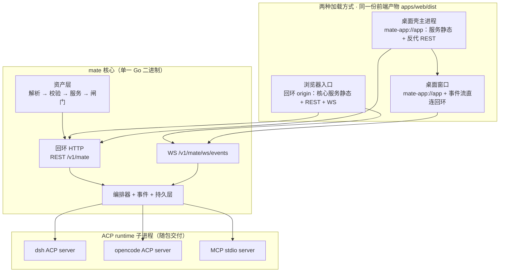
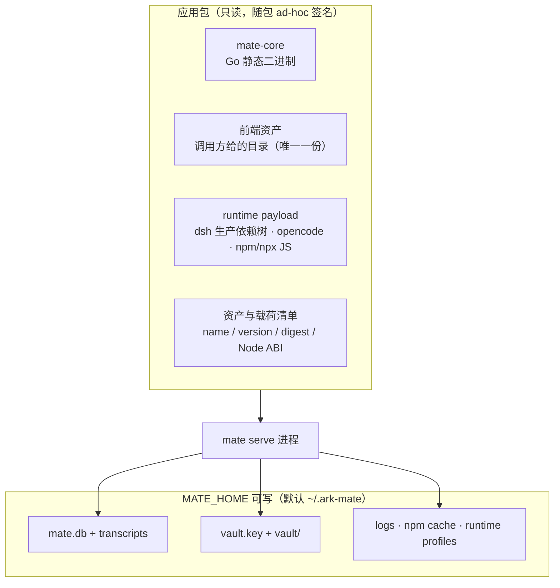
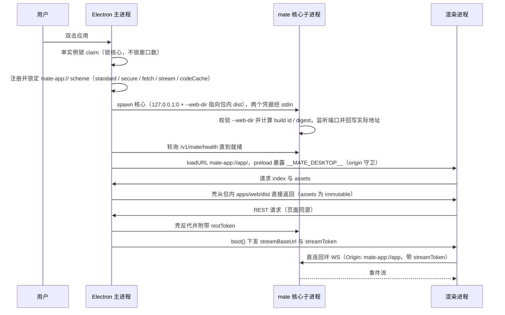

# ark-mate 桌面端架构设计

| 项 | 值 |
| --- | --- |
| 文档类型 | 技术方案（设计文档），不含实现 |
| 场景 | 增量改造（既有控制面新增桌面交付形态 + 运行时解析面改动）；桌面壳为新建 |
| 篇幅档位 | 完整档（裁剪：无多租户、容灾、成本核算章节） |
| 专题 | 架构设计 · 安全 · 性能与容量 |
| 设计基线 | `ark-mate` HEAD `0c4768e`；参考实现 `deepseek-harness` `0.1.7-rc.2`；Electron 44 / Node 24.18.1（实测） |
| 形态 | **一份 Go 核心**（回环 REST + WS + 资产层）**＋ 一个 Electron 壳 ＋ 一份随包资产与运行时载荷**。用户机器不需要 Go / Node / pnpm / Python，也不需要预装 dsh 或 opencode |

---

## 1. 目标与非目标

### 1.1 三条硬需求与验收判据

| # | 需求 | 可验证判据 | 验收环境 |
| --- | --- | --- | --- |
| R1 | **一份产物、两种加载方式**：交付态（桌面）与开发态（浏览器靶）功能一致 | 同一份前端产物、同一套 `/v1/mate` REST + WS、同一份数据目录；**同一个 DoD 脚本**在两个靶上全绿；且不存在"桌面能、浏览器不能"的流程（§10.2） | 交付态跑一次 + 开发态跑一次 + 单向断言 |
| R2 | 桌面安装不依赖用户本机的 node / pnpm / go | 最小 `PATH`（`<诱饵目录>:/usr/bin:/bin`，诱饵 = 会写标记文件的假 `dsh`/`opencode`/`node`/`npx`）+ 私有 `HOME`/`MATE_HOME`：首启 → 新建会话 → 跑完一轮 → 退出 → **重启续聊**，全程无"环境缺失"类错误，且诱饵**一次都没被调到**。**权限卡 / 提问卡暂无端到端覆盖**（假 LLM 发不出 `tool_use`，见 `.dsh/docs/plans/2026-10-10-no-host-dependency-plan.md` §5） | 打包态 `pnpm ui:accept:desktop-nohost:packaged`（源码态 `make verify/no-host-dep`）+ 静态配对 `internal/archtest/desktop_host_path_test.go`。**干净机器（VM / 干净用户）自 2026-10-10 起不再是必做**，仅作可选佐证 |
| R3 | 不存在远端 server | 首启到可用只发生两类出站：① 用户自配的模型 API；② 用户显式触发的 MCP 包拉取。无遥测、无崩溃上报、无默认更新检查 | 抓包 + 连接清单 |

R1 的实现方式决定了整体架构：一致性不靠两套实现，而靠**两个靶加载同一份产物、共用同一套契约**（§3）。

> **定位口径（决策 v8①③，2026-10-10）**：本项目只有**一个产品**——桌面应用。`apps/web` 是**唯一 UI 产物**，
> 浏览器入口只是**开发过程使用的形态**（它是唯一带 HMR 的开发循环），**不是第二个产品、也不是交付面**。
> R1 是**架构不变量**（挡住「桌面偷偷长出独占流程」），**不是**「两端同等排期」的承诺。

### 1.2 非目标

| 非目标 | 原因 |
| --- | --- |
| 跨机 / 局域网访问 | 与 R3 冲突；对外监听需先补 TLS、鉴权模型、多操作员归属与审计（§9.4） |
| 多用户 / 多操作员 | 产品定位即「单机单操作员的个人 Agent」（决策 v8①，沿用 v7①） |
| Linux 桌面发行 | 本期只做 macOS + Windows；Linux 走容器与源码 |
| 发现或复用用户本机已有的 dsh / opencode / node | 运行时随包交付；桌面端不探测 `PATH`、不引导用户自行安装（§6.4） |
| **桌面 IDE 外壳**（编辑器 / 终端 / 文件树 / Split View / canvas） | 决策 v8⑤：「聚焦桌面端」= 聚焦**交付形态与用户体验**，不是把产品做深成一个 IDE；编辑/终端归 agent 或外部 IDE |
| 桌面端独占功能 | 与 R1 冲突：桌面只允许"多给"，不允许"少给"（§10） |
| 重造 runtime 能力（skills / MCP / 推理） | 能力复用底层 runtime，平台只做数据与控制面 |
| 从网络获取 UI 资产 | 与 R3 冲突；资产来源只允许本地（§6.1） |

---

## 2. 工程结构

### 2.1 一个产品、一份 UI 产物：`apps/desktop`（交付态）与 `apps/web`（产物包）

工程分三层，依赖单向向下：

| 层 | 位置 | 职责 |
| --- | --- | --- |
| 能力层 | `frontend/packages/{ui,types,api,tsconfig}` | 组件库、类型、API 客户端、构建配置；被产物/产品层消费 |
| 产物 / 产品层 | `frontend/apps/desktop`（**唯一产品形态**）、`frontend/apps/web`（**UI 产物包**） | 桌面壳是交付态产品；`apps/web` 产出唯一一份 UI `dist`（开发态由 vite 托管、交付态由壳与核心加载） |
| 核心层 | `backend/`（单 Go module）+ `cmd/mate` | 回环 REST/WS + 资产层 + 运行时编排；不属于 pnpm workspace |

**两者关系（决策 v8①③，2026-10-10 口径修订）**：

- `apps/desktop` = **唯一产品形态（交付态）**：Electron 壳 + 资产与载荷装配 + 打包 / 签名 / 更新；**依赖
  `apps/web` 的产物**，不 import 其源码。
- `apps/web` = **UI 产物包**（**不是第二个产品**）：Vite SPA，产物 `apps/web/dist`；对外只暴露产物
  （`exports: { "./dist/*": "./dist/*" }`），不暴露源码。它有两个消费方：交付态（壳与核心读同一份）、
  开发态（vite 托管，**唯一 HMR 循环**）。
- **交付物**：桌面安装包（dmg / Windows 安装器）是**交付物**；`mate` 二进制与容器镜像属**服务端形态**
  （维护态，决策 v8③），其界面路径按「自用 / 开发」对待，不承诺 UI 体验。
- **专属能力**：托盘、更新、原生对话框只存在于交付态；共享代码不得依赖它们（§10.1）。
- **共享不变量**：同一份 `apps/web/dist`（R1 的实现方式）、同一套 `/v1/mate` 契约、同一份数据目录、同一套 DoD 脚本。

两者各自带 `dev` / `build` / `typecheck` 脚本，根 workspace 只做聚合与 `ui:accept`；构建缓存按 target 分开，
避免把开发态产物喂给桌面包。

**产物包纪律**（照参照实现的做法固化）：`apps/web` 对外是**产物包而非应用**——`dependencies` 为空（依赖在构建期全部打进 `dist`）、`exports` 只开 `./dist/*` 与 `./package.json`、`files` 只发 `dist` 并**排除 sourcemap 与开发面**；它必须是非 private 包，随桌面运行时闭包一起发布，桌面壳与核心都从**运行时依赖树里的同一份**读（§6.2）。守卫测试因此直接断言 `exports` 与 `files`，而不只是扫描 import。

**为什么两个包却仍共享一份前端产物**（决策 v8④ 口径）：deepseek-harness 的 `apps/web`（`@deepseek-ai/dsh-web-frontend`）构建出的 `dist`，正是它桌面窗口渲染的那份 UI——桌面壳在 `dsh-app://app/` 路由下，从包内 `node_modules/@deepseek-ai/dsh-web-frontend/dist` 直接读静态资产，其余请求反代给本地 Host，事件流按壳在 boot 时下发的 `streamBaseUrl` 直连回环。即：**产物只有一份，加载方式有两种（交付态 / 开发态）。**

| deepseek-harness | ark-mate | 说明 |
| --- | --- | --- |
| `apps/web`（`dsh-web-frontend`，Vite，`exports: ./dist/*`） | `apps/web`（Vite SPA，`exports: ./dist/*`） | **UI 产物包**：同一份 `dist` 被两种加载方式共用（交付态桌面 / 开发态浏览器靶） |
| `apps/desktop`（`dsh-desktop`：壳 + 打包 + 更新 + 安装器脚本） | `apps/desktop` | **唯一产品形态（交付态）**：依赖 `apps/web` 的 `dist` |
| `apps/desktop-host` | `backend/`（Go 核心，含资产层与运行时编排） | 被壳 spawn 的宿主；ark-mate 里它就是 `mate` 二进制本身，不在 pnpm workspace 内 |
| `apps/cli`（owns the `dsh` bin） | `backend/cmd/mate` | 命令行入口 |
| `packages/*/*`（含 `client/ui-*` 组件层） | `packages/{ui,types,api,tsconfig}` | 能力层 |
| `packages/bundle/web-app`：组装可运行的 web 产品（起 webServer + 打开浏览器） | 浏览器入口由核心托管前端资产（`mate web`） | 组装层在 ark-mate 落在 Go 侧 |
| `apps/desktop/scripts/*`：`prepare-runtime`、`sign-primary-runtime`、electron-builder 配置、更新环境、安装器测试 | `apps/desktop/scripts/*`：资产与载荷装配（`prepare-runtime`）、`release.json` 生成与逐项复核（`build-release-json` / `verify-release-json`）、打包、签名/公证、更新环境、安装器测试 | 把**发布契约**与业务逻辑分离，让"发布怎么发生"有唯一落点 |
| `desktop-runtime.json`（逐文件完整性清单）+ `release.ts`（发布列车统一版本；实测 `apps/{web,cli,desktop,desktop-host}` 同为 `0.1.7-rc.2`） | `apps/desktop/release.json`：app 版本 + `mate-core` 版本 + **前端 build id / digest** + 各载荷 `name/version/digest` + 交付事实（`signing` / `notarized` / `channel` / `macUpdate`，见计划 §12.27） | 一个发布号标识整套（`coreVersion` 必须等于 `appVersion`，由脚本断言）；同时是 §6.7 版本闸门的落点 |
| pnpm 供应链纪律：`allowBuilds` 默认拒绝、`patchedDependencies`、`minimumReleaseAge`、随包第三方按平台钉死确切版本 | 沿用，并**扩展到随包 runtime**：Electron、`dsh`、`opencode` 的确切版本与平台矩阵写入 `release.json` 与合规清单（§11） | 随包第三方二进制必然出现在用户机器上，版本必须可复现、可审计 |

**依赖边界（守卫测试固化，越界即 CI 失败）**：

1. `apps/web` 不得 import 任何 Electron 模块或 Node 内置模块；
2. `apps/desktop` 不得 import `apps/web` 的源码，只允许消费其 `dist` 产物；
3. `packages/*` 不得 import 任何 `apps/*`；
4. `backend/` 不依赖 `frontend/`（Go module 边界已保证；`backend/internal/archtest` 已有分层守卫，前端补等价的一层）。

这四条把"两端功能完全一致"从**纪律**变成**结构**：前端产品在类型与依赖层面就够不到 Electron API，只能走宿主能力面（§10.1）。这比任何验收脚本都更早生效。

**构建 DAG**：

```text
packages/*  ──>  apps/web  ──>  apps/web/dist
                                 ├──> backend 资产装配 + 构建 ──> mate 二进制 / 镜像   （产品一：web）
                                 └──> apps/desktop 资产装配 ──┐
backend/（Go 核心：mate-core）────────────────────────────────┴──> dmg / 安装包         （产品二：desktop）
apps/desktop（Electron 壳 + 打包 / 签名 / 更新）
```

> 构建 DAG 矢量图（可独立打开：[monorepo-build-dag-20260928.svg](assets/monorepo-build-dag-20260928.svg)）：


**Makefile 入口（保持单一入口，不引入第二套构建心智）**：

| 目标 | 产物 | 依赖 |
| --- | --- | --- |
| `make web` | `apps/web/dist`（唯一一份资产） | — |
| `make image` | 容器镜像 | `web` |
| `make desktop/dist` | macOS dmg / Windows 安装包 | `core/desktop`（= `web` + 核编译）+ 资产与载荷装配 |

> 单二进制形态（`make all` 产出仓库根 `./mate`、前端资产经 `go:embed` 内嵌）已于 **2026-10-10 取消**：核心
> **永不自带**资产，资产只有 `apps/web/dist` 一份，由调用方 `--web-dir`/`MATE_WEB_DIR` 指过去（没给即拒启，
> 退出码 3）；要自建就用 `cd backend && CGO_ENABLED=0 go build -o mate ./cmd/mate` + 外挂那份 dist。

**「独立 vs 共享」的准确含义**（决策 v8④：**产物只有一份，加载方式有两种**；独立的只是**流水线与交付物**，
**不是第二个产品**）：

| 独立（各自构建、互不渗透） | 共享（不允许分裂） |
| --- | --- |
| 代码位置（两个 app 包）· 构建流水线 · 交付物（安装包 vs 二进制 / 镜像）· 发布节奏 · 专属能力（托盘、更新、原生对话框） | 前端产物（同一份 `apps/web/dist`——交付态与开发态共用）· `/v1/mate` REST + WS 契约 · 数据目录 · DoD 脚本（同一套打两个靶子） |

> **层次组织**：产物层与产品放在 `frontend/apps/*`，与 `packages/*` 同一个 pnpm workspace，工具链（`.nvmrc` / `packageManager`）统一。若要将仓库按"产品"而非"语言"划分（`apps/*` + `packages/*` 提到顶层、`backend/` 并入 `apps/`），在引入第三个消费方（例如独立部署的服务端装配）时再评估。
> **不做**：桌面产品不新增 Go module，壳也不 import Go 代码；共享走 API 与 `release.json`，避免把 monorepo 边界搅浑。

### 2.2 影响面与唯一的行为变更

设计虽为"新增桌面形态"，但落到既有系统上只有**一条行为变更**需要兼容性论证：**运行时可执行文件的解析策略**。

| 面 | 改动 | 兼容性要求 |
| --- | --- | --- |
| 资产来源 | 唯一机制：`--web-dir` 显式目录（桌面形态由壳指向包内 dist；构建期内置那一支 2026-10-10 已删） | 没给目录即拒启（退出码 3）；实际路径（`webPath`）与 build id 可观测（§6.1） |
| 运行时解析 | 新增"随包载荷"为一等来源；桌面态只认载荷 + 显式覆盖 | CLI / Docker / 开发态行为不变（仍走 `PATH`，§6.5） |
| 配置 | 新增：资产来源与路径、载荷名称解析、桌面握手开关、宿主能力面 | 全部有默认值；未设即现状行为 |
| MCP stdio | 支持把 `npx` 指向随包转发启动器（绝对路径） | MCP 契约（要求绝对路径）不变 |
| 构建流水线 | 建立 `apps/web`（UI 产物包）/ `apps/desktop`（产品）两个包与 `make desktop`；资产装配与 engines 断言进 CI | `make image` 保持可用（`make all` 单二进制已于 2026-10-10 取消） |
| 前端 | 桌面能力经宿主能力面暴露（声明面 + 执行面，§7.3），不嗅探 UA | 开发态（浏览器靶）行为不变 |
| 数据目录 | 一份共享路径，不按入口分裂（§8.4） | 既有用户的 `vault.key` / `mate.db` / transcripts 位置不变 |

---

## 3. 总体形态：一份核心，多入口

> **口径（决策 v8③）**：下面两个入口**不是平级的**——桌面入口是**交付态**（唯一产品形态），浏览器入口是
> **开发态**（唯一 HMR 循环 + R1 的第二个靶）。服务端形态（自建二进制 + 外挂 dist / 容器内 dist）用同一份产物，其界面按
> 「自用 / 开发」对待。



**形态**：只有一个 `mate serve`；浏览器与桌面窗口是它的两个前端入口，加载**同一份 `apps/web/dist`**，但 origin 与通道不同：

| | 浏览器入口（`mate web`） | 桌面入口（Electron 壳） |
| --- | --- | --- |
| origin | `http://127.0.0.1:<port>` | `mate-app://app` |
| 静态资产 | 核心资产层（§6.1） | 壳服务 `index` 与 `/assets/*`（运行时树里那一份 dist）；核心以同一目录为 `--web-dir` |
| REST | 页面直连核心，`Authorization: Bearer` | 壳反代（页面同源）；REST 凭据只存在于主进程 |
| 事件流 | 页面直连 `ws://127.0.0.1:<port>` | 同左：壳在 boot 时下发基址与通道级凭据 |
| 数据与事件语义 | 同一份 `MATE_HOME`、同一套 `/v1/mate` 契约与事件类型 | 同左 |

- **为什么桌面入口不复用回环 origin**：① origin 与随机端口解耦——`mate-app://app` 恒定，磁盘缓存与页面存储跨启动稳定复用；② REST 凭据不进渲染进程，只剩事件流一条通道需要凭据；③ 页面脚本无法自行构造对核心 REST 面的带凭据请求。
- **为什么事件流仍然直连回环**：`protocol.handle` 不承载 WebSocket upgrade，属机制限制而非取舍（§7.2）。
- **为什么这样比两套实现好**：R1 从"需要持续维护的一致性"变为"结构上不可能不一致"；现有 CDP 验收脚本天然复用；两端共享同一份数据与事件语义。
- **代价**：桌面端额外承担壳、资产与载荷装配、签名、更新；业务逻辑只能经 HTTP/WS，多一层进程边界；静态资产存在核心侧与壳侧两条服务路径，必须由 CI 断言锁住行为一致（§6.2）。
- **什么情况下不该选**：产品要的是"Electron 原生 UI 而非 Web UI"，或要求核心逻辑跑在渲染进程内、做无端口纯本地应用。

**一个核心、N 个窗口**：单实例锁锁的是**核心**，窗口数不受限，将来可"一个工作区一个窗口"全部指向同一核心。启动顺序（起核心 → 等就绪 → 开入口）封装为**唯一一份启动器逻辑**，桌面壳与 `mate web` 共用，避免两套就绪判定。

---

## 4. 桌面壳：Electron

| 维度 | **Electron** | Wails v3 | Tauri v2 |
| --- | --- | --- | --- |
| 渲染引擎 | 自带 Chromium，版本固定 | 系统 WebView | 系统 WebView |
| 与 web 端渲染一致性 | **完全一致** | 随 OS/版本漂移 | 随 OS/版本漂移 |
| 自动化验收靶子 | **现有 Chrome + CDP 脚本直接复用** | macOS 端需重做（WKWebView 无 CDP） | 同左 |
| 附加体积（macOS，估算） | 90–120 MB | 15–30 MB + 系统 WebView | 10–25 MB + 系统 WebView |
| 自带 Node | **有（24.18.1，实测）** | 无 | 无 |
| 系统前置依赖 | 无 | 长尾需 WebView2 bootstrapper | 同左 |
| 原生能力扩展（托盘/深链/多窗口/更新/公证） | 生态最成熟 | 一般 | 成熟（Rust 侧） |

**选择理由**：

1. **统一渲染**：两端同一个 Chromium 版本，antd 6 + React 19 的差异不会变成"桌面专属 bug"。
2. **单一验收靶子**：真 Chrome + CDP 的 `ui:accept` 可直接打到 Electron 窗口（开 remote debugging port），"功能完全一致"有唯一的机器判据。
3. **扩展成本最低**：托盘、协议处理、多窗口、原生菜单、自动更新、公证工具链在同一生态内。

关于系统 WebView 的事实口径：WebView2 Evergreen 在**所有 Windows 11** 上预装，微软也已推送到符合条件的 Windows 10 设备（[Microsoft Learn](https://learn.microsoft.com/en-us/microsoft-edge/webview2/concepts/evergreen-vs-fixed-version)），残留长尾（LTSC / 未纳管老镜像 / Server）需要 bootstrapper（[Tauri Windows Installer](https://v2.tauri.app/distribute/windows-installer/)）。因此 WebView 方案的差异**不在"零依赖"**，而在渲染统一与验收靶子——这正是 R1 最在意的一环。

- **代价**：附加 90–120 MB；Electron 主版本成为发布兼容性义务（含其 Node 版本，§5）。
- **什么情况下不该选**：
  - 不接受体积与 JS 构建链，且能接受 macOS 端另做一套 UI 验收 → Wails v3。注意 Wails 也可以加载同一个回环 URL（不必用其 bindings），它损失的不是功能一致性，而是渲染统一与统一靶子。
  - 只要求"零附加体积"、能接受窗口就是系统浏览器（`mate web` + 托盘 + 开机自启）→ **瘦启动器形态**：三条需求都轻松满足，代价是失去桌面应用感（图标、独立窗口、深链、原生对话框）。

---

## 5. 运行时执行环境：Node 由 Electron 提供

### 5.1 事实与口径

| 事实 | 值 | 来源 |
| --- | --- | --- |
| Electron 自带 Node | **24.18.1**（V8 15.2.124.13-electron.0，ABI 149） | 实测 `ELECTRON_RUN_AS_NODE=1 <Electron 可执行文件> -e 'process.versions'`（2026-09-28，Electron 44.0.0） |
| dsh 要求的 Node | `^22.19.0 \|\| >=24.0.0` | 源码 `package.json` 的 `engines`（0.1.7-rc.2）。**实测订正（2026-09-28，M3-7）**：发布到 npm 的包里**没有保留 `engines`**（闭包内 85 个包有 engines，`@deepseek-ai/*` 一个都没有），因此随包载荷里没有可判定的声明——M3-7 的 engines 判定对 dsh 目前**退化**为「ABI + Electron 版本」两项（那两项有牙齿），并逐份打印「无声明 + 看过哪些文件」。这条值仍是我们对该 runtime 的**要求**；要让判定真正成立，应由装配期把它写进 `payload.json`（见计划 §13 的 T11） |
| 结论 | **满足**，且由发布期断言持续保证（§5.3） | — |

### 5.2 机制

| 环节 | 做法 |
| --- | --- |
| 直接子进程（ACP runtime） | 解析结果 = `[Electron 可执行文件, --expose-internals, <runtime 入口 JS>]`，并在该子进程 env 注入 `ELECTRON_RUN_AS_NODE=1`。`utilityProcess` 是 Electron 侧等价且官方推荐的路径（[utilityProcess](https://electronjs.org/docs/latest/api/utility-process)、[process-model](https://github.com/electron/electron/blob/main/docs/tutorial/process-model.md)） |
| 孙子进程（runtime 自己再 spawn） | 私有 bin 目录放转发启动器（`node` / `npx`，Windows 下 `.cmd`），把该目录**前置**到这些子进程的 `PATH`（保留其尾部，§6.6），并注入 `MATE_NODE_EXECUTABLE` 指向 Electron 自身可执行文件；不注入 agent 常规 shell |
| MCP stdio | 契约要求绝对路径，指向私有 bin 的 `npx`；`npm`/`npx` 是 JS，跟随 Electron 的 Node 执行，体积仅十几 MB |

### 5.3 发布期断言

把 `dsh` 的 `engines.node` 与 Electron 自带 Node 版本**在打包时比对**，不满足即构建失败；Node 版本与 ABI 同时写入资产/载荷清单，供 `mate doctor` 复核。**Electron 主版本升级必须重跑这条断言**——这是"共用同一个 Node"唯一的系统性安全网。

### 5.4 回退形态

满足任一条即改用**独立 Node 载荷**（资产与载荷的配置面不变，只换装配）：

1. `dsh` 或 `opencode` 在 Electron 的 Node 下启动失败，或原生 addon（Node-API）加载失败；
2. 某 runtime 明确检查并拒绝非官方 Node（例如读 `process.versions.electron`）；
3. `--expose-internals` 类内部符号依赖在 Electron 升级后断裂且无替代。

**代价**：约 +90–110 MB，并多一个需要单独签名的原生可执行文件（不公证，见 §8 决策）。三条各自写成一个 smoke 用例，作为桌面构建的门禁。

---

## 6. 资产与运行时载荷交付

### 6.1 前端资产：唯一来源是调用方给的目录（2026-10-10 收敛）

前端资产（`apps/web/dist`）只有一种进入方式——调用方给的目录，其余场景都是「谁把这份目录指给核心」的组合。
（2026-10-10 之前还有第二种：构建期经 `//go:embed` 把 dist 打进二进制；那一支与「单二进制」形态已一并删除
——**两种来源意味着两份资产的可能，而本设计的红线是只有一份**，理由见决策 v9。）

| 机制 | 何时用 | 行为 |
| --- | --- | --- |
| 运行期目录（`--web-dir` / `MATE_WEB_DIR`，必须是绝对路径） | **所有形态**：桌面（壳指向包内那一份 dist）、容器（镜像内 `COPY` 的那份）、开发（vite 产物目录）、自建二进制、部署者热修与白标 | 启动时校验目录存在且含 `index.html`；实际路径（`/meta` 的 `webPath`）、build id、digest 写入启动日志与 `/meta` |

**规则**：

- **没有第二种来源可回落**：给了目录就用它，没给就**拒绝启动**（退出码 3），给了无效目录同样拒绝启动——"配错却照常跑起来"会让人看到旧界面却以为新版本已生效，而"没配也能跑"会让一份资产变成两份。
- **不做隐式搜索**：没有"可执行文件同目录 → `../share/ark-mate/`"这类多级回落，来源永远只有「调用方给的那一个」，实际采用的绝对路径永远写在启动日志与 `/meta` 的 `webPath` 里。
- **显式覆盖只出现在"未打包"与"打包层"**：打包形态下 `--web-dir` 由壳按安装布局写死（参照实现的两个路径覆盖环境变量只在 `!app.isPackaged` 分支被读取，打包态是固定布局），核心既不推测也不搜索——来源永远是别人告诉它的。
- 完整性：目录在启动时计算并回报 build id 与逐文件 digest（`/meta` 与 `mate doctor` 都能看），但不与签名清单比对——它表示"操作者显式选择了这个来源"；桌面打包期另由 `release.json` 记录资产清单与摘要、壳与核心两侧断言同一值（§6.7）。
- 资产只允许来自本地（R3）。不实现远端拉取与运行期下载。
- 桌面窗口的静态资产由壳服务（§6.2）；桌面形态的核心**不内嵌**资产，而是被 spawn 时收到指向同一份 dist 的 `--web-dir`，因此浏览器入口与桌面窗口读的是同一目录、同一 build id。

### 6.2 静态资产服务路径：核心侧与壳侧

**核心侧**（浏览器入口、Docker、CLI）：调用方给的目录（`os.DirFS`）归一成**同一个 `fs.FS` + 一套逻辑**——参照实现把 dist 服务交给组装层（其宿主 webserver 明确"不服务文件"），ark-mate 没有插件组装层、核心本身就是那一层：

| 关注点 | 一次定义，处处生效 |
| --- | --- |
| SPA 回退 | 非 API 路径未命中 → `index.html`；`/v1/*` 未注册路径 → 标准信封 404（语义不变） |
| 缓存语义 | `index.html` → `no-store`；带内容 hash 的 `assets/*` → `immutable, max-age=31536000` |
| 完整性 | 资产清单（逐文件 sha256 或包级 sha256），启动时校验；缺失/不符 → 明确报错 |
| 版本闸门 | §6.7 |
| 可观测 | `/meta` 回报 `webPath`（实际采用的绝对路径）、`webBuildId`、`webDigest` |

**壳侧**（桌面窗口）：壳只服务五个路径——`/`、`/index.html`、`/assets/*`、`/favicon.svg`、`/manifest.webmanifest`——从运行时依赖树里的那一份 `apps/web/dist` 读（`release.json` 记录其 build id 与 digest，两侧断言同一值）；其余请求（含 SPA 回退与全部 `/v1/*`）交给核心。壳与核心读**同一个目录**，因此不存在两份资产，也不存在"index 引用到别处 assets"的错配。

| 一致性断言（进 CI） | 内容 |
| --- | --- |
| 路径集合 | 壳服务的路径集合是核心侧静态规则的子集，且壳侧不含回退逻辑 |
| 响应头 | 同一路径在两侧的 `Content-Type`、`Cache-Control` 逐字一致 |
| 回退归属 | 非资产路径在桌面窗口下也必须最终由核心的回退产出 `index.html` |
| build id | 两侧读到的 `build id` 相同（同一目录），且与核心期望值一致（§6.7） |

**路径解析**：核心只接受**绝对路径**——壳与包装脚本负责在边界处做一次 `realpath`（Homebrew/Cellar 符号链接、macOS bundle 内的 `Contents/Resources/`、Windows 安装目录、容器工作目录的差异都在那里归一），核心启动时用 `EvalSymlinks` 复核、要求目录内存在 `index.html`，并把**实际采用的绝对路径**写进启动日志与 `/meta`。没有隐式搜索、没有多级回落，因此"页面 404 但服务正常"这种半启动状态在结构上不成立。

### 6.3 运行时载荷：随包只读



- **只读面**：核心二进制、前端资产、运行时载荷、清单——全部在应用包内，直接使用，不做首启物化。
- **可写面**：只有 `MATE_HOME` 下的状态目录。不往系统目录写任何东西，不持久改用户环境（私有 `bin` 只前置到子进程的临时 `PATH`，§6.6），不碰用户既有的 dsh / opencode 配置。
- **完整性**：打包期逐文件生成清单 + CI 复算；启动期只做必要读取，全量复算由 `mate doctor --verify-payload` 承担。
  **清单必须自描述**（M4-5 修正）：`fileList` 的相对路径基准由 `payload.json` 的 `fileListBase` 给出——
  两份载荷的落点形态本就不同（dsh 的闭包在 `node_modules/` 下、opencode 直接铺在载荷根），此前清单里
  没有任何字段说明这件事，任何"从清单复算载荷树"的消费方都只能靠猜。补齐这个字段正是
  `mate doctor --verify-payload`（15k+ 个文件逐个 sha256 + 合成摘要）能成立的前提（计划 §12.31）。
  收尾核对：`make verify/compliance`（NOTICES + CycloneDX SBOM 与 `release.json` 逐项一致，设计 §11.1）。
- **命名空间**：`payloads/<name>/<version>/`（随包）+ `MATE_RUNTIME_<NAME>` 覆盖。当前两份：`dsh`、`opencode`；`npx` 走 Electron 的 Node + 私有 bin，不单独占一份载荷。将来加 `python`（部分 MCP server 需要）只需新增一份载荷 + 一个名字，配置面不动。
- **回退条件**：若某 runtime 需要写自身所在目录，或平台签名/公证/hardened runtime 不允许包内执行该二进制，
  则该载荷退回"从包内首启物化到 `MATE_HOME`"——这是唯一允许引入物化的场景。
- **形态结论（2026-09-28，M3-6）**：**当前不需要物化**，随包只读执行。三条回退条件的取证状态：
  - ① **runtime 是否会写自身所在目录** —— 已验：桌面态经私有 bin 真起了两份载荷（`opencode` 完成
    `initialize` + `session/new`；`dsh` 起进程并在 Electron 的 Node 上跑到 boot 阶段）后，两者载荷目录的
    指纹（文件数 / 总字节 / 元数据摘要 / 目录 mtime）**逐字零变化**（见计划 §12.26；跑的是
    `desktop-runtime-smoke.mjs`）。注意措辞：`dsh` 那天**没走完握手**，原因见下面的第四条约束；
  - ② **签名 / 公证 / hardened runtime 是否允许包内执行** —— **拆成两半**（2026-09-28 决策，计划 §12.27）：
    **hardened runtime 这一半由 M4-2a 用 ad-hoc 签名验证**（`codesign --options runtime -s -` 不要求证书，
    是同一套运行时约束）；**公证那一半不做**（不上架、不付费），因此"异地机器 + staple"这条验收被撤销，
    替换为"`tar.gz` 解到干净目录后首启无阻断"。
    **结论（2026-09-28，M4-2a，计划 §12.29）**：**hardened runtime 半边已验绿**——打出来的包
    （ad-hoc + `--options runtime` + entitlements 最小集）里，壳、核心与两份载荷全部能执行：
    `MATE_SMOKE_APP=<app> pnpm smoke:desktop` 40/40（dsh 与 opencode 的 `initialize` + `session/new`
    都在包内那份 Electron 的 Node 上走完，且载荷目录指纹零变化）。公证半边**本期不做**（`spctl` 如实记录为
    `rejected`，是 ad-hoc 的预期结论）。
    **2026-10-09 复跑（随包载荷换代到 dsh `0.2.0-rc.2` / opencode `2.0.26` 之后）**：`pnpm
    smoke:desktop:packaged` **41/41**（同一批断言，两份包内载荷目录指纹仍逐字零变化）、`pnpm
    verify:signature` 44 个 Mach-O 对象全带 `--options runtime`。同批**补上 V9 判不到的那一层**——
    包内**能力投放**：真包内壳 + 包内核心 + **打包时重新生成**的私有启动器 + 包内载荷，平台物化的
    skill 逐字出现在**包内 dsh** 的模型请求体 `<available_skills>` 里（opencode 侧同判，见其
    `<skill><id>…</id>…</skill>` 目录块），**27/27**；探针的 `HOME`/`MATE_HOME` 仍全在仓库内，
    收尾核对用户真实 `~/.agents`、`~/.ark-mate`、`~/.local/state/opencode` 零变化。入口：
    `make verify/hardened-runtime`（已把这条并进打包链）或 `pnpm ui:accept:desktop-skills:packaged`；
    V9 判"包内能不能跑"，这条判"跑起来有没有把该给底座的给到"——两件事，别互相替代；
  - ③ **Windows SmartScreen / AV 是否拦** —— **未验**（需要 Windows 测试机与出包，属 M4；见 T2）。

- **第四条约束（2026-09-28 M3-8 实测新增，与上面三条并列，必须一起看）**：**载荷里的原生插件能不能在
  壳随包的那份 Node 上 boot**。dsh 的传递依赖 `node-addon-require-builtin@0.1.6` 对 Electron 做
  **V8 精确指纹**匹配（不是 ABI 匹配——ABI 两边都是 149，照样被拒），它的支持表只列了
  `43.0.0 / 44.0.0 / 45.0.0-alpha.6`；本仓先前 pin 的 `44.4.5`（V8 15.2.124.28）不在表里，症状是
  `dsh: fatal uncaught exception: … unsupported Electron runtime fingerprint`（进程起得来、握手发不出去）。
  **处置：Electron 回到设计 §5.1 记的 `44.0.0`**（V8 15.2.124.13，ABI 同为 149），dsh 握手实测转绿。
  教训要留住：**ABI 一致不等于能跑**——原生插件的 prebuilt 表可能还认 V8/Electron 版本；
  M3-7 的 engines 断言目前只比 engines 声明 + ABI，抓不到这一层（见计划 §13 的 T11）。
  因此这条结论是**有条件的**：②③ 一旦在 M4 被拒，按本节回退条件物化，且只对命中的那份载荷启用
  （`--web-dir` 与 `MATE_RUNTIME_<NAME>` 这两条既有通路已能承载，不需要新机制）。

### 6.4 与用户本机环境的隔离

桌面形态**不探测、不提示、不复用**用户本机的 dsh / opencode / node：只运行随包版本。理由是"用户本机恰好有一个旧版 runtime"会同时带来版本漂移与"桌面和 CLI 行为不一致"两类问题。

各 runtime 的 home / config 变量重定向到 `MATE_HOME` 下的专属子目录，避免与用户自己安装的 dsh / opencode 串味。具体变量名按各自文档逐个核对后写入注入表（§15 Q2）。

### 6.5 运行时解析策略

| 优先级 | 来源 |
| --- | --- |
| 1 | 显式配置覆盖（`runtimes.json` 的 `Command` / MCP 的 `command`；仅高级用户显式设置） |
| 2 | **随包载荷**（只有打包分发才存在） |
| 3 | `PATH`（没有随包载荷时） |

三个形态走的是**同一条链**，差别只在"随包载荷是否存在"：桌面分发一定存在，于是永远落不到 `PATH`——这正是 R2 要的；CLI / Docker / 开发态通常不存在，于是落到 `PATH`。这不是对既有用户的兼容让步，而是同一套语义在不同分发形态下的自然结果。命中哪一级必须写进启动日志与 `/meta`。

**但这里有两件事不能混为一谈**（混了会让桌面态下大部分 MCP server 起不来）：

| | 规则 | 参照依据 |
| --- | --- | --- |
| **我们自己的载荷解析**（`dsh` / `opencode` / Node） | 只从随包载荷解析；**不做 `which` 式探测**；缺失即打包期或启动期错误（§6.3、§6.4）。因此链上的第 3 级对我们的载荷在打包形态下不可达 | 参照实现里没有任何 `command -v` / `which` 探测，打包态路径是一次 `isPackaged` 二分之后的固定布局 |
| **子进程环境里的 `PATH`** | 私有 `bin` **前置**，其后保留调用方的 `PATH`（§6.6） | 参照实现显式保留调用方环境（注释写明"为插件执行保留"），只在前面插入私有 `bin`：`PATH = bin + 分隔符 + 原 PATH` |

用户显式配置的 MCP `command` 允许是 `PATH` 上的名字——那是用户的意图，不是我们的回落。

### 6.6 子进程环境注入

环境以**调用方环境为基线整体继承**，再覆盖必须覆盖的项。整份白名单化（只给必需变量）会让 MCP server 与用户自己的工具链（`git` / `python` / `uv` / 代理与 `SSH_AUTH_SOCK`）找不到或连不上；参照实现同样选择"保留调用方环境，只为插件执行叠加变量"，这里跟随它：

| 变量 | 值 | 注入给谁 |
| --- | --- | --- |
| （继承） | 调用方环境原样保留 | 全部子进程 |
| `ELECTRON_RUN_AS_NODE` | `1` | 由 Electron 的 Node 承担执行的那些 runtime / MCP 子进程 |
| `PATH` | 私有 bin **前置** + 继承值（`私有bin + 分隔符 + 原 PATH`） | runtime / MCP 子进程（不注入 agent 常规 shell，不改用户环境） |
| `MATE_NODE_EXECUTABLE` | Electron 自身可执行文件的绝对路径 | 私有 `node` / `npx` 启动器，使转发到同一个 Node（对应参照实现的 `DSH_DESKTOP_NODE_EXECUTABLE`） |
| `MATE_HOME` | 桌面数据目录 | 核心 |
| 各 runtime 的 home / config 变量（下表逐个列出） | `MATE_HOME` 下的专属子目录 | 对应 runtime 子进程（隔离既有配置，但不影响其工具链可见性） |
| `npm_config_cache` / `npm_config_prefix` | `MATE_HOME` 下（`npm/cache`、`npm/global`） | runtime / MCP 子进程 |

不覆盖：用户原有的 `PATH` 尾部、代理与凭据类变量、语言运行时变量。隔离的目标是**我们自己的 runtime 配置**（home / cache / prefix），不是用户的开发环境。

#### 6.6.1 各 runtime 实际读取的变量（Q2 的核对结果，2026-09-28）

计划 §15 Q2 要求"逐个查 dsh、opencode 实际读取的 home / config 变量名"。核对方式不是查文档而是**查载荷本身**
（我们随包发的就是这些字节）：dsh 的 JS 闭包直接读源码，opencode 是单文件原生二进制、用 `strings` 提取
（`strings payloads/opencode/<v>/bin/opencode | grep -oE '\b(XDG_[A-Z_]+|OPENCODE_[A-Z_]+|HOME)\b' | sort | uniq -c`）。

| runtime | 变量 | 我们注入的值 | 依据（载荷内的证据） |
| --- | --- | --- | --- |
| dsh | `DSH_HOME` | `<MATE_HOME>/runtime/dsh` | `@deepseek-ai/dsh-home-paths/lib/index.js`：`const DSH_HOME_ENV = "DSH_HOME"`，默认 `join(homedir(), ".dsh")` |
| dsh | `DSH_AGENTS_HOME` | `<MATE_HOME>/runtime/dsh/agents` | 同文件：`DSH_AGENTS_HOME ?? join(homedir(), …)`——**默认不跟着 `DSH_HOME` 走**，只给 `DSH_HOME` 会漏掉 agents 面，所以两个都注入 |
| opencode | `XDG_CONFIG_HOME` / `XDG_DATA_HOME` / `XDG_CACHE_HOME` | `<MATE_HOME>/runtime/opencode/{config,data,cache}` | 二进制内的变量名（opencode 的配置/数据面走 XDG 约定） |
| opencode | `XDG_STATE_HOME` | `<MATE_HOME>/runtime/opencode/state` | **v2 补（2026-10-09 对 `@opencode/cli-darwin-arm64@2.0.26` 复核对齐）**：后台服务的登记文件解析式在二进制里是 `join(process.env.XDG_STATE_HOME ?? join(homedir(), ".local", "state"), "opencode", "service.json")`。不隔离这一项，平台拉起的 `opencode acp` 会读到**用户自己**的登记：同版本同 url 直接复用用户的服务，版本不符还会走替换分支（SIGTERM 旧进程 + 删登记文件）——即"mate 动了本机" |
| opencode | `OPENCODE_CONFIG_DIR` | `<MATE_HOME>/runtime/opencode/config/opencode` | 同上；opencode 自己的配置目录覆盖点 |
| opencode | `OPENCODE_DB` | `<MATE_HOME>/runtime/opencode/data/opencode.db` | 同上；其会话库落在数据目录内 |
| 两者 | `npm_config_cache` / `npm_config_prefix` | `<MATE_HOME>/npm/{cache,global}` | 我们自己的 npm/js 生态（MCP server 用 `npx` 拉起时不该污染 `~/.npm`） |

**隔离的代价（明写出来，免得被当成遗漏）**：桌面态下 dsh/opencode 读不到用户在终端里给它们配好的东西
（`~/.dsh` 的 profile、`~/.config/opencode` 的 provider 凭证）。这是**有意**的：桌面态的凭证来源是平台自身
（provider 档案 / 平台配置的 dsh profile），否则"终端里登录过"就成了桌面态能否工作的隐藏前提。
代价的真实后果只有一个——用户在终端里配好的 runtime 配置不会自动出现在桌面态，需要在平台里配一次；
反向也成立：桌面态不会把平台配置写回用户的 runtime 目录（这正是隔离要保证的）。

三条纪律：
1. **只注入"我们发的那份 runtime"需要的变量**，不整份重写 `HOME`——用户工具链（git / uv / 代理 / `SSH_AUTH_SOCK`）仍按用户环境工作（§6.4 的"隔离在配置面而不是环境面"）。
2. 变量名是**实测值**，不是猜的：上表的每一项都能在载荷里指到出处；将来 dsh / opencode 换名，
   做法是重新核对并更新本表，而不是"多注几个以防万一"（多注的变量不会报错，只会静默失效）。
3. 注入点：变量随 `LaunchSpec.Env` 进对应 runtime 子进程（Go 侧 `pkg/runtime.IsolationEnv`），
   不污染壳给核心的那份环境——`MATE_HOME` 本身是全局的，各 runtime 的**子目录**是局部的。

### 6.7 UI/API 版本闸门

只要前端资产可被替换，就会出现"前端与核心不同步"的组合。闸门成本极低，作为常设机制：

| 环节 | 内容 |
| --- | --- |
| 前端产物 | 构建时写入 `build id`（产物内常量或 `index.html` 的 meta） |
| 核心 | 启动时读自己的期望值，并在 `/health` 或 `/meta` 回报 `coreVersion` / `webBuildId` / `apiContract` |
| 前端 | 启动时比对自身 `build id` 与核心回报值；不一致 → 显示明确状态（"前端与核心版本不一致，请刷新或重新安装"），而不是白屏或零散接口错误 |
| 打包期 | `release.json` 记录三者并做一致性断言，缺一即构建失败。取值方式（M4-1）：`coreVersion` / `apiContract` 由 **`mate-core --version --json`** 交出（核心的版本出口，唯一取法——ldflags 注入是构建期生效的，只有问二进制才知道它带了哪个值）；`webBuildId` / `webDigest` 由打包脚本**复算** `resources/web`（摘要算法与核心侧的 `router.compositeDigest` 同源，两者逐字一致由 `make verify/release-json` 拿核心 `/meta` 的回报值对照） |

---

## 7. 启动链与握手

### 7.1 启动链



链路上没有任何"安装"动作：无 registry 请求、无编译、不写系统目录、不改用户 `PATH`。R2 就照这条链逐步核对。

> 启动链与信任域矢量图（左：启动链；右：信任域与边关系。可独立打开：[desktop-architecture-startup-20260928.svg](assets/desktop-architecture-startup-20260928.svg)）：


### 7.2 端口与凭据

| 议题 | 决策 | 理由 / 代价 |
| --- | --- | --- |
| 端口 | 桌面态 `127.0.0.1:0`（内核分配）+ 核心回写实际地址；CLI 保持 `10001` | 随机端口只影响回环内部：桌面窗口的 origin 是 `mate-app://app`，与端口无关，磁盘缓存与页面存储跨启动稳定。代价：URL 不可预测，必须以握手为准 |
| 凭据分层 | 核心在握手时经 stdin 下发两个凭据：`restToken`（只由壳持有，仅用于反代）与 `streamToken`（只在 `/v1/mate/ws/events` 被接受） | REST 凭据不进渲染进程；事件流面对数据的权限本就只有订阅（`attach` / `detach`），拿不到改数据的能力（§9.1） |
| 令牌传递 | 32 字节随机，只经 **stdin**（不进 argv / env / 文件）；桌面态强制启用 | argv 会被 `ps` 看到、env 会被子进程继承，两者都会把令牌泄露给 runtime 子进程 |
| 注入页面 | preload 只暴露一个命名空间 `__MATE_DESKTOP__`（origin 守卫），其 `boot()` 下发 `streamBaseUrl` 与 `streamToken`，不下发 `restToken`（§7.3） | 令牌不进 URL、不进历史记录；REST 走同源反代，不需要页面持有凭据 |
| Origin 矩阵 | 核心只接受 `Origin: mate-app://app`（事件流）与无 `Origin` 的壳内反代请求，其余一律拒绝 | 恶意网页用自己的 origin 打不到核心；DNS rebinding 也拿不到壳的反代路径 |
| 免鉴权面 | 仅 `/health` | 现成就绪探针 |

**事件流为何直连回环**：`protocol.handle` 不承载 WebSocket upgrade，服务端的升级请求无法经壳转发——参照实现（`deepseek-harness`）同样如此：它的流客户端是 `new WebSocket(...)`、服务端用 `http.Server` 的 upgrade 事件接管，因此壳在 boot 时把 `streamBaseUrl` 直接下发为回环地址。要让事件流经壳同源转发，只能把通道换成 SSE / fetch-stream，那要重做重连、心跳、背压与订阅控制帧，并把浏览器入口也拖成两套通道；而页面持有 `streamToken` 的残余风险已由"通道级凭据 + CSP 无外域"收口（§9.1、§9.2），换传输的收益不足以支撑这个代价。

### 7.3 载体契约：声明面与执行面

两种加载方式共用一份产物，所以"桌面多出来的东西"只能经**契约**进入，不能靠产物分叉。契约分两半：

| 半 | 机制 | 覆盖 |
| --- | --- | --- |
| 声明面 | `GET /v1/mate/capabilities`（免鉴权面之外的常规端点，浏览器入口同样可调） | "这个部署有哪些能力"：两端返回同一份结构，浏览器入口如实回报"无托盘 / 无原生对话框" |
| 执行面 | 壳经 preload 暴露**唯一一个**命名空间 `__MATE_DESKTOP__` | 只能在渲染进程内完成的操作：原生目录选择、拖入文件的真实路径、`openPath` / `openExternal`、窗口与主题控制 |

**规范**：

- `__MATE_DESKTOP__` 的形状由**一份共享 TS 模块**声明，preload 与前端共用同一份类型与同一个运行期守卫——参照实现把"外壳共享给前端的模块清单"收敛成 `platform.ts` 单一真源，并用 `satisfies` 在编译期钉死两张表不许漂移；我们的对应物就是这份契约模块，防止 preload 写入的字段与前端读取的字段各说各话。
- preload 只在 `mate-app://app` + 主框架上暴露它（`location.protocol`、`hostname`、`process.isMainFrame` 三重判定）；其它 origin 一律不暴露。
- 前端用**存在性探测**降级（`__MATE_DESKTOP__ === undefined` → 浏览器路径），禁止 UA 嗅探、禁止读 `window.electron`、禁止编译期分支（§10.1）。
- `boot()` 返回 `{ streamBaseUrl, streamToken }`（§7.2）：页面先 `await boot()`，再建事件流。参照实现需要一张 index 注入表加一个 boot 门，是因为它把**脚本**注入文档、必须按行序执行；我们的产物是封闭静态包（无运行期插件装载），因此**不需要注入表、也不需要 boot 门**——这一处是刻意不照搬。
- 若将来要支持第三方 UI 扩展（运行期装载插件包），扩展点是这张注入面与 `capabilities` 的配合，而不是新增一个产物。

### 7.4 退出语义

| 层 | 动作 |
| --- | --- |
| 关窗 | 默认隐藏到托盘（首次给一次持久化确认） |
| 退出 | 向核心询问活跃任务（**2 s 上限**，超时按"有任务"保守处理），有则二次确认 |
| 收尾 | SIGTERM → 停 HTTP → 关编排器（在途轮次归 `interrupted`，可续聊重发）→ 清理子进程；壳在宽限后对残留进程组 SIGKILL |

---

## 8. 打包、签名、安装与更新

### 8.1 安装器

| 平台 | 形态 | 要点 |
| --- | --- | --- |
| Windows | **per-user 安装（免 UAC）**，装到 `%LOCALAPPDATA%\Programs\ark-mate`；目录式安装器：先解到 `$INSTDIR.new-<GUID>`，再**同卷两次 rename** 提升，失败回滚 | 不弹管理员提权是"零门槛"的关键一条；"10k+ 文件 / 数百 MB"体量下逐文件覆盖几乎必然留下半损坏状态，故必须原子化。**长路径**（>260 字符）需显式处理；杀软对数千小文件的扫描与新包的 SmartScreen 声誉需签名缓解 |
| macOS | **`tar.gz` 解压到 `~/Applications`（非浏览器渠道分发，不带 quarantine）；dmg 只作本地自测**（2026-09-28 决策：不公证、不签 Developer ID，见计划 §12.27） | hardened runtime 用 **ad-hoc 签名**开启并验证（`codesign --options runtime -s -`，不要求证书）；**资产与载荷里的每个原生可执行文件都要单独签名**（不能只签外层；完全未签名的对象在 arm64 上会被 `SIGKILL`）；V8 需要 JIT 类 entitlement；对已签名子树设置"不重签"排除项，避免同一对象签两遍。**落地形态（M4-2a，见计划 §12.29）**：`hardenedRuntime: true` + `build/entitlements.mac.plist`（`allow-jit` 与 `disable-library-validation` 两条最小集）+ `build/entitlements.mac.inherit.plist`（子进程/嵌套对象）+ `afterSign: scripts/after-sign.cjs`（**补齐与复核**：osx-sign 已逐对象签；钩子只补漏网的，并在补签后重封外层封条——在 afterSign 里无脑重签会改坏 `CodeResources` 封条）；`make verify/signature` 逐对象断言"有签名 + 带 runtime 标记 + identity 与 `release.json` 一致" |
| 签名 | ~~macOS：Developer ID + 公证；Windows：EV 或 Azure Trusted Signing~~ **决策更新（2026-09-28，见计划 §12.27）**：不上架、不付费 → **不做公证、不签 Developer ID**；改为 **ad-hoc 签名 + 内网 `tar.gz` 非浏览器渠道分发**（quarantine / Mark-of-the-Web 由下载器写入，`curl` 不写 → 不触发 Gatekeeper / SmartScreen）。代价：没有来源可信性，且 macOS 自动更新不可行（Squirrel.Mac 要求签名满足既有 designated requirement）→ 手动换包。**该决策长期有效**（2026-09-28 项目方复核：没有证书、也不需要上架应用市场 → 计划 **M4-2b 不执行**，`mac.notarize: false` 与 `release.json` 的 `signing=adhoc`/`notarized=false`/`channel=tarball`/`macUpdate=manual` 是**长期口径**而非占位；`make verify/signature` 只认 ad-hoc，出现别的声明即红）。若哪天重新开这条路，改动点是那四个字段 + `mac.identity`/`mac.notarize` + 两个 verifier 的期望集，并按"契约变更先改设计文档"走 | 签名调用按**内容缓存**，避免重复的硬件签名开销 |

### 8.2 更新

| 通道 | 形态 |
| --- | --- |
| 主路径 | **手动下载新安装包**（应用内"检查更新"打开下载页） |
| 可选增强 | 自建更新 feed（对象存储 / 内网），带退避与抖动；取不到策略时保留上次决策 |
| 强制更新 | 仅在部署者自建 feed 时可启用 |

**默认不发起任何更新检查**（R3），因此不存在"官方更新服务器"。同时**无遥测、无崩溃上报**——否则 §1.1 的出站判据自相矛盾。诊断改为本地日志 + 导出诊断包（桌面对话框保存位置；浏览器端等价物为下载）；诊断包里那段**机器可读**的内容由 `mate doctor --json` 产出（M4-5：资产来源与摘要、载荷清单与入口、ABI 与契约的一致性、数据目录可写性、端口占用；`--verify-payload` 再带上全量复算结论），脱敏口径见 §9.3。

### 8.3 体积预算（估算；实测值与差距见计划 §12.26，**收口更新归 M5-5**）

| 组件 | macOS arm64，安装后未压缩 |
| --- | --- |
| Electron 运行时 | 90–120 MB |
| `mate-core`（桌面核与独立二进制是**同一份**、都不含前端资产；那约 1.3 MB 的 dist 在运行时树里另算） | 15–30 MB |
| dsh 生产依赖树 | 40–120 MB |
| npm/npx JS + 转发启动器 | 10–20 MB |
| opencode 二进制 | 40–100 MB |
| **合计** | **200–370 MB** |

体积主要来自随包运行时；前端资产（约 1.3 MB）在总量中可忽略。缓解手段：只带目标平台产物、不做全平台矩阵；安装器用同卷 rename，不做额外压缩；增量更新依赖 electron-updater 的块级差分（blockmap）——UI 改一行只重下变化的块，而且资产在运行时树里只有一份、桌面核心不内嵌副本（§6.1）。

### 8.4 数据目录

保留**一份共享路径**（默认 `~/.ark-mate`，`MATE_HOME` 可覆盖），三端（CLI / 浏览器 / 桌面）共用。理由：R1 的前提是同一份数据——按入口分裂会出现"桌面打开后会话不见了"；点目录也是开发者工具的既有惯例（`~/.docker`、`~/.kube`、`~/.ollama`）。代价是与 macOS/Windows 应用数据惯例不一致（备份与清理工具不识别）。缓解：桌面端提供"打开数据目录"与**显式迁移**（复制 + 校验 + 保留原目录，绝不静默移动）。

---

## 9. 安全

### 9.1 回环监听面

| 威胁 | 对策 |
| --- | --- |
| 恶意网页对回环发跨站请求（DNS rebinding / CSRF） | 只绑 `127.0.0.1`；`Host` 白名单；**Origin 矩阵**（§7.2：只放行 `mate-app://app` 与壳内无 Origin 反代）；令牌强制；不依赖 CORS |
| 本机其它用户 / 进程调用 API | 两个凭据都只在内存中、每次启动随机；`streamToken` 只能订阅事件，改数据需要 `restToken`，而后者从不离开主进程 |
| 令牌泄露给子进程 | 只经 stdin 传入；`restToken` / `streamToken` 从不写进任何子进程环境（其余环境按 §6.6 继承） |
| 渲染进程被 XSS | REST 侧无凭据可偷；`streamToken` 即使被偷也只能读事件；CSP 无外域白名单（§9.2）使外泄没有目标 |
| 资产或载荷被篡改 | 随包 ad-hoc 签名（只证明未损坏、**不证明来源**，见 §8 决策）+ 打包期清单 + CI 复算；`mate doctor` 可复核。显式目录来源在启动时计算并回报 digest，但不与签名清单比对——它是操作者显式选择的受信来源（§6.1） |

### 9.2 渲染进程加固基线

| 项 | 值 |
| --- | --- |
| `contextIsolation` / `sandbox` / `nodeIntegration` | `true` / `true` / `false` |
| `webviewTag` / `remote` | 禁用 |
| CSP | 由核心以响应头下发：`default-src 'self'`、`connect-src 'self' ws://127.0.0.1:*`、`img-src 'self' data:`、禁 `unsafe-eval`；**不列任何外域**（前端产物不得依赖 eval） |
| 导航 | `will-navigate` 与 `setWindowOpenHandler` 只允许 `mate-app://app/`，其余拦截或交给系统浏览器 |
| 权限 | `setPermissionRequestHandler` 默认全拒，按需显式开放 |
| 自定义 scheme | `registerSchemesAsPrivileged`（必须在 `app.ready` 之前）：`standard`、`secure`、`supportFetchAPI`、`corsEnabled`、`stream`、`codeCache` |
| IPC 与 origin 校验 | 所有 IPC handler 先校验 `event.senderFrame.url.startsWith('mate-app://app/')` |
| 令牌不落渲染进程 | REST 凭据只存在于主进程（§7.2）；渲染进程仅持有通道级 `streamToken`，且 WS 面只有订阅能力 |

### 9.3 子进程环境

见 §6.6。环境按调用方基线整体继承，私有 `bin` 只**前置**到子进程的临时 `PATH`：

- **我们自己的凭据不进环境**：`restToken` / `streamToken` 只经 stdin 传给核心，从不写进任何子进程环境（§7.2）。
- **用户环境原样继承是有意的**：agent 的工具执行与 MCP server 本来就是用户开发环境的一部分——剥掉 `PATH` 尾部或凭据类变量会让 `git` / `python` / `uvx` 以及需要 `GITHUB_TOKEN` 的 MCP server 大面积失效。代价是用户 shell 里的凭据对"用户自己配置的 runtime 与 MCP server"可见，与在终端里直接运行它们同级；这些进程都是用户显式安装或配置的，且产品本身不产生任何出站（R3）。
- 隔离落在**配置面**而不是环境面：各 runtime 的 home / cache / prefix 全部重定向到 `MATE_HOME`，因此用户既有的 dsh / opencode 配置不会被读取或改写（§6.4）。

### 9.4 "能监听"不等于"可对外"

`--addr 0.0.0.0` 可以设置，但产品化对外缺四件事，缺一不可：① 令牌强制（不可为空）+ 首次启动生成并展示；② TLS 终止（自带或要求反代 + `Secure` / `wss`）；③ Host/Origin 白名单与 CSRF 防护；④ 多操作员归属与审计。四者均不在本期范围。

---

## 10. 一致性的边界

### 10.1 桌面只能"多给"

| 能力 | 桌面 | web 等价路径 |
| --- | --- | --- |
| 原生目录选择器 | Electron dialog（IPC 只对主窗口主框架开放） | 服务端目录浏览 API |
| 托盘 / 通知 | 有 | 无（不影响功能可用性） |
| 打开文件 / 文件夹 | `shell.openPath` | 显示路径 + 复制 |
| 导出诊断包 | 原生保存对话框 | 浏览器下载 |
| 深链接 | `mate://…` + 单实例转发 | URL 直达 |
| 更新 | 手动下载 / 自建 feed | 部署者更新二进制 |

宿主能力分两半（§7.3）：**声明面**经 `GET /v1/mate/capabilities` 返回（两端同一份结构，浏览器入口如实回报"无"）；**执行面**只在桌面入口经 preload 的 `__MATE_DESKTOP__` 暴露（origin 守卫 + 存在性探测）。**前端不得嗅探 UA、不得读 `window.electron`、不得做编译期分支**。

### 10.2 可证伪的一致性

DoD 脚本除"两入口各跑一次"，再加一条单向断言：对每个桌面独有能力，浏览器端必须能用服务端路径走完同一业务流程并断言结果等价。任何只能靠原生对话框完成的流程 = 一致性失败。

---

## 11. 随包再分发的合规门禁

| 组件 | 许可证 | 义务 |
| --- | --- | --- |
| dsh（`@deepseek-ai/dsh` 0.1.7-rc.2） | MIT（源码仓库根 `LICENSE`） | 保留版权与许可声明 |
| opencode | MIT（[LICENSE](https://github.com/anomalyco/opencode/blob/dev/LICENSE)） | 同上 |
| Node / Electron | MIT | 同上 |

门禁动作：① 随包 `THIRD-PARTY-NOTICES`（各组件版本与来源 URL）；② 生成 SBOM 并在打包期校验资产与载荷版本和清单一致；③ 记录所捆绑 runtime 的确切版本，避免不可复现；④ 划清边界：opencode 的**托管服务**另有服务条款（[ToS](https://opencode.ai/legal/terms-of-service)），本期只捆绑其 CLI 二进制，不引入其托管服务的默认依赖。

### 11.1 实现（M4-5，2026-09-29；计划 §12.31）

| 项 | 落地形态 |
| --- | --- |
| 生成物 | `resources/compliance/THIRD-PARTY-NOTICES.txt` + `resources/compliance/sbom.cdx.json`（CycloneDX 1.5）；两者都是**生成物**（字段序固定、无时间戳/序列号、原子写），不手改 |
| 生成 | `apps/desktop/scripts/gen-compliance.mjs`（`make desktop/compliance`；`make desktop/dist` 在 electron-builder **之前**自动跑） |
| 随包 | `electron-builder.yml` 的 `extraResources` → `<Resources>/compliance/` |
| 门禁 | `make verify/compliance`（`verify-compliance.mjs`：① 逐字节复算 ② 组件与 `release.json`/载荷清单/锁文件交叉校验 ③ SBOM 形状 ④ `--require-artifacts` 判**包内**那份）；`desktop/dist` 收尾跑 ④，`verify/desktop-dod` 跑 ①②③ |
| 组件集合 | 随包载荷树里**实际存在**的每个 npm 包（按 `node_modules` 布局判定；`payloads/<name>/<version>` 下的 skill 模板等非依赖 `package.json` 不算），加 Electron / Node 与本应用自身 —— 本批 653 个 |
| 版本事实 | 组件版本必须同时出现在 `release.json`、载荷清单（`payload.json`）与 `pnpm-lock.yaml`；例外只有一类：包自己声明 `bundleDependencies` 时随它发布的依赖（npm 是唯一一个，本批 138 个），锁文件不建模它们，故单独标注且不参与 pin 校验 |
| 载荷 ↔ 包名 | `PAYLOAD_PACKAGES` 显式声明（`dsh` → `@deepseek-ai/dsh`、`opencode` → `@opencode/cli-darwin-arm64`；v1 时代是 `opencode-darwin-arm64`，v2 换成 `@opencode/cli-<os>-<arch>`）；生成期硬校验"树里确有此名此版本"，对不上即失败——载荷短名不是 npm 包名，许可证义务挂在真名上 |
| 许可证文本 | 取自各包自己的 `package.json`（`license` / `licenses` 两种形态），**原样保留**、不做 SPDX 纠正；上游漏写字段的包必须在 `LICENSE_FALLBACKS` 显式登记，否则生成期失败（不静默记 unknown） |
| 诊断 | `mate doctor`（设计 §6.3 的完整性一行）：`--verify-payload` 全量复算载荷树；打包态拿 `<Resources>/release.json` 逐项比对核心版本/契约代数/资产指纹/载荷清单 |

---

## 12. 验收与回归

| # | 验收项 | 怎么验 | 阈值 |
| --- | --- | --- | --- |
| V1 | 零依赖首启（R2） | 打包态 + 最小 `PATH`（`<诱饵目录>:/usr/bin:/bin`）+ 私有 `HOME`/`MATE_HOME`：首启 → 新建会话 → 跑完一轮 → 退出 → **重开续聊**（`pnpm ui:accept:desktop-nohost:packaged`；源码态 `make verify/no-host-dep`） | 无环境类错误；诱饵（假 `dsh`/`opencode`/`node`/`npx`）**零命中**；重启后会话仍在且二轮成功。**零出站**（无 registry 请求 / 遥测 / 更新检查）**尚未判**——R3 的抓包口径还没建（见计划 §5）；干净机器自 2026-10-10 起降为可选佐证 |
| V2 | 两种加载方式一致（R1） | 同一份 CDP 脚本打**交付态**（Electron 窗口）与**开发态**（浏览器靶） | 全绿且断言数一致 |
| V3 | 单向一致性 | 逐个桌面独有能力，在浏览器端用服务端路径跑完 | 无"仅桌面可完成"的流程 |
| V4 | 无远端 server（R3） | 抓包 + 连接清单 | 除模型 API 与用户触发的 MCP 拉取外无出站；无遥测 / 崩溃上报；默认无更新检查 |
| V5 | 资产来源 | 给了 `--web-dir` 起一次；再故意不给目录起一次 | 给了即正常服务（缓存头、SPA 回退、build id），`/meta` 的 `webPath` 与实际路径相符；**不给则拒启（退出码 3）** |
| V6 | 资产失效语义 | `--web-dir` 指向不存在的目录，或目录内缺 `index.html`，或不给目录 | **拒绝启动**并给出明确错误；没有可回落的来源（2026-10-10 起内置那一支已删） |
| V7 | 缓存语义 | 检查 `index.html` 与 `assets/*` 的响应头 | `no-store` / `immutable` 分别命中 |
| V8 | 版本闸门 | 人为构造前端与核心 build id 不一致 | 显示明确状态页，非白屏 |
| V9 | Electron 作为 Node | 三条回退触发条件各一个 smoke 用例 | 全过则不启用独立 Node 载荷 |
| V10 | 载荷解析与环境 | ① 清空 `PATH` 起桌面态，`dsh` / `opencode` 仍能起来且日志显示命中"随包载荷"；② 在子进程内断言 `PATH` 首段是私有 bin、其后仍含调用方 `PATH`；③ 在本机放一个假的 `dsh`（放在 `PATH` 上），断言全程没有被探测或执行 | 三级判据同时成立：载荷不回落 `PATH`、用户工具链仍可见、本机已有安装不被探测 |
| V11 | 工程边界 | 守卫测试：`apps/web` 不引 Electron/Node、`apps/desktop` 不引 `apps/web` 源码、`packages/*` 不引 `apps/*` | 越界即 CI 失败 |
| V12 | 安装 | Windows 安装不弹 UAC；长路径可用；安装失败可回滚 | 无提权提示；失败无半损坏 |
| V13 | 退出 | 有在途轮次退出 → 二次确认；强杀壳 → 无孤儿进程；runtime env 中无令牌 | 无孤儿；轮次为 `interrupted` |
| V14 | 合规 | 安装包内 `THIRD-PARTY-NOTICES` + SBOM 与 `release.json` 一致 | 组件版本与清单一致 |
| V15 | 凭据分层 | 在渲染进程内全局搜索 `restToken`；再用 `streamToken` 调 REST、连 WS | 搜不到；REST 被拒 401；WS 正常建立 |
| V16 | Origin 矩阵 | 从另一个 origin（本地起的 `http://127.0.0.1:其它端口`）请求核心的 REST 与 WS | 全部被拒；壳内存路径不可从外部构造 |
| V17 | 壳侧与核心侧资产一致 | 同一路径分别经壳与核心各取一次（`Content-Type` / `Cache-Control` / 内容）；再从非资产深链刷新 | 逐字一致；深链由核心回退产出 `index.html` |
| V18 | 载体契约 | 两个入口各查一次 `/v1/mate/capabilities`；桌面窗口内断言 `__MATE_DESKTOP__` 的形状；origin 守卫测两层——preload 单元测试（mock `location` 与 `contextBridge`，负例是 origin 表 `mate-app://shell/*`、`mate-app://other/*`、`https://…`、`http://…` 加 `isMainFrame === false`） | 声明面两端同构；执行面只在 `mate-app://app` 主框架可见；"判定"与"是否调用暴露"两层都有覆盖，字段与共享契约模块一致 |

**回归范围**：`make image`、`make test`、`pnpm ui:accept`、依赖边界守卫，以及 §2.2 那一条行为变更（运行时解析策略）。

---

## 13. 落地路径

| 里程碑 | 交付 | 出口判据 |
| --- | --- | --- |
| M1 壳与握手 | 建立 `apps/web`（UI 产物包）与 `apps/desktop`（产品）两个包（骨架 + 依赖边界守卫）＋ Electron 最小壳：单实例锁、注册 `mate-app://`、spawn 核心、`:0` + stdin 双凭据、health 轮询、壳服务 index/assets、boot 下发流基址与 `streamToken`、退出语义、渲染进程加固基线 | V11、V13、V15、V9 第一轮 |
| M2 资产层 | 资产来源（`--web-dir`，2026-10-10 起是唯一来源）与失败语义、核心侧与壳侧两条服务路径与一致性断言、缓存语义、完整性校验、`/meta` 可观测、版本闸门 | V5–V8、V17 |
| M3 包内执行 | 资产与载荷随包只读运行；Electron 作为 Node 执行 dsh / opencode；`npx` 转发启动器；Origin 矩阵；确认是否需要 §6.3 的物化回退 | V9、V16；`PATH` 中无 node 也能起 runtime |
| M4 安装与签名 | `apps/desktop/scripts/` 的打包 / 签名 / 安装器流水线与 `release.json`、per-user 安装器、公证、合规门禁 | V1、V12、V14 |
| M5 一致性收口 | 宿主能力面、`mate web` 共用启动器、两种加载方式一致性 + 单向一致性矩阵脚本化 | V2、V3 |

顺序要点：**M3 必须在 M4 之前**——签名会锁死资产与载荷形态（包内执行 vs 物化），先签名再改形态，代价翻倍。

---

## 14. 风险与应对

| 风险 | 触发条件 | 动作 |
| --- | --- | --- |
| Electron 的 Node 不满足 runtime | engines 断言失败或 smoke 失败 | 启用独立 Node 载荷（§5.4），配置面不变 |
| Electron 升级破坏 runtime | 升级后 smoke 红 | engines / ABI 断言进 CI，升级前必须跑 V9 |
| 包内执行被平台拒绝 | 公证 / hardened runtime 报错，或 runtime 需写自身目录 | 该载荷退回物化（§6.3 回退条件），只对受影响载荷启用 |
| 资产来源静默降级 | 用户看到旧版本界面 | 显式指定失败即拒绝启动 + `/meta` 回报来源；V6 覆盖 |
| 显式目录写错 | 壳 / 包装脚本在 Homebrew、bundle、容器下算出错误路径 | 边界处一次 `realpath`；核心只接受绝对路径、复核 `index.html`、打印实际路径；不存在即拒绝启动（不做隐式搜索） |
| 体积超预期 | 安装包 > 400 MB | 裁平台矩阵；核实 dsh 闭包是否带入 dev 依赖；最后才考虑按需下载 opencode（会破坏离线首启，需拍板） |
| 安装被 AV / SmartScreen 拦 | 用户报告安装失败或警告 | 签名（EV / Azure Trusted Signing）+ per-user 目录 + 原子安装 |
| 桌面能力渗入共享组件 | 出现"仅桌面"流程 | V3 单向断言纳入 DoD；能力经能力面暴露 |
| 合规遗漏 | 发布包缺 NOTICES / SBOM | 门禁进发布流程（§11）；V14 |

---

## 15. 开放问题

| # | 问题 | 默认倾向 |
| --- | --- | --- |
| Q1 | `CGO_ENABLED=0` 是否全绿（纯 Go SQLite 的实际构建与运行）？ | **已关闭（2026-09-28）**：`CGO_ENABLED=0 go build -tags release ./...` 与 `CGO_ENABLED=0 go test ./...` 双绿（证据：计划 m0-notes §1 的 Gate M0 命令矩阵、计划 §13 T3）——"不成立则按平台分发带 cgo 二进制的运行时库"这条退路不再需要 |
| Q2 | 各 runtime 实际读取哪些 home / config 变量（用于隔离用户既有配置）？ | **已关闭（2026-09-28，查载荷本身而非文档）**：dsh = `DSH_HOME` + `DSH_AGENTS_HOME`（后者默认不跟随前者，必须同时给）；opencode = `XDG_CONFIG_HOME`/`XDG_DATA_HOME`/`XDG_CACHE_HOME`/`OPENCODE_CONFIG_DIR`/`OPENCODE_DB`；两者共用 npm 面 `npm_config_cache`/`npm_config_prefix`。逐项与出处见 §6.6.1 |
| Q3 | `streamToken` 的生命周期：随核心退出失效，还是短 TTL + 续期？ | **已关闭**（M1-1，计划 §13 T5）：随核心进程生命周期（退出即失效、无续期面）；TTL 只在需要"页面凭据可轮换"时引入 |
| Q4 | win-arm64 是否在发布范围内？ | **已关闭（本期不做）**：列为后续（计划 §12「明确不做」） |
| Q5 | 是否承诺 Python / uv（部分 MCP server 需要）？ | **已关闭（本期不承诺）**：需要时按第二份载荷加入（§6.3 已留位） |
| Q6 | 块级差分更新（electron-updater blockmap）在"只改一行 UI"时是否真的只重下变化的块？ | **未测（截至 2026-09-29）**：默认依赖 blockmap，M4-4 实测（计划 §13 T6）；若实测退化成整包重下，再把前端资产挪成独立 sidecar 目录（`--web-dir` 已支持，改动只在打包脚本） |

---

## 16. 评审检查清单

> 本清单是**设计评审**用的提问清单（历史记录）。每条是否落地以**计划的 §12 进度表与 §13 欠账表**为准，这里不逐条勾选——勾选只会造出第二份进度事实源（两边一定会漂移）。

- [ ] §1.1 的三条需求是否都被翻译成可执行、可判定的验收项？验收表里有没有"看起来对但没人能验"的条目？
- [ ] §2.1 的四条依赖边界是否实现为守卫测试？桌面专属代码是否确实没有落进 `backend/` 与 `apps/web`？
- [ ] §4 是否接受"体积 +90–120 MB 换渲染统一与单一验收靶子"？若不接受，是否明确转向 Wails v3 或瘦启动器形态？
- [ ] §5.3 的 engines / ABI 打包期断言是否会被实现（共用 Electron Node 的唯一安全网）？
- [ ] §6.1 只有"内置"与"显式目录"两种来源、且显式目录无效即拒绝启动，是否被接受（代价：部署者配错时启动失败，而不是静默用旧资产或旧界面）？——**2026-10-10 收敛定论**：来源只剩「显式目录」一种，内置那一支已删（§6.1、决策 v9）
- [ ] §6.2 的缓存语义、两侧一致性断言与"只接受绝对路径、不做隐式搜索"是否有明确实现归属？
- [ ] §6.3 的"包内只读不物化"是否接受，并接受其回退条件（运行时自写目录 / 平台拒绝）在 M3 用实测定论？
- [ ] §6.7 版本闸门是否成为常设机制，`release.json` 是否成为唯一发布契约？
- [ ] §8.1 Windows per-user 免 UAC + 原子安装 + 长路径是否都进 M4？
- [ ] §8.2 默认无更新检查、无遥测、无崩溃上报是否与 §1.1 的出站判据一致？
- [ ] §9.2 渲染进程加固基线的六项是否有明确实现归属？
- [ ] §10.2 的单向一致性断言是否进 DoD？
- [ ] §11 合规门禁（NOTICES + SBOM）是否进发布流程？
- [ ] §2.1 的产物包纪律（`exports` / `files` / 零运行期依赖）是否进了守卫测试？§7.3 的载体契约（声明面 + 执行面）是否进了验收（V18）？
- [ ] §15 的开放问题是否都有默认倾向，且每条都有明确的关闭时点？
