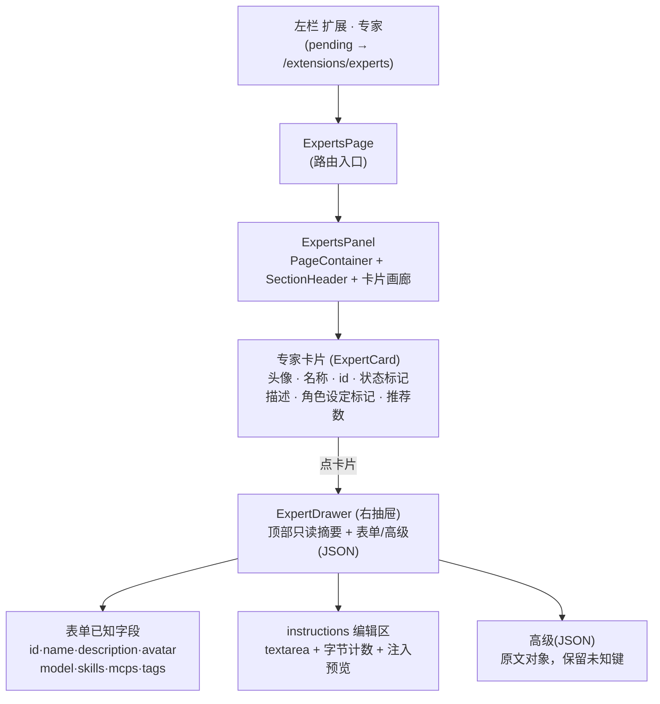

# 专家定义管理页

> 状态：已实现（分支 `feat/expert-management`）｜ 形态：**方向 C · 卡片画廊 + 右抽屉** ｜ 更新：2026-10-29

给「扩展 · 专家」一个真正的管理页：把左栏 pending 的「专家」接上 `/extensions/experts`，页面用**卡片画廊 + 右抽屉**管理本机专家定义（名称 / 描述 / 头像 / 推荐模型 / 推荐技能 / MCP / 标签 / 角色设定 `instructions`），支持**创建 / 编辑 / 启停 / 删除**，`instructions` 提供 **textarea + 字节计数 + 只读注入预览 + 保存期校验**。

后端 `/experts` 六个接口、`Expert` 类型与 API 封装**已经就绪，本页零后端改动**，只新增前端页面与纯函数。

一句话边界：**这是「编辑本机专家定义」的页面，不是会话内改能力、不是专家市场/导入导出、不是每专家独立进程。** 左栏只把已存在的 pending 项接上，不新增一级项、不改顺序。

## 背景与目标

- **入口原本是死的**：左栏「扩展 · 专家」是 pending（提示「预设化助手（未实现）」），点击无路由。
- **后端定义面已就绪、前端无消费面**：`/experts` 六接口（列表带 `has_instructions`、不含正文；详情含 `instructions` 全文；`POST/PUT/DELETE/PATCH`），类型见 `frontend/packages/types/src/capability.ts`，API 封装见 `frontend/packages/api/src/resources/mate.ts`。
- 用户此前只能手写 JSON 直接打接口；本页让「不写 JSON 也能建出完整专家」，同时保留「高级（JSON）」精确表达入口。

业务目标：R1 列表可管、R2 表单可建可改、R3 角色设定可编辑可预览可校验、R4 可启停可删除、R5 入口接上、R6 零后端改动。

反目标：只让用户换个地方写 JSON；把 `instructions` 正文塞进列表响应；用全量 PUT 冲掉高级 JSON 里的未知键；为迁就 UI 改 `/experts` 契约。

## 方向选择

三方向初稿对比后选定 **C（卡片画廊 + 右抽屉）**：

| 方向 | 做法 | 结论 |
|---|---|---|
| A 单列行 + 弹窗 | 复用技能/连接器页的两行式行 | 备选，未选（人格不显眼） |
| B 主从分栏 + 就地编辑 | 左列表 + 右常驻编辑 | 备选，未选（横向占位多） |
| **C 卡片画廊 + 右抽屉** | auto-fill 网格卡片，点卡片滑出右抽屉编辑 | **采用**：人格前置、最像「专家库」，将来扩导入/分享不改结构 |

## 信息架构

页面是「一级：专家卡片画廊 → 二级：右抽屉（表单 + 高级 JSON）」两层，全部在 `/extensions/experts` 一个路由内。

## 交互与字段约束

### 卡片画廊

`PageContainer` 标题「专家」，`extra` 放搜索框 + 「新建专家」；`SectionHeader` 标题「我的专家」，count = 总数，刷新按钮。画廊 `grid-template-columns: repeat(auto-fill, minmax(300px,1fr))`，卡片各自贴合内容。

每张 `ExpertCard`：头像（内置图标键）+ 名称（`name || id`）+ 状态标记（`角色设定` when `has_instructions`、`引用缺失` when 引用指向不存在、`已禁用` when `enabled=false`）+ 等宽 `id`；描述（2 行截断）；角色设定区（已设置显示「首轮隐藏注入（打开查看正文）」，为空显示「未设置角色设定（仅能力预设）」）；底部状态点 + 「N 技能 · M MCP」+ 模型短名；hover/聚焦出「编辑 / 删除」动作。整卡 `role="button"`、可 Tab 聚焦、`Enter` 打开抽屉。

空态 / 加载态（4 张骨架卡）/ 列表错误 banner（带重试）分别处理，不把「取不到」假装成「空」。

### 右抽屉（只读摘要 + 表单 + 高级 JSON）

`Drawer` 宽 480，窄屏（≤760）全宽。顶部只读摘要（头像 + 名称 + id + 启停状态，右侧删除/关闭）；`表单` / `高级（JSON）` 双 tab；底部左侧启停 `Switch`，右侧「取消 / 保存」。点遮罩、关闭、`Esc` 均可关；保存成功关闭并刷新画廊，失败错误留在抽屉里（输入不丢）。

### 字段表（只改已知键，编辑态只提交变化键）

| 字段 | 控件 | 约束（对齐后端 `ValidateExpert`，`backend/internal/core/capability/expert.go:79-127`） |
|---|---|---|
| `id` | Input（仅新建可填） | `^[a-z0-9]+(-[a-z0-9]+)*$`，≤64；创建后不可改 |
| `name` | Input | 去空白后 1–40 字符 |
| `description` | Input | ≤120 字符 |
| `avatar` | Select（内置键） | `spark\|chart\|code\|pen\|search\|briefcase` |
| `model` | Select（模型目录 `mdl_…`，可空） | 空或 `mdl_` 前缀 |
| `skills` | chips 多选 | 去重升序、≤50；允许暂指不存在的 id（写面给 warnings） |
| `mcps` | chips 多选 | 去重升序、≤50；同上 |
| `tags` | 标签输入（逗号分隔） | ≤8 个，每个 ≤20 字符 |
| `instructions` | TextArea + 字节计数 + 注入预览 | ≤4096 **UTF-8 字节**；拒绝危险标记 |

### `instructions` 编辑与校验

- **字节计数**：`new TextEncoder().encode(text).length`（UTF-8 字节，与后端 `len(e.Instructions)` 同口径），始终显示「N / 4096 字节」，超限变红并禁用保存。
- **危险标记前置提示**：扫描 `</system-reminder>`、`<!--`、`-->`、`{{`、`}}`、`\x00`（与后端 `expertDangerousMarkers` 同源），命中即列出并禁用保存。
- **只读预览**：纯文本、等宽、可滚动，顶部标「角色设定预览 / 首轮隐藏 user-context，不进入对话正文」。
- **保存期是权威**：前端校验只省一次往返；服务端 `ValidateExpert` 是唯一闸门（超长/危险标记 → `40001 definition_invalid`，零字节落库）。

## 接口复用（零后端改动）

| 用途 | 接口 | 返回/写面 | 前端封装 |
|---|---|---|---|
| 列表 | `GET /experts` | `Expert[]`（含禁用；`has_instructions` 标记、不含正文） | `listExperts()` |
| 详情正文 | `GET /experts/:id` | `Expert`（含 `instructions` 全文） | `getExpert(id)` |
| 新建 | `POST /experts` | `{id, path, created}`；id 已存在 → `40901 expert_exists` | `createExpert(body)` |
| 覆盖写 | `PUT /experts/:id` | `{id, path, created=false}`；CAS 失败 → `40901 definition_changed` | `updateExpert(id, body)` |
| 删除 | `DELETE /experts/:id` | `{id, deleted}`（幂等） | `deleteExpert(id)` |
| 启停 | `PATCH /experts/:id` | `{id, enabled}`（禁用只影响新选择） | `setExpertEnabled(id, enabled)` |

写面 body 语义（与 skill/mcp 一致）：**未出现的键保留原值，`null` 删键，`""`/`[]` 显式清空**；编辑态只提交变化键，因此不会把用户在高级 JSON 里加的未知键冲掉。列表与详情分两个请求：列表不带正文，正文在打开抽屉时才 `getExpert(id)` 取回。

## 实现落点（前端）

- 导航接入：`frontend/packages/console/src/console/navView.tsx` 把专家项 `to` 改为 `/extensions/experts` 并去掉 `pending`/`hint`（`PENDING_HINT` 仅此一项使用，随之删除）；`frontend/packages/console/src/app.tsx` 仿 connectors 增加路由与 import。
- 页面：`frontend/packages/console/src/pages/extensions/ExpertsPage.tsx` → `frontend/packages/console/src/components/capability/ExpertsPanel.tsx`。
- 组件：`ExpertCard.tsx`（卡片）、`ExpertDrawer.tsx`（右抽屉）、`useExpertData.tsx`（唯一数据入口：列表/详情/写面/启停/删除）。
- 纯函数：`frontend/packages/console/src/console/expertView.ts`（表单↔写面、变化键 patch、字节/危险标记/tags 校验、引用缺失、JSON 解析），单测 `frontend/packages/console/tests/expertView.test.ts`。
- 复用：`shared.tsx` 的 `SectionHeader`/`CapabilityEmpty`、`capabilityView.ts` 的 `writeErrorText`。

## A 系列验收

| 编号 | 验收项 | 阈值 | 结果 |
|---|---|---|---|
| A1 | 卡片画廊渲染全部（含禁用）；禁用降透明度标「已禁用」；`has_instructions` 标「角色设定」；引用缺失标「引用缺失」 | 标记与状态正确 | 通过（引用缺失目视见下备注） |
| A2 | 空态显示文案 + 「新建专家」入口 | 空态出现、按钮可点 | 通过 |
| A3 | 创建（表单）→ `POST` → 列表出现，`created=true` | 字段逐项相等 | 通过 |
| A4 | 编辑（表单）改 1–2 字段 → `PUT` 只提交变化键 | 请求体只含变化键 | 通过（单测） |
| A5 | 高级 JSON：改未知键 / `null` 删键 → `PUT` | 未知键在、目标键无 | 通过（单测） |
| A6 | id 校验：大写/下划线/超长前端拒 + 后端 `40001` | 两处都拒 | 通过（单测） |
| A7 | 重名 → `40901 expert_exists`，抽屉报错、输入保留 | 抽屉报错、输入不丢 | 通过 |
| A8 | 启停 `PATCH` 翻 enabled → 列表标灰/恢复 | DB 翻转、历史会话不变 | 通过 |
| A9 | 删除 `Popconfirm` → `DELETE` → 列表移除；重复删幂等 | `deleted:true` 后再次 `false` 无错 | 通过 |
| A10 | `instructions` >4096 字节 → 计数变红 + 保存被拒 | 前端禁存、后端拒 | 通过（边界 4096 放行/4097 拒，单测） |
| A11 | 危险标记 `</system-reminder>`/`{{`/`<!--` → 本地提示 + 保存被拒 | 命中列全、`40001` | 通过（单测） |
| A12 | 预览：有正文显示全文 + 「首轮隐藏注入、不出现在正文」；空则「仅能力预设」 | 文案两态正确 | 通过（截图两态） |
| A13 | 引用缺失：保存成功带 warnings，行/详情标「引用缺失」 | 保存成功且标记出现 | 通过（逻辑/单测） |
| A14 | 导航：左栏「专家」无「待开发」、点击进 `/extensions/experts` 并高亮；一级项/顺序不变 | 无新增一级项、顺序一致 | 通过 |
| A15 | 响应式 + 键盘：1440×900 / 1024×768 / 500 不溢出；Tab 聚焦卡片、Enter 打开、Esc 关闭 | 无横向滚动、全流程可完成 | **通过（实测见下）** |
| A16 | 零后端改动：后端路由/DTO/类型无 diff，前端只调现有封装 | 后端 0 改动 | 通过 |

## A15 实测记录（2026-10-29）

真 Chrome 156 headless + 真后端（`MATE_STORE=sqlite`，隔离 `HOME`/`MATE_HOME`），夹具 5 条专家（启用带人格 / 启用无模式 / 禁用 / 引用缺失候选）：

| 档位 / 项 | 实测结果 |
|---|---|
| 1440×900 | `overflowX=0`；5 张卡全部渲染；左栏「专家」高亮、无「待开发」；卡片 `tabIndex=0` |
| 1024×768 | `overflowX=0`；两列网格正常 |
| 500×900 窄屏 | `overflowX=0`；rail 收成顶部菜单；画廊单列；抽屉**全宽**（`left=0, width=500=视口宽, transform:none`） |
| 键盘 Tab | 从「刷新」按 1 次 Tab → 焦点落到「编辑 代码审查员」卡片（`role=button`） |
| 键盘 Enter | 聚焦卡片按 Enter → 抽屉打开 |
| 键盘 Esc | 按 Esc → 抽屉关闭 |

默认（卡片画廊）：

抽屉编辑态（带角色设定，同时佐证 A12「有正文」态：184 / 4096 字节 + 注入预览）：

高级（JSON）tab：

窄屏（500px；抽屉全宽、画廊单列）：

其余：`assets/expert-management/experts-1024.png`（1024 两列）、`experts-500.png`（500 列表）、`experts-drawer-1440.png`（无角色设定的空态抽屉）。

备注：本机 `vite build` 曾因 rolldown `binding-darwin-arm64.node` 缺代码签名无法 dlopen，对该 `.node` 做 ad-hoc `codesign --sign -` 后构建通过（只动 `node_modules`，非代码/仓库改动）；A1 的「引用缺失」在隔离库（无已装技能/MCP）未目视复现——清单为空时 `missingExpertRefs` 刻意不判「全部缺失」以避免假黄，该分支由单测覆盖。

## 落地偏差与边界

- **列表不带 `instructions` 正文**：卡片人格区只标「已设置 · 打开查看正文」，正文仅在抽屉 `getExpert` 取回，避免首屏 N+1 拉长文本。
- **模型选择器**走现有 `listModels()` 平台目录（`mdl_…`）；目录不可达时降级为可留空、保留当前值。
- 非目标：会话内改能力、专家市场/导入导出/版本发布、专家团/多专家协作、每专家独立进程、工作空间默认专家的编辑入口——均不做。
