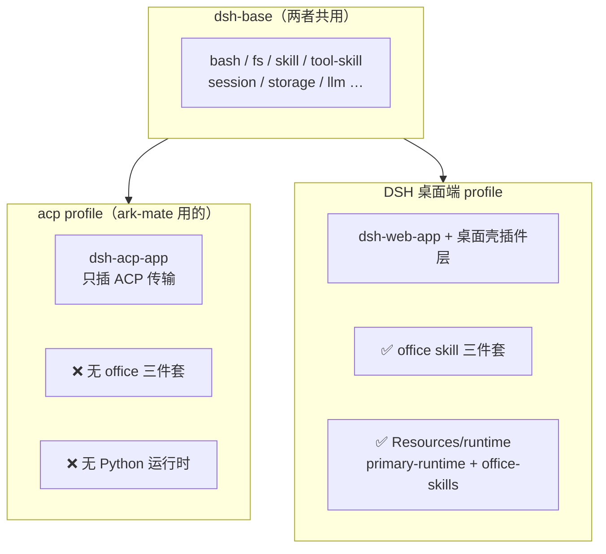
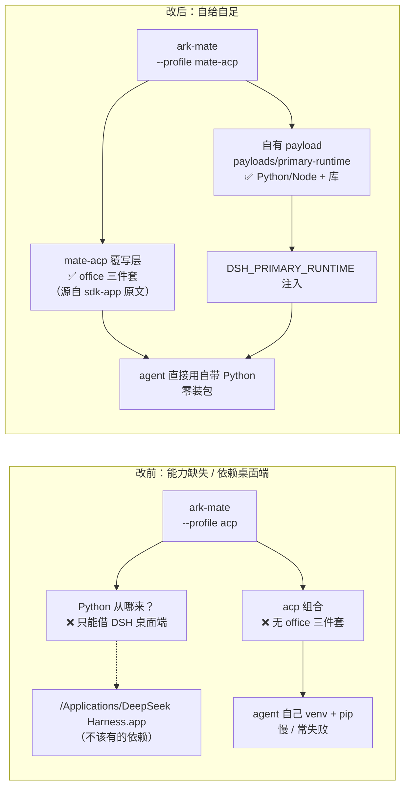
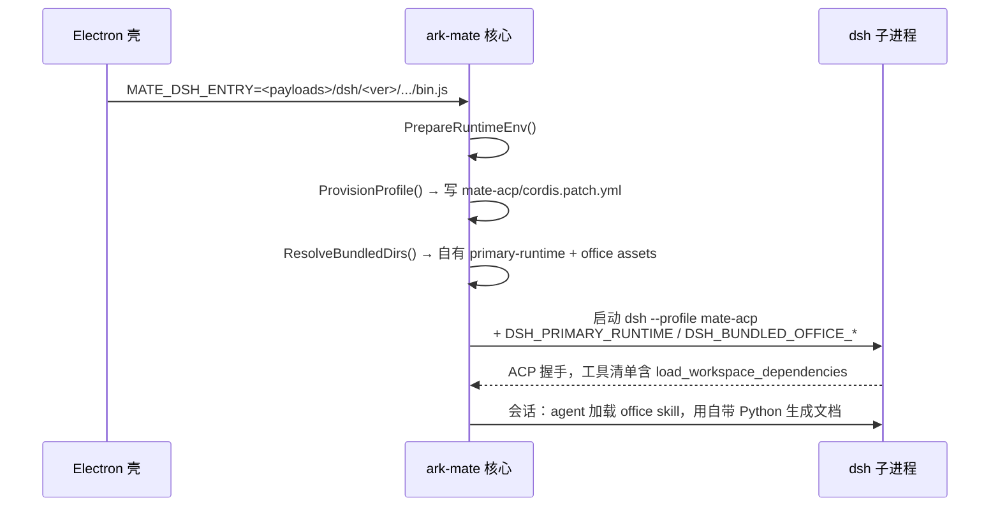

# ark-mate 的 office 能力：为什么和 DSH 桌面端不一样，以及怎么补上

> **这份文档是什么**：一次「同一句输入、两套环境结果差很远」的**完整排查与修复记录**，写成便于理解的叙事。
> 如果你只想知道结论，看 §0；想搞懂"为什么"，按 §1→§4 顺序读；想知道代码在哪，看 §6。
>
> **技术细节的权威出处**是代码与 [dsh-acp-adaptation.md](./dsh-acp-adaptation.md)；本文是**解释性地图**，与代码冲突以代码为准。
> 过程性排查流水账在 `.dsh/docs/notes/2026-11-08-weather-task-path-diff-notes.md`（gitignore，不进库）。

---

## §0 一句话结论

**ark-mate 和 DSH 桌面端跑的是同一个 dsh 内核，但用的是不同的 `profile`（能力组合）。**
DSH 桌面端的 profile 里带了「office 技能 + 自带 Python 运行时」，ark-mate 用的 `acp` profile 是最瘦的，两样都没有。
所以 agent 只能自己 `python -m venv` + `pip install` 去搭环境——慢、且经常失败。

修法是：**让 ark-mate 自建一个 profile（`mate-acp`），在里面把 office 能力声明进去，并随包自带 Python 运行时**。
全程不依赖 DSH 桌面端。

---

## §1 现象：同一句话，两套环境

同一句输入：

> 查询下明天西安的天气，然后把查询结果依次生成 md、txt、ppt、word、pdf、excel、html、png 文件

| | 环境 A：DSH 原生（`~/.dsh`） | 环境 B：ark-mate（`~/.ark-mate`） |
|---|---|---|
| 用时 | **约 96 秒** | **约 665 秒**（约 11 分钟） |
| 步数 / 工具调用 | 23 步 / 32 次 | 35 步 / 45 次 |
| 是否装包 | **0 次**（用自带 Python） | **2 次联网 pip**（还建了 venv） |
| 过程 | 一次性生成 → 单次目检 → 交付 | 反复自检 → 挑错 → 改脚本重跑 |
| 失败案例 | — | 另一次同类请求直接 `422` 报错 |

一开始以为是"模型不行"或"提示词没写对"。**都不是。** 逐层查下来是三个层次的问题叠加。

---

## §2 三层根因（由表及里）

### 2.1 第一层（表象）：ark-mate 的会话里，office 能力**根本不在**

会话实际拿到的工具清单：

| | 工具数 | 有 `load_workspace_dependencies`？ | 有 office 系列 skill？ |
|---|---|---|---|
| DSH 原生 | 97 | ✅ | ✅（office / office-docx / office-pptx / office-xlsx …） |
| ark-mate | 43 → 44 | ❌（后来修好才有） | ❌（后来修好才有） |

`load_workspace_dependencies` 是那个「告诉你自带 Python 在哪、有哪些库」的工具；office 系列 skill 是「教你怎么用 python-docx / python-pptx 规范地生成文档」的说明书。**两个都没有**，agent 只能自己摸索。

### 2.2 第二层（机制）：能力补上了，但**指向错了地方**

第一版修复把工具插进去了，agent 也真的调用了，但报错：

```
Error: ENOENT: no such file or directory, open '.../ark-mate/backend/runtime.json'
```

原因：`load_workspace_dependencies` 需要知道「自带 Python 运行时」（`primary-runtime`）在哪，靠环境变量 `DSH_PRIMARY_RUNTIME` 告诉它。那个变量**没注入**，于是它拿当前目录去猜 → 找不到。

**更根本的是**：ark-mate 的安装包里**根本没有 Python 运行时**。当时唯一能拿到 Python 的地方是 DSH 桌面端安装目录 `/Applications/DeepSeek Harness.app/...`——这意味着 **ark-mate 偷偷依赖了 DSH 桌面端**。这不能接受。

### 2.3 第三层（结构）：为什么两套环境的"能力面"天生不同

这一层是**真正的根因**，也是最容易搞混的地方。答案在 dsh 的 **profile 机制**里。

dsh 的 `PROFILE_TEMPLATES`（源码 `packages/util/official-bundles/src/bundles.ts`）定义了每个 profile 由哪些 **bundle** 拼成：

```
acp      = [dsh-base, dsh-acp-app]        ← ark-mate 用的就是这个
web      = [dsh-base, dsh-web-app]
headless = [dsh-base, dsh-headless]
sdk      = [dsh-base, dsh-sdk-app]        ← 注意：sdk 里带了 office！
```

关键差异在 **app bundle** 的 `cordis.patch.yml`（每个 bundle 往组合里"插"什么）：

- `dsh-acp-app`：只插 ACP 传输（`acp-app-startup` + `acp`），**没有 office**。
- `dsh-sdk-app`：除了传输，**还插了 office 三件套**（`workspace-dependencies` / `skill-office` / `office-to-pdf`）。
- DSH 桌面端：它的 profile 在 `web-app` 之上还挂了**桌面壳插件层**，由 Electron 通过环境变量把 `Resources/runtime/{office-skills,primary-runtime}` 挂进来。

而 `office-to-pdf`、`skill-office` 这些插件本身**早就装在 ark-mate 的 dsh 载荷里了**（`payloads/dsh/<ver>/node_modules/@deepseek-ai/`），只是**没有被组合进 `acp` profile**。



**一句话**：不是 dsh 不行，也不是模型不行——是 **ark-mate 选了最瘦的 profile，且没自带运行时**。

---

## §3 顺便澄清一个易混点：模型到底有没有关系？

排查中对比过两套环境的 `<available_skills>`（模型能看到的技能清单）：

- 修好之后，**两边完全一样**（都是 20 个，office 七个都在）。
- 两边的系统提示词里**都没有**"必须用 office skill"这种特殊指令。

也就是说：**能力面齐了之后，模型会不会主动用 skill，是模型自己的选择**。
`group/workbuddy`（DSH 原生用的）看到 office skill 就主动加载并按规范做；`deepseek-flash`（ark-mate 配的）有时会自己写脚本。

> 所以：**能力面（能不能）**和**模型行为（用不用）**是两件事。
> 本文解决的是前者——让能力真的存在且指向正确。后者若要加强，只能换更强的模型或加引导，不属本文范围。

---

## §4 解决方案

### 4.1 思路

两件事必须同时做（只做一件都不行，实测过）：

1. **能力面**：让 office 三件套进入 ark-mate 用的 profile 组合；
2. **资产面**：ark-mate 自带 Python 运行时，并把环境变量指对。

### 4.2 做法一：自建 `mate-acp` profile

不用 dsh 的 `acp` 裸模板，而是：

1. 基于 `acp` 模板派生一个**平台自有的持久 profile** `mate-acp`（落 `$DSH_HOME/profiles/mate-acp/`，四份文件由平台写）；
2. 把 `dsh-sdk-app` 里那段 office insert block **逐字**搬进 `mate-acp/cordis.patch.yml`（含官方的 `disabled: !!js` 门控）；
3. 启动参数从 `--profile acp` 改成 `--profile mate-acp`。

**为什么这么做而不是别的**：

| 方案 | 为什么不选 |
|---|---|
| 在代码里手抄 cordis 条目 + 每次 `--patch` 叠加 | 上游一改字段就漂移；且改坏了 `disabled` 语义 |
| `dsh plugin add` 从 npm 装 | 实测会拉到 `0.1.6-alpha.2` 旧版，与 dsh `0.2.2-rc.1` 不兼容被拒 |
| 直接用 `sdk` profile | 会连带换掉 ACP 传输层（sdk 走 JSON-RPC，ark-mate 走 ACP） |

**核心好处**：office 能力的声明来自 **dsh 官方 sdk-app 的原文**，不是我们发明的；组合是声明式的，随 dsh 版本走。

### 4.3 做法二：ark-mate 自带 Python 运行时（`primary-runtime` 载荷）

dsh 官方有 `scripts/primary-runtime/{prepare.ts, lock.json}`，能把固定版本的 CPython + Node + Python 库下载、解包、装库、生成 `runtime.json`。ark-mate：

1. **vendor** 这份 builder（MIT）到 `frontend/apps/desktop/scripts/primary-runtime/`；
2. 新增 `prepare-primary-runtime.mjs` 调用它，产物落 `resources/payloads/primary-runtime/`；
3. 接进 `Makefile` 的 `desktop/payloads`。

运行时，代码通过 `MATE_DSH_ENTRY`（Electron 壳传给核心的 dsh 载荷入口）**反推出 ark-mate 自己的 payload 根**，从而找到 `primary-runtime` 和 office skill assets——**绝不回落到 `/Applications/DeepSeek Harness.app`**。

---

## §5 改前 vs 改后



一次真实会话的日志（改后）：

```
serve: mate-acp profile 就绪            files_written=4
serve: 已注入 dsh office 随包 env        primary_runtime=<ark-mate 自有 payload>/primary-runtime
                                        office_skills=<ark-mate 自有 payload>/.../dsh-skill-office/assets
…
🛠 skill office-docx                     ← 主动加载 office 技能
🛠 load_workspace_dependencies            ← 拿到自带 Python 路径
🛠 bash  <自带 python> 生成 docx          ← 零 venv / 零 pip
✔ demo 完成 stop_reason="end_turn"
```

---

## §6 代码地图（改了什么、在哪）

| 位置 | 职责 |
|---|---|
| `backend/internal/infra/dsh/profile.go` | **核心**：`mate-acp` 四份 profile 文件常量（含 office insert block）；`ProvisionProfile` 幂等落盘；`ResolveBundledDirs` 从自有 payload 解析资产；`BundledEnv` 派生 4 个 env |
| `backend/internal/infra/dsh/dsh.go` | `Args = ["--profile", ProfileName]`（`mate-acp`） |
| `backend/internal/bootstrap/assembly/prepare_runtime.go` | `PrepareRuntimeEnv`：拉底座前统一做「落盘 profile + 注入 env」 |
| `backend/internal/bootstrap/assembly/build.go` | serve 装配期调 `PrepareRuntimeEnv` |
| `backend/internal/bootstrap/maintenance/demo.go` | `mate demo` 也调它（曾经漏了，导致 demo 报 profile 不存在） |
| `frontend/apps/desktop/scripts/prepare-primary-runtime.mjs` | 构建期装配 `primary-runtime` 载荷 |
| `frontend/apps/desktop/scripts/primary-runtime/` | vendor 自 DSH 的 builder（`prepare.ts` / `lock.json` / …） |
| `Makefile` | `desktop/payloads` 追加 primary-runtime 装配；新增 `desktop/primary-runtime` |

**数据流**（运行期）：



---

## §7 验证证据

1. **机制层**（单测）：`TestProvisionedProfileHasOfficeInDsh` —— 把 provision 出来的 `mate-acp` 交给**真实 dsh** 跑 `--dump-config`，断言 ACP 传输仍在 + office 三件套进组合且 enabled。
2. **构建层**：真实构建 mac-arm64 `primary-runtime`（335MB），`runtime.json` schema 与 DSH 一致，**冒烟通过**（python-docx/pptx round-trip + `pip check` + `pnpm --version`）。
3. **端到端**：用**自产** payload 当 ark-mate 自有资产跑 `mate demo` → 会话加载 office skill、调 `load_workspace_dependencies`、用自带 Python 生成有效 docx（18 段 + 3 表），**零 venv/pip**，`end_turn`。
4. **无桌面依赖**：`grep "DeepSeek Harness.app"` 在 `backend/internal` 非测试代码 → 零命中。
5. `go build` / `go vet` / `go test ./...` / `go test ./internal/archtest/` 全绿。

---

## §8 排查中踩到并修掉的三个坑（值得记住）

| 坑 | 症状 | 修法 |
|---|---|---|
| profile 准备只写在 serve 装配里 | `mate demo` 报 `profile "mate-acp" does not exist` | 抽成公共 `PrepareRuntimeEnv`，**每一处拉底座前都调** |
| 借用 DSH 桌面端路径 | 违反独立分发定位 | 改 `ResolveBundledDirs` 只从 ark-mate 自有 payload 解析，找不到就如实降级（office 关闭） |
| `extract-zip@2`（yauzl）在 Node 26 上 promise 不 resolve | 文件解出来了但进程 `exit 13`（"unsettled top-level await"） | vendored builder 改用系统 `unzip`，Windows 回落 extract-zip |

---

## §9 边界与后续

- **本文保证**：office 工具 / skill 确实在，且指向 ark-mate 自带的正确资产。
- **本文不保证**：具体模型一定主动用 office skill（模型选择，见 §3）。
- **升级 dsh 时**：需同步 `scripts/primary-runtime/lock.json` 与 `profile.go` 里那段 office insert block（与 dsh 的 `sdk-app/cordis.patch.yml` 对齐）。
- **安装包体积**：`primary-runtime` 约 335MB（Python + Node + 库），这是自给自足的代价。
- **仍需随包**：`payloads/primary-runtime` 必须在 `make desktop/payloads` 阶段产出，否则运行期 office 能力如实降级（不报错、不借桌面端）。
