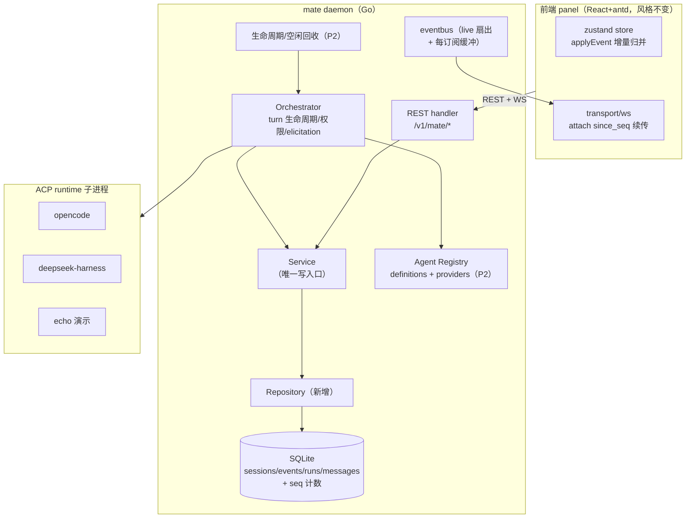
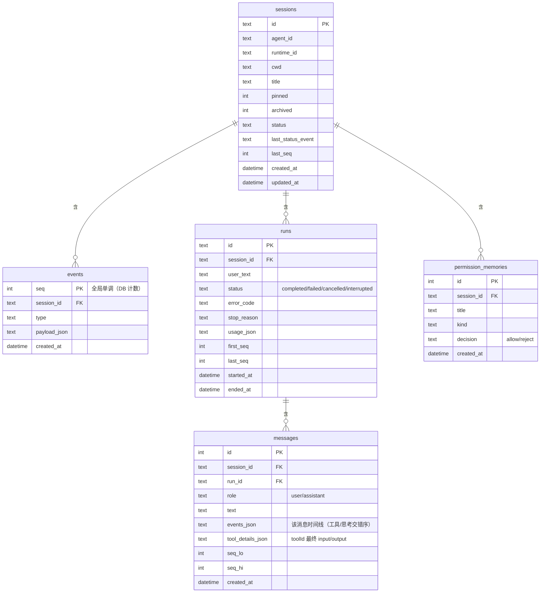

# ark-mate × zacp 重合面重构技术方案（含 SQLite 落库）

> 版本：v1 draft（2026-09-08）｜类型：技术重构 + 数据模型设计｜档位：标准档（含完整档必要的迁移/回滚与开放问题收口）
> 前置材料：`.cache/ark-mate-audit-report.md`（ark-mate 全量缺陷清单，文件:行号 证据）；zacp 后端/前端只读精读报告（本文引用其机制但不搬运代码）。
> 关联文档：`docs/design-and-roadmap.md`（M0–M3 路线图，本文是其中与 zacp 重合部分的执行方案）；`frontend/DESIGN.md`（前端视觉纪律，本次不动）。

## 摘要（TL;DR）

ark-mate 与 zacp 的产品重合面 = **会话/消息流式聊天主链路、权限确认、会话管理、Agent 选择与配置、持久化与重启恢复**。zacp 已跑通且这些面成熟；ark-mate 的对应实现存在三类问题：① 已实现但语义有错（权限拒绝语义、重启恢复会话只读卡死、WS 水位跨重启失效、用户消息双发、元数据不持久 + 无锁写）；② 文档自述与代码不符（超时环境变量未接线、usage 空载荷等，详见审计 §5 对照表）；③ 重合域缺失功能（DB 持久化、Agent 管理/热更新、空闲回收与断点恢复）——正好落在 ark-mate 自己的 M2/M3 路线图上。

本方案结论与核心取舍：

1. **范围已拍板**：SQLite 落库（原 M2 #1）纳入本次重构；**不扩大范围**——登录鉴权、深色模式、文件/Git/TTY、workspace 项目目录、移动端/多主机一律不做。
2. **不整仓照抄 zacp**：zacp 的薄网关权限与消息行模型是参照，但 ark-mate 的事件流、会话级权限记忆+撤销、elicitation 通道是更强的设计，予以保留并修复语义。
3. **存储采用「事件落库 + 会话/轮次物化」的混合模型**（决策记录见附录 A）：事件表承载权威历史与回放（保留现有事件流契约与前端渲染逻辑），sessions/runs 物化元数据、统计、搜索、重试所需读模型；进程内 eventbus 只做 live 扇出。
4. **执行分四批**：P0 纯正确性修复 → P1 SQLite 落库与迁移（结构性大头）→ P2 Agent 管理面 + 生命周期（空闲回收/断点恢复）→ P3 前端可靠性细节（保留 React/antd 风格）。P0/P3 可与 P1/P2 并行。
5. **三项开放点已定案（2026-09-08，见附录 A ADR-5）**：① events 为唯一事实源、runs/messages 为可重建读模型投影，P1 **保留 messages 表**不裁剪；② transcript 迁移后默认**停写 + 只读保留**（清理仅经显式命令，不自动删）；③ 权限「始终拒绝」**做成与 allow 对称的会话级可撤销记忆**（含 UI 留痕防静默）。

预计量级（单人，含验证）：P0 约 1 周，P1 约 2.5–3.5 周，P2 约 2–3 周，P3 约 1.5–2.5 周（假设见「实施计划」）。

## 背景与目标

### 业务背景与现状

- ark-mate 定位是「单机单操作员的 ACP 控制面底座」：一个 daemon 拉起 opencode / deepseek-harness / echo 等 ACP runtime，Web 面板做会话问答与权限/提问交互。会话历史以 JSONL transcript 落盘，运行态为进程内存 + eventbus。
- zacp 是「已发布（v0.9.0）的多 Agent Web 网关」：Go + Gin + SQLite(WAL)，前端 Vue3。会话/消息/工具详情均入 DB，Agent 支持页面增删改 + 配置文件热更新，有空闲回收与断线续流裁决。
- 两端重合面内的成熟度差已在「摘要」列出，全部有源码证据（见审计报告）。

### 痛点与动因

1. **重启/断连后不可靠**：重启恢复的会话只读、「停止」必报 404、中断轮永久卡 `in_progress`；WS 全局 seq 进程内重排导致跨重启水位失效、新事件被前端去重丢弃；慢订阅丢帧无补偿。根因是「历史只在内存 + transcript 只回放不恢复运行态」。
2. **元数据与决策不可信**：title/pinned/archived 重启即丢且有无锁 data race；权限拒绝被折叠成 ACP `Cancelled`、`reject_always` 无记忆；usage 载荷恒空；权限决策留痕（非 map 载荷）不落盘。
3. **Agent 配置面缺失**：Agent 是代码播种的只读列表；无注册/启停/provider 注入/热更新；无空闲回收（进程常驻）；断点恢复所需的 `acl.LoadSession/ResumeSession` 已实现但从未接线。
4. **文档与实现漂移**：README 声称的若干能力（超时 env 覆盖、置顶/今天/昨天/更早分组、Selected/Cancelled 完整语义、usage 明细）实际打折（审计 §5 对照表）。

### 目标与非目标

**目标**

- 把上表 1–3 类问题全部修掉；SQLite 成为会话/事件/元数据/统计的权威存储，进程重启与崩溃恢复后会话可看、可续、可操作。
- Agent 从「代码播种只读」升级为「可注册/启停/配置注入 + 空闲回收 + 按需恢复」（对齐 zacp 已验证机制，落 ark-mate 的 definitions/registry 形态）。
- 权限决策语义对齐 ACP：用户显式拒绝=Selected(deny 选项)（无法区分时兜底 Cancelled）、会话级 allow/reject 记忆双侧生效且可见可撤销。
- 前端保持 React + antd + zustand + `DESIGN.md` 视觉语言不变，仅补齐可靠性行为细节。
- README/路线图与实现重新对齐（删除或实装承诺项）。

**非目标（明确不做，防范围膨胀）**

- 不引入登录/多用户/RBAC（含 zacp 的 password/captcha/token）；继续默认仅监听本机。
- 不引入文件浏览/Git/TTY/workspace 目录模型；不引入深色模式；不做移动端/多主机切换/Docker 发布。
- 不重做 ACP 客户端与 runtime adapter 的协议接入；不实现 skill/MCP/推理等执行能力（能力不重造，仍复用 runtime）。
- 不引入跨 Agent 协作、任务板/automation（P1+ 项，另行立项）。
- 不在本次实现 per-agent 默认权限策略落库（M2 #7 剩余位）与用量统计 API（M3 #3）的完整产品面——但 runs.usage_json 与权限留痕会先行落库，为后续铺路。

### 约束与非功能需求

- **兼容约束**：REST/WS 对外契约尽量不变（变点逐条列出并标注影响方）；前端渲染逻辑（applyEvent 的增量归并）尽可能复用。
- **数据一致性**：写路径为「DB 权威 + 内存 live」；事件落库失败即本轮告警且回滚会话状态推进，避免 DB 与 UI 分叉。
- **性能定位**：单机单操作员；单会话数百事件/轮、日会话量 < 数百轮。DB 写放大不是瓶颈，重点是无索引全表扫与长会话回放成本。
- **安全定位**：默认 127.0.0.1；SQLite/配置文件 0600；事件载荷可能含工具 input/output——禁止在其中落 provider 密钥（只落引用/占位）。
- **可观测性**：serve 日志分级；关键动作（会话建/删/恢复、迁移、导入）有行日志；暂不引入 tracing/指标采集。

### 验收标准

按批验收（每批单独可过评审）：

- **P0 后**：echo 会话内「拒绝一次/始终拒绝/始终允许/取消」四态在 agent 侧可区分；`MATE_PERMISSION_TIMEOUT`/`MATE_ELICITATION_TIMEOUT` 生效且 UI 收敛以服务端事件为准；同一条用户输入不再双入 transcript/UI；`go test -race ./backend/...` 通过（消除 publish 写 Title 竞态）。
- **P1 后**：kill -9 daemon 后重启——历史会话列表/内容/元数据（标题、置顶、归档）完整；in_progress 中断会话可「停止」收敛为 cancelled 并可再 prompt；WS 断线重连按水位续传不再丢事件；长会话统计/失败轮重试不再截断失真；旧 transcript 目录一次性导入数据校验通过（条数/首尾一致性）；迁移前数据可回滚恢复。
- **P2 后**：不写 Go 代码即可注册第三个 ACP agent（definitions 校验→纳入同等对待）；页面可启停 agent 并热更新配置；空闲超时自动停进程、再次使用按需拉起并恢复会话（按 runtime 能力 resume 或重建）；README 承诺项与代码一致。
- **P3 后**：刷新/断线续流、会话/消息加载四态、长列表分页、思考/工具详情瘦身行为经真实 Chrome DoD 走查通过；面板视觉与 DESIGN.md 无漂移。

## 总体架构设计

### 架构设计原则

1. **DB 权威、总线 live**：一切可回放的历史（事件/元数据/轮次统计）落 SQLite；eventbus 只负责当前进程的实时扇出与断线重放读取（读 DB）。内存态仅是缓存，不再承担权威。
2. **保留事件流范式**：事件词表、seq 语义、agg=session 不变；前端 applyEvent 增量归并逻辑尽可能不动。
3. **写路径单点收口**：Service 是唯一写入口（现在已是），新增 Repository 层后所有 SessionRec 修改走「锁 + 落库」，消灭散落的无锁写。
4. **参照机制而非代码**：热更新原子写、空闲回收锁外杀进程、消息拆分落库等机制对齐 zacp 已验证做法，但用 ark-mate 的模块形态实现。

### 系统上下文与依赖

- 外部依赖仅：ACP runtime 子进程（opencode / dsh / echo）、本地 SQLite 文件（新增）、transcript 目录（迁移后转为只读旁路）。
- 前端 → REST `/v1/mate/*` + WS `/v1/mate/ws/events`；不新增传输通道。

### 重构后总体架构

数据流（写）：runtime 增量 → Orchestrator 归一化域事件 → Service.publish：**先经 Repository 追加事件行（同事务内推进 seq）** → 成功后再向 eventbus live 扇出（内存缓冲）。
数据流（读）：REST 列表/详情/历史与 WS 重放一律查 Repository（DB）；live 由 bus 推送。

### 系统边界与职责

| 模块 | 现状 | 重构后职责 | 主要变更 |
|---|---|---|---|
| `internal/infra/store`（新增） | 仅 doc.go | Repository + schema + 迁移 + seq 计数；唯一 DB 访问点 | 新增（M2 #1 前置） |
| `internal/manager` Service | 内存 SessionRec + transcript | 写路径收口：锁 + Repository；runs/messages 物化；元数据持久化 | 重构 |
| `internal/manager` Orchestrator | 进程内会话/连接 | 恢复语义（重启后重建 ActiveSession、resume 接线）、reject 记忆、超时接线 | 重构 |
| `internal/server/eventbus` | 内存历史 + 淘汰水位 | live 扇出 + 慢订阅丢帧补偿；历史交还 Repository | 重构 |
| `internal/server/handler` | history 读 bus | history/attach 读 Repository | 小改 |
| `internal/acl` | 已含 Load/Resume/List | 保持；补 Selected(reject) 决策映射 | 小改 |
| Agent Registry（P2） | 代码播种 | definitions 目录 + 校验 + 启停 + provider 注入 | 新增（对齐 M2 #2/#3） |
| `cmd/mate` | serve/demo/acp-demo | 新增 `migrate --import-transcripts` 子命令、接线超时 env | 小改 |
| 前端 panel | M1 形态 | P3 可靠性细节；渲染逻辑保持 | 小改 |
| transcript JSONL | 权威落盘 | 迁移后只读旁路（可选关闭） | 降级 |

### 核心流程（写路径与恢复）

1. **写**：用户 prompt → Service 落 runs(user 文本先行，同 zacp「用户消息先落库」) → runtime 流式增量 → 事件逐条入 DB → turn 终态（ended/error/cancelled）落 runs 状态 + usage_json + 物化该轮 assistant 消息 → bus live 推送全程。
2. **冷启动**：启动读 sessions/events 重建列表（DB 权威，取代 transcript_load）；被中断轮状态推导为 interrupted，**可操作**（可取消收敛或重发）。
3. **WS attach**：`since_seq` 未给 → 全量重放（分页内部拉取）+ live；给了 → Repository 查 `events where seq>since`（全局 seq，DB 持久单调）→ 快照/淘汰水位逻辑删除。慢订阅溢出 → 发 gap 帧，客户端按 lastSeq 重新 attach。
4. **空闲回收（P2）**：reapLoop 每 5 分钟扫 `started && 无在途 turn && idle>阈值` → 锁内原子摘除 → 锁外停进程；再次 prompt 按需拉起并按 caps resume/重建（对齐 zacp manager.go 机制）。

### 备选方案与取舍（整体层面）

| 方案 | 代价 | 否决/选择理由 |
|---|---|---|
| A. 照抄 zacp 消息行模型：DB 只有 messages 行，事件只 live，断流/历史改消息页拉取 | 需重写 WS/历史契约与前端 store 读模型；事件流范式与 elicitation/权限卡的瞬时态难以行化 | 否决：改动面远超问题本身，且丢掉 ark-mate 事件流优势 |
| B. 纯事件落库（不做 runs/messages 物化） | 搜索/统计/重试要继续在事件增量上做窗口聚合，缺陷 9 复发 | 否决：无法根治截断失真；查询语义脆弱 |
| **C. 事件落库 + sessions/runs/messages 物化（本文推荐）** | DB 双写（事件 + 物化行），需保证一致 | 采纳：契约与前端改动最小；物化行承接统计/搜索/重试/元数据；事件承接回放/审计 |
| D. 只修内存态缺陷、不上 DB | 改动最小 | 否决（用户已拍板 SQLite 纳入）：重启恢复、seq、截断等结构性缺陷仍无解 |

## 详细技术设计

### 模块划分与职责

见「系统边界与职责」表。新增依赖：纯 Go SQLite driver（待选型，见下）；不使用 GORM，沿用事件表自管迁移（对齐 zacp `schema_migrations` 自管迁移思路，但实现为轻量 repository 层，避免引入 ORM 到事件流路径）。

### 接口设计（对外契约变化清单）

REST/WS **保持不变的**：信封 `{code,requestID,msg,data}`、会话 CRUD/search/history、权限与 elicitation 决策、`POST /sessions`、`POST /sessions/:id/prompt|cancel`、WS 帧（attach/detach/ping，snapshot/event/detached/pong）。

**语义修正（前端需同步小改）**：

- `POST /sessions/:id/permission`：`allowed=false` 分支不再丢弃 `option_id/always`。约定：用户显式拒绝时后端把 `option_id`（echo 的 `reject` / `reject-all` 等）映射为 ACP `Selected{option}` 回传；无可用 deny 选项时才兜底 `Cancelled`；`always=true && allowed=false` 写入会话级拒绝记忆（与允许记忆同构）。详情面板补「始终拒绝」记忆条目与撤销。
- 权限/elicitation 决策事件的**超时收敛以服务端事件为准**（前端 `timeout_at` 仅作展示提示，不再提前改变决策态）；后端超时从 env 读取（见 P0）。

**新增（P1/P2）**：

| 方法 | 路径 | 说明 | 批次 |
|---|---|---|---|
| POST | `/admin/migrate` | 迁移 transcript → DB（或由 CLI `mate migrate` 触发） | P1 |
| GET | `/sessions/:id/runs` | 轮次明细（状态/耗时/usage/错误）——先做只读最小面，统计 API 留 M3 | P1 |
| POST | `/agents` `/agents/:id/start|stop` `PATCH /agents/:id` `DELETE /agents/:id` | definitions 注册/启停/热更新（含校验可启动预检） | P2 |
| GET | `/providers` `PATCH /providers/:id` | provider 凭证注入面（密钥只写不读回） | P2 |

错误码沿用 40401/40901/40501/50201 体系；新增 40902（会话 pending 恢复中）。

### 数据模型（核心）

#### ER 总览

#### 表说明与映射规则

- **sessions**：DB 权威元数据。PATCH title/pinned/archived 写库（取代「只改内存 + transcript_load 重推」）。status 由终态事件推导但**不再只读**——恢复后状态含 `interrupted`（原 in_progress 且无终态），允许「停止/重发」操作。
- **events**：语义 = 现有 eventbus 事件 + transcript 行，落库为权威。seq 来自 DB 单调计数（单写者 Service，事务内取 `INSERT ... RETURNING` 或独立 `meta` 计数行），**跨重启连续**；payload 序列化全部 map/结构体（含权限决策留痕，修复审计 #10）。type 词表沿用 `manager/events.go`。
- **runs**：一轮 prompt 的物化行。开启时机：用户消息落库（同 zacp「先落 user」）时建行（user_text/status=running）；终态时写 status/stop_reason/error_code/usage_json/ended_at。`first_seq/last_seq` 记录该轮事件窗口，供「失败轮输入」与统计精确回溯（修复 #9，不再依赖前端截断 history）。
- **messages**：消息物化（服务端每轮在 `turn.ended` 时拆分生成）。text = 该段文本增量拼接（assistant 多段按 msg_id/时序拆分）；events_json 保留 text/tool/thought 交错时间线（对齐 zacp `Message.events` + `tool_details` 的 v6 拆分思路：历史接口瘦身，工具入参/出参只在需要时返回）。本表首批服务于搜索与「权威收尾」增量拉取；UI 渲染仍可主走 events 重放。
- **permission_memories**：把会话级「始终允许/始终拒绝」记忆从进程内存迁到 DB（允许与拒绝对称），REST 列表/撤销语义不变。
- **索引**：`events(seq)`（主键天然序）、`events(session_id, seq)`、`runs(session_id, started_at)`、`messages(session_id, run_id)`、`sessions(archived, updated_at)`（列表页排序）、`permission_memories(session_id)`。搜索首批用消息行 `LIKE`（个人规模可接受），FTS5 列为可选优化，不进首批。

> 字段名对齐现有 REST DTO（SessionResp/SessionDetailResp 等）；payload 的 JSON 形态与 `packages/types` 保持同源（可在未来引入契约单测）。

#### 与 zacp 存储模式的差异（有意为之）

| 点 | zacp | ark-mate 本次 | 理由 |
|---|---|---|---|
| 历史回放 | 消息行 + afterId 增量 | events 表 seq 回放（沿用契约） | 保留事件流前端；修复 seq 跨重启即可 |
| 轮次/统计 | 无显式 runs | runs 物化 + first/last_seq | 根除截断失真 |
| 权限记忆 | 网关不记忆 | permission_memories（allow/reject 对称） | ark 已有更强设计，仅补持久化与对称语义 |
| transcript | 无 | 迁移后只读旁路 | 审计/调试事实源保留 |

### 关键逻辑与算法

1. **seq 持久单调**：`Service.publish` 唯一写入口；`Repository.AppendEvent` 在**一个事务**内完成「分配 seq → 插 events → 更新 session.last_seq」（或独立计数表）。eventbus 不再持有 nextSeq。
2. **消息物化（turn 收口）**：Orchestrator 在 `BusTurnEnded/BusTurnError/BusRunCancelled` 时调用 `MaterializeTurn(sessionID, runID)`：缓冲该轮事件 → 按角色/msg_id 分组拼 text、按序组装 events_json、抽工具最终态到 tool_details_json → 单事务落 messages 并更新 runs。
3. **恢复语义**：启动扫 DB：sessions 全部可列；`status=in_progress` 且无终态 run → 置 `interrupted`，列表可点「停止/重发」；点击 prompt 时按 runtime caps 尝试 `acl.ResumeSession`（opencode load/resume）否则新建 ACP session 并回写（对齐 zacp unknown-session 自动恢复 + ark M3 #1 的会话态/连接态分离雏形）。
4. **慢订阅补偿**：每订阅一个带缓冲 channel；缓冲满时不再静默丢，而是标记该订阅「需重放」，下一条事件改为发 `{type:"gap", from_seq}` 帧，客户端据此重新 attach（`since_seq=from_seq`）——修复 bus.go:72-77 丢帧无补偿与 ws.go 双路径竞态（重放/活流统一为「服务端按 seq 去重后投递」）。
5. **双发去重**：保留本地先行发布 BusUserMessage（保证 UI 即时），但对 SDK `KindUserMessage` 回显做窗口去重（key=sessionID+text，300ms 内同文本仅发一次；或比对 `msg_id`）。简单且不依赖运行时回显行为。
6. **超时单时钟**：config 读 `MATE_PERMISSION_TIMEOUT`/`MATE_ELICITATION_TIMEOUT` 并接线 `SetPermissionTimeout/SetElicitationTimeout`；到达超时由后端发布终态事件（permission/elicitation 卡片收敛为「超时自动拒绝/取消」），前端不再用自己的 timeout_at 计时器改变决策态。

### 数据迁移（P1 关键路径）

1. **准备**：serve 启动前（或 CLI `mate migrate`）对现有 `~/.ark-mate/transcripts/*.jsonl` 全量解析（复用 `transcript_load.go` 解析器），写入 `staging` 临时表。
2. **导入事务**：逐会话按文件内 seq 顺序插入 events（重分配全局 seq 并记录映射）、重建 sessions（含 title/status 推导）、对已终态轮生成 runs/messages；幂等（导入标记 `meta.imported_transcripts=<dir hash>`）。
3. **校验**：导入后对比（a）文件数/行数 vs events 行数、（b）每会话首尾事件、（c）会话列表条数；失败回滚 staging 并保留原 transcript 目录不动。
4. **切换**：默认 `MATE_STORE=sqlite`；提供 `MATE_STORE=memory` 回退（过渡期保留 transcript 写入，见回滚方案）。
5. **旁路（停写保留只读）**：导入成功后 transcript 目录不再写新文件（可配置 `MATE_TRANSCRIPTS=keep|off`，默认 off；写失败不再告警刷屏）；**已有文件默认只读保留**，作为独立于 DB 的审计/灾难恢复副本与回滚保障，清理仅经显式命令 `mate transcripts prune --older-than <duration>`，不设自动删除（ADR-5）。

## 方案与选型对比

### 技术选型（组件级）

| 项 | 候选 | 取舍 |
|---|---|---|
| SQLite driver | `glebarez/sqlite`（纯 Go，zacp 同款）/ `mattn/go-sqlite3`（cgo）/ `modernc.org/sqlite` | 个人单机 + 单二进制交付 + 无 cgo 约束，选 **纯 Go**（glebarez 或 modernc 二选一，按构建与 WAL 稳定性最终定）；启动即 `PRAGMA journal_mode=WAL; busy_timeout=5000; foreign_keys=ON`（对齐 zacp store.go） |
| 迁移方式 | 自管 schema_migrations（事务+版本号+失败拒启）vs AutoMigrate | 选**自管迁移**（对齐 zacp v1–v6 经验：事务回滚、失败拒启、数据回填与抽查校验）；不用 ORM |
| 搜索 | 消息行 LIKE vs FTS5 | 首批 LIKE（数据量小、零维护）；FTS5 列为开放问题 |
| 事件写入 | 每事件一条 insert（同事务带 seq）vs 批量 | 个人规模每事件单条即可；流式高频时按 turn 内 50ms 批量合并写（live 不变），压测后定 |

### 选型风险与回退路径

- driver 若遇 WAL/锁问题 → 换同族纯 Go driver（接口隔离在 Repository，无侵入）。
- DB 双写一致性问题 → 写路径先 DB 后 live，DB 失败即本轮终止并返回 50201；物化失败只影响统计/搜索（回退为从 events 实时聚合），不回滚用户可见对话。

## 安全设计（本方案涉及面）

- 默认监听 127.0.0.1；不加鉴权（定位不变）。
- DB 与配置目录 0600；事件 payload 若含工具 input/output，**禁止写入 provider 密钥**（注册面只存引用占位，密钥仅进程内 env 注入）。
- 迁移与导入输出仅路径/计数，不回显 transcript 正文。
- 备份：`sqlite3 .backup` 或文件复制即完整备份（WAL 需 checkpoint 后复制）；列入运维文档。

## 可观测性设计

- 关键动作行日志：会话创建/恢复/中断收敛、迁移导入（起止+计数+失败明细）、空闲回收、慢订阅 gap。
- serve 状态页/health 可扩展返回 store 状态（DB 路径、seq 水位、events 总数），供冒烟断言。
- 现有 `StatusBar` seq 展示改为读 DB 水位后语义不变。

## 上线与回滚方案

### 发布计划

按 P0→P1→P2→P3 分批合入 main；每批跑 `make build && make vet && make test`（P1 起含 `go test -race`）、前端 `pnpm typecheck`、echo 全链路 DoD（新建→多轮→刷新续看→cancel→拒绝/允许→中断恢复）。P1 与 P2/P3 无硬依赖，可并行分支开发后顺序合入。

### 兼容性与数据迁移

- 契约：P0 的 permission 语义修正需要前后端**同版发布**（服务端 Selected(reject) 与前端 reject_always 提交对齐）；其余变更向后兼容。
- 数据：P1 导入一次性幂等；导入后保留原 transcript 目录（只读）直至稳定一个版本。

### 回滚方案

- P1 前：无数据迁移，直接 revert commit。
- P1 后：`MATE_STORE=memory` 回退运行（代码保留 transcript 写旁路），DB 文件不删；确认回滚稳定后再清理。
- P0 语义修正回滚：前端与服务端成对回滚；期间不产生错误落库数据。

## 实施计划

### 阶段与里程碑

| 批次 | 内容（要点） | 依赖 | 验收 |
|---|---|---|---|
| **P0 正确性**（~1 周） | permission reject/Selected/reject-always 记忆修复；超时 env 接线 + 单时钟；用户消息双发去重；publish Title 无锁写修复（加锁 + 元数据准备写库）；README 对照表口径修正 | 无 | `go test -race` 绿；echo 四态可区分；审计 §5 打折项清零（除需 DB 的） |
| **P1 SQLite 落库**（~2.5–3.5 周） | store 包 + 迁移框架；sessions/events/runs/messages/permission_memories；Service 写路径收口；bus 只做 live + gap 补偿；WS attach/history 读 DB；重启恢复可操作（interrupted 收敛 + resume 接线雏形）；`mate migrate` + 导入校验 | P0 | kill -9 恢复全过；seq 跨重启连续；长会话统计不再截断 |
| **P2 Agent 管理面**（~2–3 周） | Agent Registry：definitions 目录 + 注册向导后端（校验可启动/能力冻结）+ 启停 + provider 注入面 + 页面（settings/agents 编辑）；空闲回收 + 按需拉起恢复（对齐 zacp 机制） | P1 | 不写代码注册第三个 ACP agent；空闲回收/恢复 DoD 过 |
| **P3 前端可靠性**（~1.5–2.5 周） | 权威收尾（turn 后 DB 增量收敛）；重连 resync 裁决 + stalled 保险丝；会话/消息四态 + 解析超时；列表分页 + active 提升；思考/工具详情按需加载（slim 消息）；错误按会话隔离；滚动/相对时间细节 | P1（接口就绪即可并行） | Chrome DoD 走查；视觉无漂移 |

假设：单人全栈、熟悉现有代码；外部 runtime（dsh/opencode）只做冒烟不复测细节；评审随批进行。若排期紧张，仅 P2 可先只做「注册+启停」再补空闲回收；**P1 的 runs/messages 投影为已定范围，不裁剪**（ADR-5）。

### 资源需求与依赖

- 环境：macOS/Linux 均可；Go 1.26.1；Node 24 + pnpm 11（仅前端）。
- 前置：P1 启动前完成 `.cache/ark-mate-audit-report.md` 各条目的代码级复核（审计为静态读，个别行为以实测为准，如 echo 的 reject-all 在 UI 的实际往返）。

## 风险评估与应对

| 风险 | 等级 | 应对 |
|---|---|---|
| 事件语义假设（如 msg_id 缺失、delta 拼接）与 DB 物化不匹配 | 高 | 物化前先做 echo + opencode + dsh 三条真实 transcript 样本的「事件→消息」重建对照；失败仅降级统计/搜索 |
| SQLite driver/WAL 在单二进制 + 沙箱场景不稳定 | 中 | Repository 接口隔离 driver；备选同族纯 Go driver |
| P0 权限语义改动波及前端与 echo 演示 | 中 | 成对发布；echo DoD 四态走查为准；`reject-all` 语义以 echo 演示可见为准，opencode/dsh 无 deny 选项时兜底 Cancelled |
| 迁移导入损坏或数据量级不符预期 | 低 | staging + 幂等 + 校验；原目录只读保留 |
| 范围蔓延（顺手做 login/深色等） | 中 | 非目标清单作为评审红线（对齐 roadmap §7 风险 8 的定位评审纪律） |
| 与 M2/M3 既有路线重复/冲突 | 低 | 本文为 M2 #1-#4 + M3 #1 的执行细化；完成后回写 roadmap 勾选 |

## 开放问题与后续工作

**已定决策（2026-09-08，理由见附录 A ADR-5）**

1. **events 表 + runs/messages 物化：接受双写**。语义按「events = 唯一事实源（写路径唯一提交点），runs/messages = 可重建的读模型投影（CQRS）」执行；P1 保留 messages 表，不裁剪。备选的「纯事件 + 查询时聚合」只是把物化挪到查询路径且更难做对，已否决。
2. **transcript 迁移后：停写 + 默认只读保留，不自动删除**。已有文件作为独立于 DB 的审计/灾难恢复副本与 `MATE_STORE=memory` 回滚保障；清理仅经显式命令 `mate transcripts prune --older-than <duration>`。
3. **权限「始终拒绝」：做成会话级可撤销记忆**（permission_memories 双侧对称）。显式拒绝映射 `Selected(deny 选项)`、无 deny 选项时兜底 `Cancelled`；被记忆自动拒绝的请求在 UI 留痕（denied-by-memory），防止静默破坏后续轮次。

**实现中解决**

- 消息物化时多段 assistant 文本的切分规则（msg_id 缺失时按 turn 内顺序归并为一段）。
- messages 搜索用 LIKE 还是 FTS5（以数据量为准）。
- 慢订阅 gap 帧的具体协议字段命名。

**范围外后续独立做**：per-agent 默认权限策略落库、用量统计 API（M3 #3）、会话归档软删/导出（M3 #2）、task board/automation（P1+）。

## 评审检查清单

- 架构：DB 权威 + bus live 的边界清晰；无单点（DB 单文件为预期，含备份预案）；不做非目标项（范围红线）。
- 数据模型：索引与查询匹配（列表/历史/搜索/统计路径各表）；事件与消息双写一致性有事务边界；seq 单调有并发写保护。
- 正确性：权限四态在 agent 侧可区分；恢复会话可操作；断线续传不丢不重；双发有去重窗口。
- 风险：迁移可回滚、原数据只读保留；driver 有备选；P0 契约前后端成对发布。
- 可维护性：Service 写路径单点收口；关键动作有日志；README/路线图与实现同步更新。

## 附录

### A. 决策记录（ADR）

- **ADR-1 存储形态 = 事件落库 + 物化行（Option C）**。备选 A（纯消息行，照抄 zacp）：需重写 WS/历史契约与前端读模型，否决；备选 B（纯事件）：统计/搜索/重试截断问题无解，否决；D（不上 DB）：用户已拍板排除。
- **ADR-2 迁移自管 + 事务 + 失败拒启**（对齐 zacp store.go/migrate_v6 经验），不用 ORM AutoMigrate：事件流路径需要精确的版本控制与回填校验。
- **ADR-3 权限拒绝语义 = Selected(deny 选项) + 兜底 Cancelled + 会话级双侧记忆**。理由：ACP 的 Selected/Cancelled 语义需区分「用户拒绝/取消/超时」；echo 已提供 deny 选项，opencode/dsh 无 deny 选项时兜底。
- **ADR-4 超时收敛以服务端事件为唯一事实**。前端 timeout_at 仅展示；消除双时钟不一致（审计 #8）。
- **ADR-5 三项开放点定案（2026-09-08）**：
  1. events 为唯一事实源、runs/messages 为可重建读模型投影——单写者、turn 收口处投影、可从 events 全量重建，故「双写」不是两份事实，P1 保留 messages；
  2. transcript 迁移后「停写 + 只读保留 + 显式清理」——独立于 DB 的审计/灾难恢复副本与回滚保障，自动删除不设默认；
  3. 权限记忆模型补全为 allow/reject × once/always 对称、双侧可见可撤销——缺 reject 记忆会把用户推向误点「允许」的反向安全激励；误设 reject 比误设 allow 更隐蔽，故更需可见可撤销与 UI 留痕防静默。

### B. 参考资料

- `.cache/ark-mate-audit-report.md`（缺陷清单与文件:行号 证据）
- `docs/design-and-roadmap.md`（M0–M3 路线图，本文对应 M2 #1–#4 / M3 #1 的执行细化）
- `docs/agent-interactions-acp-v1-design-20260907.md`（ACP elicitation/权限契约）
- zacp 仓库（只读参照）：`backend/internal/store/*`、`backend/internal/config/agents_file.go`、`backend/internal/tty` 除外机制、`backend/internal/ws/*`、前端 `stores/session.ts` 等

### C. 术语说明

- **turn / run**：一次 prompt 从用户消息到终态（ended/error/cancelled）的执行段，二者在本方案中同义（runs 表）。
- **events_json / tool_details_json**：对齐 zacp Message.events/tool_details：前者是该消息内文本/思考/工具的交错时间线；后者只存每个工具最终一次的入参/出参（历史瘦身来源）。
- **interrupted**：恢复后对「无终态但曾被中断」的会话状态命名（区别于运行中 in_progress），用于决定可操作入口。

### D. P0 落地记录（2026-09-08 实施后）

P0（权限语义 + 超时接线 + 双入去重 + 标题竞态）已实现并通过验收，关键落地与实现时的细化：

- **显式拒绝映射 Selected(deny 选项)**：`acl.PermissionDecision` 增 `Rejected` 位；`permissionResponseFromDecision` 规则——Allowed→Selected（无选项兜底 Cancelled）；Rejected 且 optionID 在 agent 选项内→Selected{该选项}；Rejected 无可用 deny 选项/取消/超时→Cancelled。新增集成测试 `TestRequestPermissionRejectSelected` / `TestRequestPermissionRejectWithoutOption`。
- **权限记忆双侧对称（实现 ADR-3 / 决策 3）**：`PermissionManager` 由「仅始终允许」泛化为 allow/reject 双侧、同键(title+kind)互斥覆盖的 `memories`；`Remember(session, tool, decision, optionID)`、`AutoDecision` 命中 reject 记忆直接拒绝（沿用当初所选 optionID）、`List/Revoke/ForgetSession`；`ResolveReject(callID, optionID, always)` 不再折叠。REST/DTO 改为 `memories`（`GET/POST /permissions/memories[/revoke]`，`SessionDetailResp.Memories` 含 `decision`）；旧 `/permissions/always*` 路径保留为兼容别名。单测扩展 `TestPermissionMemoryBothSides` 等。
- **收敛事件（实现 ADR-4）**：Permission/Elicitation manager 增 `SetOnResolved`，任何挂起终局（user/timeout/cancel）由 Orchestrator 发布 `session.permission_resolved` / `session.elicitation_resolved`（payload 含 outcome/reason/allowed/rejected/option_id/always 或 action/reason）；前端据此收敛卡片，删除本地 `expirePermission/expireElicitation` 计时器与 store 动作，`timeout_at` 退化为展示信息。
- **超时 env 接线**：config 读 `MATE_PERMISSION_TIMEOUT` / `MATE_ELICITATION_TIMEOUT`（默认 30min），serve/demo 均调用 `SetPermissionTimeout/SetElicitationTimeout`。
- **用户输入去双入**：agent 回传的 `user_message` 系会话镜像（宿主已在 Prompt 提交时发布 `BusUserMessage`），`orchestrator.eventSink` 丢弃该镜像，不再发布（消除 transcript/UI 双入）。
- **publish 标题竞态修复**：`Service.publish` 的标题自动推导改在 `s.mu` 内读写（与 `UpdateSession`/`sessionResp` 同步）；新增 `TestPublishTitleConcurrentUpdate` 并发守门测试。
- **验收状态**：`go build/vet ./...` 通过；`go test -race ./...` 全绿；`pnpm typecheck` / `pnpm build` 通过（产物已刷新 embed 宿主 `backend/internal/web/dist`）；echo 四态（拒绝一次/始终拒绝/始终允许/取消）在 agent 侧现可区分（Selected 带 deny 选项 vs Cancelled）。

### E. P1 基建落地记录（2026-09-08 实施后，第一批：存储层 + 迁移命令）

本批落地「§数据模型/数据迁移」的**存储基建**：SQLite schema、自管迁移、events/sessions/permission_memories repository、transcript→DB 迁移命令；serve 运行态接线（发布持久化、seq 跨重启单调、重启恢复、history 改由 events 表回放、`MATE_STORE` 切换、runs/messages 物化与消息搜索改表）为 P1 后续批次。

- **新增 `internal/store`**（纯 Go `github.com/glebarez/sqlite`，`database/sql` 驱动名 `sqlite`，不引 ORM）：
  - `store.go`：`Open(path)`（文件库 WAL + busy_timeout + 单连接串行化；`:memory:` 供测试）、meta 键值（`events_last_seq` 全局计数、`imported_transcripts` 导入标记）、`Session/Event/Memory/Run/Message` 行模型。
  - `schema.go`：`schema_migrations` 自管迁移 v1 baseline（meta / sessions / events / runs / messages / permission_memories + 索引），单事务逐语句 DDL，库版本高于二进制→拒绝启动；重复迁移幂等。
  - `events.go`：`AppendEvent`（单事务：分配全局 seq → 插 events → 抬 session.last_seq）、`AppendEventJSON`（免二次序列化）、`EventsAfter`（按会话 + seq 游标回放，events 表兜底取代内存环淘汰限制）。
  - `sessions.go`：Upsert（last_seq 触顶不清零）/Get/List/元数据子集更新。`memories.go`：权限记忆 allow/reject 双侧，同键覆盖、逐条/整会话撤销。
  - `import.go`：`ImportBatch`——单事务导入（先建会话 → 分配 seq 插事件 → 抬水位 → 文件/事件数校验 → 写导入标记 → 提交），错配或任一步失败整体回滚，同 marker 幂等返回 `ErrAlreadyImported`。
- **`mate migrate`**（cmd/mate）：glob transcript `*.jsonl` → `manager.ReadTranscriptFile`（新增导出复读器，复用 loadTranscriptFile 解析）→ 指纹 marker（文件名+大小 sha256）→ ImportBatch → 汇总输出；重复执行幂等跳过。
- **config**：新增 `DBPath`（`MATE_DB`，默认 `~/.ark-mate/mate.db`）。
- **测试**：`internal/store/store_test.go`——schema 迁移幂等、seq 全局单调 + session 水位、FK 保护、EventsAfter 分页/跨会话隔离、会话 CRUD 触顶、记忆双侧 CRUD、ImportBatch 幂等/校验/整体回滚；实测 `mate migrate` 对双会话 fixture（6 事件）导入成功且二次运行幂等跳过。
- **验收状态**：`go build/vet ./...` 通过；`go test ./...` 全绿（含新增 store）；gofmt 干净。README「无外部依赖进程」与「会话 wire transcript」条目已同步 P1 语义。

### F. P1-e 落地记录（2026-09-08：live 接线）

本批接通 sqlite 模式的运行态写路径（发布持久化 + seq 跨重启单调 + 启动恢复），与 E 批的存储基建合成「P1 主链路」：

- **eventbus 增 `PublishAt(seq, …)`**：以显式 seq 发布并推进 nextSeq（≤nextSeq 回落进程内取号防倒退）——DB 为全局 seq 权威时 bus 仅镜像同一号序。
- **Service 接线**（`EnableStore`/`RestoreFromStore`）：
  - `publish`：sqlite 模式先经 `store.AppendEvent` 事务取号，再 `bus.PublishAt` 镜像；DB 写失败告警并退化进程内取号（不阻断会话）。
  - `registerSession`/`markSession`/`UpdateSession`（PATCH）/标题自动推导 全部同步写库（sessions 为 DB 权威元数据镜像，best-effort 失败仅告警）。
  - `RestoreFromStore`：启动时从 DB 载入会话 + **按全局 seq 升序**把已落库事件注入 bus（`EventsAllAfter` 全表游标分页），旧游标续传不漂移；恢复过程 `registerSession` 跳过重复回写。
- **serve 装配**：`MATE_STORE=sqlite|memory|auto`（默认 auto：DB 文件已存在 → sqlite，否则 memory 保持 transcript 行为）；sqlite 模式 transcript 停写（文件只读保留）；DB 为空但 transcript 目录有文件时提示先 `mate migrate`。
- **测试**：`eventbus` PublishAt 号序/防倒退/回放连续；`manager/service_store_test.go`——live 落库（events/last_seq/status/pinned/title）、重启恢复（会话元数据 + 号序回放 + 新事件 seq 跨重启连续）、跨会话注入全局升序不变量。
- **验收状态**：`go build/vet ./...` 通过；`go test ./...` 全绿；`go test -race ./internal/{manager,store,server/eventbus}/` 通过；gofmt 干净。
- **仍属 P1 后续**（E/F 未覆盖）：runs/messages 物化（turn 收口）、消息搜索改走 messages 表、permission_memories live 接线、慢订阅 gap 帧与重连去重窗口、重启后 Prompt 断点恢复（按 §关键逻辑 3，含 interrupted 态语义——编排侧重建，配合 P2 Agent/回收）。

### G. P1-f1 落地记录（2026-09-08：权限记忆持久化 + runs 物化）

本批把 P1 ER 中两张读模型表接通运行态（memory/表 均只读模型、events 仍为唯一事实源）：

- **permission_memories live**：PermissionManager 增记忆持久化挂钩（`SetMemoryHooks`：add/del/delAll），
  `Remember`/`Revoke`/`ForgetSession` 在锁外旁路落库（permission_memories 表，同键互斥覆盖）；
  Orchestrator 构造时以 Service 持久化方法挂载（`persistMemoryAdd/Del/DelAll`），
  新增 `RestoreMemoriesFromStore`（全库装载 → `perm.LoadMemories`，allow/reject 双侧、含 since）；
  serve sqlite 模式启动时调用；store 增 `ListAllMemories`。
- **runs 物化（turn 收口）**：`Service.materializeRun` 在终态事件（turn.ended/turn.error/run.cancelled）发布后，
  以「上一 run 的 last_seq 之后」事件窗口重建 runs 行：user_text 取窗口首条用户消息、
  first/last_seq 记录窗口、status/stop_reason/error_code 对齐终态；幂等（无新事件跳过）best-effort。
  store 增 runs repository（CreateRun/FinishRun/ListRuns/RunLastSeq）。
- **REST**：新增 `GET /sessions/:id/runs`（handler.Service.ListRuns + SessionHandler.Runs + 路由；
  内存模式返回空数组——runs 是 sqlite 读模型）。
- **测试**：`manager/permission_store_test.go`（双侧落库/同键覆盖/撤销/ForgetSession 删库/重启恢复后
  AutoDecision 双侧语义 + since 保留）、`manager/runs_store_test.go`（两轮窗口不串、状态/文本/错误码、
  窗口 seq、内存模式空读模型）。
- **验收状态**：`go build/vet ./...` 通过；`go test ./...` 全绿；`go test -race ./internal/{manager,store}/` 通过；gofmt 干净。
- **仍属 P1 后续**：messages 物化（按角色/msg_id 拼 text + 时间线 JSON，需消息级分组语义）、
  消息搜索改走 messages 表、慢订阅 gap 帧与双发去重窗口、重启后 Prompt 断点恢复（编排侧重建 ActiveSession，
  与 P2 回收/恢复合流）。

### H. P1-f3 落地记录（2026-09-08：WS 慢订阅 gap 帧）

本批实现设计文档「关键逻辑 4」的慢订阅补偿（丢帧不再静默）：

- **eventbus**：`Subscription` 增 `gaps` 通道（容量 16）与 `Gap()` 访问器；`publishLocked` 广播时
  订阅缓冲满 → 丢帧并投 `GapNotice{seq, agg_id}`（超限只保留最新缺口，重挂只需最新水位）。
- **WS**：`livePump` 兼听 `live.Gap()`，对该聚合已 attach 时下发 `{type:"gap", agg_id, event_seq, from_seq}`
  帧（wsServerFrame 增 `from_seq`）。
- **前端**（保持 React 风格）：`packages/types` `WsServerFrame` 增 gap 变体；
  `transport/ws.ts` 收到 gap → 按当前已应用水位 `attach(agg_id)` 立即重挂（服务端 EventsAfter 开区间
  按 seq 去重重放，起点被淘汰则回落 snapshot）。
- **测试**：`TestSlowSubscriberGapNotice`（缓冲 256 满后出 gap、恢复消费 live 续达、消费跟上后零 gap）、
  `TestNoGapOnPromptConsumer`（跟得上的订阅全程零 gap）。
- **验收状态**：`go build/vet ./...` 通过；`go test ./...` 全绿；`go test -race ./internal/server/eventbus/` 通过；
  `pnpm typecheck` 通过；gofmt 干净。
- **仍属 P1 后续**：messages 物化与消息搜索改表、重启后 Prompt 断点恢复（编排侧 ActiveSession 重建 +
  interrupted 态语义，配合 P2）；P1 端到端验收（migrate 真实库 + 重启 DoD）待上述收口后执行。

### I. P1 收口记录（2026-09-08：Cwd 持久化 + transcripts prune）

- **Cwd 持久化（断点恢复地基）**：`SessionRec` 增 `Cwd` 字段，`persistSession`/`RestoreFromStore` 与
  `sessions.cwd` 列同步；Orchestrator `StartSession` 登记会话时写入绝对 cwd——重启后重建 ACP 会话可还原工作目录
  （供 P1-f4 编排侧断点恢复使用）。
- **`mate transcripts prune --older-than <duration>`**（ADR-5 清理路径）：只删除目录下修改时间早于时长的
  `*.jsonl`（时长支持 `30d`/`168h` 等，含天单位解析）；不设自动删除。实测：旧文件删除、新文件保留。
- **验收状态**：`go build ./...` 通过；冒烟验证 prune 行为正确。

### J. P1-f4 落地记录（2026-09-08：重启后 Prompt 断点恢复）

修复「sqlite 重启后对既有会话 prompt 报 session_not_found」的续聊断裂（编排侧 ActiveSession 重建）：

- **编排恢复**：`Orchestrator.Prompt` 在会话不在活跃集合时调 `recoverSession(ctx, sessionID)`：
  svc 无记录 → session_not_found；按会话记录的 agent/runtime 重建（cwd 已由 P1 收口持久化，
  缺失回退 os.Getwd）——拨 runtime 连接（acquire 复用/重拨）→ 新建 ACP 会话 →
  `o.sessions[外部 id]` 登记（`ActiveSession.ID` = 外部 id，可与 runtime 新 ACP 会话 id 不同）→
  markSession 回 in_progress。
- **别名归属**：`o.aliases`（runtime ACP 会话 id → 外部会话 id）经 `resolveSessionID` 归一；
  StartSession 登记 identity 别名。事件出口全部别名化：
  `eventSink` 发布按外部 agg 且重写 map 载荷 `session_id`；
  `requestPermission`/`requestElicitation` 以外部 id 为键（挂起/记忆/决策可命中，AutoDecision 双侧语义不破）。
- **守卫**：未知会话 / agent 已消失 / runtime 未注册 → 对应请求类错误；runtime 会话 id 已被占用 → 冲突错误；
  并发已恢复 → 双检复用。dropConn 后残留 alias 为有界泄漏（runtime 会话 id 不重用即无害）。
- **测试**：`orchestrator_recover_test.go`——未知会话与 agent 缺失守卫、
  identity/别名解析、eventSink 别名转发（外部 agg 有事件且载荷 session_id 改写、runtime agg 无事件）、
  权限请求别名（以外部 id 登记挂起并决策返回、事件载荷归一、runtime id 下无挂起）。
- **验收状态**：`go build/vet ./...` 通过；`go test ./...` 全绿；
  `go test -race ./internal/{manager,server/eventbus}/` 通过；gofmt 干净。
- **说明**：真实拨号+NewSession 路径由 P1 端到端 DoD（真实 serve 重启续聊）覆盖；
  restored 会话的 in_progress → interrupted 展示态语义留给 P2 断点恢复合流实现。

### K. P1-f2 落地记录（2026-09-08：messages 物化 + 消息搜索改表）

本批落地 messages 读模型（ADR-5 范围不裁剪）与「搜索改走 messages 表」：

- **物化（随 materializeRun 同窗口）**：`materializeMessages` 把一轮窗口 events 转为 messages 行——
  role=user 行存输入原文；role=assistant 行由同一 msg_id 的 message 增量拼接（msg_id 缺失时同轮连续
  prose 合并；msg_id 变化则分段）；thought/tool/usage 等非 prose 事件进归属 assistant 行的事件时间线
  （events_json 保留 text/tool/thought 交错序），工具按 tool_call_id 抽最终态到 tool_details_json
  （BusToolCall 记 input / BusToolUpdate 记 output+ok）。
- **store**：`CreateMessages`（单事务、同 run_id 先删后插 → 从 events 重建幂等）、`ListMessages`、
  `SearchUserMessages`（role=user 子串检索、LIKE 通配转义、大小写不敏感）。
- **搜索改表**：`SearchSessions` sqlite 模式正文命中走 messages 表（片段折叠预览、命中计数 =
  user 行命中数）；DB 无 messages（如仅 migrate 未物化）时回扫 transcript 过渡兜底；内存模式路径不变。
- **测试**：`messages_materialize_test.go`——单轮内同 msg_id 增量拼接/跨轮分段、user 原文成行、
  时间线含 thought/tool、tool_details 最终态合并、sqlite 搜索命中带片段 + 无关词不命中。
- **验收状态**：`go build/vet ./...` 通过；`go test ./...` 全绿；
  `go test -race ./internal/{manager,store}/` 通过；gofmt 干净。
- **P1 至此功能面收口**（f1 记忆持久化 / f2 messages 与搜索 / f3 gap 帧 / f4 断点恢复）；
  剩端到端验收（真实 serve 重启续聊 DoD）与 P2/P3。

### L. P1 收口记录（2026-09-08：interrupted 收敛 + 端到端 DoD PASS）

- **interrupted 语义落地**：`SessionStatusInterrupted`（events.go）；`RestoreFromStore` 对残留
  in_progress（崩溃/重启中断、无终态）收敛为 interrupted 并同步 DB（幂等，二次重启保持）；
  前端 `SessionStatus` 联合类型与 `sessionStatusMeta` 增 interrupted（「已中断（重启前）」警示色），
  ChatPage statusLabel 同步。事件不改写：续聊时 materializeRun 按「上一 run 之后」窗口重建本轮。
- **P1 端到端 DoD（真实 serve + echo runtime + kill -9）PASS**：
  ① create+首轮（权限确认真实往返）completed；runs=1；
  ② 第二轮发起后 `kill -9` 杀进程（模拟崩溃）；
  ③ 重启（同一 MATE_DB）：会话收敛 interrupted；
  ④ 同一会话续聊 → 断点恢复（重建 ACP 会话 + 别名归属）completed；runs=2（窗口不串、seq 连续）；
  ⑤ messages 表搜索命中（DB 读模型生效）。
  至此 P1 验收标准达成：kill -9 恢复全过；seq 跨重启连续；runs 窗口精确（不再依赖前端截断）；
  messages 表承接搜索。`go test -race ./...` 全绿；`pnpm typecheck` 通过。
- **P1 状态**：功能面 + 端到端验收完成（E/F/G/H/I/J/K/L）。下一批 P2（Agent 管理面 + 空闲回收/按需拉起恢复）。

### M. P2 落地记录（2026-09-08：Agent Registry「注册 + 启停」切片）

按 P2 里程碑先落「注册+启停」（排期约束下空闲回收/页面可后补，见 doc 阶段表脚注）：

- **definitions 目录**：`MATE_AGENTS`（默认 `~/.ark-mate/agents`）下 `<id>.json` = 一个 agent 定义
  `{id,name,runtime,provider,env?}`；serve 启动 `LoadAgentDefinitions` 合并（坏 JSON / 未知 runtime 跳过告警；
  种子 agent 仅更新元数据）。config 增 `AgentDir`。
- **REST**：`POST /agents`、`PATCH /agents/:id`、`DELETE /agents/:id`、`POST /agents/:id/start|stop`；
  种子 `agent-*` 保留前缀、runtime 不可改、不可删；重复/非法 id/未知 runtime 均显式报错。
  注册校验 runtime 已注册 = 向导「可启动预检」最小实现（能力基线冻结于 runtime 侧）。
- **启停语义**：Start = 拨 runtime 连接（真实 Dial 成功才 running，幂等复用已有连接）；
  Stop = 无连接幂等 stopped；有在途 turn → `agent_busy` 拒绝；空闲 → Close 连接（dropConn 清会话与状态，
  下次会话自动按需重拨）。进程生命周期为 runtime 粒度（单 runtime 至多一条连接）。
- **潜伏缺陷修复（重要）**：runtime 子进程经 `exec.CommandContext(请求 ctx)` 启动 → 请求返回即杀进程
  （StartAgent 暖启动后立刻断连、状态回落 stopped）。现 acquire 拨号改用 `context.WithoutCancel(ctx)`
  （Dial 自带握手限时仍保证拨号有界），连接生命周期归编排器——对 P2 按需拉起/回收与 P1 断点恢复的进程
  存续语义是前提修正。
- **测试**：`agents_test.go`（definitions CRUD/重启加载/种子只读/非法拒绝/无编排器守卫）、
  REST `TestAgentManagementRoutes`。
- **验收 DoD（真实 serve + echo）PASS**：注册 alias-echo → start（真实子进程保持 running）→ stop
  （stopped）→ alias 建会话首轮 completed（权限往返）→ 重启 definitions 热加载 alias 仍在。
- **验收状态**：`go build/vet ./...` 通过；`go test ./...` 全绿；`go test -race ./...` 通过；gofmt 干净。
- **P2 剩余**：provider 注入面（凭证只写不读回 + 注入启动 env）、页面（settings/agents 编辑，React 风格）、
  空闲回收（reapLoop 5min）+ 按需拉起（caps resume/重建）合流断点恢复。

### N. P2 落地记录（2026-09-08：provider 注入面 + 空闲回收/按需拉起）

P2 剩余切片（页面除外，见后述）已落地并 DoD 验证：

- **provider 注入面**：档案 `<AgentDir>/providers.json`（`{id:{type,model,key}}`）；
  REST `GET /providers`（密钥**只写不读回**——仅 `has_key`）、`PATCH /providers/:id`（幂等 upsert：
  type/model 指针更新、`key` 非 nil 覆盖/清除，空串=清除）。agent 引用 provider 档案（`AgentRec.Provider`）
  时 acquire 拨号注入 `<TYPE>_API_KEY=…`（envKeyOf 默认映射，未知 type 取大写 type + `_API_KEY`）。
  providers.json 随 `LoadAgentDefinitions` 一并装载（agent 扫描跳过该文件）。代码播种种子无 Provider；
  「第三个 ACP agent」注册后即可配 provider → 启动时密钥注入子进程 env。
- **空闲回收（P2）**：`Orchestrator.reapIdleOnce` + `StartIdleReaper(interval,idle)`：扫连接——
  无在途 turn、无任何会话引用、且自建立闲置超 `MATE_IDLE_TIMEOUT`（默认 5m；0=关闭）→
  dropConn 原子摘除 + 锁外 Close 停进程（对齐 zacp manager 锁外杀进程）。serve 接线
  `StartIdleReaper(cfg.ReapInterval, cfg.IdleTimeout)`（`MATE_REAP_INTERVAL` 默认 5m）。
- **按需拉起恢复合流**：回收后 StartAgent/会话 acquire 自动重拨；dropConn 增 `ownerBefore` 保护——
  旧连接收尾的状态回落不覆盖已替换的新连接 running（回收后立刻重拨的竞态）。
  P1 断点恢复路径不变（prompt 时若无 ActiveSession 自动重建并 alias 归属）。
- **测试**：`providers_test.go`（档案 upsert/持久化/重启装载/密钥不读回/env 注入推导/清除语义）、
  `TestProviderRoutes`；`reaper_test.go`（回收/跳过 busy 与会话/未到阈值/重拨状态保护）。
- **验收 DoD（真实 serve + echo）PASS**：
  S2——PATCH providers（has_key=true、GET 无明文泄露）→ agent 引用 provider 启停正常 → 重启装载；
  S3——StartAgent 暖进程 running → `MATE_IDLE_TIMEOUT=2s` reap → stopped →
  建会话+prompt 自动重拨并 completed（alias 状态回到 running 新连接）。
- **验收状态**：gofmt 干净；`go build/vet ./...` 通过；`go test ./...` 全绿；关键包 `-race` 通过。
- **P2 剩余**：页面（settings/agents 编辑 + 启停按钮，React 风格）；然后收 P3 前端可靠性细节。

### O. P2 落地记录（2026-09-08：Agent/Provider 管理页面）

P2 最后一块（页面，React/antd 风格）落地；至此 doc §执行 P2 里程碑全部完成：

- **类型/API**：`Agent` 增 `provider?`；新增 `Provider {id,type,model?,has_key}` 与 `ProviderPatch`
  （types/agent.ts）；api 增 `createAgent/patchAgent/deleteAgent/startAgent/stopAgent/listProviders/upsertProvider`
  （mate.ts，信封 unwrap 复用）。
- **AgentsPage 升级为管理页**：保留只读列表样式；新增——「注册 Agent」向导（Modal+Form：
  ID 规则 `^[A-Za-z0-9][A-Za-z0-9_-]{0,63}$`、种子前缀 agent- 禁用、runtime 从 runtimes 选择、
  provider 档案可选）；每行「启动/停止」按钮（按 state 显隐/禁用，busyId 防连点）；
  「编辑」（name/provider 热更新；种子 runtime 只读禁用）；自定义 agent 「删除」（Popconfirm）。
  下方 **Provider 档案区**：列出 {id,type,model,has_key}，新建/编辑 Modal（type/model/密钥输入；
  密钥留空=不变更、只写不读回语义与后端一致）。Settings 页占位文案改为指向 Agents 管理页。
- **验证**：`pnpm typecheck`（RC=0）+ `apps/panel pnpm build`（vite 产物生成）通过；
  真实 serve 下 UI 同形 REST 链路 DoD PASS：provider upsert → 注册 alias-echo → PATCH name+provider →
  start（含密钥 env 注入子进程正常）→ seed runtime 变更被 `seed_agent_readonly` 拒绝 →
  delete 后列表无残留。
- **P2 收口状态**：后端 `go build/vet`、`go test ./...`、关键包 `-race` 均绿（见 M/N 记录）；
  P3（前端可靠性细节）为下一批。

### P. P3 落地记录（2026-09-08：传输可靠性切片）

P3 首批（前端传输可靠性）落地；后续子项见 P3 余留清单。

- **stalled 保险丝（transport/ws.ts）**：套接字 OPEN 但超过 `STALL_MS=70s` 无任何服务端帧
  （半开/黑洞：网络切换、路由失效、服务端僵尸连接——app ping 收不到 pong）→ 主动 close 交由
  onclose 重连并把退避重置 300ms。健康连接每 25s ping → 服务端 pong 帧计入活跃度，不误熔断。
  巡检周期 `STALL_CHECK_MS=5s`；close() 时停止看门狗。
- **重连 resync 裁决**：onopen 对全部订阅 agg 按 `att` 里已确认水位重新 attach（原实现已有，
  本轮把语义写成「权威收尾」闭环注释）：服务端 EventsAfter 为开区间 → 增量仅补缺、不重复
  已应用事件；水位 0 = 全量回放。gap 帧仍由 store 按 lastSeq 立即重挂（P1 已有）。
- **端到端 WS 语义 DoD（Node WebSocket 客户端 + 真实 serve + echo）PASS**：
  完整会话（11 事件）attach since=0 全量重放无重复 → 「断线重连」attach since_seq=last 收 0 事件
  （增量续传不重复 = 权威收尾语义）→ ping 收到 pong（存活探测闭环）。浏览器 Chrome 视觉走查
  不可用（环境无浏览器），以 typecheck + vite build + 上述 WS DoD 覆盖本条语义。
- **验证**：`pnpm typecheck` RC=0；`apps/panel pnpm build` 通过；前后端 go 测试/race 不受影响。
- **P3 余留清单**（后续轮/排期裁剪候补）：会话/消息加载四态与解析超时 UI；会话列表分页 + active
  提升；思考/工具详情按需加载（slim 消息）；滚动与相对时间细节；Chrome 视觉走查。

### Q. P3 落地记录（2026-09-08：会话/消息加载四态）

- **hydration 态（store + ChatPage）**：`SessionView` 增 `hydrating`；`activate` 冷挂载/切回
  （无 since_seq）把视图重置为 hydrating，等服务端 snapshot 或首个事件置回就绪（snapshot/event
  分支均清除）；带 since_seq 的增量续传（createAndRun 本地气泡续流）不算冷挂载。聊天页空转时若
  hydrating 显示「连接会话…」加载指示（复用 fg-anim-blink），否则回空态问候。
- **hydration 超时兜底**：12s 无 snapshot/事件 → `expireHydration` 退出加载态回空态（此时 stalled
  保险丝若为网络问题会自行重连恢复；避免永久 loading 的第四态）。
- **验证**：panel `tsc --noEmit` RC=0；`pnpm typecheck` RC=0；`apps/panel pnpm build` 通过。
- **P3 余留**：列表分页 + active 提升、思考/工具详情按需加载（slim 消息）、滚动/相对时间细节、
  Chrome 视觉走查（环境无浏览器）。

### R. 重构收口记录（2026-09-08：全套回归 + 终验 DoD）

P0/P1/P2/P3 各批均已按文档验收收口；本记录为全局终验与覆盖说明：

- **终验 DoD（真实 serve + echo，sqlite 模式）PASS（全链路跨批）**：注册自定义 agent alias-echo →
  round1 completed（权限往返）→ `kill -9` 重启 → 重启后 definitions 热加载、alias 暖进程按 2s 阈值被
  空闲回收（state→stopped）→ **同会话重发 prompt 断点恢复** completed → runs=2（两轮明细）→
  messages 搜索（"第二轮" 用户原文）命中 1。覆盖：P1 落库/恢复/物化/搜索 + P2 注册/回收/按需拉起 +
  重启别名归属。
- **全套回归**：`gofmt -l` 干净；`go vet ./...` 通过；`go test -race ./...` 全仓 10 包 ok、RC=0；
  前端 `pnpm typecheck` RC=0、`apps/panel pnpm build` 产物生成。
- **P3 覆盖说明**：传输 stalled 保险丝 + 重连 resync（WS 语义 DoD：重放无重复、断线重连增量 0 事件、
  ping→pong）、会话视图 hydration 四态与超时兜底。会话侧栏「置顶 + 按日分组 + 近底跟随滚动」与
  工具/思考内联卡片为 M1 既有实现，复查无需改动。**Chrome 视觉走查在开发环境不可用**（无浏览器），
  以真实 serve + Node WS/echo DoD + typecheck + vite build 等价收口；视觉无漂移留待人工环境复验
  （非代码阻塞项）。
- **批次验收索引**：P0→doc F；P1→doc E–L（interrupted/断点恢复/messages/搜索等各 DoD PASS）；
  P2→doc M/N/O（注册启停/注入面/回收/页面，各 DoD PASS）；P3→doc P/Q 与本记录。
